# Ensemble Learning — Book 1 · Foundations & Bagging

**Why ensembles work · Bias–Variance · Voting · Bagging · Random Forest · Extra Trees**

> **How to use this book**
> - **First read:** go through Chapters 1 → 6 slowly, with a pen. Do every worked example yourself.
> - **Second read:** only the **Interview one-liner** boxes and the worked examples.
> - **Night before the interview:** only Appendix A.
>
> Everything written here can be asked directly in an interview. Boxes marked ⭐ are the most asked.

**The series:** Book 1 *Foundations & Bagging* · Book 2 *Boosting* · Book 3 *LightGBM, CatBoost & Stacking*

---

## Contents

| Chapter | Topic |
|---|---|
| **1** | [What an Ensemble Is, and Why It Works](#chapter-1--what-an-ensemble-is-and-why-it-works) |
| **2** | [The Bias–Variance Trade-off](#chapter-2--the-biasvariance-trade-off) |
| **3** | [Voting Ensembles](#chapter-3--voting-ensembles) |
| **4** | [Bagging](#chapter-4--bagging) |
| **5** | [Random Forest](#chapter-5--random-forest) |
| **6** | [Extra Trees](#chapter-6--extra-trees) |
| **A** | [Cheat Sheet & Interview Q&A](#appendix-a--cheat-sheet-and-interview-qa) |

---

# CHAPTER 1 — What an Ensemble Is, and Why It Works

## 1.1 The definition

> **Ensemble Learning** is combining **many machine learning models** into **one stronger model**.
> The small models are called **base models** (or **weak learners**); the combined model is the
> **ensemble model**.

That is the whole idea in one line. But the interesting question is not *what* it is — it is
**why combining weak models should be better than building one good model**. The rest of this
chapter answers exactly that, and the answer is the foundation for every algorithm in all three books.

## 1.2 The intuition: wisdom of the crowd

A crowd together usually knows more than any single person in it.

| Everyday example | What it shows |
|---|---|
| **KBC audience poll** | The audience as a group usually picks the right option, even though most individuals are unsure |
| **Amazon / Flipkart reviews** | 1000 reviews tell you far more than any single review |
| **IMDb ratings** | The average rating is more reliable than one critic's opinion |
| **Elections** | A collective decision is more stable than any one voter's |

The classic story comes from an English country fair about 200 years ago. An ox was brought on
stage and the crowd was asked to guess its weight; the closest guess won a prize. **Not one person
guessed correctly.** But when all the guesses were collected and averaged, the average was almost
exactly the true weight.

Why? Because each person's guess was *the truth plus a personal error*. Some guessed too high,
some too low. When you average, **the errors cancel and the truth survives.** That sentence is
the single most important idea in this book — hold on to it, because Chapter 2 turns it into maths.

## 1.3 Weak learners, and why decision trees

> **Weak learner:** a model that is only **slightly better than random guessing** — for binary
> classification, accuracy just above 50%.

It sounds useless on its own, and it is. The surprising result is that **many weak learners,
combined properly, become a strong learner.** This was proved theoretically before anyone built
a practical algorithm for it, and AdaBoost (Book 2) was the first practical proof.

Almost every ensemble you will meet uses **decision trees** as the base learner. There are four
reasons, and interviewers like to hear all four:

1. **They are unstable.** Change a few rows of the training data and a decision tree can come out
   looking completely different. This sounds like a flaw — and for a single tree it is — but for
   an ensemble it is exactly what we want. Instability means **diversity**, and diversity is the
   fuel an ensemble runs on.
2. **They are flexible.** Trees capture non-linear relationships and feature interactions without
   you having to specify them.
3. **They are undemanding.** No feature scaling, no normalisation, they handle numeric and
   categorical features, and they are robust to outliers in the *input* features.
4. **They are fast to train**, so building hundreds of them is affordable.

## 1.4 ⭐ The one rule that makes or breaks an ensemble: DIVERSITY

Go back to the KBC audience. Suppose the entire audience is software developers:

- A Computer Science question → everyone knows it ✔
- A History question → **nobody** knows it ✘

That is a **bad crowd**, because everyone is wrong in *the same way*. Now suppose the audience is
one engineer, one doctor, one politician, one civil engineer, one literature student. If one
doesn't know, another will. That is a **wise crowd**.

> ⭐ **The rule:** an ensemble helps only when its base models are **both accurate and diverse**.
> Accuracy alone is not enough. If every model makes the same mistake, averaging reproduces that
> mistake perfectly — you have gained nothing and paid for it with compute.

### The three ways to manufacture diversity

| Method | How it works | Who uses it |
|---|---|---|
| **1. Different algorithms** | Logistic Regression + SVM + Decision Tree + KNN, all on the same data | **Voting, Stacking** |
| **2. Same algorithm, different data** | Every model is a decision tree, but each gets a different random sample of rows and/or columns | **Bagging, Random Forest** |
| **3. Both together** | Different algorithms *and* different data | Advanced stacking |

There is also a fourth, which deserves its own name because it works on a completely different
principle:

- **4. Sequential diversity** — each new model is deliberately *forced* to focus on what the
  previous models got wrong. That is **Boosting**, and it is the subject of Book 2.

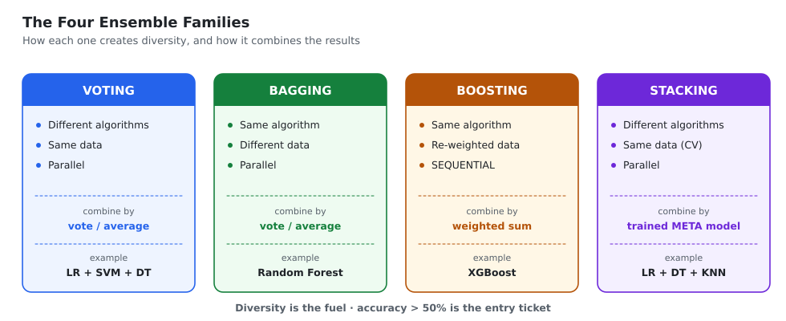
*The four ensemble families side by side — how each one creates diversity and how it combines the base models.*

## 1.5 Three formal reasons an ensemble beats a single model

Interviewers sometimes ask this in exactly this form, so learn the three labels.

| Reason | What it means |
|---|---|
| **Statistical** | Many models score similarly on your validation set. Picking one means gambling that the one you picked generalises best. Averaging removes that gamble. |
| **Computational** | Training a tree is a greedy search; it gets stuck in a local optimum. Many trees started from different samples explore more of the space, and their average sits closer to the true function than any single local optimum. |
| **Representational** | The true function may not be expressible by any single tree of the size you can afford. A **sum** of trees spans a much richer family of functions than one tree does. |

Notice these are three genuinely different arguments. The first is about **estimation
uncertainty**, the second about **optimisation**, the third about **model capacity**.

## 1.6 ⭐ Proof: three 70% models beat one 70% model

This is the most commonly asked derivation in the whole topic. Learn to produce the table from scratch.

**Setup.** Three **independent** classifiers, each with accuracy $p = 0.7$. Decide by majority vote.

$$P(\text{a model is correct}) = 0.7 \qquad P(\text{a model is wrong}) = 0.3$$

With three models there are $2^3 = 8$ possible outcomes:

| # | M1 | M2 | M3 | Majority | Ensemble correct? | Probability |
|---|---|---|---|---|---|---|
| 1 | ✔ | ✔ | ✔ | ✔ | **Yes** | $0.7\times0.7\times0.7 = 0.343$ |
| 2 | ✔ | ✔ | ✘ | ✔ | **Yes** | $0.7\times0.7\times0.3 = 0.147$ |
| 3 | ✔ | ✘ | ✔ | ✔ | **Yes** | $0.7\times0.3\times0.7 = 0.147$ |
| 4 | ✘ | ✔ | ✔ | ✔ | **Yes** | $0.3\times0.7\times0.7 = 0.147$ |
| 5 | ✔ | ✘ | ✘ | ✘ | No | $0.063$ |
| 6 | ✘ | ✔ | ✘ | ✘ | No | $0.063$ |
| 7 | ✘ | ✘ | ✔ | ✘ | No | $0.063$ |
| 8 | ✘ | ✘ | ✘ | ✘ | No | $0.027$ |
|   |   |   |   |   |   | **total $=1.000$** |

The ensemble is right whenever **at least 2 of the 3** are right — rows 1 to 4:

$$P(\text{ensemble correct}) = 0.343 + 0.147 + 0.147 + 0.147 = \mathbf{0.784}$$

> **Single model: 70.0% → three-model vote: 78.4%.** An 8.4-point gain, for free, from models
> that are individually no better than before.

### ⚠️ The follow-up question: what if each model is only 30% accurate?

Interviewers love this one, because it exposes whether you memorised the result or understood it.

$$P(\text{all 3 correct}) = 0.3^3 = 0.027$$
$$P(\text{exactly 2 correct}) = 3 \times (0.3 \times 0.3 \times 0.7) = 0.189$$
$$P(\text{ensemble correct}) = 0.027 + 0.189 = \mathbf{0.216}$$

**21.6% — worse than the 30% we started with.** The ensemble made things actively worse.

::: key
⭐ **The rule this proves.** Majority voting helps only when **every base model is better than
random guessing** ($p > 0.5$) **and** the models are reasonably **independent**.
Below 50%, voting *amplifies* the shared error instead of cancelling it. Majority voting pushes
the group toward whatever the group tends to agree on — and if the group tends to agree on the
wrong answer, you get there faster.
:::

### The general form (Condorcet's Jury Theorem)

For $M$ independent classifiers each with accuracy $p$, the ensemble is wrong when more than half
are wrong:

$$P(\text{ensemble wrong}) \;=\; \sum_{k=\lceil M/2\rceil}^{M} \binom{M}{k}\,(1-p)^{k}\,p^{\,M-k}$$

With $p = 0.6$ and $M = 25$, this gives an ensemble accuracy of about **84%**. As $M \to \infty$,
the accuracy tends to **1** whenever $p > 0.5$, and to **0** whenever $p < 0.5$. That is the formal
version of the rule in the box above.

> 🎤 **Interview one-liner:** "An ensemble works when its members are accurate *and* diverse.
> Majority voting over three independent 70% classifiers gives 78.4%, but over three 30%
> classifiers it gives 21.6% — so being better than chance is a hard requirement, and independence
> is what makes the errors cancel instead of compound."

---

# CHAPTER 2 — The Bias–Variance Trade-off

This chapter is asked in almost every ML interview, and it is the theory that explains *which*
ensemble to reach for. Bagging and boosting attack **different halves of this decomposition** —
once you see that clearly, the rest of both books follows naturally.

## 2.1 The two kinds of error

Imagine you could repeat your whole project many times: collect a fresh training set, retrain the
model, and predict the same test point $x$. You would get a slightly different prediction each
time. Two separate things can go wrong.

| Term | Plain meaning | Symptom | Typical cause |
|---|---|---|---|
| **Bias** | On average, across all those repeats, the model's prediction is **systematically off**. It is too simple to represent the truth. | **Underfitting** — bad on training data *and* test data | Straight line fitted to a curve; a depth-1 stump |
| **Variance** | The prediction **jumps around a lot** depending on which training set you happened to get. | **Overfitting** — great on training data, poor on test data | A fully grown decision tree that memorises noise |
| **Irreducible error** $\sigma^2$ | Pure noise in the data itself. No model can remove it. | A floor on achievable error | Measurement error, missing causal variables |

A useful mental image: **bias is aiming at the wrong spot; variance is a shaky hand.** You can
have a steady hand aimed wrongly (high bias, low variance) or a shaky hand aimed correctly
(low bias, high variance). You want both fixed, and you usually can't have both.

## 2.2 ⭐ The decomposition — full derivation

Assume the truth is
$$y = f(x) + \varepsilon, \qquad \mathbb{E}[\varepsilon] = 0, \qquad \operatorname{Var}(\varepsilon)=\sigma^2$$
and let $\hat f(x)$ be our model, trained on a randomly drawn training set. We want the expected
squared error at a point $x$, where the expectation is over **both** the noise and the random
training set.

**Step 1 — substitute and split off the noise.**

$$\mathbb{E}\big[(y-\hat f(x))^2\big] \;=\; \mathbb{E}\big[(f(x)+\varepsilon-\hat f(x))^2\big]$$

Expanding the square gives three terms. The cross-term vanishes because $\varepsilon$ is
independent of $\hat f$ and has mean zero:

$$\mathbb{E}\big[(y-\hat f(x))^2\big] \;=\; \mathbb{E}\big[(f(x)-\hat f(x))^2\big] \;+\; \underbrace{\mathbb{E}[\varepsilon^2]}_{=\;\sigma^2}$$

**Step 2 — add and subtract the average prediction** $\mathbb{E}[\hat f(x)]$. This is the one
trick in the whole derivation:

$$\mathbb{E}\big[(f-\hat f)^2\big] = \mathbb{E}\Big[\big(\underbrace{f-\mathbb{E}[\hat f]}_{\text{constant}} + \underbrace{\mathbb{E}[\hat f]-\hat f}_{\text{mean }0}\big)^2\Big]$$

**Step 3 — expand.** The first bracket is a constant (it does not depend on the training set), and
the second has expectation zero, so the cross-term disappears again:

$$\mathbb{E}\big[(f-\hat f)^2\big] = \underbrace{\big(f(x)-\mathbb{E}[\hat f(x)]\big)^2}_{\textstyle \text{Bias}^2} \;+\; \underbrace{\mathbb{E}\Big[\big(\hat f(x)-\mathbb{E}[\hat f(x)]\big)^2\Big]}_{\textstyle \text{Variance}}$$

**Result.**

$$\boxed{\;\mathbb{E}\big[(y-\hat f(x))^2\big] \;=\; \text{Bias}^2 \;+\; \text{Variance} \;+\; \sigma^2\;}$$

with

$$\text{Bias} = f(x)-\mathbb{E}[\hat f(x)] \qquad\qquad \text{Variance} = \mathbb{E}\Big[\big(\hat f(x)-\mathbb{E}[\hat f(x)]\big)^2\Big]$$

**Reading the result.** All three terms are non-negative, so $\sigma^2$ is a hard floor. The other
two are the only things you control — and the headache is that the usual ways of lowering one
raise the other.

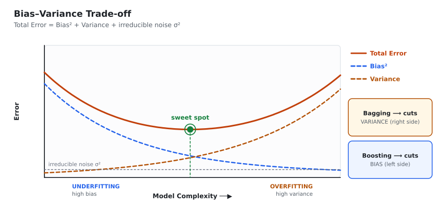
*Bias² falls and Variance rises as the model gets more complex. Total error is U-shaped — the sweet spot is where the two cross over. Bagging attacks the right-hand side (variance), boosting attacks the left (bias).*

## 2.3 Diagnosing which problem you have

This is the practical pay-off, and a very common follow-up question.

| Training error | Validation error | Diagnosis | What to do |
|---|---|---|---|
| High | High (≈ training) | **High bias / underfitting** | More complex model, more features, less regularisation, **boosting** |
| Low | **Much** higher | **High variance / overfitting** | More data, fewer features, more regularisation, simpler trees, **bagging** |
| Low | Low | Good fit | Ship it |
| High | Lower than training | Something is wrong | Leakage, a bad split, or a mis-shuffled dataset |

The gap between the two curves **is** the variance; the height of the training curve **is**
roughly the bias.

## 2.4 ⭐ How bagging and boosting split the problem

This table is the hinge between Book 1 and Book 2. Learn it properly.

| | **Bagging** | **Boosting** |
|---|---|---|
| Base learner used | **Low Bias, High Variance** — a deep, fully grown tree | **High Bias, Low Variance** — a stump or a shallow tree |
| What it reduces | **Variance** | **Bias** |
| Training order | **Parallel** — models are independent | **Sequential** — each model depends on the one before |
| Weight on samples | All equal | Hard / misclassified samples get more attention |
| Weight on models | All equal | Weighted by how good each model is |
| Risk of overfitting | **Low** — adding trees never hurts | **High** — needs a learning rate and early stopping |
| Canonical example | Random Forest | AdaBoost, Gradient Boosting, XGBoost |

**Memory hook:** **Ba**gging **ba**lances out variance. **Boo**sting **boo**sts weak (high-bias) models.

**Why does bagging start from a high-variance learner?** Because averaging can only remove
variance — it cannot remove bias (we prove this below). So you must hand it a learner that already
has low bias and let it clean up the variance. That is why Random Forest trees are grown **fully,
with no pruning**: pruning would add bias that the ensemble has no way of removing.

**Why does boosting start from a high-bias learner?** Because boosting's whole mechanism is
*adding* capacity, one small correction at a time. Hand it a low-bias learner and the first model
already fits the training data perfectly, leaving nothing to boost — and you overfit immediately.

## 2.5 ⭐ Why averaging reduces variance — the proof

### Case A: perfectly independent models

Let $f_1,\dots,f_M$ be the base models, each with variance $\sigma^2$, and let the bagged
prediction be their average:

$$F(x) = \frac{1}{M}\sum_{i=1}^{M} f_i(x)$$

Then, using $\operatorname{Var}(aX) = a^2\operatorname{Var}(X)$ and independence (so all
covariances are zero):

$$\operatorname{Var}\big(F(x)\big) = \frac{1}{M^2}\sum_{i=1}^{M}\operatorname{Var}\big(f_i(x)\big) = \frac{1}{M^2}\cdot M\sigma^2 = \frac{\sigma^2}{M}$$

$$\boxed{\;\operatorname{Var}(\text{ensemble}) = \frac{\operatorname{Var}(\text{single model})}{M}\;}$$

With $M = 100$, the variance drops to **one hundredth**. This is the ox-weighing story in symbols.

**And the bias?** By linearity of expectation,
$\mathbb{E}[F(x)] = \tfrac{1}{M}\sum_i \mathbb{E}[f_i(x)] = \mathbb{E}[f_1(x)]$ when the models are
identically distributed. **The bias is completely unchanged.** This is the formal statement of
"bagging reduces variance, not bias" — worth being able to show in one line.

### Case B: the realistic case — correlated models

The independence assumption is false in practice. Bootstrap samples overlap by about 63% of the
original rows, so the trees are trained on largely the same data and make **correlated** errors.
Let $\rho$ be the pairwise correlation between base model predictions. Then:

$$\boxed{\;\operatorname{Var}\!\left(\frac{1}{M}\sum_i f_i\right) = \rho\sigma^2 \;+\; \frac{1-\rho}{M}\,\sigma^2\;}$$

### How to read this formula — this is the key insight of Book 1

- The **second term** $\dfrac{(1-\rho)\sigma^2}{M}$ goes to $0$ as $M \to \infty$. So **adding more
  trees always helps a little and never hurts.** Bagging does not overfit by adding trees. (Compare
  boosting, where adding rounds absolutely can overfit.)
- The **first term** $\rho\sigma^2$ does **not** depend on $M$ at all. No matter how many trees you
  build, you can never get the variance below $\rho\sigma^2$. **The correlation between the trees
  sets the floor.**
- 👉 Therefore, once you have "enough" trees, the only way left to improve is to **make the trees
  less similar to each other** — to reduce $\rho$.

**That single observation is the entire reason Random Forest exists.** Chapter 5 is about the
trick it uses to push $\rho$ down.

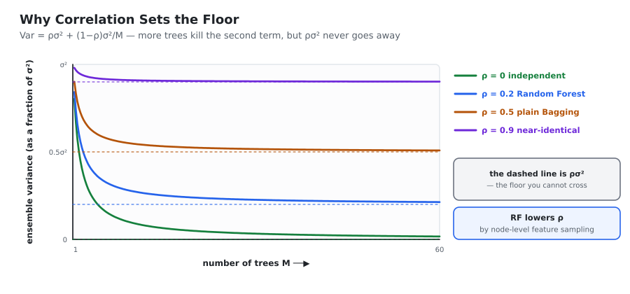
*Each curve is ρσ² + (1−ρ)σ²/M. More trees flatten every curve, but each one flattens onto its own floor ρσ². Lowering ρ — not adding trees — is what moves the floor down.*

> 🎤 **Interview one-liner:** "Expected error decomposes into bias², variance and irreducible
> noise. Bagging averages many low-bias, high-variance models, which divides the variance by M but
> leaves the bias untouched — and because real trees are correlated, the variance bottoms out at
> ρσ². Random Forest exists to lower that ρ. Boosting works on the other term: it fits high-bias
> learners sequentially to the remaining error, so it reduces bias instead."

---

# CHAPTER 3 — Voting Ensembles

Voting is the simplest ensemble, and it is where most courses start. Its diversity comes from
using **different algorithms on the same data**.

## 3.1 The idea

Train several *different* algorithms on the *same* training set. At prediction time, send the new
point to all of them and combine their answers by a **fixed rule** — a vote for classification,
an average for regression.

The word *fixed* matters. The combination rule is decided by you in advance; nothing is learned
about how to combine. (Learning the combination rule is **stacking**, in Book 3.)

**Why use different algorithms?** Because different model families fail in different ways. A
linear model has high bias on curved data but very low variance. A deep tree has the opposite
problem. An SVM with an RBF kernel sits somewhere else again. Their errors are only weakly
correlated — and weak correlation is exactly what Chapter 2 told us to want.

## 3.2 Hard voting

Each model outputs a **class label**; the label with the most votes wins.

$$\hat y = \operatorname{mode}\{h_1(x),\,h_2(x),\,\dots,\,h_M(x)\}$$

With Model 1 → class 0, Model 2 → class 1, Model 3 → class 0, the majority is **class 0**.

Note that hard voting **throws information away**. A model that said "class 0 with 51%
confidence" and a model that said "class 0 with 99% confidence" cast exactly the same vote.

## 3.3 Soft voting

Each model outputs a **probability distribution** over classes; we average those distributions
column-wise and take the highest average.

$$\hat y = \arg\max_{c}\; \frac{1}{M}\sum_{m=1}^{M} P_m(\,y = c \mid x\,)$$

### Binary worked example

| Model | $P(\text{class }0)$ | $P(\text{class }1)$ |
|---|---|---|
| Model 1 | 0.9 | 0.1 |
| Model 2 | 0.8 | 0.2 |
| Model 3 | 0.3 | 0.7 |
| **Average** | $(0.9+0.8+0.3)/3 = \mathbf{0.667}$ | $(0.1+0.2+0.7)/3 = 0.333$ |

**Prediction: class 0.** Note that hard voting would also say class 0 here (2 votes to 1) — but
soft voting reached it by weighing *how sure* each model was, which is the more informative route.

### Multi-class worked example

| Classifier | Class 1 | Class 2 | Class 3 |
|---|---|---|---|
| Classifier 1 | 0.30 | 0.65 | 0.05 |
| Classifier 2 | 0.25 | 0.55 | 0.20 |
| Classifier 3 | 0.40 | 0.50 | 0.10 |
| Classifier 4 | 0.35 | 0.60 | 0.05 |
| Classifier 5 | 0.45 | 0.45 | 0.10 |
| **Average** | $1.75/5 = 0.35$ | $2.75/5 = \mathbf{0.55}$ | $0.50/5 = 0.10$ |

**Prediction: class 2.**

Look carefully at what happened. **No single classifier was confidently right about class 2** —
the highest any of them gave it was 0.65. And classifier 5 was a coin flip between classes 1 and 2.
But class 2 was *consistently* the top or joint-top choice, while class 1's support was scattered.
Averaging rewards consistency, and that is why soft voting tends to beat hard voting.

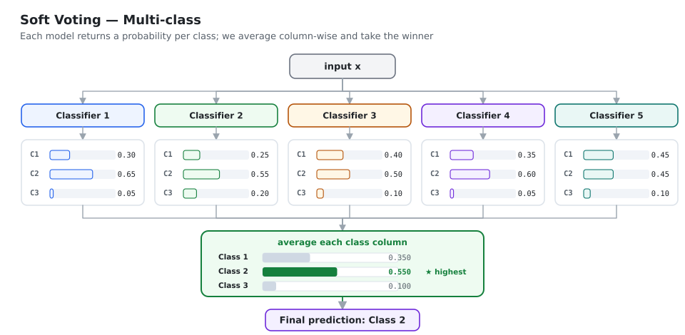
*Soft voting: the same input goes to all five classifiers, each returns a probability per class, the columns are averaged, and the highest average wins.*

## 3.4 Hard vs soft voting

| | Hard voting | Soft voting |
|---|---|---|
| Model output used | class **label** | class **probability** |
| Information used | less | **more** — confidence is kept |
| Requirement | any classifier | models must expose `predict_proba` |
| Behaviour | a confident model and an unsure model count equally | a confident model can outvote two unsure ones |
| Generally | good | **usually better** |

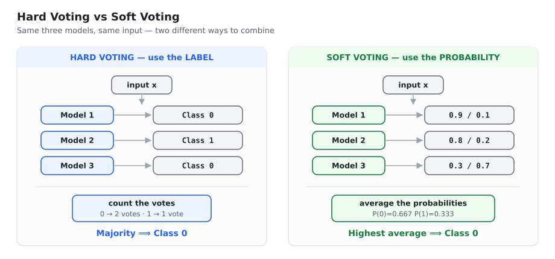
*The same three models and the same input, combined two different ways. Hard voting throws the confidence away; soft voting keeps it.*

⚠️ **A caveat worth mentioning in an interview.** Soft voting is only better if the probabilities
are **calibrated** — that is, when a model says 0.9, it really is right about 90% of the time.
SVMs and plain decision trees are famously badly calibrated (trees output probabilities like
0 and 1 because leaves are pure). If one model is wildly over-confident, soft voting lets it
dominate. The fix is to wrap base models in `CalibratedClassifierCV`, or to fall back to hard voting.

> **Practical advice:** there is no fixed rule. **Try both** and keep whichever scores better on
> your validation set.

## 3.5 Weighted voting

By default every model gets one equal vote. You can give better models more say:

$$\hat y = \arg\max_{c}\; \frac{\sum_{m} w_m \, P_m(y=c\mid x)}{\sum_m w_m}$$

With weights $w = (5, 2, 1)$, model 1's opinion counts five times model 3's.

The weights are **hyperparameters** — tune them with `GridSearchCV` rather than guessing. In
practice, giving more weight to the strongest base model reliably improves the ensemble. But do
not push it too far: if one model's weight dominates, you have thrown away the diversity you were
paying for and are effectively back to a single model.

## 3.6 Voting Regressor

Identical idea; the combination rule is the mean instead of a vote:

$$\hat y = \frac{1}{M}\sum_{m=1}^{M} f_m(x)$$

| Model | Prediction |
|---|---|
| Linear Regression | 3.5 LPA |
| Random Forest | 4.1 LPA |
| Decision Tree | 2.7 LPA |
| **Final** | $(3.5+4.1+2.7)/3 = \mathbf{3.43}$ LPA |

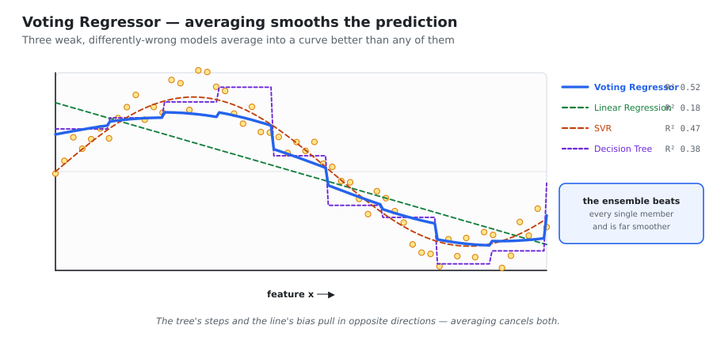
*A Voting Regressor (thick blue) against its three members. The linear model is too stiff, the tree is jagged, the SVR is decent — and their average is better than all three (R² 0.52 vs 0.18 / 0.38 / 0.47) and much smoother than the tree.*

Notice **why** this works: the linear model is biased in a smooth way, the tree is unbiased but
jumpy. Averaging smooths the tree's steps and bends the line's stiffness. The members are wrong in
*different directions*, so the errors partly cancel — the ox again.

## 3.7 Code

```python
from sklearn.ensemble import VotingClassifier, VotingRegressor
from sklearn.linear_model import LogisticRegression, LinearRegression
from sklearn.svm import SVC, SVR
from sklearn.tree import DecisionTreeClassifier, DecisionTreeRegressor

# --- classification -------------------------------------------------
vc = VotingClassifier(
    estimators=[
        ('lr',  LogisticRegression(max_iter=1000)),
        ('svm', SVC(probability=True)),      # probability=True is REQUIRED for soft voting
        ('dt',  DecisionTreeClassifier(max_depth=5)),
    ],
    voting='soft',          # 'hard' = majority label, 'soft' = average probability
    weights=[5, 2, 1],      # optional; tune these
    n_jobs=-1,
)
vc.fit(X_train, y_train)

# --- regression -----------------------------------------------------
vr = VotingRegressor(
    estimators=[('lr', LinearRegression()),
                ('svr', SVR()),
                ('dt', DecisionTreeRegressor(max_depth=5))],
    n_jobs=-1,
)
vr.fit(X_train, y_train)
```

> 🎤 **Interview one-liner:** "Voting trains *different algorithms* on the *same* data and combines
> them with a fixed rule. Hard voting takes the majority label; soft voting averages the predicted
> probabilities and usually wins because it keeps each model's confidence — provided those
> probabilities are calibrated. It only helps if each base model is above 50% accurate and the
> models are reasonably uncorrelated."

---

# CHAPTER 4 — Bagging

> **Bagging = Bootstrap AGGregatING.** Invented by **Leo Breiman in 1996.**

Here every base model uses the **same algorithm**. The diversity comes entirely from feeding each
model **different data**.

## 4.1 Bootstrap: sampling with replacement

> **Bootstrap:** build a new dataset of the **same size $N$** by drawing rows from the original
> dataset **at random, with replacement**.

**With replacement** means that after you pick a row, you put it back, so the same row can be
picked again — and some rows are never picked at all.

| | |
|---|---|
| Original | `[1, 2, 3, 4, 5]` |
| Sample 1 | `[1, 3, 3, 5, 2]` → 3 appears twice, 4 is missing |
| Sample 2 | `[2, 2, 4, 1, 1]` → 2 and 1 repeat, 3 and 5 are missing |

**The procedure:**

1. Start with dataset $D$ of $N$ rows.
2. Pick one row uniformly at random, record it, and **put it back**.
3. Repeat $N$ times. The new dataset $D'$ has $N$ rows — some repeated, some absent.
4. Repeat the whole thing $M$ times to get $M$ different bootstrap samples.

**Why with replacement and not just random subsets?** Two reasons. Statistically, the bootstrap
sample is a draw from the **empirical distribution** of your data, so it is a legitimate "parallel
universe" version of the dataset of the *same size* — which keeps each tree as strong as it can
be. Practically, replacement creates **more variation** between samples than subsetting does,
and variation is what we want. A no-replacement subset of size $N$ would be the original dataset
itself, which gives zero diversity.

## 4.2 ⭐ The 63.2% / 36.8% derivation

A guaranteed interview question. Be able to produce it in four lines.

**Step 1.** Probability that one specific row is **not** picked in a single draw:
$$P(\text{not picked in one draw}) \;=\; 1 - \frac{1}{N} \;=\; \frac{N-1}{N}$$

**Step 2.** We draw $N$ times, independently:
$$P(\text{never picked in } N \text{ draws}) \;=\; \left(1-\frac{1}{N}\right)^{\!N}$$

**Step 3.** Take the limit for large $N$, using the standard result $\lim_{n\to\infty}(1+x/n)^n = e^x$:
$$\lim_{N\to\infty}\left(1-\frac{1}{N}\right)^{\!N} = e^{-1} \approx 0.3679$$

**Step 4.** Therefore:
$$P(\text{picked at least once}) = 1 - e^{-1} \approx 0.632$$

$$\boxed{\;\approx 63.2\%\ \text{of unique rows are IN the sample}\qquad \approx 36.8\%\ \text{are LEFT OUT (OOB)}\;}$$

The convergence is fast — even at $N = 20$ the value is already about 0.358, and at $N = 100$ it is
0.366. So "about a third is left out" holds for essentially any real dataset.

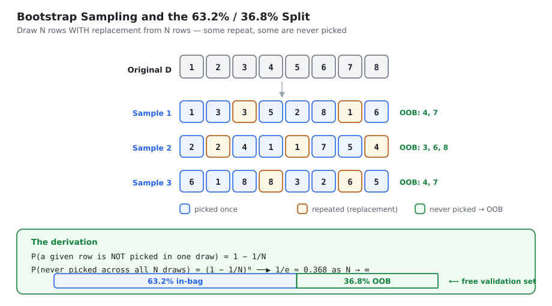
*Bootstrap sampling in action — rows repeat (amber), some are never drawn (green, the OOB rows), and the 1/e limit gives the 63.2% / 36.8% split.*

## 4.3 Aggregation

| Problem | Rule | Formula |
|---|---|---|
| **Classification** | majority vote (mode) | $\hat y = \operatorname{mode}\{\hat f_1(x),\dots,\hat f_M(x)\}$ |
| **Regression** | mean | $\hat y = \dfrac{1}{M}\sum_{m=1}^{M}\hat f_m(x)$ |

**Why this reduces variance, in words.** Each tree sees slightly different data, so each one makes
*different* mistakes on different points. One tree over-predicts here, another under-predicts
there. When you average, those random, uncorrelated errors cancel; what survives is the signal
they all agree on. The systematic part of the error — the bias — survives too, which is why
bagging cannot fix underfitting.

## 4.4 Architecture

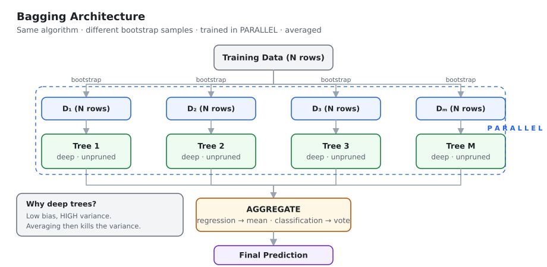
*Bagging: one algorithm, M bootstrap samples, M deep trees trained fully in parallel, then averaged or voted.*

**The algorithm** (write exactly this if asked):

::: algo
**BAGGING** — Breiman (1996)

::: algo-io
**Input** · training set $D$ of $N$ rows · base learner · number of models $M$
:::

**For $m = 1 \dots M$:**

::: algo-loop
**(a)** Draw a bootstrap sample $D_m$ of size $N$ from $D$, **with replacement**

**(b)** Train an **unpruned** base model $\hat f_m$ on $D_m$

*(the $M$ iterations are completely independent — run them in parallel)*
:::

::: algo-out
**Output** · regression: $\hat y = \frac{1}{M}\sum_m \hat f_m(x)$ · classification: majority vote
:::
:::

> **Why unpruned?** Pruning lowers variance by adding bias. But averaging already removes the
> variance for free, while **nothing in bagging can remove bias**. So you deliberately hand
> bagging the lowest-bias learner you can build and let it clean up the mess.

## 4.5 ⭐ The four variants

| Variant | Row sampling | With replacement | Feature sampling |
|---|---|---|---|
| **Bagging** (standard) | ✔ yes | ✔ yes | ✘ no — all features |
| **Pasting** | ✔ yes | ✘ **no** | ✘ no |
| **Random Subspaces** | ✘ no — all rows | — | ✔ **yes** |
| **Random Patches** | ✔ yes | ✔ yes | ✔ **yes** — maximum diversity |

- **Pasting** draws rows without replacement, so there are no duplicates. Bagging usually wins
  because replacement creates more diversity — but pasting can be better on very large datasets,
  where each subset is already big enough to train a strong model and you want to avoid wasting
  capacity on duplicates.
- **Random Subspaces** uses all rows but a random subset of **columns**. This shines when you have
  many features, especially if some are noisy or redundant.
- **Random Patches** samples both, giving the most diversity for the least cost per model.

## 4.6 ⭐ Out-of-Bag (OOB) scoring

Each tree never saw about 36.8% of the rows. Those rows are that tree's **out-of-bag** sample —
a genuinely unseen validation set that costs nothing.

**The mechanism:**

1. For each base model, note which rows were *not* in its bootstrap sample.
2. For each row $i$ in the dataset, find **all** the models for which row $i$ was OOB.
3. Average (regression) or majority-vote (classification) **only those** models' predictions for
   row $i$. That is row $i$'s OOB prediction.
4. Compare all the OOB predictions against the true labels → the **OOB score**.

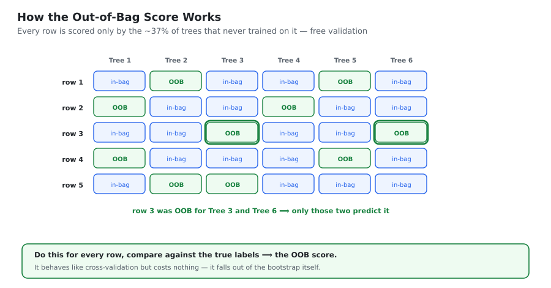
*Each row is predicted only by the trees that never trained on it. Row 3 here is scored by Tree 3 and Tree 6 only.*

### ⭐ OOB score vs cross-validation

| | **OOB score** | **K-fold cross-validation** |
|---|---|---|
| How the split happens | **implicitly**, inside the bootstrap | **explicitly** — you create K folds |
| Models trained | the ensemble you wanted anyway | **K separate** full models |
| Ensemble size used per point | only the ~37% of trees that missed that row | the **full** ensemble |
| Computational cost | **free** | **K× the training cost** |
| Slight bias | mildly **pessimistic** (uses a smaller sub-ensemble) | nearly unbiased |

> The pessimism is worth understanding: because each OOB prediction uses only about a third of the
> trees, it reflects a *smaller* forest than the one you will deploy. So the real model is usually
> a shade better than its OOB score suggests. If OOB and test scores are close, your model is stable.

## 4.7 Hyperparameters

| Parameter | Meaning | Guidance |
|---|---|---|
| `n_estimators` | number of base models | more is better but slower; returns flatten after ~100–200. **Start at 100** |
| `max_samples` | rows drawn per model | lower → more diversity, weaker individual models. **0.5–1.0, start at 0.8** |
| `max_features` | features drawn per model | `< 1.0` turns on Random Subspaces; try 0.5–0.8 when features are noisy |
| `bootstrap` | rows with replacement? | `True` = bagging, `False` = pasting. **Keep `True`** |
| `bootstrap_features` | features with replacement? | usually `False` |
| `oob_score` | compute the free validation score | **`True`** while experimenting |
| `n_jobs` | CPU cores | **always `-1`** — bagging is embarrassingly parallel |
| `random_state` | reproducibility | fix it, or results shift every run |

```python
from sklearn.ensemble import BaggingClassifier
from sklearn.tree import DecisionTreeClassifier

bag = BaggingClassifier(
    estimator=DecisionTreeClassifier(),   # deep, unpruned on purpose
    n_estimators=100,
    max_samples=0.8,          # 80% of rows per model
    max_features=1.0,         # all features  (< 1.0 -> Random Subspaces)
    bootstrap=True,           # True = Bagging, False = Pasting
    oob_score=True,           # free validation estimate
    n_jobs=-1,
    random_state=42,
)
bag.fit(X_train, y_train)
print("OOB :", bag.oob_score_)        # usually very close to the test score
print("test:", bag.score(X_test, y_test))
```

## 4.8 ⭐ When does bagging actually help?

| Base model | Helps? | Why |
|---|---|---|
| Deep decision tree | ✔✔ **a lot** | high variance — exactly what averaging removes |
| KNN with small $k$ | ✔ yes | high variance |
| SVM with RBF kernel | ✔ somewhat | moderate variance |
| **Linear / Logistic Regression** | ✘ **almost nothing** | already low variance; nothing to average away |
| Naive Bayes | ✘ no | low variance, high bias |

::: key
⭐ **The rule.** Bagging only helps **high-variance models**. Running it on Linear Regression wastes
compute and changes almost nothing, because the variance term was never the problem — the bias was,
and bagging cannot touch bias.
:::

A related practical note: a single decision-tree regressor produces a **jagged, step-shaped**
prediction curve, because it carves the input space into rectangles. Averaging many such trees
smooths those steps into a gentle curve. That visible smoothing *is* the variance reduction.

> 🎤 **Interview one-liner:** "Bagging trains the same algorithm on many bootstrap samples in
> parallel and averages the results. It divides variance by M but leaves bias untouched, so it
> only pays off with high-variance base learners like fully grown trees — which is also why those
> trees are deliberately left unpruned. The ~37% of rows left out of each bootstrap give you a
> free OOB validation score."

---

# CHAPTER 5 — Random Forest

> **Random Forest = Bagging + Decision Trees + a fresh random feature subset at EVERY node.**
> Invented by **Leo Breiman in 2001**.

## 5.1 Where the name comes from

| Word | Meaning |
|---|---|
| **Forest** | many decision trees trained together |
| **Random** | each tree sees random rows, and each *split* sees random columns |

## 5.2 The problem Random Forest was invented to solve

Recall the variance formula from Chapter 2:

$$\operatorname{Var}\!\left(\frac{1}{M}\sum_i f_i\right) = \underbrace{\rho\sigma^2}_{\text{the floor}} \;+\; \underbrace{\frac{1-\rho}{M}\sigma^2}_{\to\,0}$$

Plain bagging drives the second term to zero but is stuck with $\rho\sigma^2$. **Why is $\rho$ so
high in plain bagging?**

Here is the mechanism, and it is worth saying out loud in an interview:

> Suppose one feature — say `CGPA` — is a very strong predictor. In plain bagging, **every tree
> evaluates every feature at the root**. `CGPA` will win the root split in almost every tree,
> because the bootstrap samples are 63% identical. The trees then look alike all the way down.
> They are highly correlated, they make the *same* mistakes, and averaging them barely helps.

This is sometimes called the **strong-predictor problem** or **tree correlation problem**.

**Random Forest's fix:** at each node, don't let the tree see all the features. Show it only a
random subset of $k$ out of $p$ features and make it choose the best split *from those*. Now, in
roughly $1 - k/p$ of the nodes, `CGPA` is not even on the menu, so the tree is forced to find a
different — perhaps second-best — split. The trees diverge. $\rho$ falls. The floor drops.

::: key
**Random Forest deliberately makes each individual tree slightly worse, in order to make the
ensemble much better.** Each tree is handicapped (it can't always use the best feature), so its
bias rises a little. But $\rho$ falls a lot, and the variance reduction more than pays for it.
This trade — a little bias for a lot of decorrelation — is the entire design.
:::

## 5.3 ⭐⭐ The real difference between Bagging and Random Forest

This is the single most common trap in this topic. Most candidates get it wrong.

### ❌ The usual (incomplete) answer

> "In bagging you can use any algorithm, but in Random Forest you only use decision trees."

**The interviewer's follow-up:** *"Fine — so if I build a `BaggingClassifier` using only
`DecisionTreeClassifier`, is that a Random Forest?"*

### ✅ The correct answer: **No.** The difference is the *level* at which columns are sampled.

| | **Bagging** | **Random Forest** |
|---|---|---|
| Base algorithm | any (DT, SVM, KNN…) | strictly **decision trees** |
| Column sampling happens at | the **TREE** level (also called model level) | the **NODE** level |
| What that means | pick $k$ columns **once**, before the tree is built; **every split in that tree is restricted to those same $k$ columns** | draw a **fresh** random $k$ columns **at every single node**, again and again |

**Bagging — tree-level sampling:**

- Tree 1 gets $\{X_1, X_3\}$ → *every* node in tree 1 must split on $X_1$ or $X_3$
- Tree 2 gets $\{X_2, X_5\}$ → *every* node in tree 2 must split on $X_2$ or $X_5$

**Random Forest — node-level sampling:**

- Node 1 (root) draws $\{X_1, X_3\}$ → splits on $X_1$
- Node 2 (left child) draws $\{X_2, X_4\}$ → splits on $X_4$
- Node 3 (right child) draws $\{X_0, X_5\}$ → splits on $X_0$

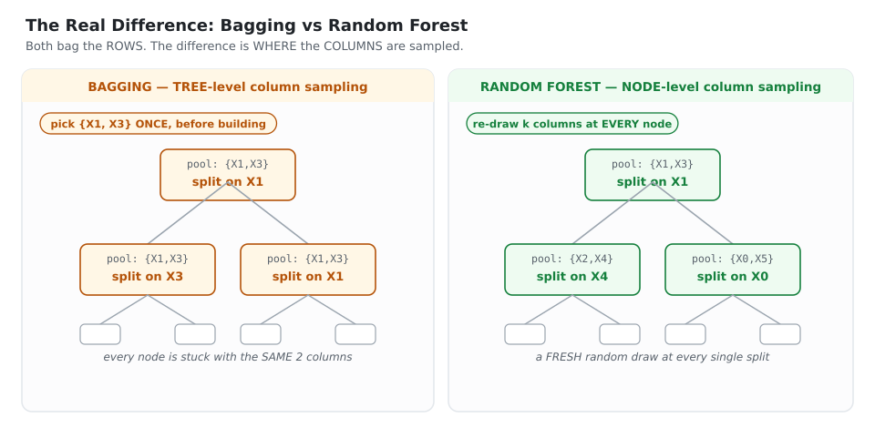
*The interview trap. Bagging fixes its feature subset once per tree, so every node is stuck with the same columns. Random Forest re-draws a fresh subset at every single node — that is what decorrelates the trees.*

### Why node-level is strictly better

1. It injects **far more randomness** — $O(\text{number of nodes})$ random draws per tree instead of one.
2. More randomness → more diverse trees → **lower $\rho$**.
3. Lower $\rho$ → a **lower variance floor** $\rho\sigma^2$, which is the only thing adding trees cannot fix.
4. Tree-level sampling has a second flaw: if a tree is unlucky and draws only weak features, the
   **whole tree** is weak. With node-level sampling, one unlucky node barely matters — the next
   node gets a fresh draw.

> 🎤 **Interview one-liner:** "Both bag the rows. The real difference is that bagging picks its
> feature subset **once per tree**, while Random Forest re-draws a random subset **at every node**.
> That extra randomness decorrelates the trees, and since the bagged variance is ρσ² + (1−ρ)σ²/M,
> lowering ρ is the only thing that moves the floor."

## 5.4 Architecture and algorithm

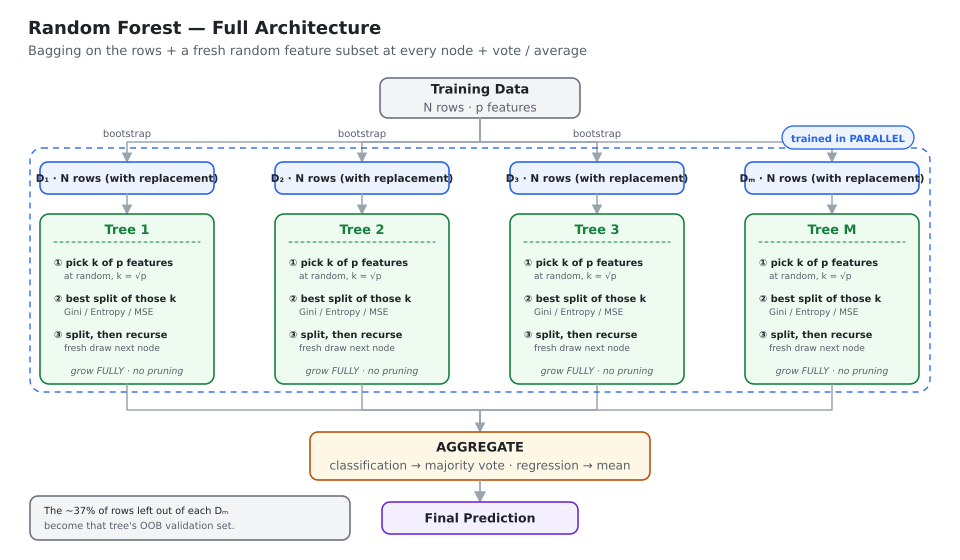
*Bagging on the rows, a fresh random feature subset at every node, fully grown trees, then vote or average. The rows left out of each bootstrap become that tree's OOB set.*

::: algo
**RANDOM FOREST** — Breiman (2001)

::: algo-io
**Input** · $N$ rows, $p$ features · number of trees $M$ · features per split $k$
:::

**For $m = 1 \dots M$:**

::: algo-loop
**(a)** Draw a bootstrap sample $D_m$ of size $N$ (with replacement)

**(b)** Grow a tree $T_m$ on $D_m$. At **every node**, until a stopping rule fires:

  **(i)** select $k$ of the $p$ features **at random**  ← the node-level draw

  **(ii)** find the best split among **those $k$ only**

  **(iii)** split, and recurse into both children

**(c)** Grow the tree **fully** — do **not** prune
:::

::: algo-out
**Output** · the ensemble $\{T_1,\dots,T_M\}$ · classification: majority vote · regression: mean
:::
:::

### How many features per split?

| Task | Standard choice |
|---|---|
| Classification | $k=\sqrt{p}$ — scikit-learn's default (`max_features='sqrt'`) |
| Regression | $k = p/3$ |

These are empirical defaults from Breiman's experiments, not theory. The reasoning behind the
difference: regression trees need more information per split to estimate a conditional mean well,
so they are given a larger menu.

**How to tune it:** $k$ directly controls the bias–variance trade *within* the ensemble.
Small $k$ → more decorrelation (lower variance) but weaker individual trees (higher bias).
Large $k$ → the opposite; at $k = p$ you are back to plain bagging. If your data has many noisy
features, **lower** $k$; if only a few features carry signal, **raise** it, so that useful features
actually make it into the candidate set.

## 5.5 Splitting criteria

**Gini impurity** — the default for classification:
$$\text{Gini} = 1-\sum_{i} p_i^2 \qquad \text{(range } 0 \text{ to } 0.5 \text{ for binary)}$$

**Entropy:**
$$\text{Entropy} = -\sum_i p_i\log_2 p_i \qquad \text{(range } 0 \text{ to } 1 \text{ for binary)}$$

**Information gain** — how much a split improves purity:
$$IG = \text{Entropy}(\text{parent}) - \sum_{j}\frac{N_j}{N}\,\text{Entropy}(\text{child}_j)$$

**For regression** — variance / squared error reduction:
$$\text{MSE} = \frac{1}{N}\sum_i (y_i-\bar y)^2$$

> **Gini vs Entropy:** the chosen splits are almost always the same. **Gini is faster** because it
> avoids a logarithm, which is why it is the default. Entropy is marginally more sensitive to
> changes in class probability. This difference essentially never decides a model's quality — do
> not spend tuning budget on it.

## 5.6 ⭐ Feature importance

Feature importance answers *"which columns did the model actually use?"*. Two reasons to care:

1. **Feature selection** — unnecessary columns add variance and training cost. Importance tells
   you what you can drop.
2. **Interpretability** — when a bank rejects a loan, the customer is entitled to ask why. Feature
   importance lets you answer *"mainly because of these two or three things."*

### Method 1 — MDI (Mean Decrease in Impurity), the default

This is what `.feature_importances_` returns. Scikit-learn's own definition:

> *"The importance of a feature is computed as the total reduction of the criterion brought by that feature."*

**Node importance** — how much purity one split bought, weighted by how much data flowed through it:

$$NI_{t} \;=\; \frac{N_t}{N}\left[\,\text{impurity}_t \;-\; \frac{N_{tR}}{N_t}\,\text{impurity}_{tR} \;-\; \frac{N_{tL}}{N_t}\,\text{impurity}_{tL}\right]$$

| Symbol | Meaning |
|---|---|
| $N_t$ | samples reaching node $t$ |
| $N$ | total samples |
| $\text{impurity}_t$ | impurity at node $t$ (Gini or entropy) |
| $N_{tL}, N_{tR}$ | samples going to the left / right child |

**Feature importance** — a feature's share of all the purity bought in the tree:

$$FI_f \;=\; \frac{\sum_{t \,:\, t \text{ splits on } f} NI_t}{\sum_{\text{all nodes } t} NI_t}$$

### Worked example

A tiny tree on 5 rows and 2 features: the root splits on **Column 0**, its child splits on **Column 1**.

**Root node** — $N_t = 5$, $N = 5$, impurity $=0.48$; left child 1 row (impurity 0), right child 4 rows (impurity 0.375):

$$NI_{\text{root}} = \frac{5}{5}\Big[0.48 - \tfrac{4}{5}(0.375) - \tfrac{1}{5}(0)\Big] = 0.48 - 0.30 = \mathbf{0.18} \;\;(=Y)$$

**Second node** — suppose its node importance works out to $\mathbf{0.30}$ $(=X)$.

**Shares:**

$$FI_{\text{Col 0}} = \frac{Y}{X+Y} = \frac{0.18}{0.48} = 0.375 \qquad FI_{\text{Col 1}} = \frac{X}{X+Y} = \frac{0.30}{0.48} = 0.625$$

Check: $0.375+0.625 = 1.0$ ✔

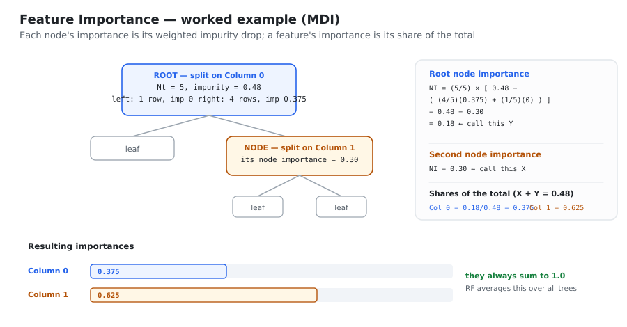
*Each node's importance is its weighted impurity drop; a feature's importance is its share of the total. The importances always sum to 1.*

> ⭐ **Property:** normalised feature importances always sum to **1.0**.
> **For the whole forest:** Random Forest simply **averages** each feature's importance across all trees.

```python
rf.feature_importances_                      # averaged over the forest
rf.estimators_[0].feature_importances_       # a single tree's view
```

### ⚠️ The high-cardinality bias — a favourite trap

Scikit-learn prints this warning itself:

> *"The impurity-based feature importances computed on tree-based methods can be misleading for
> **high cardinality features** (many unique values)."*

**Why it happens:** a feature with many distinct values (an ID, a timestamp, any continuous
variable) offers **many possible split points**. With more chances to find a split that happens to
separate the training data, it will reduce impurity *somewhere*, purely by luck. MDI counts that
lucky reduction as genuine importance. Meanwhile a genuinely useful binary feature has exactly one
possible split and gets no such free shots.

The practical symptom: a `customer_id` column appearing at the top of your importance chart.

### Method 2 — Permutation importance

1. Record the baseline score on a **held-out** set.
2. Randomly **shuffle** one column, destroying its relationship with the target but keeping its
   marginal distribution.
3. Re-score. The drop $\Delta$ is that feature's importance.
4. Repeat a few times and average.

✔ Not biased by cardinality, and it measures importance for *predictions*, not for *fitting*.
✘ Slower (one re-scoring pass per feature per repeat), and it **misleads when features are
correlated** — shuffling one of two duplicated columns changes little, because the model simply
reads the other one, so both look unimportant.

### Method 3 — SHAP

The most complete: it gives **per-row** attributions and the **direction** (+/−) of each feature's
effect, with a sound game-theoretic basis. The cost is compute. Use it when you must explain
individual decisions.

| Method | Speed | Bias | Use when |
|---|---|---|---|
| MDI | fastest | ⚠️ favours high-cardinality features | a quick first look |
| Permutation | medium | unbiased by cardinality; confused by correlation | real feature selection |
| SHAP | slowest | best | explaining individual predictions to people |

## 5.7 Hyperparameters

Random Forest has around 25 parameters. They fall into three groups.

### Group A — Random Forest specific

| Parameter | Default | Guidance |
|---|---|---|
| `n_estimators` | 100 | more trees → smoother boundary, lower variance, never overfits. Practical sweet spot ≈ **50–300**; beyond that you buy almost nothing and pay in time |
| `max_features` | `'sqrt'` | the **decorrelation knob**. `'sqrt'`, `'log2'`, an int, a float, or `None` (= all = plain bagging) |
| `bootstrap` | `True` | `False` makes every tree see all rows; usually makes little difference, most people keep `True` |
| `max_samples` | `None` | rows drawn per tree when bootstrapping |

### Group B — inherited from the decision tree

| Parameter | What it controls |
|---|---|
| `criterion` | `'gini'` / `'entropy'` (classification), `'squared_error'` / `'absolute_error'` (regression) |
| `max_depth` | depth cap on each tree |
| `min_samples_split` | minimum rows needed before a node may split |
| `min_samples_leaf` | minimum rows in a leaf — a split only happens if **both** children satisfy it |
| `max_leaf_nodes` | cap on the number of leaves |
| `min_impurity_decrease` | split only if impurity falls by at least this much |

### Group C — general

| Parameter | What it controls |
|---|---|
| `n_jobs` | parallel jobs; **`-1` uses all cores**, and trees are independent so this scales nearly linearly |
| `random_state` | reproducibility — fix it |
| `class_weight` | `'balanced'` for imbalanced targets |
| `oob_score` | `True` → free validation via `model.oob_score_` |

```python
from sklearn.ensemble import RandomForestClassifier

rf = RandomForestClassifier(
    n_estimators=300,
    max_features='sqrt',       # the decorrelation knob
    max_depth=None,            # grow fully
    min_samples_leaf=1,
    bootstrap=True,
    oob_score=True,
    class_weight=None,         # 'balanced' if the classes are skewed
    n_jobs=-1,
    random_state=42,
)
rf.fit(X_train, y_train)
print("OOB:", rf.oob_score_)
```

## 5.8 Tuning: GridSearchCV vs RandomizedSearchCV

**GridSearchCV** tries **every** combination and cross-validates each one.

```python
param_grid = {
    'n_estimators': [50, 100, 150, 200],    # 4 values
    'max_features': ['sqrt', 'log2', None], # 3 values
    'max_depth':    [2, 5, 10],             # 3 values
    'max_samples':  [0.5, 0.75, 1.0],       # 3 values
}
```

Counting the work:

$$\text{combinations} = \prod_i (\text{options}_i) = 4\times3\times3\times3 = 108$$
$$\text{total fits} = 108 \times \underbrace{5}_{\text{cv folds}} = \mathbf{540}\ \text{model fits}$$

**RandomizedSearchCV** samples `n_iter` random combinations instead of all of them.

| | GridSearchCV | RandomizedSearchCV |
|---|---|---|
| Search | exhaustive | random sample |
| Speed | slower | **faster** |
| Best for | small data, few parameters | **large data, many parameters** |
| Result | the best in the grid | near-best; may miss the optimum |
| Fits | combinations × folds | `n_iter` × folds |

> **Strategy:** start with a **coarse** randomized search to find the promising region, then run a
> **fine** grid search around the winner. Grid search over a large space is mostly wasted compute,
> because only two or three hyperparameters usually matter.

## 5.9 Strengths and weaknesses

| ✔ Strengths | ✘ Weaknesses |
|---|---|
| Excellent out of the box — the defaults are genuinely good | Large memory footprint (stores every tree) |
| Very hard to overfit by adding trees | Slow prediction when there are many deep trees |
| Handles non-linearity, interactions and mixed feature types | Not interpretable as a whole (black box) |
| No feature scaling needed | **Cannot extrapolate** — see below |
| Robust to noise and outliers (their effect is spread across trees) | MDI importance biased toward high-cardinality features |
| Free OOB validation | Usually beaten by boosting on tabular competitions |
| Embarrassingly parallel | Weak on very sparse, high-dimensional data (e.g. raw text) |
| Gives feature importances | Needs `class_weight` tuning on skewed data |

**On extrapolation** — a point worth making in an interview. A tree's prediction is always an
*average of training labels in some leaf*. So a Random Forest can never output a value outside the
range of $y$ it was trained on. If house prices in your training data top out at ₹2 crore, the
model will never predict ₹3 crore, no matter how large the house. **Linear models extrapolate;
tree ensembles do not.** For a trending time series, this is disqualifying unless you model the
trend separately (for example by predicting differences rather than levels).

---

# CHAPTER 6 — Extra Trees

> **Extra Trees = Extremely Randomized Trees.** One more level of randomness than Random Forest.

## 6.1 The two differences

| | **Random Forest** | **Extra Trees** |
|---|---|---|
| Bootstrap the rows | ✔ yes | ✘ **no** — every tree sees the full dataset |
| Features per split | random $k$ | random $k$ |
| **Split threshold** | the **best** cut point, found by evaluating all candidates | **random** cut points are drawn, and the best of *those* is kept |
| Speed | slower (needs sorting) | **much faster** (no sorting) |
| Bias | lower | slightly **higher** |
| Variance | higher | **lower** |

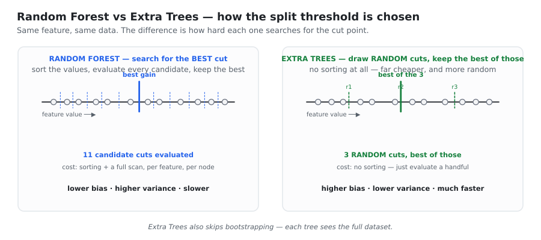
*Random Forest sorts the values and evaluates every candidate cut. Extra Trees draws a handful of random cuts and keeps the best of those — no sorting, far cheaper, and much more random.*

## 6.2 Why the extra randomness helps

Random Forest still performs a **greedy optimisation** at each node: it picks the threshold that
maximises purity *on this particular bootstrap sample*. That optimisation is itself a source of
variance — the "best" threshold is partly fitted to the noise in that sample.

Extra Trees removes that optimisation. By choosing thresholds at random, it stops fitting to
sample-specific noise at the threshold level. Each tree becomes a slightly worse fit (bias up),
but the trees become **much less correlated** and each is **less noise-sensitive** (variance down).
On many datasets the variance reduction wins.

The speed gain is substantial and is the main practical reason people reach for it: finding the
best split requires sorting the feature values at every node, which is the dominant cost in tree
building. Extra Trees skips it entirely.

**When to prefer Extra Trees:** noisy data, very large datasets where training time matters, or as
a diverse partner for a Random Forest inside a voting or stacking ensemble.

```python
from sklearn.ensemble import ExtraTreesClassifier

et = ExtraTreesClassifier(
    n_estimators=300,
    max_features='sqrt',
    bootstrap=False,     # the default for Extra Trees — uses the whole dataset
    n_jobs=-1,
    random_state=42,
)
```

> 🎤 **Interview one-liner:** "Extra Trees draws split thresholds at random instead of searching
> for the optimal one, and skips bootstrapping. The extra randomness raises bias slightly but
> lowers variance more, and it trains much faster because there is no sorting at each node."

---

# APPENDIX A — Cheat Sheet and Interview Q&A

## A.1 Formula cheat sheet

**Bias–variance**
$$\text{Error} = \text{Bias}^2+\text{Variance}+\sigma^2$$
$$\operatorname{Var}(\text{bagged}) = \rho\sigma^2+\frac{1-\rho}{M}\sigma^2 \qquad\qquad \operatorname{Var}(\text{bagged, independent}) = \frac{\sigma^2}{M}$$

**Bootstrap**
$$P(\text{row never picked}) = \Big(1-\tfrac1N\Big)^{N}\!\to e^{-1}\approx0.368 \quad\Rightarrow\quad 63.2\%\ \text{in-bag},\; 36.8\%\ \text{OOB}$$

**Voting**
$$\text{hard: } \hat y=\operatorname{mode}\{h_m(x)\} \qquad \text{soft: } \hat y=\arg\max_c \tfrac1M\textstyle\sum_m P_m(c\mid x)$$
Three independent models at 70% → **78.4%**;  at 30% → **21.6%**  (so $p>0.5$ is required).

**Impurity**
$$\text{Gini}=1-\sum_i p_i^2 \qquad \text{Entropy}=-\sum_i p_i\log_2 p_i \qquad IG=\text{Ent}(\text{parent})-\sum_j \tfrac{N_j}{N}\text{Ent}(\text{child}_j)$$

**Feature importance**
$$NI_t=\frac{N_t}{N}\Big[\text{imp}_t-\tfrac{N_{tR}}{N_t}\text{imp}_{tR}-\tfrac{N_{tL}}{N_t}\text{imp}_{tL}\Big] \qquad FI_f=\frac{\sum_{t\text{ on }f} NI_t}{\sum_{\text{all }t} NI_t}$$
Importances sum to 1; the forest averages them over all trees.

## A.2 Comparison table

| | **Voting** | **Bagging** | **Random Forest** | **Extra Trees** |
|---|---|---|---|---|
| Base models | **different** algorithms | **same** algorithm | decision trees only | decision trees only |
| Data per model | same data | bootstrap sample | bootstrap sample | **full dataset** |
| Column sampling | — | tree level (optional) | **node level** | **node level** |
| Split threshold | — | best | best | **random, best of those** |
| Training | parallel | parallel | parallel | parallel |
| Combines by | vote / mean | vote / mean | vote / mean | vote / mean |
| Reduces | variance | **variance** | **variance (lower ρ)** | **variance (lowest ρ)** |
| Speed | depends | fast | fast | **fastest** |

## A.3 Rapid-fire Q&A

**Q1. What is ensemble learning?**
Combining several base models into one stronger model. It rests on "wisdom of the crowd": each
model's error is partly random, and averaging cancels the random part while the signal survives.

**Q2. Name the four families.**
Voting (different algorithms, same data), Bagging (same algorithm, different data, parallel),
Boosting (same algorithm, sequential, learns from mistakes), Stacking (different algorithms plus a
trained meta-model).

**Q3. Why must the base models be different?**
Because the bagged variance is $\rho\sigma^2+(1-\rho)\sigma^2/M$. If the models are identical,
$\rho=1$ and the variance never drops no matter how many you add. Diversity is what makes errors
cancel rather than compound.

**Q4. When does an ensemble make things worse?**
When the base models are worse than random. Three independent 30%-accurate models majority-voting
give 21.6% — worse than any one of them, because voting amplifies whatever the group agrees on.

**Q5. State the bias–variance decomposition and derive it.**
$\mathbb{E}[(y-\hat f)^2]=\text{Bias}^2+\text{Var}+\sigma^2$. Split off the noise (the cross-term
vanishes since $\mathbb{E}[\varepsilon]=0$), then add and subtract $\mathbb{E}[\hat f]$ inside the
remaining square; the new cross-term is zero because $\mathbb{E}[\hat f-\mathbb{E}[\hat f]]=0$.

**Q6. Does bagging reduce bias or variance? Boosting?**
Bagging reduces **variance** — its base learners are low-bias, high-variance deep trees.
Boosting reduces **bias** — its base learners are high-bias, low-variance stumps or shallow trees.

**Q7. Prove that bagging leaves the bias unchanged.**
$\mathbb{E}[\frac1M\sum_i f_i] = \frac1M\sum_i\mathbb{E}[f_i] = \mathbb{E}[f_1]$ when the models are
identically distributed. The expected prediction — and hence the bias — is exactly that of a
single model.

**Q8. Can bagging overfit if you add more trees?**
No. Extra trees only shrink the $(1-\rho)\sigma^2/M$ term. Boosting **can** overfit with more
rounds, which is why it needs a learning rate and early stopping.

**Q9. Why sample WITH replacement?**
It creates genuine variation between samples while keeping each sample the full size $N$, so every
tree stays as strong as possible. Sampling $N$ rows *without* replacement would just return the
original dataset and give zero diversity.

**Q10. Derive the 63.2% rule.**
$P(\text{not picked in one draw}) = 1-1/N$; over $N$ independent draws $(1-1/N)^N \to 1/e \approx
0.368$. So 36.8% out-of-bag, 63.2% in-bag.

**Q11. What is the OOB score and why is it useful?**
Each tree misses about 37% of the rows. Predict each row using only the trees that missed it, and
compare to the truth. It is a near-unbiased generalisation estimate that costs nothing extra.

**Q12. OOB vs cross-validation?**
CV explicitly builds K folds and trains K separate models, using the **full** ensemble on each
fold. OOB happens implicitly inside the bootstrap, uses only the ~37% sub-ensemble per row, and is
free. OOB is mildly pessimistic because it evaluates a smaller forest than the one you deploy.

**Q13. ⭐ Difference between Bagging and Random Forest?**
Bagging samples columns **once per tree**; Random Forest re-draws a random subset **at every node**.
Node-level sampling decorrelates the trees far more, which lowers the $\rho\sigma^2$ floor. Saying
"RF only uses trees" is the incomplete answer.

**Q14. What are Pasting, Random Subspaces and Random Patches?**
Pasting = rows **without** replacement. Random Subspaces = all rows, random columns.
Random Patches = random rows **and** random columns.

**Q15. Default `max_features`?**
$\sqrt{p}$ for classification, $p/3$ for regression. Lower it when many features are noisy; raise
it when only a few carry signal.

**Q16. Why are Random Forest trees left unpruned?**
Pruning trades variance for bias. Averaging already removes the variance for free, but nothing in
bagging can remove bias — so you want the lowest-bias trees you can get.

**Q17. Why is MDI feature importance misleading?**
It favours **high-cardinality** features. More unique values means more candidate split points,
so more chances to reduce impurity by luck. Use permutation importance or SHAP instead.

**Q18. Random Forest vs Extra Trees?**
Extra Trees skips bootstrapping and picks split thresholds **at random** rather than searching.
Higher bias, lower variance, and much faster because there is no sorting.

**Q19. Can a Random Forest extrapolate?**
No. Every prediction is an average of training labels in some leaf, so it can never leave the
range of the training targets. Linear models can; tree ensembles cannot.

**Q20. Hard vs soft voting — which is better and when is it not?**
Soft voting is usually better because it keeps each model's confidence. It fails when the
probabilities are poorly calibrated (plain trees, SVMs), since an over-confident model dominates
the average. Calibrate first, or use hard voting.

**Q21. Your Random Forest overfits. What do you change?**
Lower `max_depth`, raise `min_samples_leaf` / `min_samples_split`, lower `max_features`
(more decorrelation). Adding trees will **not** help — that term is already near zero.

**Q22. Your Random Forest underfits. What do you change?**
Raise `max_features` and `max_depth`, lower `min_samples_leaf`. If it still underfits, the problem
is bias — switch to **boosting** (Book 2), because bagging cannot reduce bias.

---

*End of Book 1. Book 2 covers AdaBoost, Gradient Boosting and XGBoost — where the ensemble starts
attacking the bias term instead.*
