# Ensemble Learning — Book 2 · Boosting

**AdaBoost · Gradient Boosting · XGBoost — every derivation worked out**

> **Prerequisite:** Book 1, especially the bias–variance decomposition. Boosting attacks the
> **bias** term; bagging attacked the **variance** term. If that sentence is not yet obvious,
> re-read Book 1 Chapter 2 before starting here.

**The series:** Book 1 *Foundations & Bagging* · Book 2 *Boosting* · Book 3 *LightGBM, CatBoost & Stacking*

---

## Contents

| Chapter | Topic |
|---|---|
| **1** | [AdaBoost](#chapter-1--adaboost) |
| **2** | [Gradient Boosting](#chapter-2--gradient-boosting) |
| **3** | [XGBoost](#chapter-3--xgboost) |
| **B** | [Cheat Sheet & Interview Q&A](#appendix-b--cheat-sheet-and-interview-qa) |

---

# CHAPTER 1 — AdaBoost

> **AdaBoost = Adaptive Boosting** (Freund & Schapire, 1995). It builds weak learners **one at a
> time**, and each new learner is forced to concentrate on the examples the previous ones got
> **wrong**.

## 1.1 What "boosting" means, and why it was a surprise

In 1990 Robert Schapire proved something that sounds impossible: **if you can build a learner that
is even slightly better than random guessing, you can combine such learners into one that is
arbitrarily accurate.** This is called the *strength of weak learnability* result.

AdaBoost was the first practical algorithm to deliver on that promise, and it won its authors the
Gödel Prize. That history matters for interviews, because it explains the design: AdaBoost is not
trying to build good models — it is trying to **squeeze a strong learner out of deliberately
terrible ones**.

**The analogy.** Think of a group project. Each student is only okay at the subject. But if each
new student deliberately studies the parts the earlier ones kept getting wrong, the group's final
answer is excellent — even though no individual improved.

## 1.2 The three pillars

| Pillar | Symbol | Role |
|---|---|---|
| **Sample weights** | $w_i$ | every training row carries a weight. Starts equal, updated every round |
| **Weak learner** | $h_t(x)$ | usually a **decision stump**. Must be better than random |
| **Amount of say** | $\alpha_t$ | how much this learner's vote counts in the final answer |

**Decision stump:** the simplest possible tree — `max_depth = 1`, exactly **one split on one
feature**. For example *"if CGPA > 7.5 then placed, else not placed."* On its own it is almost
useless. That is the point.

::: key
⚠️ **In AdaBoost, classes are encoded as $+1$ and $-1$, not $0$ and $1$.**
This is not cosmetic. The final prediction is $\operatorname{sign}\big(\sum_t \alpha_t h_t(x)\big)$,
so each learner's vote must be able to push the sum in the **positive or negative** direction.
With $0/1$ labels there is no "negative vote" and the arithmetic breaks.
:::

## 1.3 Why it is sequential

You cannot train AdaBoost's models in parallel. Model $t$'s *training data weights* depend on what
model $t-1$ got wrong. The algorithm is **stage-wise additive**: models are added one at a time,
each correcting the mistakes of the combined ensemble so far, and the final answer is a **weighted
sum** of all of them.

This is the fundamental architectural difference from bagging, and it has a practical cost:
boosting cannot use `n_jobs=-1` to train trees in parallel. (XGBoost does parallelise — but
*inside* each tree, not across trees. More on that in Chapter 3.)

## 1.4 ⭐ The algorithm

::: algo
**ADABOOST** (binary classification, labels $y_i \in \{-1,+1\}$)

::: algo-io
**Input** · training set $\{(x_i,y_i)\}_{i=1}^{N}$ · weak learner · number of rounds $T$
:::

**Step 1 — Initialise the weights equally**, so they form a probability distribution:

$$w_i^{(1)} = \frac{1}{N}, \qquad i = 1,\dots,N$$

**For $t = 1 \dots T$:**

::: algo-loop
**Step 2 — Train a weak learner** $h_t(x)$ on the *weighted* data. Search over features and
thresholds and keep the stump with the lowest **weighted** error.

**Step 3 — Compute the weighted error**

$$\varepsilon_t \;=\; \sum_{i\,:\,h_t(x_i)\neq y_i} w_i^{(t)}$$

**Step 4 — Compute the amount of say**

$$\alpha_t \;=\; \frac{1}{2}\ln\!\left(\frac{1-\varepsilon_t}{\varepsilon_t}\right)$$

**Step 5 — Update the weights** (exponential rule)

$$w_i^{(t+1)} \;=\; w_i^{(t)}\cdot e^{-\alpha_t y_i h_t(x_i)} \;=\; \begin{cases} w_i^{(t)}\,e^{+\alpha_t} & \text{if misclassified}\\[2pt] w_i^{(t)}\,e^{-\alpha_t} & \text{if correct}\end{cases}$$

**Step 6 — Normalise** so the weights sum to 1 again:

$$w_i^{(t+1)} \;\leftarrow\; \frac{w_i^{(t+1)}}{\sum_{j} w_j^{(t+1)}}$$
:::

::: algo-out
**Output** · $\displaystyle H(x) = \operatorname{sign}\left(\sum_{t=1}^{T}\alpha_t\,h_t(x)\right)$
:::
:::

Notice that the single expression $w_i\,e^{-\alpha_t y_i h_t(x_i)}$ covers both cases: when the
prediction is correct, $y_i h_t(x_i) = +1$ and the exponent is $-\alpha_t$; when it is wrong,
$y_i h_t(x_i) = -1$ and the exponent is $+\alpha_t$. That compactness is why the $\pm1$ encoding is used.

## 1.5 ⭐⭐ Where does $\alpha = \tfrac12\ln\frac{1-\varepsilon}{\varepsilon}$ come from?

Most candidates memorise this formula. Deriving it is a strong differentiator, and it is not hard.

**Claim.** AdaBoost is exactly **stage-wise minimisation of the exponential loss**

$$L = \sum_{i=1}^{N} \exp\big(-y_i F(x_i)\big), \qquad F(x) = \sum_t \alpha_t h_t(x)$$

**Derivation.** Suppose we already have $F_{t-1}$ and want to add $\alpha h_t$. Write
$w_i = \exp(-y_i F_{t-1}(x_i))$ — these are exactly AdaBoost's weights. Then

$$L(\alpha) \;=\; \sum_i \exp\big(-y_i\,[F_{t-1}(x_i) + \alpha h_t(x_i)]\big) \;=\; \sum_i w_i\, e^{-\alpha y_i h_t(x_i)}$$

Split the sum into correctly and incorrectly classified points. For correct points
$y_i h_t(x_i)=+1$; for wrong points $y_i h_t(x_i)=-1$:

$$L(\alpha) \;=\; e^{-\alpha}\!\!\sum_{\text{correct}}\! w_i \;+\; e^{+\alpha}\!\!\sum_{\text{wrong}}\! w_i \;=\; e^{-\alpha}(1-\varepsilon) + e^{\alpha}\varepsilon$$

(using normalised weights, so the two sums are $1-\varepsilon$ and $\varepsilon$).

Differentiate with respect to $\alpha$ and set to zero:

$$\frac{dL}{d\alpha} = -e^{-\alpha}(1-\varepsilon) + e^{\alpha}\varepsilon = 0 \;\;\Longrightarrow\;\; e^{2\alpha} = \frac{1-\varepsilon}{\varepsilon}$$

$$\boxed{\;\alpha = \tfrac{1}{2}\ln\!\left(\frac{1-\varepsilon}{\varepsilon}\right)\;}$$

::: key
**What this tells you.** AdaBoost is not an ad-hoc recipe — it is **gradient descent on the
exponential loss**, taken one weak learner at a time. The weight update and the $\alpha$ formula
both fall out of that single choice of loss. This framing is also the bridge to Chapter 2: if you
swap the exponential loss for *any* differentiable loss, you get **Gradient Boosting**.
:::

**A consequence worth knowing:** the exponential loss grows *exponentially* in the margin
$-y_iF(x_i)$. So a persistently misclassified point gets an enormous weight. This makes AdaBoost
**very sensitive to label noise and outliers** — a mislabelled row can consume the whole ensemble's
attention. That is the standard criticism of AdaBoost and a common interview question.

## 1.6 Reading the $\alpha$ formula

| Error $\varepsilon$ | $\alpha$ | Meaning |
|---|---|---|
| 0.1 | **+1.099** | excellent stump → loud voice |
| 0.2 | +0.693 | good |
| 0.4 | +0.203 | barely useful |
| **0.5** | **0.000** | random guessing → **no vote at all** |
| 0.8 | **−0.693** | worse than random → **negative** vote |

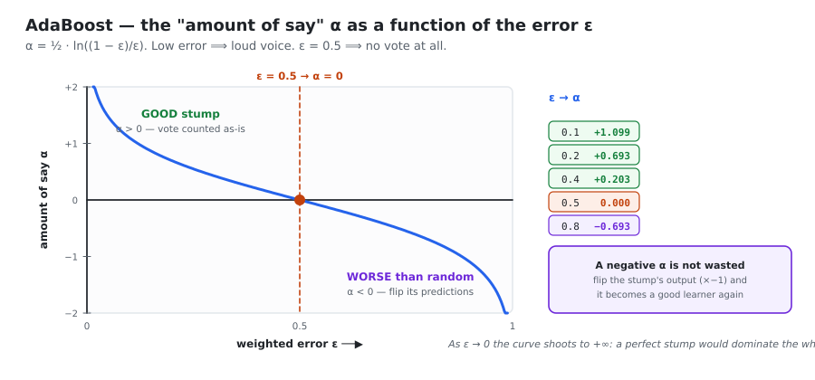
*α = ½ ln((1−ε)/ε). It is large and positive as ε → 0, crosses exactly zero at ε = 0.5, and goes negative beyond that.*

**The negative-α case is not a failure.** If a stump is worse than random, flipping its output
(multiplying by $-1$) makes it better than random — and the formula does this automatically,
because a negative $\alpha$ multiplied by the stump's prediction reverses its sign. Nothing is
wasted. ($\varepsilon$ exactly $0.5$ is the one genuinely useless case: $\alpha = 0$, the stump is
ignored entirely.)

## 1.7 Worked example — two full rounds

**Dataset ($N=5$):**

| Point | Feature | $y$ |
|---|---|---|
| P1 | 2 | +1 |
| P2 | 4 | +1 |
| P3 | 6 | −1 |
| P4 | 8 | −1 |
| P5 | 10 | +1 |

### Round 1

**Step 1:** $w_i = 0.2$ for all five points.

**Step 2:** the best stump is *"if value ≤ 5 then +1, else −1"*.

**Step 3:** predictions and error

| Point | Actual | Predicted | Result | Weight |
|---|---|---|---|---|
| P1 | +1 | +1 | ✔ | 0.2 |
| P2 | +1 | +1 | ✔ | 0.2 |
| P3 | −1 | −1 | ✔ | 0.2 |
| P4 | −1 | +1 | ✘ | 0.2 |
| P5 | +1 | −1 | ✘ | 0.2 |

$$\varepsilon_1 = 0.2+0.2 = 0.4$$

**Step 4:**
$$\alpha_1 = \tfrac12\ln\frac{0.6}{0.4} = \tfrac12\ln(1.5) = \tfrac12(0.4055) = 0.2027$$

**Step 5:** update
$$\text{wrong (P4,P5): } 0.2\,e^{+0.2027} = 0.2(1.2247) = 0.2449 \;\;\uparrow$$
$$\text{correct (P1,P2,P3): } 0.2\,e^{-0.2027} = 0.2(0.8165) = 0.1633 \;\;\downarrow$$

**Step 6:** normalise. Sum $= 3(0.1633)+2(0.2449) = 0.9797$

$$w_{\text{P1,P2,P3}} = \frac{0.1633}{0.9797} = 0.1667, \qquad w_{\text{P4,P5}} = \frac{0.2449}{0.9797} = 0.2500$$

### Round 2

Stump 2 trains on the re-weighted data and misclassifies only **P1**.

$$\varepsilon_2 = w_{\text{P1}} = 0.1667 \qquad \alpha_2 = \tfrac12\ln\frac{0.8333}{0.1667} = \tfrac12\ln 5 = 0.8047$$

Far fewer errors ⟹ a **much larger** $\alpha$ (0.80 vs 0.20). Stump 2 gets four times the say.

Updating and normalising gives $w_{\text{P1}} = 0.50$, $w_{\text{P2,P5}} = 0.10$,
$w_{\text{P3,P4}} = 0.15$. **P1 now carries half the total weight** — the next stump will be forced
to get it right.

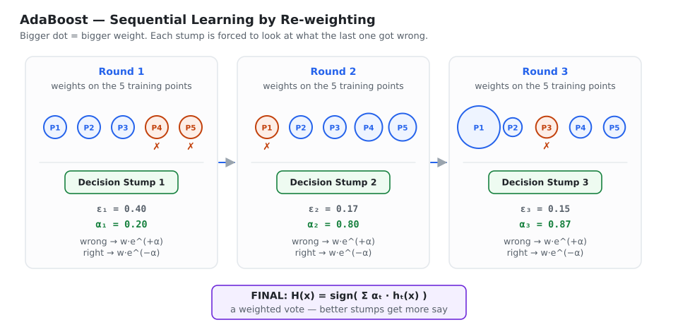
*Dot size = sample weight. Points the last stump got wrong (red) grow; the next stump is forced to concentrate on them. Lower error ⟹ higher α ⟹ more say in the final vote.*

### Predicting a new point

| Stump | $\alpha$ | $h(x)$ | Weighted vote |
|---|---|---|---|
| 1 | 0.2027 | +1 | +0.2027 |
| 2 | 0.8047 | −1 | −0.8047 |
| | | **Total** | **−0.6020** |

$$H(x) = \operatorname{sign}(-0.6020) = \mathbf{-1}$$

Note that stump 1 and stump 2 disagreed, and stump 2 won **because it was more accurate**. That is
the whole point of $\alpha$.

## 1.8 How weights become actual training data (resampling)

Some weak learners accept sample weights directly. For those that do not, AdaBoost converts the
weights into data by **sampling with replacement**, using each row's weight as its probability.

Using the normalised weights from Round 1:

| Point | Weight | Cumulative range |
|---|---|---|
| P1 | 0.1667 | 0.0000 – 0.1667 |
| P2 | 0.1667 | 0.1667 – 0.3334 |
| P3 | 0.1667 | 0.3334 – 0.5001 |
| P4 | 0.2500 | 0.5001 – 0.7501 |
| P5 | 0.2500 | 0.7501 – 1.0000 |

Draw 5 random numbers — say `0.08, 0.35, 0.60, 0.82, 0.55`:

| Random | Falls in | Selected |
|---|---|---|
| 0.08 | 0.0000–0.1667 | P1 |
| 0.35 | 0.3334–0.5001 | P3 |
| 0.60 | 0.5001–0.7501 | P4 |
| 0.82 | 0.7501–1.0000 | P5 |
| 0.55 | 0.5001–0.7501 | **P4 again** |

New dataset: **P1, P3, P4, P5, P4**. The high-weight points occupy larger ranges, so they are drawn
more often — sometimes several times. The next stump literally sees more copies of the hard cases.

## 1.9 Hyperparameters

| Parameter | Default | Notes |
|---|---|---|
| `estimator` | `DecisionTreeClassifier(max_depth=1)` | can be Logistic Regression or SVM. ⚠️ **KNN does not work** — it has no notion of sample weights |
| `n_estimators` | 50 | too low (1–2) → **underfitting**; too high (500–1500) → **overfitting** |
| `learning_rate` | 1.0 | shrinkage: the effective say becomes $\alpha \times \text{learning\_rate}$ |
| `algorithm` | `'SAMME.R'` | `'SAMME'` = discrete multi-class; `'SAMME.R'` uses probabilities and converges in fewer rounds |

### The learning rate

Multiplying $\alpha$ by a small number makes every weight update gentler: misclassified points get
a smaller boost, correct points a smaller reduction. The model therefore learns **more slowly but
generalises better**.

| | Low `n_estimators` (1–2) | High `n_estimators` (500–1500) |
|---|---|---|
| Boundary | a single straight line | many tiny jagged regions chasing individual points |
| Problem | **underfitting** | **overfitting** |
| Fix | raise `n_estimators` | **lower the `learning_rate`** |

> ⭐ **The golden combination: high `n_estimators` + low `learning_rate`.** For example
> `n_estimators=500, learning_rate=0.1`. If you raise the number of rounds, lower the learning rate
> to compensate — they trade off against each other almost exactly.

```python
from sklearn.ensemble import AdaBoostClassifier
from sklearn.tree import DecisionTreeClassifier
from sklearn.model_selection import GridSearchCV

ada = AdaBoostClassifier(
    estimator=DecisionTreeClassifier(max_depth=1),   # a stump
    n_estimators=500,
    learning_rate=0.1,
    random_state=42,
)

grid = GridSearchCV(
    ada,
    {'n_estimators':  [50, 100, 200, 500],
     'learning_rate': [0.01, 0.1, 0.5, 1.0]},
    cv=5, scoring='accuracy', n_jobs=-1,
)
grid.fit(X_train, y_train)
print(grid.best_params_, grid.best_score_)
```

## 1.10 Where AdaBoost is used

- **Face detection** — the famous **Viola–Jones** detector. Thousands of trivially simple features
  (rectangular light/dark patterns) are each a weak learner; AdaBoost selects and weights a few
  hundred of them into a real-time face detector. This was the first genuinely practical
  computer-vision system of its kind and is still the textbook example.
- Binary classification: spam detection, fraud detection.
- Multi-class classification via SAMME.

## 1.11 Strengths and weaknesses

| ✔ Strengths | ✘ Weaknesses |
|---|---|
| Very few hyperparameters to tune | **Very sensitive to noisy labels and outliers** (exponential loss) |
| No feature scaling required | Sequential — cannot parallelise across learners |
| Rarely overfits for moderate `n_estimators` | Fixed exponential loss — no choice of objective |
| Simple to explain and to implement | Usually beaten by gradient boosting on tabular data |
| Gives feature importances | Weak learners must support sample weights |

> 🎤 **Interview one-liner:** "AdaBoost keeps a weight on every training row. Each round it fits a
> stump, measures its weighted error ε, gives it a say α = ½·ln((1−ε)/ε), then multiplies the
> weights of wrong rows by e^(+α) and right rows by e^(−α), so the next stump concentrates on the
> hard cases. The final answer is sign(Σ αₜhₜ(x)). All of it is exactly stage-wise minimisation of
> the exponential loss — which is also why it is so sensitive to outliers."

---

# CHAPTER 2 — Gradient Boosting

> **Gradient Boosting** (Friedman, 2001) generalises AdaBoost: instead of re-weighting the data
> points, each new model is trained to predict the **errors (residuals)** of the combined model so
> far — and "residual" turns out to mean "negative gradient", which is where the name comes from.

## 2.1 The idea, in plain words

Imagine you must draw a complicated curve but you are only allowed short straight segments. You
draw one segment, look at where it is wrong, draw another small segment to fix that, then another
to fix what is still wrong. After many small corrections the curve is almost perfect.

Gradient Boosting does exactly this with data:

1. Build a very simple first model — just a single number.
2. Find out where it is wrong (the **residuals**).
3. Build a small tree to **predict those residuals**.
4. Add that tree's output to the running model, scaled down by a small **learning rate**.
5. Repeat.

The final model is the **sum** of all these small corrections.

### Why "additive modelling"?

If a complicated function $F(x)$ cannot be captured by one simple function, approximate it by
adding many simple ones:

$$F(x) = f_1(x)+f_2(x)+f_3(x)+\dots+f_M(x)$$

Each $f_m$ is a small decision tree. Individually they are nearly useless; summed, they form a
**composite function** of considerable power.

### ⭐ How this differs from AdaBoost

| | AdaBoost | Gradient Boosting |
|---|---|---|
| What changes between rounds | the **sample weights** | the **target** the next tree is fitted to |
| What the next model sees | the same labels $y$, re-weighted data | brand-new targets $r$ (the residuals) |
| Loss function | fixed: exponential | **any differentiable loss** |

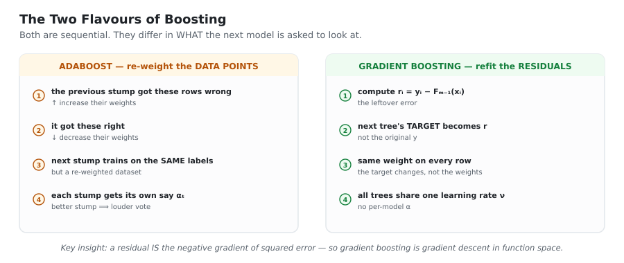
*Both are sequential. AdaBoost re-weights the rows; gradient boosting rewrites the target.*

## 2.2 Regression — the five steps

### Step 1 — the initial model $F_0(x)$

$$\boxed{F_0(x) = \operatorname{mean}(y)}$$

This is a **constant base prediction**. It is not a machine learning model at all — it is a single
number. If the average salary is 4.0, then $F_0(x)=4.0$ for every student, regardless of their IQ
or CGPA. (Section 2.4 proves this is the optimal constant for squared error.)

### Step 2 — compute the residuals

$$r_i = y_i - F_0(x_i)$$

If actual = 5.0 and predicted = 4.0, the residual is $+1.0$. If actual = 2.4, it is $-1.6$. These
are the mistakes we now need to fix.

### Step 3 — fit a tree to the residuals

| | |
|---|---|
| **Input features** | the same as before — IQ, CGPA, … |
| **Target** | **the residuals**, not $y$ |

The base learner is a **decision tree regressor**. It learns the *pattern in the mistakes*.

::: key
⭐ **Key insight:** the tree is **not** predicting salary. It is predicting **how much the previous
model was wrong by**. Everything else follows from this.
:::

### Step 4 — update, with shrinkage

$$\boxed{F_m(x) = F_{m-1}(x) + \nu \cdot h_m(x)}$$

where $\nu$ is the **learning rate** (typically 0.01–0.1).

Example: $F_0(x)=4.0$, the tree predicts a residual of $+1.2$, and $\nu=0.1$:

$$F_1(x) = 4.0 + 0.1(1.2) = 4.12$$

**Why shrink?** With $\nu=1$ the model would try to erase the entire residual in one step, which
means fitting the training data — noise included — immediately. With $\nu=0.1$ each tree fixes
only about a tenth of the error. You need more trees, but each one commits less, and the ensemble
generalises far better. Shrinkage is the single most effective regulariser in boosting.

### Step 5 — repeat

Compute new residuals against $F_1$, fit another tree, update again. As trees accumulate, the
residuals shrink toward zero.

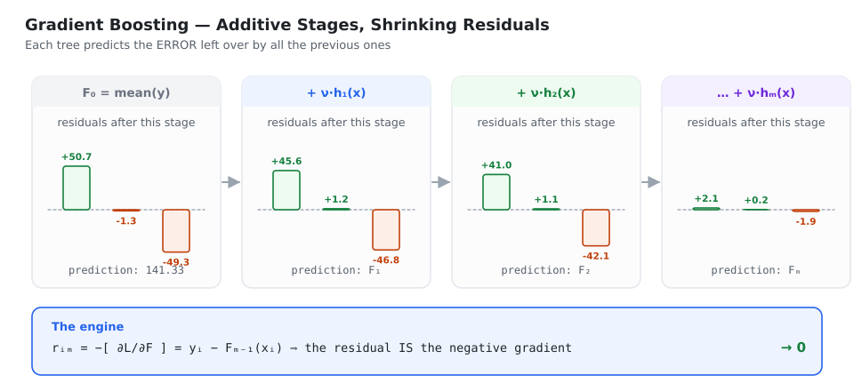
*Each tree predicts what is left over, so the residual bars shrink stage by stage.*

## 2.3 ⭐⭐ The Friedman algorithm

This is the box to memorise. Every gradient-boosting library implements exactly this.

::: algo
**GRADIENT BOOSTING** — Friedman (2001)

::: algo-io
**Input** · training set $\{(x_i,y_i)\}_{i=1}^{n}$ · a **differentiable** loss $L(y,F(x))$ · number of rounds $M$ · learning rate $\nu$
:::

**Step 0 — Initialise with the best single constant**

$$F_0(x) \;=\; \arg\min_{\gamma}\sum_{i=1}^{n} L(y_i,\gamma) \qquad\big(=\operatorname{mean}(y)\big)$$

**For $m = 1 \dots M$:**

::: algo-loop
**Step 1 — Pseudo-residuals** (the **negative gradient** of the loss)

$$r_{im} \;=\; -\left[\frac{\partial L\big(y_i,F(x_i)\big)}{\partial F(x_i)}\right]_{F=F_{m-1}} \qquad\big(=\,y_i-F_{m-1}(x_i)\big)$$

**Step 2 — Fit a regression tree** $h_m(x)$ to the targets $r_{im}$, producing terminal regions $R_{jm},\;j=1\dots J_m$

**Step 3 — Find the optimal value for each terminal region**

$$\gamma_{jm} \;=\; \arg\min_{\gamma}\sum_{x_i\in R_{jm}} L\big(y_i,\;F_{m-1}(x_i)+\gamma\big)$$

for squared error this is simply the **mean of the residuals** falling in $R_{jm}$

**Step 4 — Update the model**

$$F_m(x) \;=\; F_{m-1}(x) \;+\; \nu\sum_{j=1}^{J_m}\gamma_{jm}\,\mathbb{1}\big(x\in R_{jm}\big)$$
:::

::: algo-out
**Output** · the final model $F_M(x)$
:::
:::

**Reading the algorithm.** Step 1 asks *"in what direction should every prediction move to reduce
the loss fastest?"* — that is a gradient. Step 2 fits a tree to approximate that direction.
Step 3 asks *"given this tree's grouping, what is the best value to actually put in each leaf?"* —
note this is re-optimised against the **true loss**, not against the residual approximation.
Step 4 takes a small step in that direction.

::: key
⭐ **The deep idea.** Ordinary gradient descent updates *parameters*:
$\theta \leftarrow \theta - \nu\,\nabla_\theta L$.
Gradient boosting updates the *function itself*: $F \leftarrow F + \nu\,(-\nabla_F L)$.
Each tree is one **descent step in function space**, and $\nu$ is the step size. Once you see this,
the name "gradient boosting" stops being mysterious, and loss functions beyond squared error
become obvious extensions.
:::

## 2.4 Three derivations you should be able to produce

### Derivation 1 — why $F_0(x)=\operatorname{mean}(y)$

We want the constant $\gamma$ minimising the total squared-error loss
$L = \tfrac12(y-F)^2$:

$$S = \sum_{i=1}^{n}\tfrac12 (y_i-\gamma)^2$$

Differentiate and set to zero:

$$\frac{\partial S}{\partial\gamma} = \sum_{i}\tfrac12\cdot 2(y_i-\gamma)(-1) = \sum_i (\gamma - y_i) = 0$$

$$n\gamma - \sum_i y_i = 0 \qquad\Longrightarrow\qquad \gamma = \frac{1}{n}\sum_i y_i = \operatorname{mean}(y) \;\;✔$$

> **Why the $\tfrac12$ in the loss?** Purely convenience — it cancels the 2 produced by
> differentiating the square. It changes nothing else.

### Derivation 2 — why the pseudo-residual equals $y-F$

$$\frac{\partial L}{\partial F(x_i)} = \frac{\partial}{\partial F}\left[\tfrac12\big(y_i-F(x_i)\big)^2\right] = \tfrac12\cdot 2\big(y_i-F(x_i)\big)\cdot(-1) = -\big(y_i-F(x_i)\big)$$

Apply the leading minus sign from the definition of the pseudo-residual:

$$r_{im} = -\left[-\big(y_i-F_{m-1}(x_i)\big)\right] = y_i - F_{m-1}(x_i) \;\;✔$$

$$\boxed{\text{For squared error, the ordinary residual IS the negative gradient.}}$$

This is the sentence that explains the algorithm's name, and it is a very common interview question.

### Derivation 3 — why the leaf value is the mean of the residuals

For a terminal region $R_{jm}$ we want

$$\gamma_{jm} = \arg\min_\gamma \sum_{x_i\in R_{jm}} \tfrac12\big(y_i - F_{m-1}(x_i) - \gamma\big)^2$$

Write $r_i = y_i-F_{m-1}(x_i)$, so this is $\arg\min_\gamma \sum \tfrac12 (r_i-\gamma)^2$.
Differentiate and set to zero:

$$\sum_{x_i\in R_{jm}} -(r_i-\gamma) = 0 \;\;\Longrightarrow\;\; n_j\gamma = \sum_{x_i \in R_{jm}} r_i$$

$$\boxed{\;\gamma_{jm} = \frac{\sum_{x_i\in R_{jm}} r_i}{n_j} = \text{mean of the residuals in that leaf}\;}$$

**Numerical check:** a leaf containing residuals $+1.0$ and $-0.5$ gets
$\gamma = (1.0-0.5)/2 = 0.25$.

## 2.5 Worked example — regression

| R&D | Admin | Marketing | Profit $y$ |
|---|---|---|---|
| 165 | 137 | 471 | 192 |
| 101 | 134 | 292 | 140 |
| 121 | 118 | 282 | 92 |

**Iteration 0:**
$$F_0(x) = \frac{192+140+92}{3} = \frac{424}{3} \approx 141.33$$

**Iteration 1 — residuals:**
$$r_1 = 192-141.33 = +50.67,\qquad r_2 = 140-141.33 = -1.33,\qquad r_3 = 92-141.33 = -49.33$$

**Fit a tree.** Suppose it produces two terminal regions:

- Region 1: startup 1 alone → mean residual $= 50.67$
- Region 2: startups 2 and 3 → mean residual $= \frac{-1.33-49.33}{2} = -25.33$

**Update with $\nu = 0.1$:**

$$F_1(\text{S1}) = 141.33+0.1(50.67) = 146.40$$
$$F_1(\text{S2}) = F_1(\text{S3}) = 141.33+0.1(-25.33) = 138.80$$

**New residuals:**

| Startup | Old residual | New residual |
|---|---|---|
| 1 | +50.67 | **+45.60** |
| 2 | −1.33 | +1.20 |
| 3 | −49.33 | **−46.80** |

The residuals are shrinking. Repeat for $M$ rounds until they approach zero.

## 2.6 ⭐ Classification — only the loss function changes

::: key
In regression, the **mean** was the initial model and **squared error** was the loss.
In classification, the **log of odds** is the initial model and **log loss** is the loss.
**Everything else — the algorithm, the trees, the update — is identical.**
:::

| Aspect | Regression | Classification |
|---|---|---|
| Loss | squared error | **log loss** |
| Initial model | $\operatorname{mean}(y)$ | **log of odds** |
| Base learner | regression tree | **regression tree** (yes, even here) |
| Steps | the same | the same |

### The formulas

**Initial model — log of odds:**
$$F_0(x) = \ln\!\left(\frac{N_1}{N_0}\right) = \ln\!\left(\frac{\#\text{class-1}}{\#\text{class-0}}\right)$$
⚠️ natural logarithm, base $e$ — not base 10.

**Log-odds → probability (sigmoid):**
$$p = \frac{e^{F}}{1+e^{F}}$$

*Derivation:* if $\text{odds} = \frac{p}{1-p}$ and $\ln(\text{odds}) = F$, then
$\frac{p}{1-p}=e^{F}$, so $p = (1-p)e^{F}$, giving $p(1+e^{F}) = e^{F}$ and hence
$p = e^{F}/(1+e^{F})$.

**Pseudo-residual:**
$$r_i = y_i - p_i$$

**Leaf value (gamma):**
$$\gamma_j \;=\; \frac{\sum_{x_i\in R_j}(y_i-p_i)}{\sum_{x_i\in R_j} p_i(1-p_i)}$$

**Update:**
$$F_m(x) = F_{m-1}(x) + \nu\,\gamma_m$$

**Final prediction:**
$$p = \frac{e^{F_{\text{final}}}}{1+e^{F_{\text{final}}}}, \qquad p \ge 0.5 \Rightarrow \text{class 1}$$

### ⭐⭐ Why we need $\gamma$ at all — the two-space problem

This is the single most important thing to understand about GB classification, and it is where
most explanations skip a step.

> The running model $F$ lives in **log-odds space** (it can be any real number).
> The residual $r = y-p$ lives in **probability space** (it is between $-1$ and $+1$).
> **You cannot add them.** They are different units — like adding a temperature to a distance.

The tree groups rows into leaves, but the *value* it would naturally put in each leaf (the mean
residual) is a probability-space quantity. $\gamma$ is the conversion: it answers *"by how much
should I shift the LOG-ODDS of the rows in this leaf, so that the log loss drops as much as
possible?"*

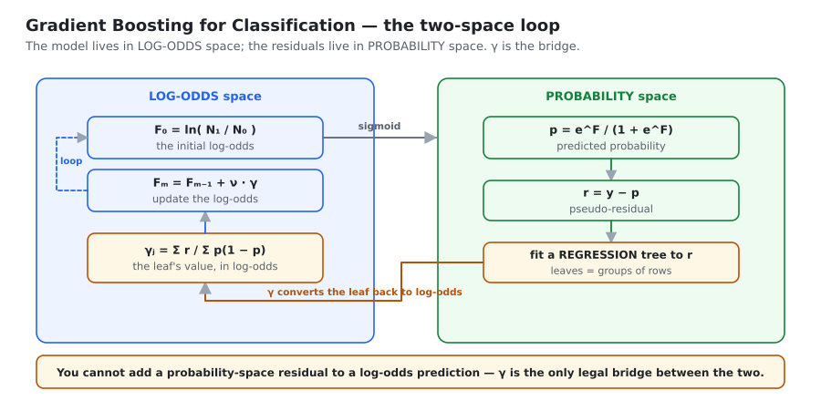
*The model lives in log-odds space; the residuals live in probability space. γ is the only legal bridge between them.*

### Deriving $\gamma$

We want the $\gamma$ minimising $\sum_{i\in R_j} L\big(y_i, F_{\text{old}}(x_i)+\gamma\big)$ for
log loss $L = -[y\log p + (1-y)\log(1-p)]$.

**Step A — the gradient.** Using the chain rule $\frac{\partial L}{\partial F} =
\frac{\partial L}{\partial p}\cdot\frac{\partial p}{\partial F}$:

$$\frac{\partial L}{\partial p} = -\left[\frac{y}{p}-\frac{1-y}{1-p}\right] = \frac{p-y}{p(1-p)}, \qquad \frac{\partial p}{\partial F} = p(1-p)$$

$$\Longrightarrow\quad \frac{\partial L}{\partial F} = \frac{p-y}{p(1-p)}\cdot p(1-p) = p-y = -(y-p)$$

So the negative gradient is $r = y-p$ ✔ — confirming the residual formula.

**Step B — the Hessian.**
$$\frac{\partial^2 L}{\partial F^2} = \frac{\partial}{\partial F}(p-y) = \frac{\partial p}{\partial F} = p(1-p)$$

**Step C — second-order Taylor expansion** around $F_{\text{old}}$:

$$L(F_{\text{old}}+\gamma) \approx L(F_{\text{old}}) \;-\; r\,\gamma \;+\; \tfrac12\,p(1-p)\,\gamma^2$$

Summing over the leaf, differentiating with respect to $\gamma$ and setting to zero:

$$\sum_{i\in R_j}\Big[-r_i + p_i(1-p_i)\gamma\Big] = 0 \qquad\Longrightarrow\qquad \gamma\sum_{i\in R_j} p_i(1-p_i) = \sum_{i\in R_j} r_i$$

$$\boxed{\;\gamma_j = \frac{\sum_{i\in R_j} r_i}{\sum_{i\in R_j} p_i(1-p_i)}\;}$$

> **Notice:** that is a second-order Taylor expansion, and the denominator is a sum of Hessians.
> **XGBoost's leaf formula $w^* = -G/(H+\lambda)$ is exactly this idea, generalised.** Chapter 3
> is, in a real sense, this derivation done properly and with regularisation added.

### Why regression trees for a classification problem?

Because the residuals $y-p$ are **continuous** numbers like $0.375$ or $-0.625$, not class labels.
Predicting continuous numbers is a regression task. The tree predicts residuals; $\gamma$ converts
each leaf into log-odds; the sum stays in log-odds space; the sigmoid turns the final answer back
into a probability.

> **Remember:** even though the problem is classification, **every tree in the ensemble is a
> regression tree fitted to residuals.**

## 2.7 Geometric intuition

Lift 2-D data $(x_1,x_2)$ into 3-D by adding the label axis. Class-0 points sit at $y=0$,
class-1 points at $y=1$. The model's prediction is a **surface**.

| Iteration | What the surface looks like |
|---|---|
| 0 | a flat plane at $p=\operatorname{mean}(y)$ |
| 1 | a stair-step: two levels |
| 2 | three levels — more flexible |
| 3+ | a complex surface following the data |
| final | an intricate boundary separating the classes |

The residuals are the **vertical gaps** between each point and the surface. As iterations
increase, those gaps shorten.

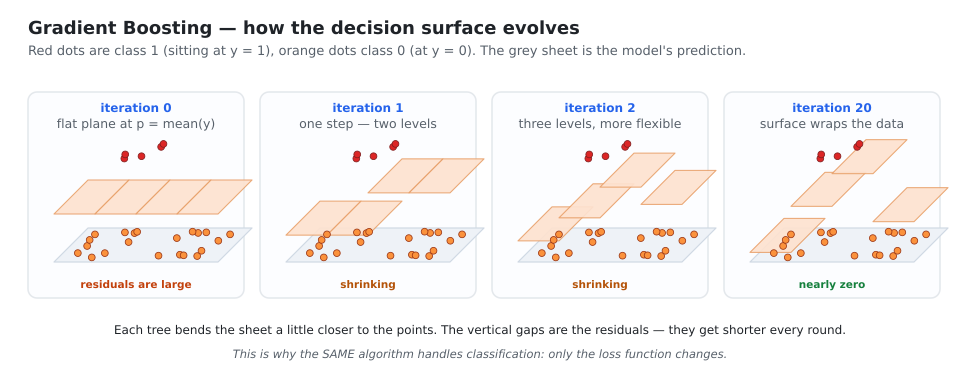
*Each tree bends the prediction sheet a little closer to the data. The vertical gaps — the residuals — get shorter every round.*

## 2.8 Hyperparameters

| Parameter | Typical | Notes |
|---|---|---|
| **tree size** | 8–32 leaves (depth 3–6) | GB uses **deeper trees than AdaBoost**. AdaBoost uses stumps; GB trees must capture *patterns in the residuals*, which are more complex. Small data → ~8 leaves; large → 32+ |
| **learning rate $\nu$** | 0.01, 0.05, 0.1 | also called shrinkage. Constant across rounds. Smaller ⟹ more trees needed ⟹ better generalisation |
| **n_estimators $M$** | 100–2000 | balance against $\nu$, and use **early stopping** |
| `subsample` | 0.5–1.0 | $<1$ gives **Stochastic Gradient Boosting** — each tree sees a random subset of rows, which adds bagging-style variance reduction on top |

::: key
⭐ **The rule that matters most:** small $\nu$ + large $M$ + **early stopping**.
$\nu$ and $M$ trade off almost exactly: halving the learning rate roughly doubles the number of
trees you need. Tune $\nu$ for quality, and let early stopping choose $M$ for you.
:::

**Why tree depth matters so much here.** The depth of each tree caps the **order of feature
interactions** the ensemble can represent. Depth 1 (a stump) can only use one feature at a time —
the model is additive and can never represent "high CGPA *and* high IQ". Depth 2 captures
pairwise interactions, depth 3 three-way, and so on. This is a far more useful way to think about
`max_depth` than "bigger = more overfitting".

## 2.9 Strengths and weaknesses

| ✔ Strengths | ✘ Weaknesses |
|---|---|
| **Any differentiable loss** — regression, classification, ranking, Poisson, quantile, custom | **Sequential** — slow to train, hard to parallelise |
| Usually the best accuracy on tabular data | **Will overfit** without a learning rate and early stopping |
| Handles non-linearity and interactions natively | More hyperparameters than Random Forest |
| Less sensitive to outliers than AdaBoost (with a robust loss like Huber) | No built-in missing-value handling (plain GBM) |
| Gives feature importances | Needs more tuning care than bagging |

> 🎤 **Interview one-liner:** "Gradient boosting fits each new tree to the **negative gradient** of
> the loss with respect to the current prediction. For squared error that negative gradient is
> just the ordinary residual, which is why it looks like 'fitting the errors'. Because it only
> needs the loss to be differentiable, the same algorithm covers regression, classification and
> ranking — only the initialisation and the leaf-value formula change."

---

# CHAPTER 3 — XGBoost

> **XGBoost = eXtreme Gradient Boosting.** Created by **Tianqi Chen** in **2014**.
> ⚠️ It is **not a new algorithm** — it is a **library** implementing gradient boosting with a
> regularized objective and a long list of engineering optimizations.

## 3.1 Why it was built

| Era | Algorithms | Strength | Problem |
|---|---|---|---|
| **1970s–80s** | Linear Regression, Naive Bayes | could solve ML problems at all | **too specialised** — each worked on one kind of data |
| **1990s** | Random Forest, SVM, GBM | powerful, worked on many data types | overfitting, and **poor scalability** as internet-era data grew |
| **2014+** | **XGBoost** | fixed both | — |

Chen chose gradient boosting as the base for five reasons: **flexibility** (any differentiable
loss), **performance**, **robustness** with regularisation, **native missing-value handling**, and
the fact that people were already winning Kaggle competitions with GBM. The only things wrong with
GBM were that it was **slow on large data** and could be pushed further on accuracy. XGBoost
attacked exactly those two.

The result: in 2016, **16 of the 29 winning Kaggle solutions used XGBoost.**

### Three design goals

1. **Performance** — high accuracy, robust, resistant to overfitting.
2. **Speed** — scalable to datasets larger than memory.
3. **Flexibility** — not locked to one language or platform. XGBoost ships bindings for Python, R,
   Java, Scala, C++, Julia and more, so you can train in Python and serve in Java.

## 3.2 The one thing that is actually different

At its core XGBoost **is** gradient boosting: start with a base model, compute residuals, fit a
tree to them, add it with a learning rate, repeat.

::: key
⭐ **The twist: the trees are built differently.**
A normal gradient-boosting tree splits using **Gini, entropy or MSE** — criteria borrowed from
ordinary decision trees. An XGBoost tree splits using a **Similarity Score** that is *derived from
the loss function itself*, with regularisation already inside it.
:::

| Symbol | Name | Default | Role |
|---|---|---|---|
| $\eta$ | learning rate | 0.3 | multiplies each tree's output before adding |
| $\lambda$ | L2 regularisation | 1 | sits in the **denominator** of the leaf value and score |
| $\gamma$ | minimum split loss | 0 | a split must improve the objective by at least this much |

## 3.3 The formulas (learn this box first)

**Regression**

$$\text{Similarity Score} = \frac{\big(\sum \text{residuals}\big)^2}{N+\lambda} \qquad\qquad \text{Leaf output} = \frac{\sum \text{residuals}}{N+\lambda}$$

**Classification**

$$\text{Similarity Score} = \frac{\big(\sum \text{residuals}\big)^2}{\sum p_i(1-p_i)+\lambda} \qquad\qquad \text{Leaf output} = \frac{\sum \text{residuals}}{\sum p_i(1-p_i)+\lambda}$$

**Both**

$$\text{Gain} = SS_{\text{left}} + SS_{\text{right}} - SS_{\text{parent}} \qquad\qquad F_m(x) = F_{m-1}(x) + \eta\cdot\text{TreeOutput}$$

> Notice how similar the two columns are. The **only** difference is the denominator: $N$ for
> regression, $\sum p(1-p)$ for classification. Section 3.6 shows that both are the same quantity —
> the **sum of Hessians**.

## 3.4 ⭐ Worked example — regression

**Dataset** (using $\lambda=0$ and $\eta=0.3$ for clarity):

| Student | CGPA | Package (LPA) |
|---|---|---|
| 1 | 4.0 | 4.5 |
| 2 | 6.0 | 6.0 |
| 3 | 7.5 | 8.0 |
| 4 | 9.0 | 11.0 |

**Stage 1 — base model = mean**
$$F_0 = \frac{4.5+6.0+8.0+11.0}{4} = \frac{29.5}{4} = 7.375 \approx 7.3$$

**Residuals**

| Student | Actual | Predicted | Residual |
|---|---|---|---|
| 1 | 4.5 | 7.3 | **−2.8** |
| 2 | 6.0 | 7.3 | **−1.3** |
| 3 | 8.0 | 7.3 | **+0.7** |
| 4 | 11.0 | 7.3 | **+3.7** |

**Root similarity score.** $\sum r = -2.8-1.3+0.7+3.7 = 0.3$

$$SS_{\text{root}} = \frac{(0.3)^2}{4+0} = \frac{0.09}{4} \approx 0.02$$

::: key
⭐ **Why it is called a *similarity* score.** The numerator squares the **sum** of the residuals,
not the sum of squares. So residuals that disagree in sign **cancel before squaring**, and the
score collapses. Residuals that are similar reinforce each other and the score is large.
**A high score means "this group of rows has similar errors" — which is exactly what makes a good leaf.**
:::

**Candidate splits** — midpoints of consecutive sorted CGPA values: 5.0, 6.75, 8.25.

**Try CGPA < 5.0**
$$SS_L = \frac{(-2.8)^2}{1} = 7.84 \qquad SS_R = \frac{(-1.3+0.7+3.7)^2}{3} = \frac{9.61}{3} \approx 3.20$$
$$\text{Gain} = 7.84+3.20-0.02 = 11.02$$

**Try CGPA < 6.75**
$$SS_L = \frac{(-4.1)^2}{2} = 8.405 \qquad SS_R = \frac{(4.4)^2}{2} = 9.68$$
$$\text{Gain} = 8.405+9.68-0.02 = \mathbf{18.065}$$

**Try CGPA < 8.25**
$$SS_L = \frac{(-3.4)^2}{3} \approx 3.85 \qquad SS_R = \frac{(3.7)^2}{1} = 13.69$$
$$\text{Gain} = 3.85+13.69-0.02 = 17.52$$

| Split point | Gain |
|---|---|
| CGPA < 5.0 | 11.02 |
| **CGPA < 6.75** | **18.065 ← winner** |
| CGPA < 8.25 | 17.52 |

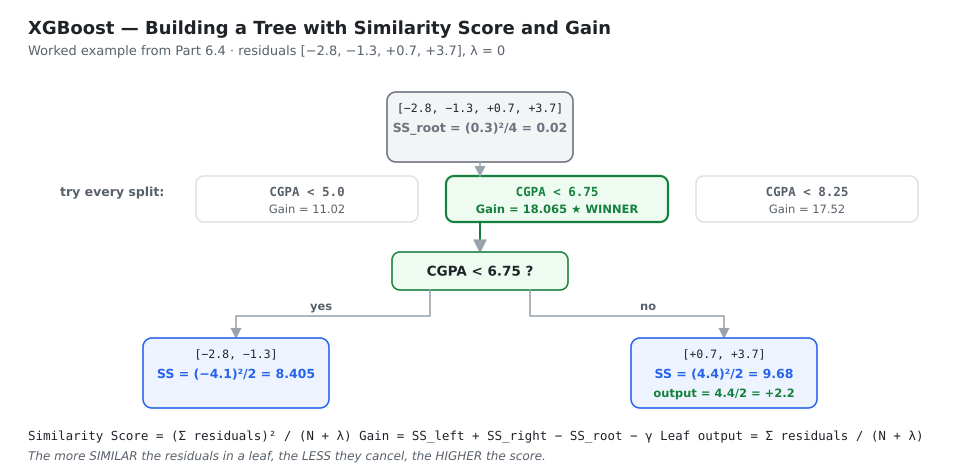
*Compute SS for the root, try every candidate split, keep the one with the highest Gain, then read each leaf's output straight off the formula.*

**Leaf outputs** (with $\lambda = 0$, the output is simply the mean residual):

$$\text{leaf } (CGPA<5.0) = \frac{-2.8}{1} = -2.8 \qquad \text{leaf }(5.0\le CGPA<6.75) = \frac{-1.3}{1} = -1.3$$
$$\text{leaf } (CGPA\ge 6.75) = \frac{0.7+3.7}{2} = 2.2$$

**Stage 2 — update with $\eta=0.3$**

| Student | Path | Leaf output | New prediction |
|---|---|---|---|
| 1 | <6.75, <5.0 | −2.8 | $7.3+0.3(-2.8) = 6.46$ |
| 2 | <6.75, ≥5.0 | −1.3 | $7.3+0.3(-1.3) = 6.91$ |
| 3 | ≥6.75 | +2.2 | $7.3+0.3(2.2) = 7.96$ |
| 4 | ≥6.75 | +2.2 | $7.3+0.3(2.2) = 7.96$ |

**New residuals:** $[-1.96,\,-0.91,\,+0.04,\,+3.04]$ — compare with the originals
$[-2.8,\,-1.3,\,+0.7,\,+3.7]$. Every one has shrunk toward zero.

## 3.5 ⭐ Worked example — classification

| Student | CGPA | Placed |
|---|---|---|
| 1 | 5.70 | 0 |
| 2 | 6.40 | 0 |
| 3 | 7.10 | 1 |
| 4 | 8.15 | 1 |
| 5 | 9.60 | 1 |

**Stage 1 — log of odds**
$$p = \tfrac35 = 0.6, \qquad \text{odds} = \tfrac{0.6}{0.4}=1.5, \qquad F_0 = \ln(1.5) \approx 0.405$$
$$p = \frac{e^{0.405}}{1+e^{0.405}} = \frac{1.5}{2.5} = 0.6$$

**Residuals** $r_i = y_i - p_i$: $[-0.6,\,-0.6,\,+0.4,\,+0.4,\,+0.4]$

**Root score.** $\sum r = 0$, denominator $= 5(0.6)(0.4) = 1.2$, so $SS_{\text{root}} = 0$.

**Try CGPA < 6.75**
$$SS_L = \frac{(-1.2)^2}{2(0.24)} = \frac{1.44}{0.48} = 3.0 \qquad SS_R = \frac{(1.2)^2}{3(0.24)} = \frac{1.44}{0.72} = 2.0$$
$$\text{Gain} = 3.0+2.0-0 = \mathbf{5.0}$$

| Split point | Gain |
|---|---|
| CGPA < 6.05 | 1.875 |
| **CGPA < 6.75** | **5.0 ← winner** |
| CGPA < 7.625 | 2.222 |
| CGPA < 8.875 | 0.834 |

**Leaf outputs**
$$\text{left (S1,S2)} = \frac{-1.2}{0.48} = -2.5 \qquad \text{right (S3,S4,S5)} = \frac{1.2}{0.72} \approx 1.667$$

**Stage 2 — update the LOG-ODDS, then convert back**

$$\text{S1,S2:}\quad F = 0.405+0.3(-2.5) = -0.345 \;\Rightarrow\; p = \frac{e^{-0.345}}{1+e^{-0.345}} \approx 0.415 \;\Rightarrow\; \textbf{not placed ✔}$$
$$\text{S3,S4,S5:}\quad F = 0.405+0.3(1.667) = 0.905 \;\Rightarrow\; p \approx 0.712 \;\Rightarrow\; \textbf{placed ✔}$$

One round has already fixed both mistakes. New residuals:
$[-0.415,\,-0.415,\,+0.288,\,+0.288,\,+0.288]$ — all smaller.

⚠️ For stage 3, build the tree using the **new** probabilities (0.415 / 0.712), not the old 0.6.

## 3.6 ⭐⭐⭐ The full derivation

This is the highest-value thing in Book 2. We now *prove* the Similarity Score and leaf formulas.

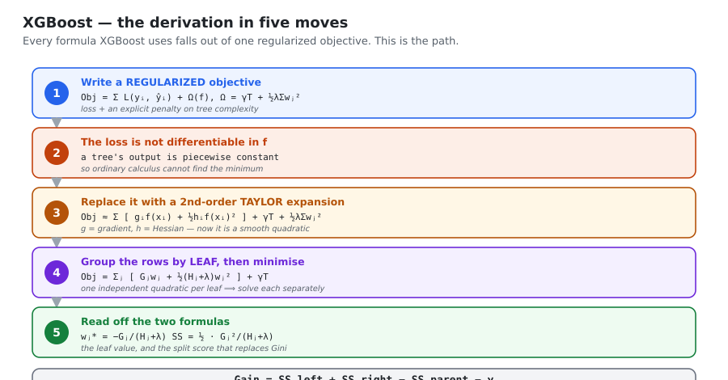
*Every formula XGBoost uses falls out of one regularized objective. This is the path.*

### Step 1 — the regularized objective

$$\text{Obj}^{(t)} = \sum_{i=1}^{n} L\big(y_i,\;\hat y_i^{(t-1)}+f_t(x_i)\big) \;+\; \Omega(f_t)$$

$$\Omega(f) = \gamma T + \frac{1}{2}\lambda\sum_{j=1}^{T} w_j^2$$

| Term | Penalises | Effect |
|---|---|---|
| $\gamma T$ | the **number of leaves** | keeps trees small |
| $\tfrac12\lambda\sum w_j^2$ | **large leaf outputs** | stops any one leaf dominating; damps the effect of outliers |

It is called an **objective** function, not a loss function, precisely because it is loss **plus**
a complexity penalty. Plain GBM could only regularise through the learning rate and tree-size
limits; here the penalty is **inside the thing being optimised**, so it influences the split
choice itself.

### Step 2 — why Taylor is needed

A decision tree's output is **piecewise constant** — it jumps between regions. So
$\text{Obj}$ as a function of $f_t$ is a jagged staircase: **not differentiable**, with no
closed-form minimum. Ordinary calculus is unavailable.

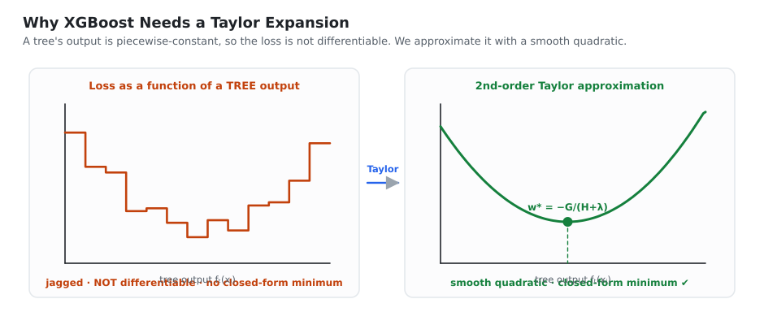
*Left: a tree's output is piecewise-constant, so the loss is a staircase with no usable derivative. Right: the 2nd-order Taylor expansion replaces it with a smooth quadratic that has a closed-form minimum.*

### Step 3 — second-order Taylor expansion

Recall Taylor's formula around a point $a$:

$$f(x) \approx f(a) + f'(a)(x-a) + \tfrac12 f''(a)(x-a)^2 + \dots$$

Here, expand around the **previous** prediction: $a = \hat y_i^{(t-1)}$ and
$x - a = f_t(x_i)$. Define

$$g_i = \frac{\partial L}{\partial \hat y_i^{(t-1)}} \quad\text{(gradient)}, \qquad h_i = \frac{\partial^2 L}{\partial (\hat y_i^{(t-1)})^2} \quad\text{(Hessian)}$$

Then

$$L\big(y_i,\hat y_i^{(t-1)}+f_t(x_i)\big) \approx \underbrace{L\big(y_i,\hat y_i^{(t-1)}\big)}_{\text{constant}} + g_i f_t(x_i) + \tfrac12 h_i f_t(x_i)^2$$

The first term does not depend on $f_t$, so it cannot move the minimum — **drop it**:

$$\text{Obj}^{(t)} \approx \sum_{i=1}^{n}\Big[g_i f_t(x_i) + \tfrac12 h_i f_t(x_i)^2\Big] + \gamma T + \tfrac12\lambda\sum_{j=1}^{T} w_j^2$$

This is now a **smooth quadratic** — exactly what we wanted.

### Step 4 — group the rows by leaf

For any row $x_i$, the tree sends it to exactly **one** leaf, and every row in a leaf gets the
**same** output. Let $I_j$ = the set of row indices landing in leaf $j$, and $w_j$ = that leaf's
output. Then $f_t(x_i) = w_j$ for all $i\in I_j$, so we can re-index the sums by leaf:

$$\sum_{i=1}^{n} g_i f_t(x_i) = \sum_{j=1}^{T} w_j \underbrace{\sum_{i\in I_j} g_i}_{\textstyle G_j}, \qquad \sum_{i=1}^{n}\tfrac12 h_i f_t(x_i)^2 = \sum_{j=1}^{T}\tfrac12 w_j^2 \underbrace{\sum_{i\in I_j} h_i}_{\textstyle H_j}$$

Substituting:

$$\boxed{\;\text{Obj}^{(t)} = \sum_{j=1}^{T}\left[G_j w_j + \tfrac12 (H_j+\lambda) w_j^2\right] + \gamma T\;}$$

::: key
⭐ **The payoff.** The objective is now a **sum of independent quadratics, one per leaf.** Each
leaf can be optimised completely separately, and a quadratic has a closed-form minimum.
:::

### Step 5 — the optimal leaf weight

For one leaf: $\text{Obj}_j = G_j w_j + \tfrac12 (H_j+\lambda) w_j^2$. Differentiate and set to zero:

$$\frac{\partial \text{Obj}_j}{\partial w_j} = G_j + (H_j+\lambda) w_j = 0$$

$$\boxed{\;w_j^{*} = -\frac{G_j}{H_j+\lambda}\;}$$

**Specialise to regression** (squared error, $L=\tfrac12(y-\hat y)^2$):

$$g_i = \hat y_i - y_i = -r_i, \qquad h_i = 1$$
$$w_j^* = -\frac{\sum(-r_i)}{\sum 1 + \lambda} = \frac{\sum \text{residuals}}{\text{count}+\lambda} \;\;✔$$

**Specialise to classification** (log loss):

$$g_i = p_i - y_i = -r_i, \qquad h_i = p_i(1-p_i)$$
$$w_j^* = \frac{\sum \text{residuals}}{\sum p_i(1-p_i)+\lambda} \;\;✔$$

Both of the formulas from Section 3.3 drop out of **one** equation. The mysterious "$N$" in the
regression denominator is simply $\sum h_i$ where every $h_i=1$.

### Step 6 — the Similarity Score

Substitute the optimal $w_j^*$ back in to find the **best achievable objective** for that leaf:

$$\text{Obj}_j^{*} = G_j\!\left(-\frac{G_j}{H_j+\lambda}\right) + \tfrac12 (H_j+\lambda)\left(\frac{G_j}{H_j+\lambda}\right)^{2} = -\frac{G_j^2}{H_j+\lambda} + \frac12\frac{G_j^2}{H_j+\lambda}$$

$$\boxed{\;\text{Obj}_j^{*} = -\frac{1}{2}\frac{G_j^2}{H_j+\lambda}\;}$$

The more **negative** this is, the better the leaf. Define the Similarity Score as its negative,
so that bigger is better:

$$\boxed{\;\text{Similarity Score} = \frac{1}{2}\,\frac{G_j^2}{H_j+\lambda}\;}$$

> **About the $\tfrac12$:** in hand-worked examples it is usually dropped, because it is a constant
> factor appearing in every term of the Gain and so cannot change which split wins. The library
> keeps it.

### Step 7 — the Gain

$$\boxed{\;\text{Gain} = \underbrace{\frac12\frac{G_L^2}{H_L+\lambda} + \frac12\frac{G_R^2}{H_R+\lambda}}_{\text{after the split}} \;-\; \underbrace{\frac12\frac{(G_L+G_R)^2}{H_L+H_R+\lambda}}_{\text{before the split}} \;-\; \gamma\;}$$

| Part | Meaning |
|---|---|
| left + right | quality of the two children |
| parent | quality before splitting |
| $-\gamma$ | the price of adding a leaf |
| Gain > 0 | the split is worth it → **make it** |
| Gain ≤ 0 | complexity outweighs benefit → **stop** |

Compare with an ordinary decision tree:

$$\text{Decision tree: } IG = \text{Entropy(parent)} - \text{weighted Entropy(children)}$$
$$\text{XGBoost: } \text{Gain} = SS_{\text{left}} + SS_{\text{right}} - SS_{\text{parent}} - \gamma$$

Same shape. The difference is that Gini and entropy are **heuristics chosen because they seem
reasonable**, whereas the Similarity Score is **derived from the loss you actually care about**,
with the regularisation already folded in.

### Summary table

| Component | Regression (squared error) | Classification (log loss) |
|---|---|---|
| Loss $L$ | $\tfrac12(y_i-\hat y_i)^2$ | $-[y_i\log p_i + (1-y_i)\log(1-p_i)]$ |
| Gradient $g_i$ | $\hat y_i-y_i = -r_i$ | $p_i-y_i = -r_i$ |
| **Hessian $h_i$** | $\mathbf{1}$ | $\mathbf{p_i(1-p_i)}$ |
| Leaf weight $w_j^*$ | $\dfrac{\sum r}{\text{count}+\lambda}$ | $\dfrac{\sum r}{\sum p(1-p)+\lambda}$ |
| Similarity Score | $\tfrac12\dfrac{(\sum r)^2}{\text{count}+\lambda}$ | $\tfrac12\dfrac{(\sum r)^2}{\sum p(1-p)+\lambda}$ |

## 3.7 The speed optimizations

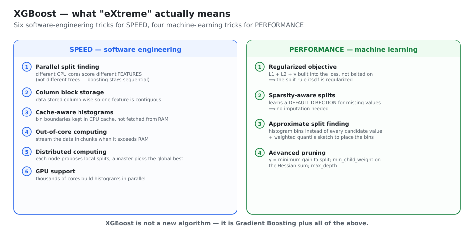
*Six software-engineering tricks for speed, four machine-learning tricks for performance.*

### 1. Parallel split finding — resolving the obvious objection

> *"Boosting is sequential. How can XGBoost be parallel?"*

**The answer:** the parallelism is **not across trees**. Trees are still added one at a time. The
parallelism is **inside the construction of a single tree.**

To find the best split at a node you must evaluate **every feature**: sort its values, enumerate
candidate split points, score each. Evaluating feature $f_1$ and feature $f_2$ are **completely
independent** tasks, so different CPU cores handle different features simultaneously.

$$\text{best split} = \arg\min_{j,\,s}\Big[\text{Impurity}\big(\text{Left}(j,s)\big) + \text{Impurity}\big(\text{Right}(j,s)\big)\Big]$$

where $j$ is the feature index and $s$ the split point — and each core owns one $j$.
(Hyperparameter: `n_jobs=-1`.)

### 2. Column block storage

Most algorithms store data **row-wise**. XGBoost stores it **column-wise**, in compressed blocks —
one block per feature, with the rows pre-sorted.

Two benefits: parallel feature scoring becomes trivial (each core grabs one block), and reading a
single feature touches **contiguous memory** instead of jumping around, which is far cache-friendlier.

### 3. Cache-aware access

The CPU is much faster than RAM, so it keeps a tiny **cache** (a few MB) of recently used data.
XGBoost builds **histograms** of each feature (bucketing values into bins) and keeps the bin
statistics in cache, so split evaluation rarely has to reach out to RAM.

> **Analogy:** a cook keeps frequently used ingredients on the counter (cache) instead of walking
> to the fridge (RAM) for every pinch of salt.

### 4. Out-of-core computing

For data larger than RAM, XGBoost splits it into chunks on disk and streams them through, using a
dedicated prefetch thread so that disk reads overlap with computation.
(Hyperparameter: `tree_method='hist'`.)

### 5. Distributed computing

Partition the data across $k$ machines. Each node computes **local** split statistics; a master
aggregates them and chooses the **globally** best split:

$$s^{(j)*} = \arg\max_{m} G_m^{(j)}$$

Works with Spark, Dask and Kubernetes.

### 6. GPU support

A CPU has a few powerful cores; a GPU has thousands of weak ones. Histogram building and split
scanning are **massively parallel and arithmetically simple** — a perfect GPU workload.
(Hyperparameter: `tree_method='gpu_hist'`, or `device='cuda'` in newer versions.)

## 3.8 The performance optimizations

### 1. The regularized objective

Already derived in Section 3.6. The point worth repeating in an interview: because $\lambda$ and
$\gamma$ sit **inside** the Gain formula, regularisation changes **which splits get made**, not
just how big the leaf values end up. Plain GBM can only shrink after the fact.

### 2. Sparsity-aware split finding (missing values)

Most algorithms force you to impute. XGBoost instead treats "missing" as a **direction**.

```
Candidate split: f > 4.5
  1. send all non-missing rows left or right by the rule
  2. try putting the missing rows LEFT   -> compute Gain
  3. try putting the missing rows RIGHT  -> compute Gain
  4. keep whichever is better, and store it as this node's DEFAULT DIRECTION
```

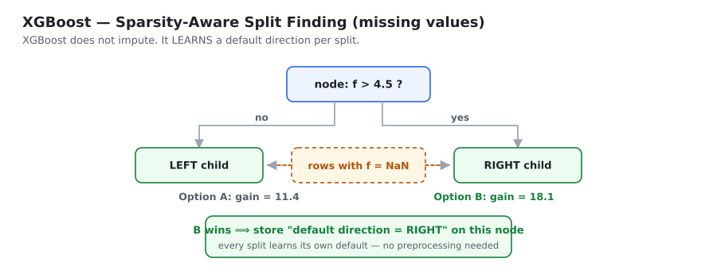
*XGBoost does not impute — it learns, for each split separately, which way the missing rows should go.*

This is also why XGBoost is fast on sparse data: it only ever iterates over the **non-missing**
entries, so the cost scales with the number of *present* values, not the matrix size.

### 3. Efficient split finding

**The problem with exact greedy search:** sorting all unique values of a feature and testing every
possible split point is $O(n\log n)$ per feature per node. On millions of rows this dominates
training time.

**Solution A — histogram / approximate split finding.** Bucket each feature into $k$ bins
(e.g. 256). Now there are only $k-1$ candidate splits instead of millions. Accuracy drops very
slightly; speed improves enormously. The binning even acts as mild regularisation, because it
stops the tree from exploiting a split between two nearly identical values.

**Solution B — the weighted quantile sketch.** *How should the bin edges be placed?*

Uniform bins ignore the data distribution and waste resolution where there is no data. XGBoost
instead places bin edges at **quantiles**, so each bin carries roughly equal **weight** — and
crucially the weight used is the **Hessian** $h_i$:

$$\sum_{x_i\in \text{Bin}_j} h_i \;\approx\; \frac{1}{k}\sum_{i=1}^{n} h_i$$

::: key
⭐ **Why weight by the Hessian?** Because $h_i$ measures how much row $i$ matters to the loss. For
log loss $h_i = p_i(1-p_i)$, which is **largest at $p=0.5$** — exactly the rows the model is most
unsure about. So the bins get their finest resolution precisely where the model most needs help.
That is the "weighted" in weighted quantile sketch, and it is a great detail to mention.
:::

### 4. Advanced pruning

| Parameter | What it does |
|---|---|
| `max_depth` | hard depth cap (pre-pruning) |
| `min_child_weight` | minimum **sum of Hessians** in a child. For regression that is just a row count; for classification it means "a child must contain enough *uncertain* rows" |
| `gamma` ($\gamma$) | a split happens only if $\text{Gain} > \gamma$ |

XGBoost also does a form of **post-pruning**: it grows to `max_depth` and then walks back,
removing splits with negative gain. This matters because a weak split can enable a strong one
below it — stopping the moment gain goes negative would miss that.

## 3.9 Hyperparameters

### Tree structure
| Parameter | Default | Meaning |
|---|---|---|
| `n_estimators` | 100 | number of boosting rounds |
| `max_depth` | **6** | tree depth; also caps the interaction order |
| `min_child_weight` | 1 | min sum of Hessians per child; ↑ = more conservative |
| `gamma` | 0 | min gain required to split |

### Regularisation
| Parameter | Default | Meaning |
|---|---|---|
| `learning_rate` (`eta`) | **0.3** | shrinkage. Lower it to 0.01–0.1 for real work |
| `reg_lambda` | **1** | **L2** on leaf weights |
| `reg_alpha` | 0 | **L1** on leaf weights — drives some leaves to exactly 0 |

### Sampling
| Parameter | Meaning |
|---|---|
| `subsample` | fraction of **rows** per tree (0.5–0.8 fights overfitting) |
| `colsample_bytree` | fraction of **columns** per tree |
| `colsample_bylevel` | fraction of columns per depth level |
| `colsample_bynode` | fraction of columns **per split** — this is Random Forest's trick, available inside XGBoost |

### System
| Parameter | Meaning |
|---|---|
| `tree_method` | `'auto'`, `'exact'`, `'approx'`, `'hist'`, `'gpu_hist'` |
| `scale_pos_weight` | for imbalanced binary data; set to $n_{\text{neg}}/n_{\text{pos}}$ |
| `early_stopping_rounds` | stop when validation stops improving |

```python
import xgboost as xgb

model = xgb.XGBClassifier(
    n_estimators=2000,          # go high; early stopping picks the real number
    learning_rate=0.05,         # low LR + many rounds = the winning combination
    max_depth=6,
    min_child_weight=1,
    gamma=0,                    # minimum gain to split
    subsample=0.8,              # row sampling
    colsample_bytree=0.8,       # column sampling
    reg_lambda=1.0,             # L2
    reg_alpha=0.0,              # L1
    tree_method='hist',         # histogram-based: fast
    eval_metric='logloss',
    early_stopping_rounds=50,
    n_jobs=-1,
    random_state=42,
)
model.fit(X_train, y_train, eval_set=[(X_val, y_val)], verbose=False)
print("best iteration:", model.best_iteration)
```

## 3.10 Strengths and weaknesses

| ✔ Strengths | ✘ Weaknesses |
|---|---|
| Regularisation derived into the split rule itself | **Many hyperparameters** — needs real tuning |
| Handles missing values natively | Slower than LightGBM on very large data |
| Very fast: parallel, cache-aware, out-of-core, GPU | Categorical support is weaker than CatBoost's |
| Any differentiable loss, including custom ones | Can overfit small datasets if under-regularised |
| Mature, stable, superb documentation and tooling | Memory-hungry with `tree_method='exact'` |
| Works with Spark / Dask / Kubernetes | Sequential — training cannot scale across trees |

> 🎤 **Interview one-liner:** "XGBoost is gradient boosting with a **regularized objective** and a
> **second-order Taylor approximation** of the loss. That gives a closed-form optimal leaf weight
> w* = −G/(H+λ) and a split criterion Gain = ½[G_L²/(H_L+λ) + G_R²/(H_R+λ) − G²/(H+λ)] − γ — so
> unlike Gini or entropy, the split rule is *derived from the loss* rather than chosen
> heuristically. On top of that sit the engineering wins: column-block storage, cache-aware
> histograms, sparsity-aware default directions for missing values, out-of-core and GPU training."

---

# APPENDIX B — Cheat Sheet and Interview Q&A

## B.1 Formula cheat sheet

**AdaBoost**
$$w_i^{(1)} = \tfrac1N \qquad \varepsilon_t=\!\!\sum_{\text{misclassified}}\!\! w_i \qquad \alpha_t=\tfrac12\ln\frac{1-\varepsilon_t}{\varepsilon_t}$$
$$w_i \leftarrow w_i\,e^{-\alpha_t y_i h_t(x_i)} \quad\text{then normalise} \qquad H(x)=\operatorname{sign}\Big(\textstyle\sum_t \alpha_t h_t(x)\Big)$$
Derived from the **exponential loss** $\sum_i e^{-y_iF(x_i)}$. Labels are $\pm1$.

**Gradient Boosting**
$$F_0=\operatorname{mean}(y)\ \text{(reg)} \qquad F_0=\ln(N_1/N_0)\ \text{(clf)} \qquad p=\frac{e^F}{1+e^F}$$
$$r_{im}=-\Big[\tfrac{\partial L}{\partial F}\Big]_{F_{m-1}} = y_i-F_{m-1}(x_i)\ \text{(MSE)} \;=\; y_i-p_i\ \text{(log loss)}$$
$$\gamma_{jm}=\text{mean of residuals}\ \text{(reg)} \qquad \gamma_j=\frac{\sum r}{\sum p(1-p)}\ \text{(clf)} \qquad F_m=F_{m-1}+\nu\gamma$$

**XGBoost**
$$\text{Obj}=\sum_i L(y_i,\hat y_i)+\sum_k\Omega(f_k),\qquad \Omega(f)=\gamma T+\tfrac12\lambda\textstyle\sum_j w_j^2$$
$$\text{Obj}\approx\sum_j\Big[G_jw_j+\tfrac12(H_j+\lambda)w_j^2\Big]+\gamma T$$
$$w_j^{*}=-\frac{G_j}{H_j+\lambda} \qquad SS=\tfrac12\frac{G_j^2}{H_j+\lambda} \qquad \text{Gain}=SS_L+SS_R-SS_P-\gamma$$
Regression: $g=-r,\;h=1$.  Classification: $g=-r,\;h=p(1-p)$.

## B.2 Comparison table

| | **AdaBoost** | **Gradient Boosting** | **XGBoost** |
|---|---|---|---|
| Base learner | stumps (depth 1) | trees, 8–32 leaves | trees, depth ~6 |
| What changes each round | **sample weights** | **the target** (residuals) | the target (residuals) |
| Loss | fixed exponential | **any differentiable** | any differentiable + **regularisation** |
| Split criterion | weighted error | MSE on residuals | **Similarity Score / Gain** |
| Model weights | per-model $\alpha_t$ | one shared $\nu$ | one shared $\eta$ |
| Regularisation | learning rate | learning rate, subsample | **L1 + L2 + γ in the objective** |
| Order of derivative used | 1st (implicitly) | **1st** | **2nd** (gradient + Hessian) |
| Missing values | impute first | impute first | ✔ **automatic** |
| Outlier sensitivity | **high** | medium | medium |
| Speed | fast | **slow** | fast |

## B.3 Rapid-fire Q&A

**Q1. What is boosting?**
Building weak learners sequentially, where each new one focuses on what the previous ones got
wrong, and combining them into a weighted sum. It reduces **bias**.

**Q2. Bagging vs boosting in one line each?**
Bagging: parallel, independent models on bootstrap samples, averaged — reduces **variance**.
Boosting: sequential, each model fixes the previous ones' errors — reduces **bias**.

**Q3. Why are AdaBoost's labels ±1 and not 0/1?**
Because the final prediction is $\operatorname{sign}(\sum_t\alpha_t h_t(x))$ — each learner must
be able to push the sum positive **or** negative. It also lets the weight update collapse into the
single expression $w_i e^{-\alpha y_i h(x_i)}$.

**Q4. ⭐ Derive AdaBoost's α.**
AdaBoost minimises the exponential loss stage-wise. Writing $w_i=e^{-y_iF_{t-1}(x_i)}$ gives
$L(\alpha)=e^{-\alpha}(1-\varepsilon)+e^{\alpha}\varepsilon$. Setting $dL/d\alpha=0$ gives
$e^{2\alpha}=(1-\varepsilon)/\varepsilon$, so $\alpha=\tfrac12\ln\frac{1-\varepsilon}{\varepsilon}$.

**Q5. What happens if ε > 0.5? If ε = 0.5?**
$\varepsilon>0.5$ gives a **negative** α, which automatically flips the learner's predictions — it
becomes useful again. $\varepsilon=0.5$ gives $\alpha=0$: the learner is ignored entirely.

**Q6. Why is AdaBoost sensitive to outliers?**
The exponential loss grows exponentially in the margin, so a persistently misclassified point
(often a mislabelled one) accumulates enormous weight and hijacks the remaining rounds.

**Q7. Which base learner will NOT work with AdaBoost?**
**KNN** — it has no notion of sample weights.

**Q8. AdaBoost vs Gradient Boosting?**
AdaBoost re-weights the **data points** and is locked to the exponential loss with stumps.
Gradient Boosting re-writes the **target** (fits residuals) and works with any differentiable
loss, using larger trees.

**Q9. ⭐ Why is it called *gradient* boosting?**
Because the quantity each tree is fitted to is the **negative gradient of the loss** with respect
to the current prediction. For squared error that is exactly $y-F$, the ordinary residual. It is
gradient descent in **function space**: $F \leftarrow F + \nu(-\nabla_F L)$.

**Q10. Why is $F_0 = \operatorname{mean}(y)$ for regression?**
Minimise $\sum\tfrac12(y_i-\gamma)^2$: setting the derivative $\sum(\gamma-y_i)$ to zero gives
$n\gamma=\sum y_i$, so $\gamma=\operatorname{mean}(y)$.

**Q11. Why log-odds for classification?**
It is the constant that minimises log loss, exactly as the mean minimises squared error. The
sigmoid then maps it back to a probability.

**Q12. ⭐ Why use REGRESSION trees for a classification problem?**
Because the residuals $y-p$ are **continuous** numbers, not labels. Predicting continuous values
is regression. The tree predicts residuals; γ converts each leaf into log-odds.

**Q13. ⭐ Why do we need γ in GB classification?**
Because the model lives in **log-odds** space and the residual lives in **probability** space —
you cannot add them. γ = $\frac{\sum r}{\sum p(1-p)}$ is the conversion, derived from a
second-order Taylor expansion of log loss.

**Q14. What does the learning rate do, and how does it interact with n_estimators?**
It shrinks each tree's contribution so the model commits slowly. ν and M trade off almost exactly:
halve ν and you roughly double the trees needed. Small ν + many rounds + early stopping is the
standard recipe.

**Q15. Why are gradient boosting trees deeper than AdaBoost's stumps?**
A stump can only use one feature, so the ensemble is additive with no interactions. GB trees of
depth $d$ capture $d$-way feature interactions, and the residual patterns they must model are more
complex than the raw labels.

**Q16. Is XGBoost an algorithm?**
No — it is a **library** implementing gradient boosting with a regularized objective and heavy
system optimisation.

**Q17. ⭐ How is an XGBoost tree different from a GBM tree?**
It splits on the **Similarity Score / Gain** derived from the regularized objective instead of
Gini/entropy/MSE, and its leaf value is $-G/(H+\lambda)$ instead of a plain mean.

**Q18. ⭐ Why does XGBoost need a Taylor expansion?**
A tree's output is piecewise constant, so the objective is not differentiable with respect to the
tree. A 2nd-order Taylor expansion replaces it with a smooth quadratic that has a closed-form
minimum.

**Q19. Derive the optimal leaf weight.**
$\text{Obj}_j = G_jw_j+\tfrac12(H_j+\lambda)w_j^2$. Set $\partial/\partial w_j = G_j+(H_j+\lambda)w_j=0$,
giving $w_j^* = -G_j/(H_j+\lambda)$.

**Q20. What is the Similarity Score?**
Substituting $w_j^*$ back gives $\text{Obj}_j^*=-\tfrac12 G_j^2/(H_j+\lambda)$. The Similarity
Score is its negative, $\tfrac12 G_j^2/(H_j+\lambda)$, so that higher means better.

**Q21. Why does the similarity score use (Σr)² and not Σr²?**
Because squaring the **sum** lets residuals of opposite sign cancel. A leaf whose residuals
disagree scores low; a leaf whose residuals agree scores high. That is precisely the property you
want from a leaf.

**Q22. What are g and h for regression and classification?**
Regression (squared error): $g=-r$, $h=1$. Classification (log loss): $g=-r$, $h=p(1-p)$.

**Q23. What do λ and γ do?**
$\lambda$ is L2 on leaf weights — it sits in the denominator and shrinks leaf outputs.
$\gamma$ is the minimum gain required to make a split — pre-pruning built into the Gain formula.

**Q24. ⭐ Boosting is sequential — so how is XGBoost "parallel"?**
The parallelism is **inside one tree**, not across trees. Scoring candidate splits for different
**features** is independent, so different cores handle different features at the same time.

**Q25. How does XGBoost handle missing values?**
Sparsity-aware split finding: at each split it computes the gain with the missing rows sent left
and sent right, and stores the better option as that node's **default direction**.

**Q26. What is the weighted quantile sketch, and why weighted?**
Histogram bin edges are placed at quantiles of the **Hessian-weighted** distribution, so each bin
carries equal weight $\sum h_i$. Since $h=p(1-p)$ peaks at $p=0.5$, the bins are finest exactly
where the model is least certain.

**Q27. Your XGBoost overfits. What do you change?**
Lower `learning_rate` (and raise rounds with early stopping), lower `max_depth`, raise
`min_child_weight` and `gamma`, lower `subsample` / `colsample_bytree`, raise `reg_lambda`.

**Q28. Your boosting model underfits. What do you change?**
Raise `max_depth` and `n_estimators`, lower `gamma` and `min_child_weight`, lower regularisation.
If it still underfits, the features are the problem, not the model.

---

*End of Book 2. Book 3 covers LightGBM and CatBoost in depth, plus stacking, tuning and the
full comparison.*
