# Ensemble Learning — Book 3 · LightGBM, CatBoost & Stacking

**The modern boosters in depth · Stacking · Tuning · Cheat sheet · Q&A**

> **Prerequisite:** Book 2, especially the XGBoost derivation. LightGBM and CatBoost both start
> from exactly the same objective — $w^*=-G/(H+\lambda)$ and $\text{Gain}=SS_L+SS_R-SS_P-\gamma$.
> Everything in this book is about **how they build the tree faster, or more honestly.**

**The series:** Book 1 *Foundations & Bagging* · Book 2 *Boosting* · Book 3 *LightGBM, CatBoost & Stacking*

---

## Contents

| Chapter | Topic |
|---|---|
| **1** | [LightGBM](#chapter-1--lightgbm) |
| **2** | [CatBoost](#chapter-2--catboost) |
| **3** | [Stacking and Blending](#chapter-3--stacking-and-blending) |
| **4** | [Choosing, Tuning and Shipping](#chapter-4--choosing-tuning-and-shipping) |
| **C** | [Master Comparison, Cheat Sheet & Q&A](#appendix-c--master-comparison-cheat-sheet-and-qa) |

---

# CHAPTER 1 — LightGBM

> **LightGBM = Light Gradient Boosting Machine.** Built by **Microsoft Research**; paper presented
> at **NeurIPS 2017**. "Light" because it is **fast** and uses **little memory**.

## 1.1 The problem LightGBM set out to solve

XGBoost was already fast, but one bottleneck remained. In histogram-based boosting, to find the
best split at a node you must scan **every data point for every feature**:

$$\text{cost of building one tree} \;\approx\; O\big(\#\text{data} \times \#\text{features}\big)$$

With 10 million rows and 1,000 features that is 10 billion operations **per node**, and a tree has
many nodes. Throwing more CPU cores at it helps linearly; LightGBM instead asked whether the
product itself could be made smaller.

Two questions, two answers:

| Question | Answer | Technique |
|---|---|---|
| Do we really need **all the rows**? | No — rows the model already predicts well teach it almost nothing | **GOSS** |
| Do we really need **all the features** separately? | No — in sparse data many features are never non-zero at the same time | **EFB** |

$$\underbrace{\text{GOSS}}_{\text{cuts }\#\text{data}} \;\times\; \underbrace{\text{EFB}}_{\text{cuts }\#\text{features}} \;\Longrightarrow\; \text{a much smaller product}$$

Plus a third, independent change to how trees grow: **leaf-wise** instead of level-wise.

These three ideas are the whole of LightGBM. Everything else is shared with XGBoost.

## 1.2 Foundation — histogram-based split finding

Before GOSS and EFB make sense, you need the histogram machinery they operate on.

### Binning

Instead of treating a continuous feature as millions of distinct values, bucket it into a small
number of **bins** (LightGBM's default is 255, so a bin index fits in one byte):

| | Exact greedy | Histogram-based |
|---|---|---|
| Split points tested | every unique value | only $\#\text{bins}-1$ |
| Pre-sorting required | **yes** — the dominant cost | **no** |
| Memory | stores sorted indices (large) | stores one-byte bin ids — about **8× smaller** |
| Accuracy | slightly higher | slightly lower, usually negligible |

What each bin stores is just **two accumulators**: $\sum g_i$ and $\sum h_i$ for the rows that
fall in it. Finding the best split is then a single left-to-right sweep over the bins,
accumulating $G_L, H_L$ and computing the Gain formula from Book 2 at each boundary.

> **A hidden benefit:** binning is a mild **regulariser**. It prevents the tree from exploiting a
> split between two nearly identical values, which is almost always noise-fitting.

### ⭐ The histogram subtraction trick

This is a cheap, elegant optimisation that interviewers like.

$$H(\text{parent}) = H(\text{left child}) + H(\text{right child})$$

Every row in the parent goes to exactly one child, so the parent's bin counts are the sum of the
children's. Therefore:

$$\boxed{\;H(\text{larger child}) = H(\text{parent}) - H(\text{smaller child})\;}$$

So you build the histogram for whichever child has **fewer rows** (cheap) and obtain the other one
by subtraction (essentially free). Since the smaller child is at most half the parent, this
roughly **halves** the histogram-building cost at every node.

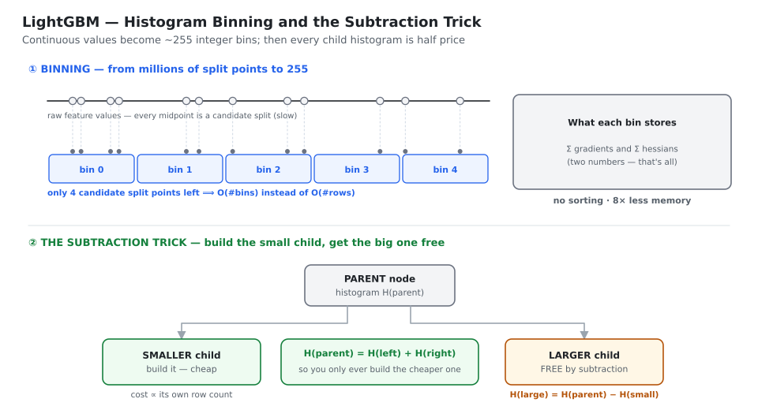
*Binning turns millions of candidate splits into ~255. The subtraction trick then makes every second child histogram free.*

## 1.3 ⭐ Leaf-wise tree growth

This is LightGBM's most visible difference, and the one most likely to bite you in practice.

### Level-wise (XGBoost's classic style)

Grow the tree **one complete level at a time**: split *every* node at the current depth before
moving down. The tree stays **balanced and symmetric**.

- ✔ naturally regularised — it is hard to overfit a balanced tree
- ✘ wasteful — it spends splits on nodes whose gain is negligible, just to keep the level complete

### Leaf-wise (LightGBM's style, also called "best-first")

Among **all current leaves**, split the one with the **maximum gain**. Repeat until you hit
`num_leaves`.

- ✔ for the **same number of leaves**, leaf-wise always reaches a **lower loss** — because every
  split it makes is the best one available anywhere in the tree
- ✔ converges in fewer trees
- ✘ grows **deep and unbalanced**, which **overfits small datasets**

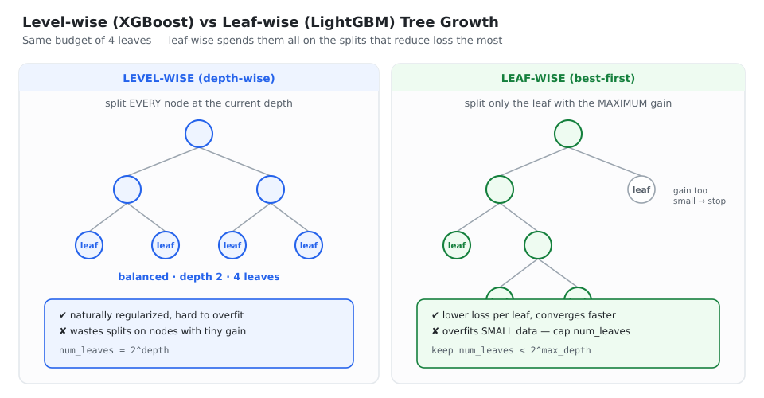
*Level-wise splits every node at a depth and stays balanced. Leaf-wise spends the same leaf budget only on the highest-gain splits — lower loss, but deeper and easier to overfit.*

| | Level-wise | Leaf-wise |
|---|---|---|
| Growth rule | split all nodes at a depth | split the single best-gain leaf |
| Tree shape | balanced, symmetric | **unbalanced, deep** |
| Loss at a fixed leaf count | higher | **lower** |
| Convergence | slower | **faster** |
| Overfitting risk | lower | **higher** |
| Best for | small / medium data | **large data** |

### ⭐ `num_leaves` — the parameter that matters most

In a level-wise tree of depth $d$ there are exactly $2^d$ leaves. In a leaf-wise tree the depth is
**not** determined by the leaf count at all — 31 leaves could be a balanced depth-5 tree or a
degenerate chain 31 levels deep.

::: key
⚠️ **The number-one LightGBM mistake** is leaving `num_leaves` too high on a small dataset.
**Rule of thumb:** keep $\texttt{num\_leaves} < 2^{\texttt{max\_depth}}$.
If `max_depth = 7`, use `num_leaves ≈ 70–127`, **not** 128. Also raise `min_data_in_leaf`
(default 20) — on a few thousand rows, try 50–100.
:::

## 1.4 ⭐⭐ GOSS — Gradient-based One-Side Sampling

### The observation

Every row carries a gradient $g_i$. Recall from Book 2 that for squared error $g_i = -r_i$, so the
gradient **is** the error:

| $\lvert g_i\rvert$ | Meaning |
|---|---|
| **small** | the model already predicts this row well — it is "easy", well-trained |
| **large** | the model predicts this row badly — it is "hard", under-trained |

> 💡 **The insight:** rows with large gradients contribute far more to the information gain.
> Rows with small gradients are nearly solved and barely affect which split wins.

### Why the naive idea fails

*"Just throw away the small-gradient rows."*

❌ This **changes the data distribution**. The surviving data would look much harder than reality,
the computed gains would be **biased**, and the tree would make systematically wrong split
choices. Faster, but wrong.

### GOSS: keep all the hard ones, sample the easy ones, then compensate

::: algo
**GOSS** — Gradient-based One-Side Sampling

::: algo-io
**Input** · sampling ratios $a$ (top, default 0.2) and $b$ (rest, default 0.1)
:::

**Step 1** — compute $\lvert g_i\rvert$ for every row and **sort descending**

**Step 2** — **Set A**: keep the top $a\times100\%$ of rows (largest gradients) — **all of them**

**Step 3** — **Set B**: from the remaining $(1-a)\times100\%$, randomly sample $b\times100\%$ of
the *full* dataset

**Step 4** — ⭐ **amplify**: multiply the gradients and Hessians of the rows in Set B by

$$\frac{1-a}{b}$$

**Step 5** — compute split gains using only $A \cup B$
:::

### ⭐ Why the factor $(1-a)/b$ — the derivation

The "rest" group originally made up a fraction $(1-a)$ of the data, but we only kept $b$ of the
data from it. To make the small sample **stand in for** the whole rest group, scale each sampled
row by

$$\frac{\text{how much it SHOULD represent}}{\text{how much we actually took}} \;=\; \frac{1-a}{b}$$

This keeps the **expected value of the gain unbiased**, so the data distribution is preserved.
That single constant is the difference between GOSS and plain lossy sampling.

The modified gain, writing $A_l, A_r$ for the top-set rows and $B_l, B_r$ for the sampled rows
going left and right:

$$\tilde V(j,d) \;=\; \frac{1}{n}\left[\frac{\Big(\sum_{i\in A_l} g_i + \frac{1-a}{b}\sum_{i\in B_l} g_i\Big)^2}{n_l(j,d)} \;+\; \frac{\Big(\sum_{i\in A_r} g_i + \frac{1-a}{b}\sum_{i\in B_r} g_i\Big)^2}{n_r(j,d)}\right]$$

The $(1-a)/b$ sits in front of every **B** term — that is the compensation.

### Worked example

$$N = 10{,}000,\qquad a = 0.2,\qquad b = 0.1$$

| Step | What happens |
|---|---|
| 1 | sort all 10,000 rows by $\lvert g_i\rvert$ |
| 2 | Set A = top 20% = **2,000 rows**, kept in full |
| 3 | Set B = random 10% of 10,000 = **1,000 rows** drawn from the remaining 8,000 |
| 4 | amplification $=(1-0.2)/0.1 = 0.8/0.1 = \mathbf{8}$ — multiply those 1,000 rows' gradients by 8 |
| 5 | build histograms from **3,000** rows instead of 10,000 |

**Result: only 30% of the data used ⟹ roughly 3× faster, with almost no accuracy loss.**

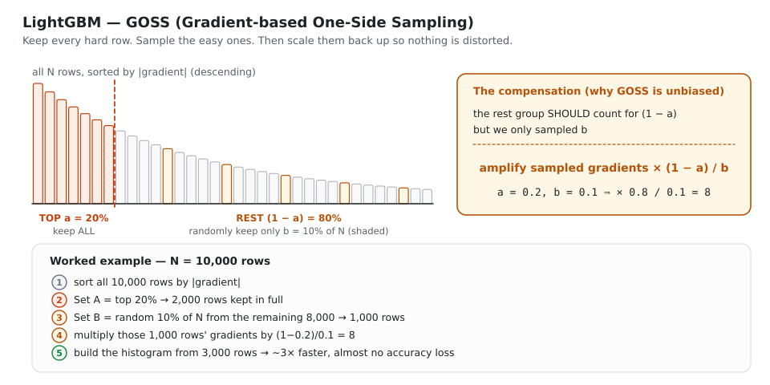
*Keep every large-gradient (hard) row, randomly sample a small slice of the rest, then scale those sampled gradients by (1−a)/b so the gain estimate stays unbiased.*

**Activated by** `boosting_type='goss'`, with `top_rate` ($=a$) and `other_rate` ($=b$).

> 🎤 **Interview one-liner:** "GOSS keeps every row with a large gradient — those are the
> under-trained, informative ones — and randomly samples only a small fraction of the
> small-gradient rows. To stop that sampling from distorting the data distribution, the sampled
> rows' gradients are scaled up by (1−a)/b, which keeps the gain estimate unbiased."

## 1.5 ⭐⭐ EFB — Exclusive Feature Bundling

### The observation

High-dimensional data is usually **very sparse** — think one-hot encoded categories, or
bag-of-words text. And in sparse data, many features are **mutually exclusive**: they are almost
never non-zero at the same time.

The classic case is a one-hot encoded column:

| | `is_Delhi` | `is_Mumbai` | `is_Chennai` |
|---|---|---|---|
| Row 1 | 1 | 0 | 0 |
| Row 2 | 0 | 1 | 0 |
| Row 3 | 0 | 0 | 1 |
| Row 4 | 1 | 0 | 0 |

Exactly **one** is non-zero per row. Those three columns carry no more information than one
column — so why pay for three histograms?

### The merging trick: disjoint value ranges

Give each original feature its own **offset**, so their value ranges never overlap:

$$\text{bundled} = \begin{cases} A & \text{when } A \neq 0 \quad (\text{range } [0,10))\\ B + 10 & \text{when } B \neq 0 \quad (\text{range } [10,30))\\ 0 & \text{when both are } 0 \end{cases}$$

Now a bundled value of 7 can only have come from feature $A$; a value of 23 can only have come
from feature $B$. **The split finder can still recover exactly which feature a value belongs to,
so zero information is lost.**

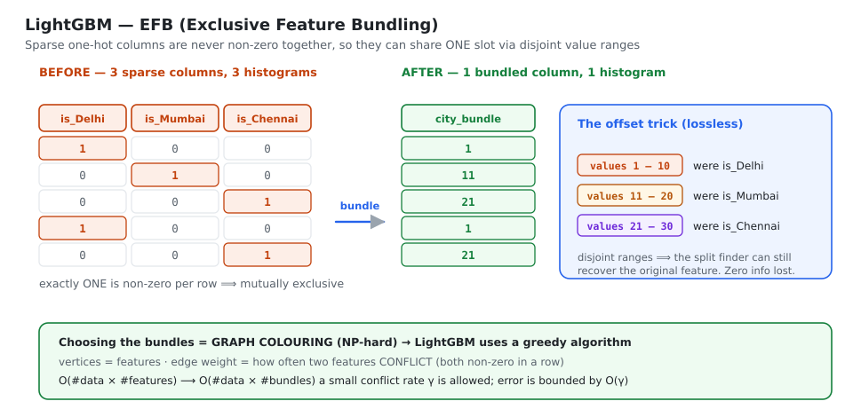
*Three one-hot columns that are never non-zero together become one column. Offsets give each original feature a disjoint value range, so nothing is lost and only one histogram is needed.*

### Sub-problem 1 — which features go into which bundle?

Model it as a graph: each **feature** is a vertex, and an edge between two features is weighted by
how often they **conflict** (both non-zero in the same row). Finding the minimum number of bundles
is **graph colouring**, which is **NP-hard**.

LightGBM uses a **greedy approximation**:

```text
1. build the conflict graph (vertices = features, edge weights = conflict counts)
2. sort vertices by degree, most-conflicting first
3. for each feature in that order:
       try to place it in an EXISTING bundle such that the bundle's
       total conflict stays below max_conflict_rate (γ)
       if no bundle fits -> start a new bundle
```

::: key
⭐ **The clever part: allowing a small conflict rate $\gamma$.** Perfect exclusivity is rare, but
*almost*-exclusive features are everywhere. Permitting a tiny overlap produces far fewer bundles
for a tiny accuracy cost — and the paper proves the error is bounded by $O(\gamma)$.
:::

### Sub-problem 2 — how to merge within a bundle?

The offset trick above (the paper calls it *Merge Exclusive Features*).

### The pay-off

$$\text{before: } O(\#\text{data} \times \#\text{features}) \qquad\longrightarrow\qquad \text{after: } O(\#\text{data} \times \#\text{bundles})$$

with $\#\text{bundles} \ll \#\text{features}$. On a heavily one-hot-encoded dataset this can be a
**10–100× reduction** in effective feature count.

> 🎤 **Interview one-liner:** "EFB bundles mutually exclusive sparse features — ones never
> non-zero together, like one-hot columns — into a single feature by giving each original feature
> a disjoint value range via offsets. Choosing the bundles is graph colouring, so LightGBM solves
> it greedily and even allows a small conflict rate, which drops the histogram cost from
> #features to #bundles."

## 1.6 Native categorical feature handling

LightGBM can split on a categorical column **directly** — no one-hot encoding required.

### Why one-hot is bad for trees

- it creates many sparse columns
- each one-hot column can only ask a **yes/no** question about a single category
- to isolate a *group* like {Chennai, Kolkata}, the tree needs **several levels of depth**,
  burning its depth budget on bookkeeping rather than on real structure

### LightGBM's method (based on Fisher, 1958)

```text
1. for the categorical feature, accumulate each category's Σg and Σh
2. SORT the categories by  Σg / Σh   (their average target behaviour)
3. treat the sorted categories as an ORDERED numeric feature
4. find the best split point along that order
```

Fisher proved that for this kind of objective, the optimal partition of categories into two groups
is always a **contiguous block of the sorted order** — so one sweep in $O(k\log k)$ finds the
globally optimal split, instead of checking all $2^{k-1}-1$ possible partitions.

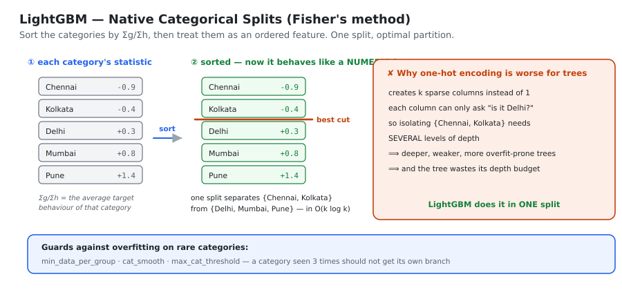
*Sort categories by Σg/Σh, then treat them as numeric. One split separates {Chennai, Kolkata} from the rest — something one-hot encoding would need several levels to achieve.*

```python
import lightgbm as lgb
train = lgb.Dataset(X, label=y, categorical_feature=['city', 'product_type'])
# or, with the sklearn API, simply give those columns the pandas 'category' dtype
```

**Guards against overfitting on rare categories:** `min_data_per_group`, `cat_smooth`,
`max_cat_threshold`. A category seen three times should not be allowed its own branch.

## 1.7 Architecture

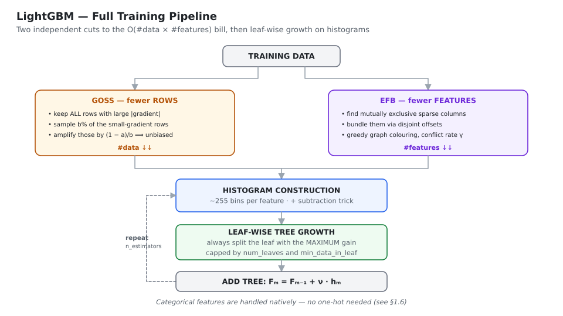
*GOSS cuts the rows, EFB cuts the features, histograms make split finding cheap, and leaf-wise growth spends the leaf budget where it buys the most.*

## 1.8 Hyperparameters

### Core
| Parameter | Default | Guidance |
|---|---|---|
| **`num_leaves`** | 31 | ⭐ **the most important one.** Keep $<2^{\texttt{max\_depth}}$ |
| `max_depth` | −1 (no limit) | set it to tame leaf-wise growth on small data |
| `learning_rate` | 0.1 | lower it (0.01–0.05) and raise `n_estimators` |
| `n_estimators` | 100 | go high and use early stopping |
| **`min_data_in_leaf`** | 20 | ⭐ **raise it on small data** (50–100) to stop overfitting |
| `min_sum_hessian_in_leaf` | 1e-3 | the Hessian-weighted version of the above |

### Sampling and speed
| Parameter | Meaning |
|---|---|
| `boosting_type` | `'gbdt'` (default), `'goss'`, `'dart'`, `'rf'` |
| `bagging_fraction` + `bagging_freq` | row subsampling (both must be set for it to take effect) |
| `feature_fraction` | column subsampling per tree |
| `max_bin` | 255. Lower = faster and more regularised, slightly less accurate |

### Regularisation
| Parameter | Meaning |
|---|---|
| `lambda_l1`, `lambda_l2` | L1 / L2 on leaf weights |
| `min_gain_to_split` | LightGBM's equivalent of XGBoost's `gamma` |
| `path_smooth` | shrinks leaf values toward their parent — helps on small data |

```python
import lightgbm as lgb

model = lgb.LGBMClassifier(
    num_leaves=31,            # keep < 2**max_depth
    max_depth=7,
    learning_rate=0.05,
    n_estimators=2000,        # early stopping picks the real number
    min_child_samples=30,     # = min_data_in_leaf; raise on small data
    subsample=0.8, subsample_freq=1,
    colsample_bytree=0.8,
    reg_lambda=1.0,
    n_jobs=-1,
    random_state=42,
)
model.fit(
    X_train, y_train,
    eval_set=[(X_val, y_val)],
    eval_metric='auc',
    callbacks=[lgb.early_stopping(100), lgb.log_evaluation(0)],
)
```

## 1.9 Strengths and weaknesses

| ✔ Strengths | ✘ Weaknesses |
|---|---|
| **Very fast** — often several times quicker than XGBoost's exact mode | **Overfits small datasets** (< ~10k rows) because of leaf-wise growth |
| **Low memory** — one-byte bin ids, bundled features | Needs careful `num_leaves` / `min_data_in_leaf` tuning |
| **Native categorical support** | More hyperparameter-sensitive than Random Forest |
| Leaf-wise growth reaches lower loss with fewer trees | Unbalanced trees are harder to interpret |
| Scales to very large data; distributed and GPU support | Results can shift slightly between versions |
| Handles missing values automatically | GOSS is not always a win — on small data, use plain `gbdt` |

---

# CHAPTER 2 — CatBoost

> **CatBoost = Categorical Boosting.** Built by **Yandex**; paper at **NeurIPS 2018**.
> Its two headline ideas — **Ordered Target Statistics** and **Ordered Boosting** — are both
> attacks on the *same* underlying bug. Its trees are **symmetric (oblivious)**.

## 2.1 The one bug CatBoost is built around: TARGET LEAKAGE

Before any of the machinery, understand the disease it cures.

::: key
⭐ **The bug.** In standard gradient boosting, a data point's **own label** is used — directly or
indirectly — to build the model that will later be asked to predict that same point. The model
therefore looks better on training data than it can possibly be on new data, and the error it
computes during training is **systematically wrong**.
:::

It shows up in two separate places:

| Where | Name of the symptom | CatBoost's fix |
|---|---|---|
| In the **features**, when encoding categories by their target mean | target leakage / **conditional shift** | **Ordered Target Statistics** |
| In the **gradients**, when computing residuals | **prediction shift** | **Ordered Boosting** |

Both fixes use the same device: a **random permutation** that gives every row an artificial
"arrival time", after which a row may only use information from rows that arrived **before** it.
The idea is borrowed from **online learning**, where you genuinely cannot see the future.

## 2.2 Handling categorical features — the road to Ordered TS

### Option 1 — One-hot encoding
```text
City  ->  is_Delhi, is_Mumbai, is_Chennai, ...
```
✘ Explodes the feature count for high-cardinality columns (think 50,000 user IDs).
✘ Each column supports only a weak, unbalanced split.

### Option 2 — Label / ordinal encoding
```text
Delhi -> 0,  Mumbai -> 1,  Chennai -> 2
```
✘ Invents a **fake ordering**. The tree can now split on "city < 1.5", which asserts that
Chennai > Mumbai > Delhi — a statement with no meaning.

### Option 3 — Target Statistics (the good idea)

Replace each category with the **average target value** for that category. With smoothing, to
handle rare categories:

$$\hat x_i \;=\; \frac{\sum_{j \in \text{same category}} y_j \;+\; a \cdot P}{\text{count of that category} \;+\; a}$$

| Symbol | Meaning |
|---|---|
| $a > 0$ | smoothing weight — how strongly to pull toward the prior |
| $P$ | the prior, usually the global mean of the target |

✔ One column instead of hundreds, and it works at any cardinality.
✘ **But it leaks the target.**

### ⭐ The leakage, made concrete

If you compute the statistic for row $i$ from a dataset that **includes row $i$'s own label**, the
encoded value secretly contains $y_i$.

The killer case: suppose the categorical feature is close to a **unique ID**, so each category
appears exactly once. Then

$$\hat x_i \;=\; \frac{y_i + a\cdot P}{1 + a}$$

which is just a rescaled copy of $y_i$. The tree finds one "perfect" split on this feature, gets
**100% training accuracy**, and is **completely useless** on test data where the IDs are new.

This is **target leakage**, and the resulting mismatch between training and test distributions is
called **conditional shift**.

### Attempts that do not work

| Approach | How | Why it still fails |
|---|---|---|
| **Greedy TS** | use all rows, including row $i$ | **leaks** — as above |
| **Holdout TS** | split the data; compute the statistic on part A, train on part B | **wastes data** — part A can't be trained on, part B can't be encoded from |
| **Leave-one-out TS** | use every row **except** $i$ | **still leaks.** For a binary target the model can algebraically invert the statistic and recover $y_i$ |

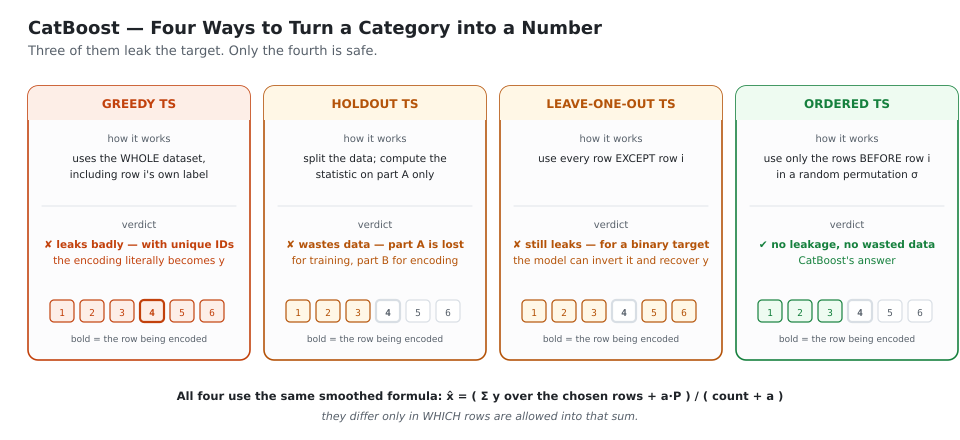
*All four use the same smoothed formula. They differ only in which rows are allowed into the sum — and three of the four let the row's own label in.*

### ⭐⭐ Ordered Target Statistics

::: algo
**ORDERED TARGET STATISTICS**

**Step 1** — draw a random permutation $\sigma$ of the training rows. This is an artificial
"arrival time".

**Step 2** — for the row at position $k$, compute its statistic using **only the rows at positions
$1\dots k-1$** that share the same category:

$$\hat x_k \;=\; \frac{\sum_{j<k,\;x_j = x_k} y_j \;+\; a\cdot P}{\big|\{\,j<k : x_j = x_k\,\}\big| \;+\; a}$$

**Step 3** — row $k$'s own label $y_k$ is **never** used. **No leakage.** ✔
:::

**Worked illustration** — category "Delhi", binary target, $a = 1$, $P = 0.5$:

| Position in $\sigma$ | city | $y$ | history of "Delhi" so far | TS used for this row |
|---|---|---|---|---|
| 1 | Delhi | 1 | (none) | $(0+1\times0.5)/(0+1) = 0.500$ |
| 2 | Mumbai | 0 | — | — |
| 3 | Delhi | 1 | $[1]$ | $(1+0.5)/(1+1) = 0.750$ |
| 4 | Delhi | 0 | $[1,1]$ | $(2+0.5)/(2+1) = 0.833$ |
| 5 | Delhi | 1 | $[1,1,0]$ | $(2+0.5)/(3+1) = 0.625$ |

In every row the value is built only from the rows **above** it. The row's own label never enters.

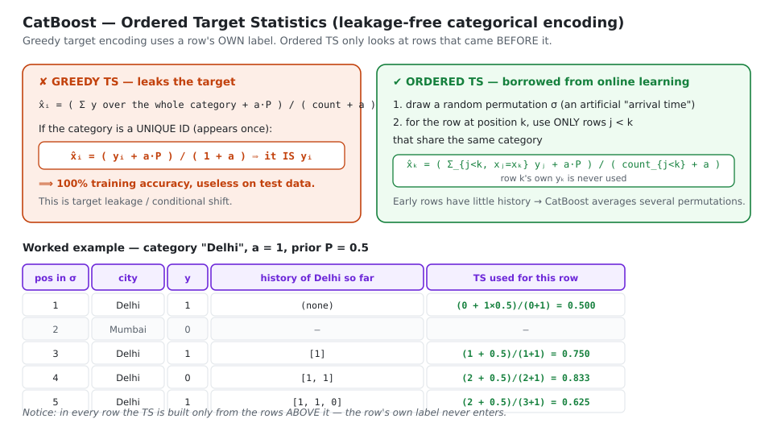
*Greedy target encoding leaks the label; with unique IDs the encoding literally becomes y. Ordered TS computes each row's statistic from only the rows that came before it in a random permutation.*

**The residual problem, and its fix.** Rows early in the permutation have almost no history, so
their statistics are **high variance** (row 1 above gets nothing but the prior). CatBoost
therefore maintains **several different random permutations** (4 by default) and averages across
them, so no row is unlucky in every permutation.

## 2.3 ⭐⭐ Ordered Boosting — fixing prediction shift

### The problem

Look again at the standard gradient boosting loop from Book 2:

$$\text{Step 1: } r_i = y_i - F_{m-1}(x_i) \qquad \text{Step 2: fit } h_m \text{ to those } r_i$$

**The hidden bug:** $F_{m-1}$ was trained on a dataset that **includes row $i$**. So
$F_{m-1}(x_i)$ is an *in-sample* prediction — unrealistically good. The residual $r_i$ is
therefore **too small**, and biased. The next tree is fitted to systematically distorted targets.

Over hundreds of rounds this compounds:

$$\text{model sees its own point} \rightarrow \text{residual too small} \rightarrow \text{next tree learns a distorted signal}$$

The distribution of gradients during training no longer matches the distribution at test time.
That gap is called **prediction shift**. It is precisely the same disease as Greedy TS, only
appearing in the gradients instead of the features.

### The fix: the same medicine

::: algo
**ORDERED BOOSTING**

**Step 1** — take a random permutation $\sigma$ of the training data.

**Step 2** — maintain a set of **supporting models** $M_1, M_2, \dots, M_n$, where $M_k$ is
trained **only on the first $k$ rows** of the permutation.

**Step 3** — to get the residual for the row at position $k$:

$$r_k \;=\; y_k - M_{k-1}(x_k)$$

$M_{k-1}$ has **never seen row $k$**, so the residual is unbiased ✔

**Step 4** — fit the new tree on these unbiased residuals.
:::

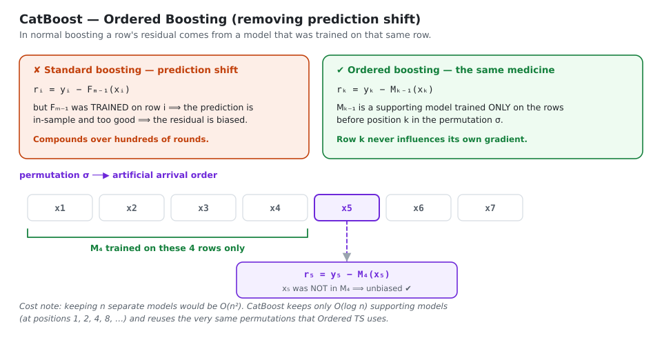
*Row 5's residual is computed with M₄ — a model trained only on rows 1–4 — so row 5 never influences its own gradient.*

### Making it affordable

Keeping $n$ separate models would cost $O(n^2)$ in time and memory — hopeless. CatBoost keeps only
$O(\log n)$ supporting models, at permutation positions $1, 2, 4, 8, 16, \dots$, and reuses the
**same permutations** that Ordered TS already needs. That brings the cost back to roughly the same
order as ordinary boosting.

### Two modes

| Mode | When to use |
|---|---|
| **`Ordered`** | small datasets (< ~50k rows). Slower, but markedly less overfitting |
| **`Plain`** | large datasets. The classic boosting scheme — but Ordered TS is still active |

> 🎤 **Interview one-liner:** "In standard boosting the residual for a point is computed by a model
> that was trained on that same point, so the residual is biased — that is prediction shift.
> Ordered boosting imposes a random permutation and computes each point's residual with a model
> trained only on the points before it, so no point ever influences its own gradient."

## 2.4 ⭐ Symmetric (oblivious) trees

> **Definition:** in a **symmetric** (or **oblivious**) tree, **every node at the same depth uses
> the same feature and the same split condition.**

A normal tree picks an independent split at each node. An oblivious tree asks **one question per
level**, applied to the whole level.

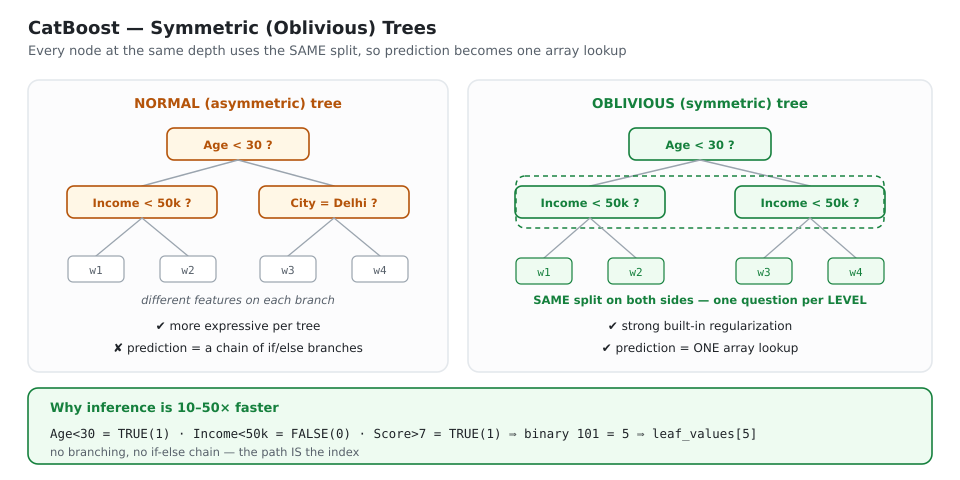
*Every node at a given depth asks the same question, so the path through the tree is just a bit-vector — and prediction collapses into a single array lookup.*

### Why prediction becomes a lookup table

Because each level asks the same question, a row's path is simply a sequence of yes/no answers —
a **binary number** — which indexes directly into the leaf array:

```text
depth-3 oblivious tree  ->  2³ = 8 leaves

row: Age<30 = TRUE(1),  Income<50k = FALSE(0),  Score>7 = TRUE(1)
     -> binary 101 -> decimal 5 -> leaf_values[5]

no branching, no if/else chain — the path IS the index
```

### Advantages

| Advantage | Why |
|---|---|
| **Extremely fast inference** | a tree becomes one array index. CatBoost prediction is often an order of magnitude faster than XGBoost/LightGBM |
| **Strong built-in regularisation** | forcing one split per level is a severe constraint — the tree simply cannot chase noise the way a free-form tree can |
| **CPU/GPU friendly** | branch-free and vectorisable; no unpredictable jumps |
| **Small model size** | per tree you store only `depth` split conditions and $2^{\text{depth}}$ leaf values |
| **Balanced by construction** | always a complete binary tree |

### The disadvantage

✘ **Less expressive per tree.** A normal tree can use different features on different branches;
an oblivious tree cannot. CatBoost compensates by building **more trees** — which is affordable
precisely because each one is so cheap to evaluate. Its defaults reflect this: `depth=6`,
`iterations=1000`.

> 🎤 **Interview one-liner:** "CatBoost uses oblivious trees, where every node at a given depth
> shares the same split. That makes each tree weaker but acts as built-in regularisation, and
> prediction becomes a single array lookup indexed by the bit-vector of the split answers — which
> is why CatBoost inference is dramatically faster."

## 2.5 Automatic feature combinations

CatBoost also builds **combinations of categorical features** by itself:

$$\texttt{city} \;\times\; \texttt{device} \;\longrightarrow\; \texttt{city\_device}$$

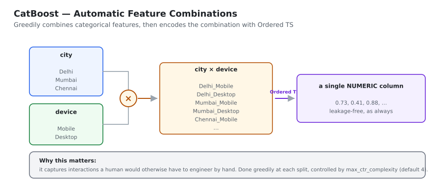
*Two categorical columns are crossed into one, then encoded with Ordered TS like any other category.*

- Done **greedily**: at each split, CatBoost considers combining the categorical features already
  used in the current tree with every other categorical feature.
- The combination is then converted to a number using **Ordered TS** — the same leakage-free rule.
- This captures interactions that a human would otherwise have to engineer by hand.

Controlled by `max_ctr_complexity` (default 4 — i.e. up to 4-way combinations).

## 2.6 Architecture

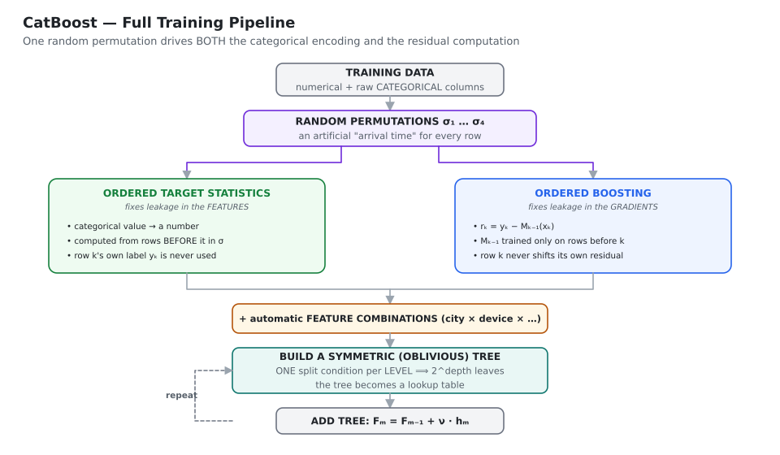
*One set of random permutations drives both the categorical encoding and the residual computation; the trees built on top are symmetric.*

## 2.7 ⭐ The three "Ordered" ideas — don't mix them up

| Name | Problem it solves | Mechanism |
|---|---|---|
| **Greedy TS** | *(the broken baseline)* | uses all rows including row $i$ → **leaks** |
| **Ordered TS** | leakage in the **categorical encoding** | row $k$'s statistic uses only rows **before $k$** in $\sigma$ |
| **Ordered Boosting** | prediction shift in the **residuals / gradients** | row $k$'s residual uses $M_{k-1}$, trained only on rows before $k$ |

Both fixes use the **same permutations**. One cleans the **features**; the other cleans the
**gradients**.

## 2.8 Hyperparameters

| Parameter | Default | Meaning |
|---|---|---|
| `iterations` | 1000 | number of trees |
| `learning_rate` | auto | CatBoost picks a sensible value from the data size |
| `depth` | **6** | tree depth. Because trees are symmetric, useful range is 6–10 |
| `l2_leaf_reg` | 3.0 | **L2** on leaf values |
| `boosting_type` | `Ordered` (small data) / `Plain` (large) | ordered boosting on or off |
| **`cat_features`** | — | ⭐ indices or names of the categorical columns. **Pass raw strings** |
| `one_hot_max_size` | 2 | categories with at most this many levels get one-hot instead of TS |
| `max_ctr_complexity` | 4 | maximum number of features combined together |
| `random_strength` | 1 | noise added to split scores — another regulariser |
| `bagging_temperature` | 1 | Bayesian bootstrap intensity |
| `border_count` | 254 | histogram bins for numeric features |
| `auto_class_weights` | None | `'Balanced'` for imbalanced targets |
| `task_type` | `'CPU'` | set `'GPU'` to train on a graphics card |

```python
from catboost import CatBoostClassifier, Pool

model = CatBoostClassifier(
    iterations=2000,
    learning_rate=0.05,
    depth=6,
    l2_leaf_reg=3,
    cat_features=['city', 'device', 'product_type'],   # RAW STRINGS — no encoding!
    eval_metric='AUC',
    early_stopping_rounds=100,
    random_seed=42,
    verbose=200,
)
model.fit(X_train, y_train, eval_set=(X_val, y_val))
```

> 💡 **The selling point:** you hand CatBoost the categorical columns as plain text. No
> `LabelEncoder`, no `get_dummies`, and — most importantly — no hand-rolled target encoding,
> which is where people silently leak the target.

## 2.9 Strengths and weaknesses

| ✔ Strengths | ✘ Weaknesses |
|---|---|
| **Best-in-class categorical handling** — no manual encoding, no leakage | **Slower to train** than LightGBM (ordered boosting is expensive) |
| **Ordered boosting** removes prediction shift → less overfitting | Higher memory during training (permutations + supporting models) |
| **Excellent defaults** — often competitive with almost no tuning | Oblivious trees are less expressive per tree |
| **Very fast inference** (oblivious trees = lookup tables) | Smaller community, fewer tutorials than XGBoost |
| Automatic feature combinations capture interactions | Overkill when the data has no categorical features |
| Robust on small datasets | Fewer third-party integrations |
| Built-in GPU training, SHAP values, text and embedding features | |

---

# CHAPTER 3 — Stacking and Blending

> **Stacking (stacked generalization)** trains several **different** base models and then trains
> **another model** — the **meta-model** — to learn how best to combine their predictions.
> It is the technique behind a large share of Kaggle-winning solutions.

## 3.1 From voting to stacking

Recall voting from Book 1: three models predict 3.5, 4.1 and 2.7 LPA, and we take the mean, 3.43.
The combination rule is **fixed in advance** — we decided to average.

::: key
⭐ **Stacking's idea:** instead of a fixed rule, feed the base models' outputs in as **input
features** to another machine learning model, and let **that** model learn the best way to
combine them.
:::

The new dataset looks like this:

| `LR_pred` | `DT_pred` | `KNN_pred` | **target** |
|---|---|---|---|
| 3.7 | 4.1 | 2.5 | 3.5 |
| … | … | … | … |

**What can a meta-model learn that an average cannot?** Several useful things:
it can learn that the KNN is reliable only when the other two agree; that the decision tree is
systematically biased low and should be shifted up; that the linear model should be trusted in one
region of the feature space and ignored in another. An average can express none of that.

| Term | Meaning |
|---|---|
| **Level-0 / base models** | the first layer: LR, DT, KNN, SVM, RF… |
| **Level-1 / meta model** | the model trained on the base models' predictions |
| **Meta-features** | those predictions, used as input columns |

## 3.2 ⚠️ The leakage problem — and why naive stacking fails

The obvious implementation is wrong, and understanding **why** is the most commonly asked question
about stacking.

```text
1. train base models on the training data
2. ask them to predict on THAT SAME training data
3. use those predictions as meta-features
4. train the meta model on them
```

**What goes wrong:**

1. The base models have already **seen** this data.
2. Their predictions on it are **unrealistically good** — a fully grown decision tree may be
   essentially perfect on its own training rows.
3. The meta model therefore learns *"the decision tree is always right — just copy it."*
4. In production the base models face **unseen** data and are far worse.
5. The meta model, which learned to trust them blindly, **fails badly**.

The meta model has been trained on a picture of the base models that will never occur again.

## 3.3 Solution 1 — Blending (the hold-out method)

Train the base models on one part of the data, and generate meta-features on a **different,
unseen** part.

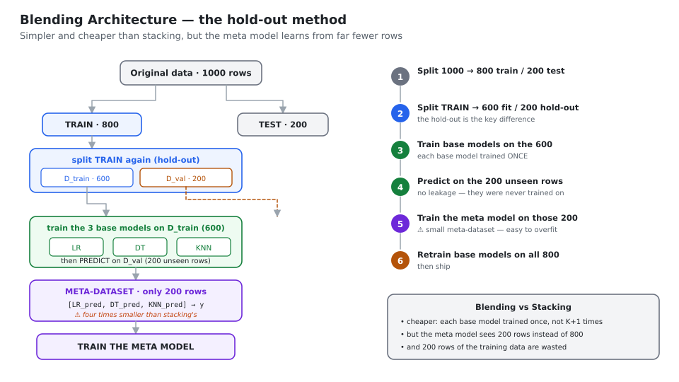
*Base models are fitted on 600 rows and predict on 200 rows they have never seen — so the meta-features are honest.*

::: algo
**BLENDING** — the hold-out method

**Step 1** — split: 1000 rows → **800 train**, 200 test

**Step 2** — split the train set again: **600** ($D_{\text{train}}$) and **200** ($D_{\text{val}}$)

**Step 3** — train the base models $M_1, M_2, M_3$ on the 600

**Step 4** — run them on the 200 unseen $D_{\text{val}}$ rows → a **200-row meta-dataset**

**Step 5** — train the meta model on those 200 rows

**Step 6** — **retrain** the base models on the full 800 rows

**Step 7** — predict: test row → retrained base models → meta model → final answer
:::

**Why it works:** the base models never saw $D_{\text{val}}$, so their predictions there are
realistic. No leakage.

**What it costs:** the meta model learns from only **200 rows**, and the base models that generated
those predictions saw only 600 rows — weaker than the ones that will actually be deployed.
**Data is wasted on both sides.**

## 3.4 Solution 2 — Stacking (the K-fold method)

The proper approach. It uses **out-of-fold (OOF) predictions**.

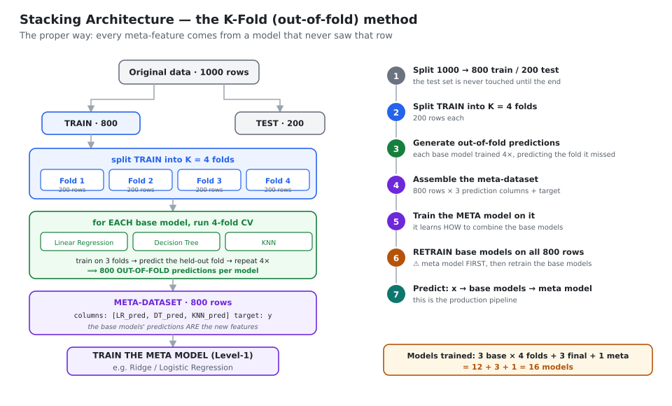
*Every row of the meta-dataset comes from a model that never trained on that row — and no data is wasted.*

### Generating out-of-fold predictions

With $K=4$ folds of 200 rows each, for **one** base model:

| Iteration | Train on | Predict on | Output |
|---|---|---|---|
| 1 | folds 2, 3, 4 (600 rows) | fold 1 (200) | `LR_pred₁` |
| 2 | folds 1, 3, 4 (600 rows) | fold 2 (200) | `LR_pred₂` |
| 3 | folds 1, 2, 4 (600 rows) | fold 3 (200) | `LR_pred₃` |
| 4 | folds 1, 2, 3 (600 rows) | fold 4 (200) | `LR_pred₄` |

Concatenating gives $200\times4 = 800$ predictions — **one for every training row**, each produced
by a model that did **not** see that row.

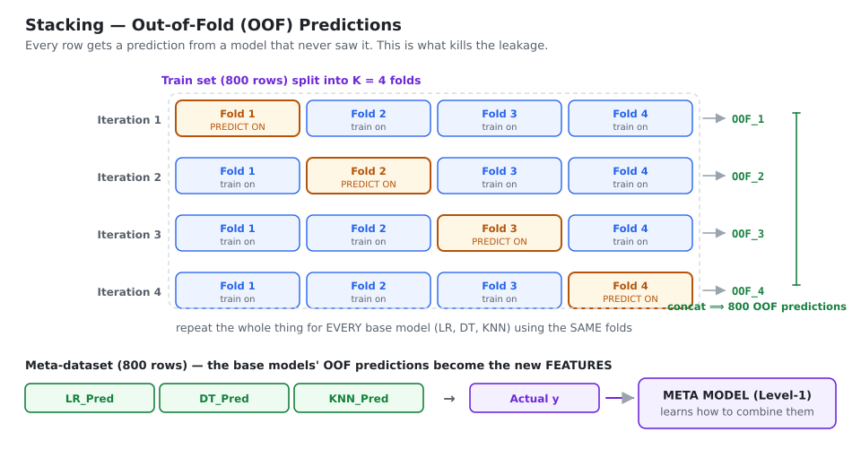
*Each fold is predicted by a model trained on the other three.*

Repeat the whole thing for each base model, **using the same folds**, and assemble:

| `LR_pred` | `DT_pred` | `KNN_pred` | target |
|---|---|---|---|
| 800 rows | 800 rows | 800 rows | 800 rows |

Then: **train the meta model on this 800-row dataset first**, and **afterwards** retrain all base
models on the full 800 rows for production.

> ⚠️ **Order matters and is a favourite question:** the meta model is trained on the OOF
> predictions **first**; the base models are retrained on all the data **second**. If you retrained
> first and then generated meta-features, you would be straight back to the leakage of §3.2.

### Counting the models

| Model | During CV | Final |
|---|---|---|
| Linear Regression | 4 | 1 |
| Decision Tree | 4 | 1 |
| KNN | 4 | 1 |
| Meta model | — | 1 |
| **Total** | **12** | **4** |

$$\textbf{grand total} = 12 + 4 = \mathbf{16}\ \text{models}$$

> **The rule:** each base model is trained **$K$ times during CV, plus once on the full data.**

## 3.5 ⭐ Blending vs Stacking

Many people call everything "stacking", but the distinction is asked.

| | **Blending** | **Stacking** |
|---|---|---|
| Technique | a simple train/validation hold-out | **K-fold cross-validation** |
| Meta-features come from | one hold-out set | **out-of-fold predictions** |
| Meta-dataset size | small (200 rows) | **the full train set (800 rows)** |
| Data efficiency | wasteful | **efficient** |
| Computation | **cheap** — each base model trained once | expensive — $K+1$ times each |
| Risk | meta model overfits the small hold-out | lower |
| Implementation | **simpler** | more code (but `StackingClassifier` does it for you) |

## 3.6 Multi-layer stacking

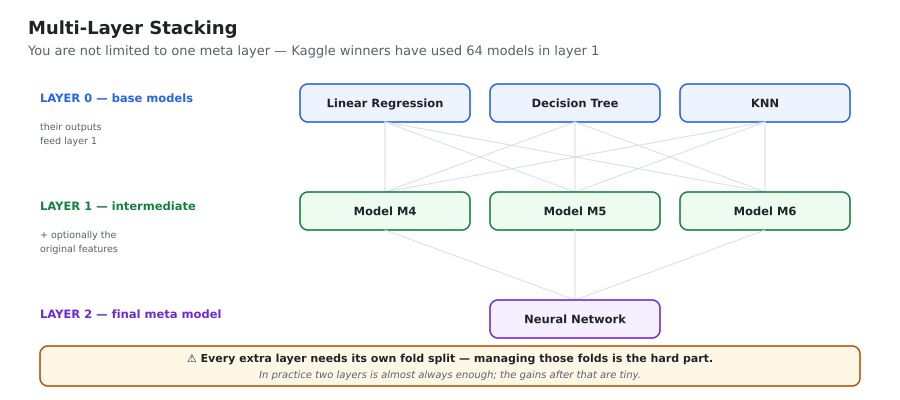
*Layer 0 feeds layer 1, which feeds a final meta model. Each extra layer needs its own fold management.*

A Kaggle-winning architecture by Jeong-Yoon Lee used **64 models in layer 1 and 10 in layer 2**.
In normal work, two layers is almost always enough — returns drop off sharply, and the fold
bookkeeping gets painful.

## 3.7 Practical rules for stacking

| Rule | Why |
|---|---|
| Make the base models **diverse** — a tree model, a linear model, a distance-based model, maybe a neural net | correlated base models give the meta model nothing to learn |
| Keep the meta model **simple** — Ridge, Logistic Regression, or a shallow tree | the meta-dataset is small and has few columns; a complex meta model overfits it immediately |
| For classification, feed **probabilities**, not labels | far more information per column |
| Consider adding the **original features** to the meta-dataset (`passthrough=True`) | lets the meta model learn *when* to trust each base model, not just *how much* |
| Use the **same folds** for every base model | otherwise the meta-features are inconsistent with one another |
| Keep the test set completely untouched until the very end | stacking has many moving parts and it is easy to leak |

```python
from sklearn.ensemble import StackingRegressor, StackingClassifier
from sklearn.linear_model import RidgeCV

stack = StackingRegressor(
    estimators=[('lr',  LinearRegression()),
                ('dt',  DecisionTreeRegressor(max_depth=5)),
                ('knn', KNeighborsRegressor())],
    final_estimator=RidgeCV(),   # keep the META model simple
    cv=5,                        # K-fold -> proper STACKING (not blending)
    passthrough=False,           # True also feeds the original features to the meta model
    n_jobs=-1,
)
stack.fit(X_train, y_train)
```

## 3.8 Stacking vs Bagging vs Boosting

| | Bagging | Boosting | Stacking |
|---|---|---|---|
| Base models | same algorithm | same algorithm | **different algorithms** |
| Data | bootstrap samples | re-weighted / residuals | same data, via CV folds |
| Training | parallel | sequential | parallel + a meta layer |
| Combination | fixed (vote / mean) | weighted sum | **a learned meta-model** |
| Main goal | ↓ variance | ↓ bias | exploit **model diversity** |

> 🎤 **Interview one-liner:** "Stacking trains a meta-model on the base models' predictions. The
> danger is leakage — if the base models predict on data they were trained on, the meta-features
> are over-optimistic and the meta model learns to trust them blindly. The fix is out-of-fold
> predictions via K-fold CV (stacking) or a separate hold-out set (blending). The meta-model is
> trained first, then the base models are refitted on the full data for production."

---

# CHAPTER 4 — Choosing, Tuning and Shipping

## 4.1 Which algorithm should I pick?

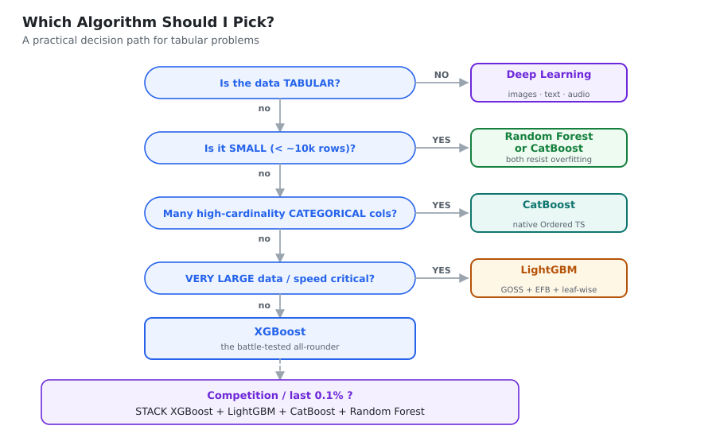
*A practical decision path for tabular problems.*

| Situation | Reach for | Why |
|---|---|---|
| Small data (< ~10k rows) | **CatBoost** or **Random Forest** | both resist overfitting; LightGBM's leaf-wise growth is dangerous here |
| Many high-cardinality categorical columns | **CatBoost** | Ordered TS, with no hand-rolled encoding to leak |
| Millions of rows, speed matters | **LightGBM** | GOSS + EFB + leaf-wise |
| A reliable, well-documented default | **XGBoost** | the most mature tooling and the largest community |
| Need a strong baseline in five minutes, with interpretable importances | **Random Forest** | good defaults, free OOB score, very hard to break |
| Competition / the last 0.1% | **stack** XGBoost + LightGBM + CatBoost + RF | they make different errors, which is exactly what a meta model can exploit |
| Images, text, audio | **not these** — use deep learning | tree ensembles need tabular features |
| You must extrapolate beyond the training range | **not these** — use a linear/parametric model | tree predictions are averages of training labels |

## 4.2 Controlling overfitting in boosting

| Lever | Direction | Effect |
|---|---|---|
| `learning_rate` | **↓** (0.01–0.05) | the single most effective control. Smaller steps generalise better |
| `n_estimators` | ↑ **with early stopping** | lets a small learning rate converge without overshooting |
| `max_depth` / `num_leaves` | **↓** | simpler trees, lower-order interactions |
| `min_child_weight` / `min_data_in_leaf` | **↑** | leaves need more support, so they can't chase single points |
| `subsample` | ↓ to 0.5–0.8 | stochastic boosting — adds bagging-style variance reduction |
| `colsample_bytree` | ↓ to 0.5–0.8 | decorrelates the trees, like Random Forest's trick |
| `reg_lambda` (L2), `reg_alpha` (L1) | **↑** | shrinks leaf values |
| `gamma` / `min_gain_to_split` | **↑** | prunes splits that don't earn their place |

::: key
⭐ **The rule to remember: low learning rate + many trees + early stopping.**
Everything else is fine-tuning around that.
:::

```python
model.fit(X_train, y_train,
          eval_set=[(X_val, y_val)],
          early_stopping_rounds=100)   # stop when validation stops improving
```

## 4.3 A tuning order that works

```text
1. fix learning_rate = 0.1, find a reasonable n_estimators with early stopping
2. tune the tree shape:    max_depth / num_leaves,  min_child_weight
3. tune the randomness:    subsample,  colsample_bytree
4. tune regularisation:    reg_lambda,  reg_alpha,  gamma
5. finally LOWER learning_rate to 0.01-0.05 and raise n_estimators proportionally
6. optionally: average or stack several tuned models with different seeds
```

Use **RandomizedSearchCV** for the coarse pass and **GridSearchCV** to refine around the winner.
For serious work use **Optuna** — Bayesian search finds good regions far faster than grid search,
because only two or three hyperparameters usually matter and grid search wastes its budget on the
rest.

## 4.4 Imbalanced data

| Method | How |
|---|---|
| **Class weights** | RF: `class_weight='balanced'` · XGB/LGBM: `scale_pos_weight = n_neg/n_pos` · CatBoost: `auto_class_weights='Balanced'` |
| **Resampling** | SMOTE / ADASYN to oversample the minority; random undersampling of the majority |
| **Threshold tuning** | don't use 0.5 — pick the threshold that maximises F1, or the one that matches your cost ratio |
| **The right metric** | ⚠️ **never accuracy.** Use **ROC-AUC**, **PR-AUC** (better when the positive class is rare), **F1**, or recall at a fixed precision |
| **The right CV** | **StratifiedKFold**, so every fold keeps the class ratio |

> A 99%-negative dataset gives 99% accuracy to a model that predicts "negative" always. If an
> interviewer gives you an imbalanced problem, say this before anything else.

## 4.5 Missing values

| Algorithm | Handling |
|---|---|
| **Random Forest (sklearn)** | ❌ not supported — impute first |
| **XGBoost** | ✔ **sparsity-aware split finding** — learns a default direction per split |
| **LightGBM** | ✔ same idea (`use_missing=True`); can also put them in a dedicated bin |
| **CatBoost** | ✔ `nan_mode`: `'Min'` or `'Max'` — treats NaN as smaller/larger than every real value |

A useful extra trick regardless of library: add a binary **`was_missing`** indicator column. If
the *fact* of being missing carries signal (it very often does), the model can then use it
explicitly.

## 4.6 Feature importance — which method when

| Method | Speed | Bias | Use when |
|---|---|---|---|
| **MDI** (`feature_importances_`) | fastest | ⚠️ favours **high-cardinality** features | a quick first look |
| **Permutation** | medium | unbiased by cardinality; confused by correlated features | real feature selection |
| **SHAP** | slowest | best — per-row, signed, theoretically grounded | explaining individual decisions to people |

## 4.7 Common mistakes

| ❌ Mistake | ✔ What to do instead |
|---|---|
| Bagging a Linear Regression | bagging only helps **high-variance** models |
| "RF differs from bagging because it only uses trees" | the real difference is **node-level vs tree-level** column sampling |
| Leaving LightGBM's `num_leaves` high on small data | keep $<2^{\texttt{max\_depth}}$ and raise `min_data_in_leaf` |
| Stacking with in-sample base predictions | use **out-of-fold** predictions |
| Target-encoding categories using the whole dataset | use **Ordered TS** (CatBoost) or out-of-fold target encoding |
| Tuning on accuracy with imbalanced data | use ROC-AUC / PR-AUC / F1 |
| Adding more trees to fix a boosting overfit | **lower the learning rate** and use early stopping |
| Expecting a tree ensemble to extrapolate | it cannot — predictions are bounded by the training targets |
| One-hot encoding a 50,000-level ID column | use CatBoost's Ordered TS, or hash / drop it |
| Tuning on the test set | keep it sealed; tune on validation or CV |

---

# APPENDIX C — Master Comparison, Cheat Sheet and Q&A

## C.1 ⭐⭐ Master comparison table

| | **Random Forest** | **AdaBoost** | **Gradient Boosting** | **XGBoost** | **LightGBM** | **CatBoost** |
|---|---|---|---|---|---|---|
| **Family** | Bagging | Boosting | Boosting | Boosting | Boosting | Boosting |
| **Training** | parallel | sequential | sequential | sequential (parallel *within* a tree) | sequential | sequential |
| **Base learner** | deep trees | stumps (depth 1) | trees, 8–32 leaves | trees, depth ~6 | leaf-wise trees | **symmetric / oblivious** trees |
| **Reduces** | variance | bias | bias | bias | bias | bias |
| **Tree growth** | — | — | level-wise | level-wise | **leaf-wise** | **symmetric** |
| **Split criterion** | Gini / Entropy / MSE | weighted error | MSE on residuals | **Similarity Score / Gain** | Gain on histograms | Gain on histograms |
| **Errors handled by** | — | re-weighting rows | fitting residuals | fitting residuals (2nd order) | fitting residuals (2nd order) | **ordered boosting** |
| **Regularisation** | depth, min samples | learning rate | learning rate, subsample | **L1 + L2 + γ in the objective** | L1 + L2 + `num_leaves` | **L2 + ordered boosting + symmetry** |
| **Categorical** | needs encoding | needs encoding | needs encoding | needs encoding | ✔ **native** | ✔✔ **best (Ordered TS)** |
| **Missing values** | ❌ impute | ❌ impute | ❌ impute | ✔ automatic | ✔ automatic | ✔ automatic |
| **Train speed** | fast | fast | **slow** | fast | ⚡ **fastest** | slower |
| **Predict speed** | medium | fast | fast | fast | fast | ⚡ **fastest** |
| **Small data** | ✔ good | ✔ good | ✔ ok | ✔ ok | ⚠️ overfits | ✔✔ **best** |
| **Big data** | ⚠️ memory | ⚠️ | ❌ slow | ✔ good | ✔✔ **best** | ✔ good |
| **Overfit risk** | **low** | medium | high | medium | **high** | **low** |
| **Tuning effort** | **low** | low | high | **high** | high | ✔ **low (great defaults)** |
| **Outlier sensitivity** | low | **high** | medium | medium | medium | medium |

## C.2 LightGBM vs CatBoost vs XGBoost — the short version

| | **XGBoost** | **LightGBM** | **CatBoost** |
|---|---|---|---|
| Made by | Tianqi Chen (2014) | Microsoft (2017) | Yandex (2018) |
| Headline idea | regularized 2nd-order objective | **GOSS + EFB + leaf-wise** | **Ordered TS + Ordered Boosting + oblivious trees** |
| Trees grow | level-wise | **leaf-wise** | **symmetric** |
| Best at | reliability, tooling | **raw speed on big data** | **categorical data, small data, fast inference** |
| Weak at | speed vs LightGBM | small data | training speed |
| The knob that matters most | `max_depth`, `learning_rate` | **`num_leaves`**, `min_data_in_leaf` | `depth`, `l2_leaf_reg` (defaults are good) |

## C.3 Formula cheat sheet

**LightGBM**
$$\text{GOSS amplification} = \frac{1-a}{b} \qquad (a=\texttt{top\_rate},\; b=\texttt{other\_rate})$$
$$\text{EFB: } O(\#\text{data}\times\#\text{features}) \to O(\#\text{data}\times\#\text{bundles})$$
$$\text{histogram subtraction: } H(\text{big child}) = H(\text{parent}) - H(\text{small child})$$
$$\text{keep } \texttt{num\_leaves} < 2^{\texttt{max\_depth}}$$

**CatBoost**
$$\text{Target statistic: } \hat x = \frac{\sum y \text{ over the chosen rows} + a\,P}{\text{count} + a}$$
$$\text{Ordered TS: } \hat x_k = \frac{\sum_{j<k,\,x_j=x_k} y_j + a\,P}{|\{j<k: x_j=x_k\}| + a} \qquad \text{(only rows BEFORE } k\text{)}$$
$$\text{Ordered boosting: } r_k = y_k - M_{k-1}(x_k) \qquad \text{(}M_{k-1}\text{ never saw row }k\text{)}$$
$$\text{Oblivious tree: one split per level} \Rightarrow 2^{\text{depth}} \text{ leaves, prediction = one array lookup}$$

**Stacking**
$$\text{Blending} = \text{hold-out} \Rightarrow \text{meta-dataset} = \text{size of the hold-out}$$
$$\text{Stacking} = K\text{-fold OOF} \Rightarrow \text{meta-dataset} = \text{size of the full train set}$$
$$\text{models trained} = (\#\text{base}\times K) + \#\text{base} + 1 \quad\big(3 \text{ base},\,K=4 \Rightarrow 16\big)$$

## C.4 Rapid-fire Q&A

### LightGBM

**Q1. Why is LightGBM faster than XGBoost?**
Three independent reasons: **GOSS** cuts the number of rows, **EFB** cuts the number of features,
and **leaf-wise growth** reaches a lower loss per split so fewer trees are needed. On top of that,
histogram binning with the subtraction trick halves histogram construction cost.

**Q2. ⭐ Explain GOSS.**
Keep **all** rows with a large $\lvert$gradient$\rvert$ — they are the under-trained, informative
ones — randomly sample a small fraction of the small-gradient rows, and **multiply those sampled
rows' gradients by $(1-a)/b$** so the gain estimate stays unbiased.

**Q3. Why the $(1-a)/b$ factor?**
The "rest" group represented a fraction $(1-a)$ of the data but we only took $b$ of it. Scaling by
$(1-a)/b$ restores its correct expected contribution, so the data distribution — and therefore the
computed gain — is not distorted.

**Q4. ⭐ Explain EFB.**
Mutually exclusive sparse features (never non-zero together — one-hot columns are the classic
case) are merged into one feature using **disjoint value ranges via offsets**. Choosing the
bundles is graph colouring (NP-hard), so LightGBM uses a greedy algorithm that even tolerates a
small conflict rate $\gamma$, with error bounded by $O(\gamma)$.

**Q5. Leaf-wise vs level-wise?**
Level-wise splits every node at a depth and stays balanced — safer, but it wastes splits.
Leaf-wise splits the single **highest-gain** leaf anywhere in the tree — lower loss for the same
leaf budget and faster convergence, but deep, unbalanced, and prone to overfitting small data.

**Q6. The biggest LightGBM pitfall?**
Leaving `num_leaves` too high on a small dataset. Keep it below $2^{\texttt{max\_depth}}$ and
raise `min_data_in_leaf`.

**Q7. What is the histogram subtraction trick?**
$H(\text{parent}) = H(\text{left}) + H(\text{right})$, so you build the histogram for the smaller
child and obtain the larger one by subtraction — roughly halving the cost at every node.

**Q8. How does LightGBM split on a categorical feature?**
It sorts the categories by $\sum g/\sum h$ and then treats them as an ordered numeric feature.
Fisher's result guarantees the optimal partition is a contiguous block of that order, so one
$O(k\log k)$ sweep finds it — instead of checking $2^{k-1}-1$ partitions.

### CatBoost

**Q9. What problem is CatBoost built around?**
**Target leakage** — a data point's own label influencing the model that will predict it. It shows
up in the features (target encoding) and in the gradients (residuals), and CatBoost fixes both.

**Q10. ⭐ What is target leakage in target encoding?**
If you replace a category with a target mean computed from data that includes the row itself, the
encoded value secretly contains that row's label. With near-unique categories the encoding becomes
$\frac{y_i + aP}{1+a}$ — effectively $y_i$ — giving perfect training accuracy and useless test
performance.

**Q11. ⭐ Explain Ordered Target Statistics.**
Apply a random permutation (an artificial arrival time), then compute each row's target statistic
using **only earlier rows of the same category**. The row's own label is never used. CatBoost
averages over several permutations because early rows have little history and high variance.

**Q12. Why isn't leave-one-out encoding enough?**
It still leaks. For a binary target the statistic can be algebraically inverted to recover the
excluded label, so the model can reconstruct $y_i$.

**Q13. ⭐ What is prediction shift, and how does ordered boosting fix it?**
In standard boosting, $F_{m-1}$ was trained on row $i$, so $F_{m-1}(x_i)$ is an in-sample
prediction and the residual $y_i - F_{m-1}(x_i)$ is biased too small; this compounds over rounds.
Ordered boosting computes row $k$'s residual with $M_{k-1}$, a model trained only on rows before
$k$ in the permutation.

**Q14. Isn't keeping $n$ supporting models impossibly expensive?**
It would be $O(n^2)$. CatBoost keeps only $O(\log n)$ of them — at positions 1, 2, 4, 8, … — and
reuses the permutations Ordered TS already needs.

**Q15. ⭐ What is a symmetric / oblivious tree?**
A tree where **every node at the same depth uses the same feature and split condition**. The path
becomes a bit-vector, so prediction is a single array lookup — hence very fast inference. It is
also strong regularisation, at the cost of expressiveness per tree, which CatBoost offsets by
building more trees.

**Q16. What are feature combinations?**
CatBoost greedily crosses categorical features (`city × device`) and encodes the combination with
Ordered TS, capturing interactions you would otherwise have to engineer by hand. Controlled by
`max_ctr_complexity`.

**Q17. When would you pick CatBoost?**
Many (especially high-cardinality) categorical features; a small dataset; a need for strong
results with minimal tuning; or a need for very fast inference.

**Q18. When would you NOT pick CatBoost?**
Purely numeric data where LightGBM will train several times faster, or a very large dataset where
ordered boosting's cost is not worth it (use `boosting_type='Plain'` then).

### Stacking

**Q19. What is stacking?**
Train several different base models, then train a **meta-model** on their predictions to learn the
best way to combine them — instead of using a fixed rule like a mean or a vote.

**Q20. ⭐ What is the main danger, and how do you fix it?**
**Leakage.** If base models predict on data they were trained on, the meta-features are
unrealistically good and the meta model learns to trust them blindly. Fix with **out-of-fold**
predictions (K-fold = stacking) or a **hold-out set** (= blending).

**Q21. Stacking vs blending?**
Blending uses one hold-out split: cheap, simple, but the meta-dataset is small and data is wasted.
Stacking uses K-fold OOF predictions: the meta-dataset is as large as the whole training set, at
the cost of training each base model $K+1$ times.

**Q22. Meta-model first or retrain base models first?**
**Meta-model first**, on the OOF predictions. **Then** retrain the base models on the full data
for production. The other order reintroduces leakage.

**Q23. How many models with 3 base models and K = 4?**
$3\times4 = 12$ during CV, $+3$ final base models, $+1$ meta model $= \mathbf{16}$.

**Q24. What should the meta-model be?**
Something **simple** — Ridge or Logistic Regression. The meta-dataset has few columns and the
signal is nearly linear; a complex meta model just overfits it.

**Q25. Stacking vs voting?**
Voting combines with a **fixed** rule; stacking **learns** the combination. Voting's weights, if
any, are set by hand; stacking derives them from data — and can learn conditional rules an average
cannot express.

### Overall

**Q26. Why does boosting usually beat Random Forest on tabular data?**
Random Forest only reduces variance; its bias is whatever the average tree's bias is. Boosting
actively reduces **bias** by fitting the remaining error each round, so with enough rounds and a
small learning rate it gets closer to the true function.

**Q27. When would you still prefer Random Forest?**
Small or noisy data, when you need a strong baseline with almost no tuning, when a free OOB score
is useful, or when robustness and training time matter more than the last 1% of accuracy.

**Q28. ⭐ XGBoost vs LightGBM vs CatBoost in one sentence each?**
**XGBoost** — the battle-tested all-rounder, with regularisation derived from a second-order
objective. **LightGBM** — the fastest, thanks to GOSS, EFB and leaf-wise growth; best on very
large data. **CatBoost** — the best with categorical and small data, thanks to Ordered TS and
Ordered Boosting, with the fastest inference via oblivious trees.

**Q29. All three are gradient boosting. So what actually differs?**
Only **how the tree is built**. The objective, the leaf formula $w^*=-G/(H+\lambda)$ and the Gain
formula are shared. XGBoost grows level-wise on exact or histogram splits; LightGBM grows
leaf-wise on histograms over sampled rows and bundled features; CatBoost grows symmetric trees on
leakage-free residuals and encodings.

**Q30. You have 2 million rows, 300 features, 20 of them high-cardinality categorical, and a
deadline. What do you do?**
Start with **LightGBM** for a fast baseline (native categorical support, handles the size), and
**CatBoost** in parallel for the categorical quality. Compare on a stratified validation split
with the right metric, tune the learning rate and the leaf constraints, and if there is time left,
**stack the two** — they make different errors, which is exactly what a meta model exploits.

---

*End of Book 3 — and of the series. Good luck with your interviews.*
