# Ensemble Learning — Complete Revision Notes for Placement Interviews

**Voting → Bagging → Random Forest → AdaBoost → Gradient Boosting → XGBoost → LightGBM → CatBoost → Stacking**

Theory + Architecture + Derivations + Diagrams + Formulas + Interview Q&A — all in one place.

> **How to use this doc**
> 1. First read: go through Part 0 → Part 9 slowly, with a pen.
> 2. Second read: only the **🎤 Interview one-liner** boxes and the worked examples.
> 3. Night before interview: only **Part 11 (cheat sheet)** and **Part 12 (rapid-fire Q&A)**.
>
> Every formula written here can be asked directly. Boxes marked ⭐ are the most asked.

---

## Table of Contents

| Part | Topic |
|---|---|
| **0** | [Ensemble Basics + Bias-Variance Trade-off](#part-0--ensemble-basics) |
| **1** | [Voting Ensemble (Hard / Soft / Weighted)](#part-1--voting-ensemble) |
| **2** | [Bagging, Pasting, Random Subspaces, Random Patches, OOB](#part-2--bagging) |
| **3** | [Random Forest + Extra Trees + Feature Importance](#part-3--random-forest) |
| **4** | [AdaBoost (full derivation + worked example)](#part-4--adaboost) |
| **5** | [Gradient Boosting (Regression + Classification)](#part-5--gradient-boosting) |
| **6** | [XGBoost (Similarity Score + Taylor derivation + optimizations)](#part-6--xgboost) |
| **7** | [LightGBM (GOSS, EFB, leaf-wise)](#part-7--lightgbm) |
| **8** | [CatBoost (Ordered Boosting, Ordered TS, Symmetric Trees)](#part-8--catboost) |
| **9** | [Stacking and Blending](#part-9--stacking-and-blending) |
| **10** | [Practical: tuning, overfitting, imbalance, missing values](#part-10--practical-side) |
| **11** | [Comparison tables + Formula cheat sheet](#part-11--cheat-sheet) |
| **12** | [Rapid-fire interview Q&A](#part-12--rapid-fire-interview-qa) |

---

# PART 0 — Ensemble Basics

## 0.1 What is Ensemble Learning?

> **Definition:** Ensemble Learning means combining **many machine learning models** together
> to make **one big, stronger model**. The small models are called **base models** (or
> weak learners), and the combined model is called the **ensemble model**.

### The idea: "Wisdom of the Crowd"

A crowd together knows more than any one person. Real examples:

| Example | How it shows crowd wisdom |
|---|---|
| **KBC Audience Poll** | Audience as a group usually picks the right option |
| **Amazon / Flipkart reviews** | 1000 reviews tell you more than 1 review |
| **IMDb ratings** | Average rating is more reliable than one critic |
| **Elections / Democracy** | Collective decision of many voters |
| **Fair weight-guessing (real story, ~200 yrs ago)** | Nobody guessed the ox's weight correctly, but the **average of all guesses** was almost exactly right |

The whole of ensemble learning is built on this one fact:
**the crowd knows more than a single individual.**

### Weak learner

> **Weak learner** = a model that is only **slightly better than random guessing**
> (accuracy > 50% for binary classification). Usually a **shallow decision tree**.

**Why decision trees are the favourite base learner:**
- They are **unstable** — a small change in data gives a very different tree → natural diversity
- They handle non-linear data and mixed feature types
- Fast to train
- No feature scaling needed

---

## 0.2 ⭐ The Most Important Rule: Models Must Be DIFFERENT

Go back to KBC. Suppose the whole audience is software developers:
- A Computer Science question → everyone knows it ✔
- A History question → **nobody** knows it ✘

That is a **bad crowd**. Now suppose the audience is one engineer, one doctor, one
politician, one civil engineer, one literature student. If one doesn't know, another will.
That is a **wise crowd**.

> **Critical rule:** In ensemble learning, the base models must be **diverse**.
> If all models make the same mistake, the ensemble also makes that mistake.

### How do we create diversity? (3 ways)

| Method | How | Used by |
|---|---|---|
| **1. Different algorithms** | LR + SVM + DT + KNN, same data | **Voting, Stacking** |
| **2. Same algorithm, different data** | All decision trees, but each gets a different random sample | **Bagging, Random Forest** |
| **3. Both together** | Different algorithms AND different data | Advanced stacking |

There is also a 4th, special one:
- **Sequential diversity** — each model is forced to focus on the previous model's mistakes → **Boosting**

> 🎤 **Interview one-liner:** "An ensemble works only when the base models are both
> **accurate** and **diverse**. Accuracy alone is not enough — if all models are correlated,
> they make the same errors and averaging does not help."

---

## 0.3 Why Does an Ensemble Work? (3 classic reasons)

| Reason | Meaning |
|---|---|
| **Statistical** | Many models have similar accuracy; averaging avoids the risk of picking one bad model |
| **Computational** | One tree gets stuck in a local optimum; many trees from different starts explore more of the space |
| **Representational** | The true function may not be expressible by a single tree, but a *sum* of trees can express it |

---

## 0.4 ⭐ Mathematical Proof: Why Voting Beats a Single Model

Take **3 independent models**, each with **70% accuracy**. Majority vote decides.

```
P(correct) = 0.7     P(wrong) = 0.3
```

With 3 models there are `2³ = 8` possible outcomes:

| # | M1 | M2 | M3 | Majority | Ensemble correct? | Probability |
|---|---|---|---|---|---|---|
| 1 | ✔ | ✔ | ✔ | ✔ | **Yes** | 0.7×0.7×0.7 = **0.343** |
| 2 | ✔ | ✔ | ✘ | ✔ | **Yes** | 0.7×0.7×0.3 = **0.147** |
| 3 | ✔ | ✘ | ✔ | ✔ | **Yes** | 0.7×0.3×0.7 = **0.147** |
| 4 | ✘ | ✔ | ✔ | ✔ | **Yes** | 0.3×0.7×0.7 = **0.147** |
| 5 | ✔ | ✘ | ✘ | ✘ | No | 0.063 |
| 6 | ✘ | ✔ | ✘ | ✘ | No | 0.063 |
| 7 | ✘ | ✘ | ✔ | ✘ | No | 0.063 |
| 8 | ✘ | ✘ | ✘ | ✘ | No | 0.027 |
| | | | | | | **Total = 1.000** |

Voting is correct when **at least 2 of 3** are correct:

```
P(ensemble correct) = 0.343 + 0.147 + 0.147 + 0.147 = 0.784
```

```
┌──────────────────────────────────────────────┐
│  Single model : 70.0%                        │
│  3-model vote : 78.4%   ← +8.4% for FREE     │
└──────────────────────────────────────────────┘
```

### ⚠️ The trap: what if each model is only 30% accurate?

```
All 3 correct      : 0.3×0.3×0.3            = 0.027
Exactly 2 correct  : 3 × (0.3×0.3×0.7)      = 0.189
P(ensemble correct) = 0.027 + 0.189         = 0.216  →  21.6%
```

**21.6% is WORSE than 30%!** The ensemble made things worse.

> ⭐ **Rule derived from this:** Voting helps **only if every base model has > 50% accuracy**
> AND the models are **independent**. Below 50%, the ensemble amplifies the errors
> instead of cancelling them.

### General form (Condorcet Jury Theorem)

For `M` independent classifiers each with accuracy `p`:

```
P(ensemble wrong) = Σ (k = M/2 to M)  C(M,k) · (1−p)^k · p^(M−k)
```

With `p = 0.6`, `M = 25` → ensemble accuracy ≈ **84%**.

---

## 0.5 ⭐ Bias–Variance Trade-off (asked in almost every interview)

### Definitions

| Term | Meaning | Symptom |
|---|---|---|
| **Bias** | Error from wrong/too-simple assumptions. Model fails even on **training** data | **Underfitting** |
| **Variance** | Error from being too sensitive to the training data. Model memorises noise | **Overfitting** |
| **Irreducible error (σ²)** | Noise in the data itself. Can never be removed | — |

### Full Derivation

Let the truth be `y = f(x) + ε`, where `E[ε] = 0` and `Var(ε) = σ²`.
Let `f̂(x)` be our model trained on a random dataset.

**Step 1:** Expected squared error at a point `x`:

```
E[(y − f̂(x))²]
   = E[(f(x) + ε − f̂(x))²]
   = E[(f(x) − f̂(x))²] + E[ε²]        (cross term = 0 because E[ε] = 0)
   = E[(f(x) − f̂(x))²] + σ²
```

**Step 2:** Add and subtract `E[f̂(x)]` inside the first term:

```
E[(f(x) − f̂)²]
   = E[( f(x) − E[f̂]  +  E[f̂] − f̂ )²]
   = (f(x) − E[f̂])²  +  E[(f̂ − E[f̂])²]  +  2(f(x) − E[f̂])·E[f̂ − E[f̂]]
     └──── Bias² ────┘  └──── Variance ───┘   └────────── = 0 ──────────┘
```

**Step 3:** Final result:

```
┌────────────────────────────────────────────────────┐
│   Expected Error  =  Bias²  +  Variance  +  σ²     │
│                                                    │
│   Bias     = f(x) − E[f̂(x)]                       │
│   Variance = E[ (f̂(x) − E[f̂(x)])² ]               │
└────────────────────────────────────────────────────┘
```

### Diagram

```
 Error
   │╲                                         ╱
   │ ╲                                       ╱   Total Error
   │  ╲                                     ╱
   │   ╲        ← Bias²             Variance →
   │    ╲                                 ╱
   │     ╲____                          ╱
   │          ‾‾‾───____            ╱
   │     ●  sweet spot    ‾‾‾──__╳‾‾
   │                         ╱   ‾‾‾───____
   │________________________╱_________________________
         Model Complexity  ─────────▶
   Underfitting                              Overfitting
   (High Bias, Low Var)                 (Low Bias, High Var)
```

### ⭐ How Bagging and Boosting attack this — KEY TABLE

| | **Bagging** | **Boosting** |
|---|---|---|
| Base learner type | **Low Bias, High Variance** (LBHV) | **High Bias, Low Variance** (HBLV) |
| Example base learner | Fully grown / unpruned decision tree | Decision stump (depth 1) or shallow tree (depth 3–8) |
| What it reduces | **Variance** | **Bias** |
| Training order | **Parallel** (models independent) | **Sequential** (each depends on previous) |
| Sample weights | All equal | Hard/misclassified samples get more focus |
| Model weights | All equal | Weighted by performance (α) |
| Overfit risk | **Low** | **High** → needs learning rate + early stopping |
| Example | Random Forest | AdaBoost, GBM, XGBoost |

**Memory trick:** **Ba**gging → **Ba**lances variance. **Boo**sting → **Boo**sts weak (high-bias) models.

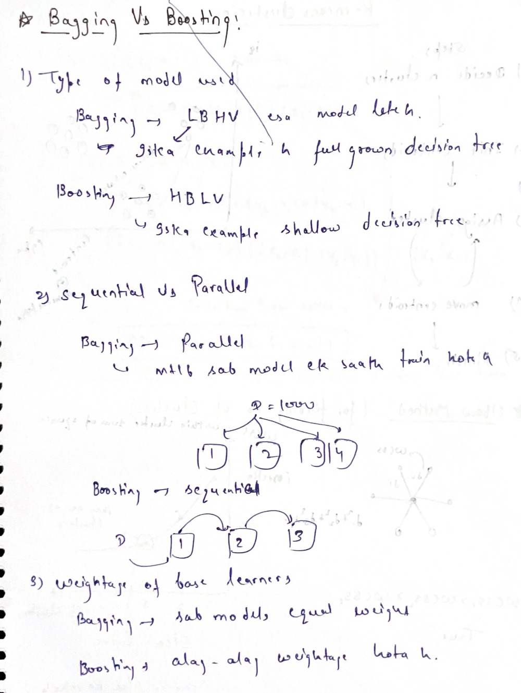
*Bagging vs Boosting: model type (LBHV vs HBLV), parallel vs sequential training, and equal vs unequal weighting of base learners.*

### ⭐ Why Bagging reduces variance — the maths

**Case A — models perfectly independent:**

Bagged prediction: `F(x) = (1/M) Σ fᵢ(x)`, each `Var(fᵢ) = σ²`.

```
Var(F(x)) = Var( (1/M) Σ fᵢ )
          = (1/M²) Σ Var(fᵢ)          (independence → covariances = 0)
          = (1/M²) · M · σ²
          = σ² / M
```

```
┌────────────────────────────────────────┐
│   Var(ensemble) = Var(single) / M      │
│   M = 100  →  variance becomes 1/100   │
└────────────────────────────────────────┘
```

**Case B — the realistic case (models correlated with correlation `ρ`):**

```
Var( (1/M) Σ fᵢ )  =  ρσ²  +  (1 − ρ)σ² / M
                       │            │
                  can't remove   → 0 as M → ∞
```

**How to read this formula (very important):**
- As `M → ∞` the second term vanishes → **more trees never hurt; bagging does not overfit by adding trees**
- But the first term `ρσ²` **stays**. The ceiling is set by the **correlation between trees**
- 👉 **This is exactly why Random Forest adds random feature selection — to push `ρ` down.**

> 🎤 **Interview one-liner:** "Bagging reduces variance by averaging independent models. Its
> limit is the correlation between base models, so Random Forest decorrelates trees by
> choosing a random feature subset at every split. Boosting instead reduces bias by
> sequentially fitting the residual errors of the combined previous models."

---

## 0.6 Map of All Ensemble Methods

```
                          ENSEMBLE LEARNING
                                 │
     ┌──────────────┬────────────┴──────┬─────────────────┐
     │              │                   │                 │
┌────▼────┐  ┌──────▼──────┐   ┌────────▼────────┐  ┌─────▼─────┐
│ VOTING  │  │   BAGGING   │   │    BOOSTING     │  │ STACKING  │
│         │  │             │   │                 │  │           │
│ Diff.   │  │ Same algo,  │   │ Same algo,      │  │ Diff algo │
│ algos,  │  │ diff data,  │   │ SEQUENTIAL,     │  │ + a META  │
│ same    │  │ PARALLEL    │   │ learns from     │  │ MODEL     │
│ data    │  │             │   │ past mistakes   │  │ on top    │
└────┬────┘  └──────┬──────┘   └────────┬────────┘  └─────┬─────┘
     │              │                   │                 │
 • Hard Vote   • Bagging           • AdaBoost        • Stacking
 • Soft Vote   • Pasting           • Gradient Boost  • Blending
 • Weighted    • Random Subspaces  • XGBoost         • Multi-layer
                • Random Patches   • LightGBM
                • Random Forest    • CatBoost
                • Extra Trees
```

| Technique | Base models | Data | Training | Combine by |
|---|---|---|---|---|
| **Voting** | **Different** algorithms | **Same** data | Parallel | Vote / average |
| **Bagging** | **Same** algorithm | **Different** (bootstrap) | Parallel | Vote / average |
| **Boosting** | **Same** algorithm | Re-weighted / residuals | **Sequential** | Weighted sum |
| **Stacking** | **Different** algorithms | Same data (via CV) | Parallel + meta | **A trained meta-model** |

---

# PART 1 — Voting Ensemble

## 1.1 What is Voting?

> **Definition:** Train **several different algorithms** on the **same dataset**, then
> combine their predictions by voting (classification) or averaging (regression).

Diversity here comes from **different algorithms**, not from different data.

### Architecture

```
                    Same Training Data
                            │
        ┌───────────────────┼───────────────────┐
        ▼                   ▼                   ▼
┌───────────────┐   ┌───────────────┐   ┌───────────────┐
│   Logistic    │   │      SVM      │   │ Decision Tree │
│   Regression  │   │               │   │               │
└───────┬───────┘   └───────┬───────┘   └───────┬───────┘
        │                   │                   │
        └───────────────────┼───────────────────┘
                            ▼
              ┌──────────────────────────┐
              │ Classification → VOTE    │
              │ Regression     → AVERAGE │
              └────────────┬─────────────┘
                           ▼
                   Final Prediction
```

---

## 1.2 Hard Voting (Majority Voting)

Each model outputs a **class label**. The class with the most votes wins.

```
Model 1 → Class 0
Model 2 → Class 1
Model 3 → Class 0
───────────────────
Majority → Class 0  ✔
```

**Formula:**
```
ŷ = mode{ h₁(x), h₂(x), ..., h_M(x) }
```

---

## 1.3 Soft Voting (Probability Averaging)

Each model outputs **probabilities**. We average the probabilities per class and take the
highest average.

**Formula:**
```
ŷ = argmax_c  (1/M) Σ(m=1 to M)  P_m(class = c | x)
```

### Binary example

| Model | P(class 0) | P(class 1) |
|---|---|---|
| Model 1 | 0.9 | 0.1 |
| Model 2 | 0.8 | 0.2 |
| Model 3 | 0.3 | 0.7 |
| **Average** | **(0.9+0.8+0.3)/3 = 0.667** | (0.1+0.2+0.7)/3 = 0.333 |

**Prediction: Class 0** (0.667 > 0.333)

### Multi-class example (5 classifiers, 3 classes)

| Classifier | Class 1 | Class 2 | Class 3 |
|---|---|---|---|
| Classifier 1 | 0.30 | 0.65 | 0.05 |
| Classifier 2 | 0.25 | 0.55 | 0.20 |
| Classifier 3 | 0.40 | 0.50 | 0.10 |
| Classifier 4 | 0.35 | 0.60 | 0.05 |
| Classifier 5 | 0.45 | 0.45 | 0.10 |
| **Average** | 1.75/5 = **0.35** | 2.75/5 = **0.55** ✔ | 0.50/5 = **0.10** |

**Prediction: Class 2**

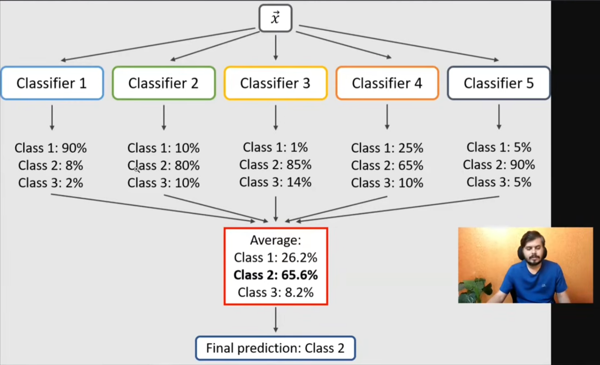
*Soft Voting architecture: the same input vector `x` goes to all 5 classifiers, each returns a probability distribution, the probabilities are averaged class-wise, and the class with the highest average wins (Class 2 at 65.6%).*

---

## 1.4 Hard vs Soft Voting

| | Hard Voting | Soft Voting |
|---|---|---|
| Model output used | Class **label** | Class **probability** |
| Information used | Less | **More** (confidence included) |
| Requirement | Any classifier | Models must support `predict_proba` |
| Generally | Good | **Usually better** |
| Why better | — | Uses confidence → a very confident model can outweigh two unsure ones; gives a "smoothing" effect |

> **Recommendation:** There is no fixed rule. **Try both** and keep whichever scores better.

---

## 1.5 Weighted Voting

By default all models get an equal vote. You can give better models more say.

```
Example weights:  Model 1 = 5,  Model 2 = 2,  Model 3 = 1
→ Model 1's opinion counts 5× more than Model 3's
```

**Weighted soft voting formula:**
```
ŷ = argmax_c  Σ(m)  wₘ · P_m(class = c | x)    /    Σ(m) wₘ
```

**Observation from experiments:** giving more weight to the best-performing model clearly
improved accuracy (in one demo it reached ~99%, versus lower without weights). Weights are
themselves hyperparameters — tune them with GridSearchCV.

---

## 1.6 Voting Regressor

Exactly the same idea; just take the **mean** instead of a vote.

```
Model 1 (Linear Regression) → 3.5 LPA
Model 2 (Random Forest)     → 4.1 LPA
Model 3 (Decision Tree)     → 2.7 LPA
──────────────────────────────────────
Final = (3.5 + 4.1 + 2.7) / 3 = 3.43 LPA
```

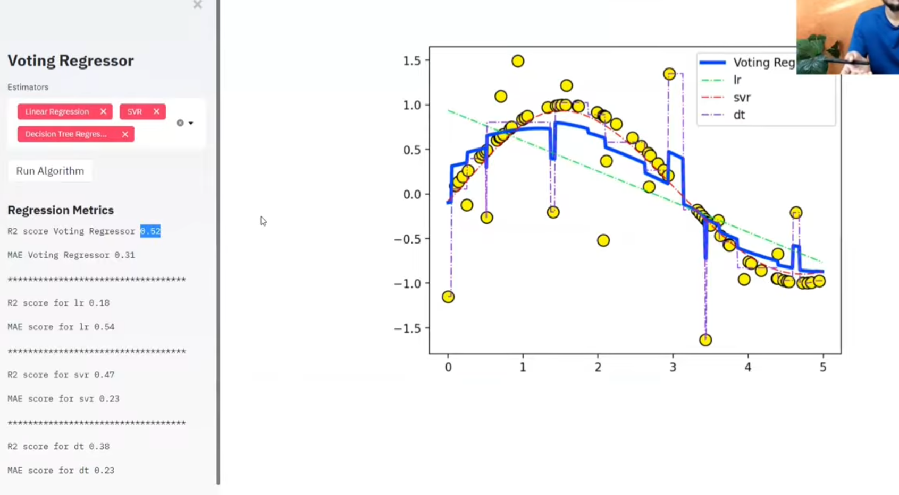
*A Voting Regressor (thick blue line) combining Linear Regression, SVR and a Decision Tree. Notice the ensemble R² = 0.52 is higher than every individual model (lr 0.18, svr 0.47, dt 0.38) — and its curve is smoother than the jagged decision-tree curve.*

### Code

```python
from sklearn.ensemble import VotingClassifier, VotingRegressor

# Classification
vc = VotingClassifier(
    estimators=[('lr', LogisticRegression()),
                ('svm', SVC(probability=True)),   # probability=True needed for soft voting
                ('dt', DecisionTreeClassifier())],
    voting='soft',          # 'hard' or 'soft'
    weights=[5, 2, 1]       # optional
)

# Regression
vr = VotingRegressor(
    estimators=[('lr', LinearRegression()),
                ('svr', SVR()),
                ('dt', DecisionTreeRegressor())]
)
```

> 🎤 **Interview one-liner:** "Voting trains different algorithms on the same data. Hard
> voting takes the majority label; soft voting averages the predicted probabilities and is
> usually better because it uses each model's confidence. It only helps if each base model
> is above 50% accurate and the models are reasonably uncorrelated."

---

# PART 2 — Bagging

> **Bagging = Bootstrap + Aggregating.** Invented by **Leo Breiman, 1996**.

Here all base models use the **same algorithm**; the diversity comes from giving each model
**different data**.

## 2.1 Bootstrap (sampling WITH replacement)

> **Definition:** Bootstrap is creating a new dataset of the **same size N** by picking rows
> from the original dataset **randomly, with replacement**.

**With replacement** means: after picking a row, you put it back, so the same row can be
picked again.

```
Original:   [1, 2, 3, 4, 5]
Sample 1:   [1, 3, 3, 5, 2]   ← 3 repeated, 4 left out
Sample 2:   [2, 2, 4, 1, 1]   ← 2 and 1 repeated, 3 & 5 left out
```

### Step-by-step bootstrap process

```
1. Start with original dataset D of N rows.
2. Randomly pick one row from D, record it, and PUT IT BACK.
3. Repeat N times.
4. The new dataset D' has N rows — some repeated, some missing.
5. Repeat the whole thing M times to get M different bootstrap samples.
```

---

## 2.2 ⭐ The 63.2% / 36.8% Derivation (very commonly asked)

**Question:** When we draw N rows with replacement from N rows, what fraction of unique
original rows appears in the sample?

**Step 1 —** Probability a specific row is NOT picked in **one** draw:
```
P(not selected in one draw) = 1 − 1/N  =  (N−1)/N
```

**Step 2 —** We draw N times, and draws are independent:
```
P(never selected in N draws) = ( 1 − 1/N )^N
```

**Step 3 —** Take the limit as N becomes large (standard calculus limit):
```
lim (1 − 1/N)^N  =  1/e  ≈  0.367879
N→∞
```

**Step 4 —** So:
```
P(selected at least once) = 1 − 1/e = 1 − 0.368 = 0.632
```

```
┌──────────────────────────────────────────────────────┐
│   ~63.2%  of unique rows ARE in the bootstrap sample │
│   ~36.8%  of rows are LEFT OUT  →  OOB samples       │
└──────────────────────────────────────────────────────┘
```

---

## 2.3 Aggregation (combining results)

| Problem type | Combine by | Formula |
|---|---|---|
| **Classification** | Majority Voting (mode) | `ŷ = mode{ f̂₁(x), ..., f̂_M(x) }` |
| **Regression** | Mean / Average | `ŷ = (p₁ + p₂ + ... + p_M) / M` |

**Why aggregation reduces variance:**
- Each base model is trained on slightly different data
- Each model makes **different** errors on different points
- When you average, the **random errors cancel each other out**
- The model becomes robust to noise in the training data

---

## 2.4 Bagging Architecture

```
                    Training Data (N rows)
                            │
        ┌───────────┬───────┴───────┬───────────┐
        │ bootstrap │  bootstrap    │ bootstrap │
        ▼           ▼               ▼           ▼
    ┌───────┐  ┌───────┐      ┌───────┐   ┌───────┐
    │  D1   │  │  D2   │      │  D3   │   │  Dm   │   N rows each
    └───┬───┘  └───┬───┘      └───┬───┘   └───┬───┘
        ▼          ▼              ▼           ▼
    ┌───────┐  ┌───────┐      ┌───────┐   ┌───────┐
    │ Tree1 │  │ Tree2 │      │ Tree3 │   │ Treem │   ← PARALLEL (n_jobs=-1)
    │(deep) │  │(deep) │      │(deep) │   │(deep) │
    └───┬───┘  └───┬───┘      └───┬───┘   └───┬───┘
        └──────────┴──────┬───────┴───────────┘
                          ▼
            ┌──────────────────────────┐
            │  Regression → AVERAGE    │
            │  Classification → VOTE   │
            └────────────┬─────────────┘
                         ▼
                  Final Prediction
```

**Note:** Trees are grown **deep / unpruned** on purpose → low bias, high variance.
Averaging then kills the variance.

### Algorithm (write exactly this in an interview)

```
1. For m = 1 to M:
     a. Draw bootstrap sample Dₘ of size N from D (with replacement)
     b. Train an UNPRUNED decision tree f̂ₘ on Dₘ
        (all models train independently → fully parallel)
2. Aggregate:
     Regression     → ŷ = (1/M) Σ f̂ₘ(x)
     Classification → ŷ = majority vote of f̂ₘ(x)
```

---

## 2.5 ⭐ The 4 Types of Bagging

| Type | Row Sampling | With Replacement | Feature Sampling |
|---|---|---|---|
| **Bagging** (standard) | ✔ Yes | ✔ Yes | ✘ No (all features) |
| **Pasting** | ✔ Yes | ✘ **No** | ✘ No |
| **Random Subspaces** | ✘ No (all rows) | — | ✔ **Yes** |
| **Random Patches** | ✔ Yes | ✔ Yes | ✔ **Yes** (max diversity) |

- **Pasting:** once a row is picked it is not returned → no duplicates. Bagging usually wins
  because replacement creates **more diversity**.
- **Random Subspaces:** all rows, random subset of **columns**. Useful when you have very
  many features, or some features are noisy.
- **Random Patches:** random rows **AND** random columns → **maximum diversity**.

---

## 2.6 ⭐ Out-Of-Bag (OOB) Score

Each tree never saw ~36.8% of the data. Those rows are its **OOB samples** — a free,
unbiased validation set.

### How the OOB score is computed

```
1. For each base model, identify its OOB rows (~37% not used in its training).
2. For each data point i in the original dataset:
      • find ALL models for which row i was OOB
      • average (regression) / majority-vote (classification) their predictions
      → this is the OOB prediction for row i
3. Compare all OOB predictions against the true labels → OOB score.
```

### Why it is useful
- Free internal validation — **no separate validation split needed**
- Saves data (you don't have to hold rows back)
- If **OOB score ≈ test score**, your model is stable

```python
bag = BaggingClassifier(estimator=DecisionTreeClassifier(),
                        n_estimators=100, bootstrap=True,
                        oob_score=True, n_jobs=-1, random_state=42)
bag.fit(X_train, y_train)
print(bag.oob_score_)        # usually very close to the test accuracy
```

### ⭐ OOB Score vs Cross-Validation (classic comparison question)

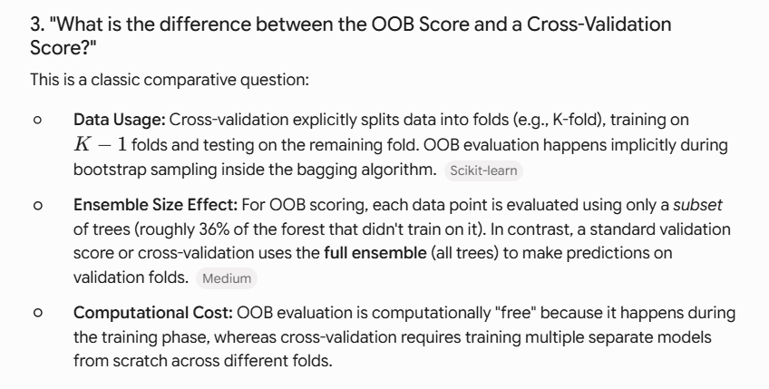

| | **OOB Score** | **Cross-Validation** |
|---|---|---|
| **Data usage** | Happens **implicitly** during bootstrap sampling inside bagging | **Explicitly** splits data into K folds; trains on K−1, tests on 1 |
| **Ensemble size used** | Each point is predicted by only a **subset** of trees (~36% that didn't train on it) | Uses the **full ensemble** on each validation fold |
| **Computational cost** | **Free** — comes out of the training phase itself | **Expensive** — trains K separate models from scratch |

---

## 2.7 Hyperparameters of Bagging

| Parameter | Meaning | Effect / Tip |
|---|---|---|
| `n_estimators` | Number of base models | More is better but slower. Diminishing returns after ~100–200. Start at **100** |
| `max_samples` | Rows per base model (int or fraction) | Lower → more diversity but weaker models. **Good range 0.5–1.0, start at 0.8** |
| `max_features` | Features per base model | `< 1.0` turns on **Random Subspaces**. Use 0.5–0.8 if features are noisy |
| `bootstrap` | Rows with replacement? | `True` = Bagging, `False` = Pasting. **Keep True** |
| `bootstrap_features` | Features with replacement? | Usually `False` |
| `n_jobs` | CPU cores | **Always `-1`** — bagging is embarrassingly parallel |
| `oob_score` | Free validation | **Always `True`** while experimenting |
| `random_state` | Reproducibility | Fix it so results don't change every run |

### Code

```python
from sklearn.ensemble import BaggingClassifier, BaggingRegressor

bagging_clf = BaggingClassifier(
    estimator=DecisionTreeClassifier(),  # base model
    n_estimators=100,                    # 100 trees
    max_samples=0.8,                     # 80% of rows per tree
    max_features=1.0,                    # all features
    bootstrap=True,                      # with replacement
    bootstrap_features=False,
    oob_score=True,
    n_jobs=-1,                           # all CPU cores
    random_state=42
)
bagging_clf.fit(X_train, y_train)
```

---

## 2.8 When does Bagging actually help?

| Base model | Does bagging help? | Why |
|---|---|---|
| **Decision Tree (deep)** | ✔✔ **Huge improvement** | High variance → averaging kills it |
| **KNN (small k)** | ✔ Yes | High variance |
| **SVM (RBF)** | ✔ Somewhat | Moderately high variance |
| **Linear Regression** | ✘ **Almost no gain** | Already low variance — nothing to average away |
| **Naive Bayes** | ✘ No | Low variance, high bias |

> ⭐ **Rule:** Bagging only helps **high-variance (overfitting) models**. Using it on a
> low-variance model like Linear Regression is a waste of compute.

### Bagging Regressor — smoother curves

A single decision-tree regressor gives a **jagged, step-like** curve because it splits the
space into rectangles. Averaging many such trees makes the curve **much smoother**, which
means better generalisation.

> 🎤 **Interview one-liner:** "Bagging trains the same algorithm on many bootstrap samples
> in parallel and averages the results. It reduces variance, not bias, so it only pays off
> with high-variance base learners like fully grown decision trees. The ~37% of rows left
> out of each bootstrap give you a free OOB validation score."

---

# PART 3 — Random Forest

> **Random Forest = Bagging + Decision Trees + Random Feature Selection at EVERY node**
> Invented by **Leo Breiman, 2001**.

## 3.1 Why the name "Random Forest"?

| Word | Meaning |
|---|---|
| **Forest** | A group of trees. We train **many Decision Trees** together |
| **Random** | Each tree gets a **random** sample of rows and/or columns |

```
Random Forest  =  Random Sampling  +  Forest (group of trees)
```

---

## 3.2 How Random Forest works — step by step

### Step 1: Creating samples

Three ways to create diversity:

**(A) Row Sampling (Bootstrap)** — give each tree a random subset of rows.
```
N = 1000 rows, each tree gets n = 500 (or 1000 with replacement)
Tree 1 → rows {1, 38, 52, 103, 433, ...}
Tree 2 → rows {5, 19, 47, 88, 201, ...}
```
Two kinds: **with replacement** (duplicates possible) or **without replacement**.

**(B) Column Sampling (Feature Sampling)** — give each tree a random subset of columns.
```
M = 10 columns, each tree gets m = 5
Tree 1 → {X1, X3, X5, X7, X9}
Tree 2 → {X2, X4, X6, X8, X10}
```

**(C) Combined Sampling** — do BOTH. Maximum diversity.
```
Combined Sample = Random subset of ROWS × Random subset of COLUMNS
```

### Step 2: Training
Train each Decision Tree on its own sample. Every tree sees different data, so every tree
learns differently. **All trees train in parallel** (independent of each other).

### Step 3: Aggregation
- **Classification** → Majority Voting (each tree gives one vote, max votes wins)
- **Regression** → Mean of all tree predictions

---

## 3.3 ⭐⭐ The REAL difference between Bagging and Random Forest (interview trap!)

Most candidates give the **wrong** answer here. Learn this properly.

### ❌ The common wrong answer
> "In Bagging we can use any algorithm, but in Random Forest we only use Decision Trees."

**Counter-question the interviewer will ask:**
> "OK — so if I build a `BaggingClassifier` using only `DecisionTreeClassifier`, is that a Random Forest?"

### ✅ The correct answer: **NO.** The real difference is the *level* of column sampling.

| | **Bagging** | **Random Forest** |
|---|---|---|
| Base algorithm | Any (DT, SVM, KNN...) | Strictly **Decision Trees** |
| Column sampling level | **TREE level** (a.k.a. model level / entry level) | **NODE level** |
| Meaning | Pick `m` columns **once**, before building the tree. **Every split in that tree uses only those `m` columns** | Pick a **fresh random** `m` columns **at every single node**, again and again |

**Bagging — tree-level column sampling:**
```
Tree 1 gets columns {X1, X3}  →  ALL nodes in Tree 1 use only X1 or X3
Tree 2 gets columns {X2, X5}  →  ALL nodes in Tree 2 use only X2 or X5
```

**Random Forest — node-level column sampling:**
```
Node 1 (root)      : randomly pick {X1, X3}  →  best of those = split on X1
Node 2 (left child): randomly pick {X2, X4}  →  best of those = split on X4
Node 3 (right child): randomly pick {X0, X5} →  best of those = split on X0
                       ↑ a FRESH random draw every time
```

### Why node-level is better
1. Node-level sampling injects **far more randomness**
2. More randomness → **more diversity** among trees → lower correlation `ρ`
3. Theorem: the more diverse the base models (as long as each beats random guessing), the
   better the ensemble
4. Recall `Var = ρσ² + (1−ρ)σ²/M` — RF attacks the `ρσ²` term that bagging cannot touch
5. 👉 This is why Random Forest usually beats plain Bagging

> 🎤 **Interview one-liner:** "Both bag rows, but bagging picks its feature subset **once per
> tree**, while Random Forest re-draws a random feature subset **at every node**. That extra
> randomness decorrelates the trees, which is what actually lowers the ensemble variance."

---

## 3.4 Architecture

```
                      Training Data (N rows, p features)
                                   │
        ┌──────────────────────────┼──────────────────────────┐
    bootstrap                  bootstrap                  bootstrap
        ▼                          ▼                          ▼
  ┌───────────┐              ┌───────────┐              ┌───────────┐
  │  Tree 1   │              │  Tree 2   │              │  Tree M   │
  │           │              │           │              │           │
  │ At EACH node:            │   same    │              │   same    │
  │  1. randomly pick k of p features                               │
  │  2. find BEST split among those k only                          │
  │  3. split, recurse                                              │
  │ Grow FULLY — do NOT prune                                       │
  └─────┬─────┘              └─────┬─────┘              └─────┬─────┘
        └──────────────────────────┼──────────────────────────┘
                                   ▼
                    ┌──────────────────────────┐
                    │ Classification → VOTE    │
                    │ Regression     → AVERAGE │
                    └────────────┬─────────────┘
                                 ▼
                         Final Prediction
```

### Algorithm

```
For m = 1 to M:
    1. Draw bootstrap sample Dₘ (size N, with replacement)
    2. Grow tree Tₘ on Dₘ. At each node, repeat until stopping condition:
         i.   randomly select k features out of p          ← NODE LEVEL
         ii.  find the best split among those k only
         iii. split the node into two children
       Grow FULLY (do NOT prune)
Output the ensemble {T₁, ..., T_M}
```

### How many features per split (`max_features`)?

| Task | Standard choice |
|---|---|
| Classification | `k = √p` ← **sklearn default (`'sqrt'`)** |
| Regression | `k = p/3` |

---

## 3.5 Why Random Forest works so well

A single Decision Tree is **Low Bias, High Variance**:
- Low bias — it learns the training data very well
- High variance — it memorises noise, so it breaks on new data

Random Forest converts **LBHV → LBLV (Low Bias, Low Variance)**:

| Situation | Single Tree | Random Forest |
|---|---|---|
| A noisy point / outlier appears | That one tree absorbs the **full** impact → high variance | Noise is spread across many trees; **no single tree carries all of it** |
| Result | Overfits | Noise effect is **averaged out** |

Each tree still learns well (bias stays low), but the noise cancels (variance drops).

---

## 3.6 Splitting criteria — formulas you must know

**Gini Impurity** (default for classification — faster, no log):
```
Gini = 1 − Σ (pᵢ)²                 range: 0 (pure) to 0.5 (binary, 50-50)
```

**Entropy:**
```
Entropy = − Σ pᵢ · log₂(pᵢ)         range: 0 (pure) to 1 (binary, 50-50)
```

**Information Gain:**
```
IG = Entropy(parent) − Σ (Nⱼ/N) · Entropy(childⱼ)
```

**MSE / variance reduction (regression):**
```
MSE = (1/N) Σ (yᵢ − ȳ)²
```

> **Gini vs Entropy:** results are almost always the same. **Gini is faster** (no logarithm),
> so it is the default. Entropy is slightly more sensitive to probability changes.

---

## 3.7 ⭐ Feature Importance — full derivation

Feature importance tells you which columns the algorithm found most useful. Available in
Random Forest, Gradient Boosting, AdaBoost, XGBoost — almost every ensemble.

### Why we need it
1. **Feature selection** — too many columns hurt the model and cause overfitting. Drop the useless ones.
2. **Model interpretability** — a bank rejects a loan; the customer asks "why?". Feature
   importance lets you say *"mainly because of these 2–3 features"*. It makes your model **explainable**.

### Method 1: MDI (Mean Decrease in Impurity) — the default `feature_importances_`

sklearn's definition:
> *"The importance of a feature is computed as the total reduction of the criterion brought by that feature."*

**Node Importance formula:**

```
                 Nt       ⎡              NtR                    NtL                  ⎤
Node Importance = ── × ⎢ impurity −  ─── × right_impurity  −  ─── × left_impurity ⎥
                  N      ⎣              Nt                     Nt                   ⎦
```

| Symbol | Meaning |
|---|---|
| `Nt` | Number of samples at the current node |
| `N` | Total samples in the dataset |
| `impurity` | Impurity at the current node (Gini or Entropy) |
| `NtR`, `NtL` | Samples in right / left child |
| `right_impurity`, `left_impurity` | Impurity of right / left child |

**Feature Importance formula:**
```
                        Sum of node importances for THAT feature
Feature Importance = ──────────────────────────────────────────────
                        Sum of node importances for ALL nodes
```

### Worked example (5 rows, 2 features)

Tree: root splits on **Column 0**, second node splits on **Column 1**.

**Step 1 — Node importance of the root (split on Column 0):**
```
Nt = 5,  N = 5,  impurity = 0.48
NtR = 4, right_impurity = 0.375
NtL = 1, left_impurity  = 0

NI = (5/5) × [ 0.48 − ( (4/5)×0.375 + (1/5)×0 ) ]
   = 1 × [ 0.48 − 0.30 ]
   = 0.18                                      ← call this Y
```

**Step 2 — Node importance of the second node (split on Column 1):**
```
NI = 0.30                                      ← call this X
```

**Step 3 — Feature importances:**
```
Feature Importance (Column 0) = Y / (X + Y) = 0.18 / (0.30 + 0.18) = 0.375
Feature Importance (Column 1) = X / (X + Y) = 0.30 / (0.30 + 0.18) = 0.625

Check: 0.375 + 0.625 = 1.0  ✔
```

> ⭐ **Property:** The sum of all (normalised) feature importances is always **1.0**.

### Step 4 — From one tree to the whole forest

Random Forest simply **averages** the feature importances across all trees.

| Feature | Tree 1 | Tree 2 | RF Importance |
|---|---|---|---|
| Feature 0 | 1.0 | 0.5 | (1.0 + 0.5)/2 = **0.75** |
| Feature 1 | 0.5 | 1.0 | (0.5 + 1.0)/2 = **0.75** |

```python
rf.feature_importances_          # the averaged importances
rf.estimators_[0].feature_importances_   # importances of a single tree
```

### ⚠️ The high-cardinality warning (interview trap)

> sklearn's own warning: *"The impurity-based feature importances computed on tree-based
> methods can be misleading for **high cardinality features** (many unique values)."*

- Features like **IDs, timestamps, continuous values** get **artificially high** importance
- Because they offer many possible split points, they look useful even when they are not
- **Solution:** use **Permutation Importance** instead

### Method 2: Permutation Importance (better, model-agnostic)

```
1. Record the baseline validation score
2. Randomly SHUFFLE one column f (break its relation with the target)
3. Re-score. The drop Δ = Importance(f)
4. Repeat several times and average
```
✔ Not biased by cardinality  ✘ Slower; can mislead when features are correlated

### Method 3: SHAP
Best of all — gives **per-row** importance and the **direction** (+/−) of each feature's effect.

---

## 3.8 Random Forest Hyperparameters

Random Forest has ~25 hyperparameters. They fall into three groups.

### Group A — Random Forest specific (the 4 that matter most)

| Parameter | Meaning | Notes / teacher's tip |
|---|---|---|
| `n_estimators` | Number of trees. **Default 100** | More trees → smoother boundary, less overfitting, slower. **Sweet spot ≈ 50–275**; too few underperforms, too many just wastes time |
| `max_features` | Columns considered **per split** | `'sqrt'` (default), `'log2'`, an int, a float (0.0–1.0), or `None` (= all). Even `max_features=1` still works okay — RF is robust. `0` is invalid |
| `bootstrap` | Sample rows with replacement? | `True`/`False`. Honestly makes little difference; **most people keep `True`** |
| `max_samples` | Rows drawn per tree | Very small or very large is not ideal |

### Group B — inherited from Decision Trees (control each tree's growth)

| Parameter | Meaning |
|---|---|
| `criterion` | Split quality. Classification: `'gini'` / `'entropy'`. Regression: `'squared_error'` / `'absolute_error'` |
| `max_depth` | Maximum depth of each tree |
| `min_samples_split` | Minimum rows needed to split an internal node (pruning) |
| `min_samples_leaf` | Minimum rows in a leaf; a split happens only if **both** children have at least this many |
| `max_leaf_nodes` | Maximum number of leaves allowed |
| `min_impurity_decrease` | Split only if impurity drops by at least this much |

### Group C — general ML parameters

| Parameter | Meaning |
|---|---|
| `n_jobs` | Parallel jobs. **`-1` = all cores.** Trees are independent, so this is a big speed-up |
| `random_state` | Fix randomness for reproducible results |
| `class_weight` | For imbalanced data; `'balanced'` auto-weights the classes |
| `oob_score` | `True` → free OOB validation via `model.oob_score_` |

```python
from sklearn.ensemble import RandomForestClassifier

rf = RandomForestClassifier(
    n_estimators=100,
    max_features='sqrt',     # sqrt(n_features) per split
    max_depth=None,
    min_samples_split=2,
    bootstrap=True,
    oob_score=True,
    n_jobs=-1,
    random_state=42
)
rf.fit(X_train, y_train)
print(rf.oob_score_)
```

---

## 3.9 Hyperparameter Tuning

### GridSearchCV — exhaustive search

Tries **every** combination you give it and picks the best by cross-validation.

```python
param_grid = {
    'n_estimators':  [50, 100, 150, 200],   # 4 values
    'max_features':  ['sqrt', 'log2', None], # 3 values
    'max_depth':     [2, 5, 10],             # 3 values
    'max_samples':   [0.5, 0.75, 1.0]        # 3 values
}
```

**Counting the work — derivation:**
```
Total Combinations = Π (options per parameter)
                   = 4 × 3 × 3 × 3
                   = 108 models

With cv = 5:
Total Fits = Total Combinations × CV folds
           = 108 × 5
           = 540 model fits
```

### RandomizedSearchCV — random sampling

Picks a fixed number (`n_iter`) of random combinations instead of all of them.

| Aspect | **GridSearchCV** | **RandomizedSearchCV** |
|---|---|---|
| Search method | Exhaustive (all combinations) | Random sampling |
| Speed | Slower | **Faster** |
| Best for | Small data, few parameters | **Large data, many parameters** |
| Accuracy | Higher (checks everything) | Near-perfect (may miss the absolute best) |
| Total fits | all combos × CV folds | `n_iter` × CV folds |

**Strategy:** start with a **coarse** grid, then **refine** around the best values found.

```python
from sklearn.model_selection import GridSearchCV, RandomizedSearchCV

gs = GridSearchCV(rf, param_grid, cv=5, scoring='accuracy', n_jobs=-1, verbose=1)
gs.fit(X_train, y_train)
print(gs.best_params_, gs.best_score_)

rs = RandomizedSearchCV(rf, param_grid, n_iter=20, cv=5,
                        scoring='accuracy', n_jobs=-1, random_state=42)
```

---

## 3.10 Advantages & Disadvantages of Random Forest

| ✔ Advantages | ✘ Disadvantages |
|---|---|
| **Versatile** — regression + classification | Large memory (stores all trees) |
| **Great out-of-the-box** — defaults already work well | Slow prediction if many deep trees |
| **Minimal tuning** needed by design | Not interpretable (black box) |
| **Robust to overfitting** (averaging) | Poor at **extrapolation** — can't predict outside the training range |
| **Handles noise and outliers** — impact spread over many trees | MDI feature importance biased toward high-cardinality features |
| **Built-in validation** via OOB | Usually beaten by boosting on tabular competitions |
| No feature scaling needed; handles mixed types | Struggles on very sparse, high-dimensional text data |
| Parallel → fast training | |

---

## 3.11 Extra Trees (Extremely Randomized Trees)

One more level of randomness than Random Forest.

| | **Random Forest** | **Extra Trees** |
|---|---|---|
| Bootstrap rows | ✔ Yes | ✘ **No** (uses the full dataset) |
| Features per split | random `k` | random `k` |
| **Split threshold** | **BEST** threshold, found by searching all candidates | **RANDOM** thresholds drawn, then the best of those random ones |
| Speed | Slower (must sort to find the best split) | **Much faster** (no sorting) |
| Bias | Lower | Slightly **higher** |
| Variance | Higher | **Lower** |

**When to use:** noisy data, or when you need speed. Often as accurate as RF.

> 🎤 **Interview one-liner:** "Extra Trees picks split thresholds at random instead of
> searching for the optimal one, and skips bootstrapping. The extra randomness raises bias a
> little but lowers variance more, and it trains much faster because there is no sorting."

---

# PART 4 — AdaBoost

> **AdaBoost = Adaptive Boosting.** It combines many weak learners **sequentially**, where
> each new learner focuses on the points the previous ones got **wrong**.

**Simple analogy:** a group project. Each student is just okay alone (weak learner), but when
they work together and each one fixes the others' mistakes, the final project is excellent.

**Why learn it:** if you understand AdaBoost, XGBoost becomes much easier — boosting,
sequential learning and weight updates are the same ideas. AdaBoost is also **more stable**
and easier to understand than XGBoost.

**Prerequisites:** Decision Stumps, Entropy/Information Gain, and one special thing —
> ⚠️ In AdaBoost the classes are encoded as **+1 and −1**, NOT 0 and 1. This matters because
> the final prediction uses the `sign()` function.

---

## 4.1 Core concepts

**Sequential learning:** you cannot train all models at once. Each model depends on the
previous model's result — the dataset's weights change after every iteration based on which
points were misclassified.

**Stage-wise additive method:** models are added one at a time, each one correcting the
mistakes of the *combined* previous models. The final prediction is a **weighted sum**.

**Decision Stump:** the simplest possible decision tree — **max_depth = 1**, exactly ONE
split on ONE feature.
```
Example stump:  "If CGPA > 7.5 → Placement = Yes,  else → No"
```

### ⭐ The Three Pillars of AdaBoost

| Pillar | Symbol | Role |
|---|---|---|
| **1. Sample Weights** | `wᵢ` | Every data point has a weight. Initially equal, updated after each round |
| **2. Weak Learner** | `hₜ(x)` | Usually a decision stump. Must be > 50% accurate |
| **3. Alpha ("amount of say")** | `αₜ` | How much influence this learner gets in the final vote. Higher accuracy → higher α |

---

## 4.2 ⭐ The Algorithm — all 9 steps with formulas

### Step 1 — Initialise weights
Give every point an equal weight so the weights form a probability distribution.
```
wᵢ = 1/N        for i = 1, 2, ..., N
```
If `N = 5`, then every `wᵢ = 0.2`.

### Step 2 — Train a weak learner
Train a decision stump on the **weighted** dataset. Try different features and thresholds;
pick the stump with the **lowest weighted error**.

### Step 3 — Calculate weighted error
Count only the misclassified points, weighted by their current weights.
```
        ε = Σ  wᵢ
          misclassified i
```
| ε value | Meaning |
|---|---|
| ε → 0 | Excellent stump |
| ε = 0.5 | Random guessing — useless |
| ε > 0.5 | Worse than random → **flip its predictions** to make it useful |

### Step 4 — ⭐ Compute Alpha (amount of say)
```
┌──────────────────────────┐
│          1       1 − ε   │
│    α =  ─── ln ( ───── ) │
│          2         ε     │
└──────────────────────────┘
```

| Error ε | Alpha α |
|---|---|
| 0.1 | **+1.099** |
| 0.2 | +0.693 |
| 0.4 | +0.203 |
| **0.5** | **0** ← no say at all |
| 0.8 | **−0.693** ← negative |


*The α vs error curve. α is large and positive when error → 0, crosses **zero at error = 0.5**, and goes negative beyond that. A negative α means the model is worse than random — but we simply **flip its predictions** (multiply by −1) and it becomes useful again. This is why even a bad model is not wasted in AdaBoost.*

### Step 5 — Update sample weights (exponential rule)
```
Misclassified points :   w_new = w_old · e^(+α)      ← weight goes UP
Correct points       :   w_new = w_old · e^(−α)      ← weight goes DOWN
```
**Core idea:** the next stump will see the "hard" examples more prominently.

### Step 6 — Normalise weights
After updating, the weights no longer sum to 1. Renormalise:
```
                 wᵢ
w_i(normalised) = ─────────
                 Σⱼ wⱼ
```

### Step 7 — Resample (optional but common)
Instead of passing weights directly to the next stump, build a new dataset by sampling
**with replacement**, where each row's probability of being picked = its normalised weight.
High-weight (previously misclassified) rows get picked multiple times; low-weight rows may
be skipped entirely.

### Step 8 — Repeat
Repeat Steps 2–7 for `T` estimators, or until the error becomes zero.

### Step 9 — ⭐ Final prediction (weighted majority vote)
```
┌───────────────────────────────────────┐
│                  ⎛  T              ⎞  │
│   H(x) = sign  ⎜  Σ  αₜ · hₜ(x)  ⎟    │
│                  ⎝ t=1             ⎠  │
└───────────────────────────────────────┘
```
| Symbol | Meaning |
|---|---|
| `T` | Total number of stumps |
| `αₜ` | Amount of say of stump t |
| `hₜ(x)` | Prediction of stump t (+1 or −1) |
| `sign()` | Returns +1 if the sum is positive, −1 if negative |

---

## 4.3 ⭐ Complete worked example (do this once by hand)

### Dataset (N = 5)

| Point | Feature | Actual y |
|---|---|---|
| P1 | 2 | +1 |
| P2 | 4 | +1 |
| P3 | 6 | −1 |
| P4 | 8 | −1 |
| P5 | 10 | +1 |

### Round 1

**Step 1:** `wᵢ = 0.2` for all 5 points.

**Step 2:** Stump 1 = *"If value ≤ 5 then +1, else −1"*

**Step 3:** Predictions and error

| Point | Actual | Pred | Result | Weight |
|---|---|---|---|---|
| P1 | +1 | +1 | ✔ Correct | 0.2 |
| P2 | +1 | +1 | ✔ Correct | 0.2 |
| P3 | −1 | −1 | ✔ Correct | 0.2 |
| P4 | −1 | +1 | ✘ **Wrong** | 0.2 |
| P5 | +1 | −1 | ✘ **Wrong** | 0.2 |

```
ε₁ = 0.2 + 0.2 = 0.4
```

**Step 4:** Alpha
```
α₁ = ½ · ln(0.6 / 0.4) = ½ · ln(1.5) = ½ × 0.4055 = 0.2027
```

**Step 5:** Update weights
```
Wrong   (P4, P5):  0.2 × e^(+0.2027) = 0.2 × 1.2247 = 0.2449   ↑
Correct (P1,P2,P3): 0.2 × e^(−0.2027) = 0.2 × 0.8165 = 0.1633  ↓
```

**Step 6:** Normalise
```
Sum = 3(0.1633) + 2(0.2449) = 0.9797
w(P1,P2,P3) = 0.1633 / 0.9797 = 0.1667
w(P4,P5)    = 0.2449 / 0.9797 = 0.2500
```

### Round 2

Stump 2 trains on the re-weighted data. Suppose it misclassifies only **P1**.
```
ε₂ = w(P1) = 0.1667

α₂ = ½ · ln(0.8333 / 0.1667) = ½ · ln(5) = ½ × 1.6094 = 0.8047
```
Notice: fewer errors → **much higher alpha** (0.80 vs 0.20). Stump 2 gets more say.

**Update:**
```
Wrong   (P1):            0.1667 × e^(+0.8047) = 0.1667 × 2.236 = 0.3727
Correct (P2,P5 @0.1667): 0.1667 × e^(−0.8047) = 0.0745
Correct (P3,P4 @0.25):   0.25   × e^(−0.8047) = 0.1118

Sum = 0.3727 + 2(0.0745) + 2(0.1118) = 0.7453
w(P1) = 0.50,   w(P2,P5) = 0.10,   w(P3,P4) = 0.15
```
P1 now carries **half** the total weight — the next stump will be forced to get it right.

### Final prediction on a new point

| Stump | α | h(x) | Weighted vote |
|---|---|---|---|
| 1 | 0.2027 | +1 | +0.2027 |
| 2 | 0.8047 | −1 | −0.8047 |
| | | **Total** | **−0.6020** |

```
H(x) = sign(−0.6020) = −1
```

---

## 4.4 The Resampling Technique (how weights become data)

Using the normalised weights from Round 1, build cumulative ranges:

| Point | Weight | Cumulative Range |
|---|---|---|
| P1 | 0.1667 | 0.0000 – 0.1667 |
| P2 | 0.1667 | 0.1667 – 0.3334 |
| P3 | 0.1667 | 0.3334 – 0.5001 |
| P4 | 0.2500 | 0.5001 – 0.7501 |
| P5 | 0.2500 | 0.7501 – 1.0000 |

Generate 5 random numbers: `0.08, 0.35, 0.60, 0.82, 0.55`

| Random | Falls in range | Selected |
|---|---|---|
| 0.08 | 0.0000 – 0.1667 | P1 |
| 0.35 | 0.3334 – 0.5001 | P3 |
| 0.60 | 0.5001 – 0.7501 | P4 |
| 0.82 | 0.7501 – 1.0000 | P5 |
| 0.55 | 0.5001 – 0.7501 | **P4 (again)** |

**New dataset: P1, P3, P4, P5, P4**

> P4 and P5 occupy **larger ranges** → get selected more often → the next stump is forced to
> focus on the hard examples. This is how "weights" turn into actual training data.

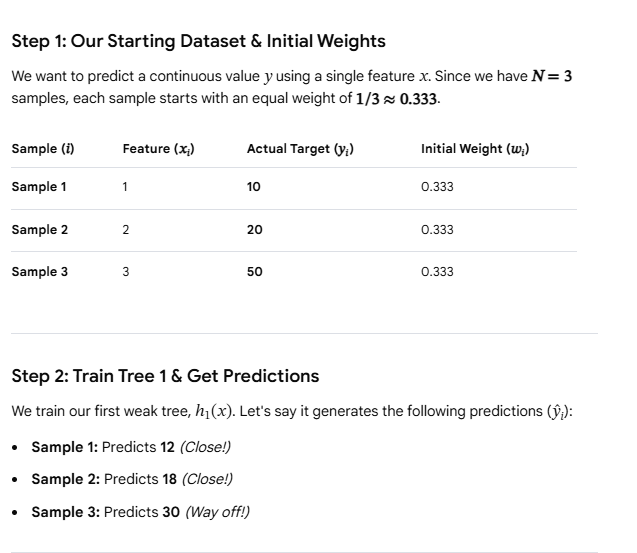
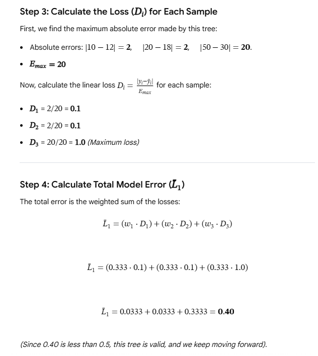
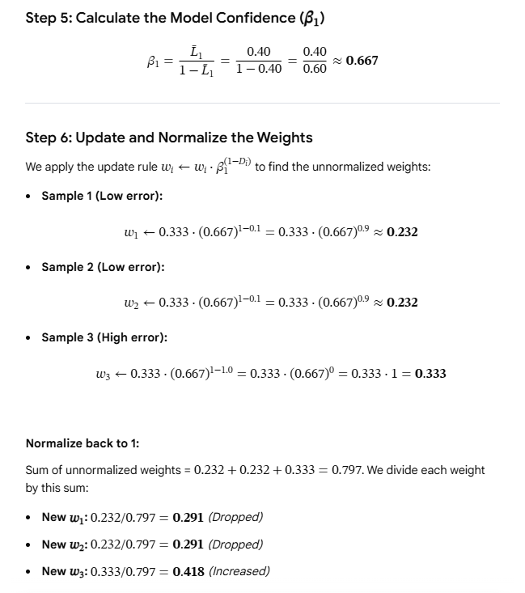
*A second worked example showing equal initial weights (1/3 each), the first weak tree's predictions, and how the sample that was "way off" gets its weight boosted for the next round.*

---

## 4.5 AdaBoost Hyperparameters

| Parameter | Default | Notes |
|---|---|---|
| `base_estimator` / `estimator` | `DecisionTreeClassifier(max_depth=1)` | Can also use Logistic Regression or SVM. ⚠️ **KNN does NOT work** — it does not support sample weights |
| `n_estimators` | 50 | Too low (1–2) → **underfitting**. Too high (500–1500) → **overfitting** |
| `learning_rate` | 1.0 | Shrinkage. `Effective α = α × learning_rate` |
| `algorithm` | `'SAMME.R'` | `'SAMME'` = discrete, `'SAMME.R'` = real-valued. **SAMME.R converges faster** with fewer rounds |

### Learning rate (shrinkage) — how it works
- The computed alpha is **multiplied by** the learning rate
- `learning_rate = 0.1` → alpha becomes 10× smaller
- Smaller α → smaller weight updates → misclassified points get a **gentler** boost, correct
  points a **gentler** reduction
- The model learns **slowly but generalises better**

### Underfitting vs Overfitting

| | Low `n_estimators` (1–2) | High `n_estimators` (500–1500) |
|---|---|---|
| Boundary | A single straight line — too simple | Many tiny jagged regions chasing every point |
| Problem | **Underfitting** | **Overfitting** |
| Fix | Increase `n_estimators` | Lower the `learning_rate` |

> ⭐ **The golden balance:** **High `n_estimators` + Low `learning_rate`** usually gives the
> best results. E.g. `n_estimators=500, learning_rate=0.1`.
> If you increase the number of estimators, decrease the learning rate to compensate.

### Tuning

```python
param_grid = {
    'n_estimators':  [50, 100, 200, 500],
    'learning_rate': [0.01, 0.1, 0.5, 1.0],
    'algorithm':     ['SAMME', 'SAMME.R']
}
grid = GridSearchCV(AdaBoostClassifier(), param_grid,
                    cv=10, scoring='accuracy', n_jobs=-1)
grid.fit(X_train, y_train)
print(grid.best_params_, grid.best_score_)
```
Proper tuning is not optional — in one demo it took accuracy from **78% → 83%**.

---

## 4.6 Where AdaBoost is used

- **Face detection** — the famous **Viola–Jones** algorithm. Many weak classifiers each
  detect a simple feature (edges, lines) in an image region; combined, they form a strong
  face detector.
- Binary classification — spam vs not-spam, fraud vs legitimate
- Multi-class classification via SAMME
- Any tabular classification problem

> 🎤 **Interview one-liner:** "AdaBoost keeps a weight on every training point. Each round it
> fits a stump, computes its error ε, gives it a say α = ½·ln((1−ε)/ε), then multiplies the
> weights of wrong points by e^(+α) and right points by e^(−α) so the next stump concentrates
> on the hard cases. The final answer is sign(Σ αₜ hₜ(x))."

---

# PART 5 — Gradient Boosting

> **Gradient Boosting** is a sequential ensemble method. Instead of re-weighting points
> (like AdaBoost), each new model is trained to predict the **errors (residuals)** of the
> combined previous models.

## 5.1 The big idea in simple words

Imagine you must draw a complex curve, but you can only use short straight line segments.
You draw one segment, see where it is wrong, draw another small segment to fix that mistake,
then another to fix the next mistake. After many small fixes, your curve looks almost perfect.

Gradient Boosting does exactly this with data:

```
1. Build a very simple first model (just a single number).
2. Find where it made mistakes (residuals).
3. Build a small decision tree to PREDICT those mistakes.
4. Add that tree's prediction to the previous model (with a small weight).
5. Repeat steps 2–4 many times.
```

The final model is the **sum** of all these small models.

### Why "Additive Modeling"?

If a complex function `F(x)` cannot be captured by one simple function, approximate it by
adding many small ones:
```
F(x) = f₁(x) + f₂(x) + f₃(x) + ... + f_M(x)
```
Each `fₘ(x)` is a small decision tree. Together they form a **composite function**.

### Four core concepts

| Concept | Meaning |
|---|---|
| **Sequential Ensemble Learning** | `Model 1 → Model 2 → Model 3 → ... → Model M`; each corrects all previous ones combined |
| **Additive Modeling** | `F_M(x) = F₀(x) + h₁(x) + h₂(x) + ... + h_M(x)` |
| **Function Approximation** | We approximate the unknown true function step by step |
| **Composite Functions** | Many simple weak learners (regression trees) → one powerful function |

### ⭐ Key difference from AdaBoost
> AdaBoost **increases the weights** of wrongly classified points.
> Gradient Boosting **trains the next model on the residuals** of the combined previous model.

---

## 5.2 Gradient Boosting for REGRESSION — intuitive steps

### Step 1: Initial model `F₀(x)` — the base prediction

```
┌──────────────────────────────────┐
│   F₀(x) = mean of the target     │
└──────────────────────────────────┘
```
- This is the **constant base prediction**
- It is **NOT** a machine learning model — it is just one number
- If the average salary is 4.0, then `F₀(x) = 4.0` for **every** student, no matter their IQ or CGPA

### Step 2: Calculate residuals (identify errors)
```
Residualᵢ = Actualᵢ − Predictedᵢ = yᵢ − F₀(xᵢ)
```
```
Actual 5.0, Predicted 4.0  →  Residual = +1.0
Actual 2.4, Predicted 4.0  →  Residual = −1.6
```

### Step 3: Train a Decision Tree on the residuals

| | |
|---|---|
| **Input (features)** | Same as original — IQ, CGPA |
| **Target** | **The residuals** from Step 2 |

- The base learner is a **Decision Tree Regressor**
- It learns the **pattern in the mistakes**
- Each leaf contains a predicted residual value
- ⭐ **Key insight:** the tree is NOT predicting salary. It is predicting **how much the
  previous model was off by**.

### Step 4: Model update with learning rate (shrinkage)
```
┌──────────────────────────────────────┐
│   Fₘ(x) = F_{m−1}(x) + ν · hₘ(x)     │
└──────────────────────────────────────┘
```
| Symbol | Meaning |
|---|---|
| `F_{m−1}(x)` | Prediction from the previous combined model |
| `hₘ(x)` | Prediction of the new tree |
| `ν` (nu / eta) | **Learning rate**, typically 0.01 – 0.1 |

**Numerical example:**
```
F₀(x) = 4.0,  tree predicts residual = +1.2,  ν = 0.1
F₁(x) = 4.0 + (0.1 × 1.2) = 4.0 + 0.12 = 4.12
```

**Why shrinkage?** Without it (`ν = 1`) the model fixes all residuals immediately and
**memorises the training data**. With small `ν` each tree only fixes ~10% of the error, so
you need more trees but the model **generalises much better**.

### Step 5: Repeat
```
1. New residuals: rᵢ = yᵢ − F₁(xᵢ)
2. Train another tree on these new residuals
3. F₂(x) = F₁(x) + ν · h₂(x)
4. Continue for M iterations
```
As trees are added, residuals shrink toward zero.

---

## 5.3 ⭐⭐ The Friedman Algorithm (memorise this box)

```
┌─────────────────────────────────────────────────────────────────────────┐
│  GRADIENT BOOSTING ALGORITHM                                            │
│                                                                         │
│  Input: {(xᵢ, yᵢ)}ⁿ, a DIFFERENTIABLE loss L(y, F(x)),                  │
│         iterations M, learning rate ν                                   │
│                                                                         │
│  Step 0 — Initialise:                                                   │
│        F₀(x) = argmin_γ  Σᵢ L(yᵢ, γ)          ( = mean(y) for MSE )      │
│                                                                         │
│  For m = 1 to M:                                                        │
│                                                                         │
│    Step 1 — Pseudo-residuals (NEGATIVE GRADIENT):                       │
│          rᵢₘ = − [ ∂L(yᵢ, F(xᵢ)) / ∂F(xᵢ) ]                             │
│                                       F = F_{m−1}                       │
│          (for MSE:  rᵢₘ = yᵢ − F_{m−1}(xᵢ) )                            │
│                                                                         │
│    Step 2 — Fit a regression tree hₘ(x) to the targets rᵢₘ,             │
│             giving terminal regions R_jm , j = 1..J                     │
│                                                                         │
│    Step 3 — Compute the optimal value of each terminal region:          │
│          γ_jm = argmin_γ  Σ_{xᵢ ∈ R_jm}  L(yᵢ, F_{m−1}(xᵢ) + γ)         │
│          (for MSE:  γ_jm = mean of the residuals in R_jm )              │
│                                                                         │
│    Step 4 — Update:                                                     │
│          Fₘ(x) = F_{m−1}(x) + ν · Σⱼ γ_jm · 1(x ∈ R_jm)                 │
│                                                                         │
│  Output: F_M(x)                                                         │
└─────────────────────────────────────────────────────────────────────────┘
```

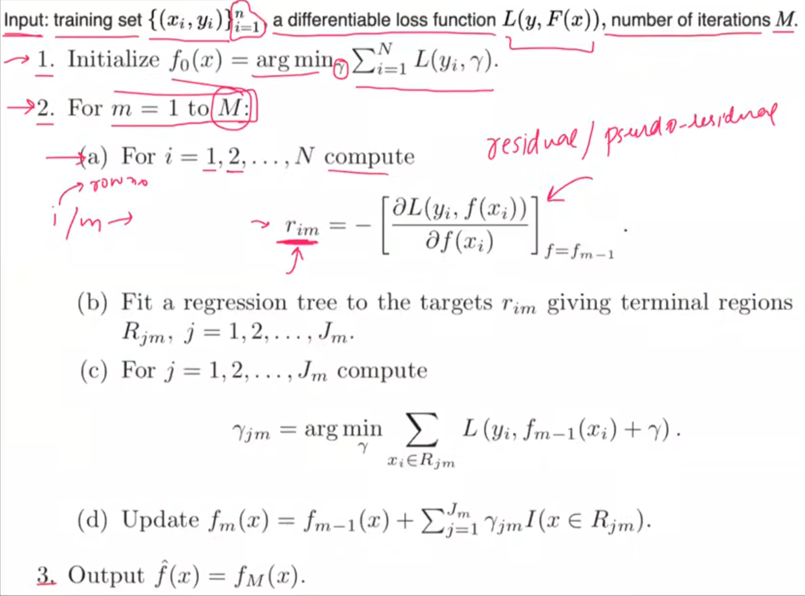
*Friedman's original algorithm. Note (a) the pseudo-residual is the **negative gradient** of the loss, (b) the tree is fitted to those residuals giving terminal regions R_jm, (c) each region gets an optimal value γ_jm, (d) the model is updated additively.*

---

## 5.4 ⭐ Full Mathematical Derivation (Regression, MSE)

### The loss function
```
L(y, F(x)) = ½ (y − F(x))²
```
> **Why the ½?** It cancels the 2 that appears when we differentiate — pure convenience.
> **Differentiability requirement:** the loss MUST be differentiable, because we need
> gradients at every step.

### Derivation 1 — Why is `F₀(x) = mean(y)`?

We need the constant `γ` that minimises the total loss:
```
F₀(x) = argmin_γ  Σᵢ L(yᵢ, γ) = argmin_γ  Σᵢ ½ (yᵢ − γ)²
```

**Step 1 —** Let `S = Σᵢ ½ (yᵢ − γ)²`. Differentiate w.r.t. `γ`:
```
∂S/∂γ = Σᵢ ½ · 2(yᵢ − γ) · (−1) = Σᵢ (γ − yᵢ)
```

**Step 2 —** Set to zero:
```
Σᵢ (γ − yᵢ) = 0
```

**Step 3 —** Expand:
```
Σᵢ γ − Σᵢ yᵢ = 0
```

**Step 4 —** Since `γ` is constant, `Σᵢ γ = nγ`:
```
nγ − Σᵢ yᵢ = 0
```

**Step 5 —** Solve:
```
┌──────────────────────────────┐
│   γ = (1/n) Σᵢ yᵢ = mean(y)  │   ✔ PROVED
└──────────────────────────────┘
```

### Derivation 2 — Why is the pseudo-residual = `y − F(x)`?

```
rᵢₘ = − [ ∂L(yᵢ, F(xᵢ)) / ∂F(xᵢ) ]_{F = F_{m−1}}
```

**Step A —** Given `L = ½(yᵢ − F(xᵢ))²`, differentiate w.r.t. `F(xᵢ)`:
```
∂L/∂F(xᵢ) = ½ · 2(yᵢ − F(xᵢ)) · (−1)
```
**Step B —** The 2 and ½ cancel:
```
∂L/∂F(xᵢ) = −(yᵢ − F(xᵢ))
```
**Step C —** Apply the leading minus sign:
```
rᵢₘ = −[ −(yᵢ − F_{m−1}(xᵢ)) ] = yᵢ − F_{m−1}(xᵢ)
```
```
┌───────────────────────────────────────────────┐
│  For MSE:  pseudo-residual = Actual − Predicted│
│  i.e. the ordinary residual IS the negative    │
│  gradient. That's why it's called "gradient"   │
│  boosting.                                     │
└───────────────────────────────────────────────┘
```

### Derivation 3 — Why is the leaf value = mean of residuals?

For each terminal region `R_jm` find the best value `γ_jm`:
```
γ_jm = argmin_γ  Σ_{xᵢ ∈ R_jm}  L(yᵢ, F_{m−1}(xᵢ) + γ)
```

**Step 1 —** Substitute the MSE loss:
```
γ_jm = argmin_γ  Σ ½ ( yᵢ − F_{m−1}(xᵢ) − γ )²
```
**Step 2 —** Let `rᵢ = yᵢ − F_{m−1}(xᵢ)`:
```
γ_jm = argmin_γ  Σ ½ (rᵢ − γ)²
```
**Step 3 —** Differentiate and set to zero:
```
∂/∂γ  Σ ½ (rᵢ − γ)² = Σ ½ · 2(rᵢ − γ)(−1) = 0
            →  Σ −(rᵢ − γ) = 0
```
**Step 4 —** Expand:
```
Σ γ − Σ rᵢ = 0
```
**Step 5 —** Let `nⱼ` = number of points in region `R_jm`:
```
nⱼ γ − Σ rᵢ = 0
```
**Step 6 —** Solve:
```
┌─────────────────────────────┐
│          Σ_{xᵢ ∈ R_jm} rᵢ   │
│  γ_jm = ─────────────────   │  = MEAN of the residuals in that leaf
│               nⱼ            │
└─────────────────────────────┘
```

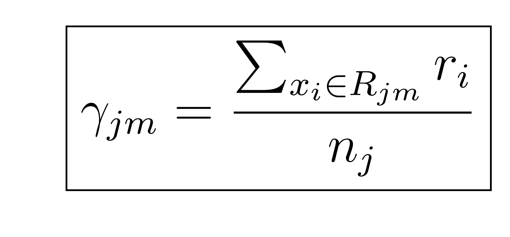

**Numerical example:** a leaf has 2 points with residuals `+1.0` and `−0.5`
→ `γ = (1.0 − 0.5)/2 = 0.25`

---

## 5.5 Worked Example — Gradient Boosting Regression

**Dataset:** 3 startups.

| R&D | Admin | Marketing | Profit (y) |
|---|---|---|---|
| 165 | 137 | 471 | 192 |
| 101 | 134 | 292 | 140 |
| 121 | 118 | 282 | 92 |

### Iteration 0 — initial model
```
F₀(x) = mean(192, 140, 92) = 424 / 3 ≈ 141.33
```

### Iteration 1 — first tree

**Step A — residuals:**
```
r₁ = 192 − 141.33 = +50.67
r₂ = 140 − 141.33 =  −1.33
r₃ =  92 − 141.33 = −49.33
```

**Step B — fit tree on residuals.** Suppose the tree makes 2 terminal regions:
```
Region 1: Startup 1 only  →  avg residual = 50.67
Region 2: Startups 2 & 3  →  avg = (−1.33 + −49.33)/2 = −25.33
```

**Step C — update model (ν = 0.1):**
```
Startup 1: F₁ = 141.33 + 0.1(50.67)  = 141.33 + 5.07 = 146.40
Startup 2: F₁ = 141.33 + 0.1(−25.33) = 141.33 − 2.53 = 138.80
Startup 3: F₁ = 141.33 + 0.1(−25.33) = 141.33 − 2.53 = 138.80
```

**Step D — new residuals:**
```
r₁ = 192 − 146.40 = +45.60      (was +50.67)
r₂ = 140 − 138.80 =  +1.20      (was  −1.33)
r₃ =  92 − 138.80 = −46.80      (was −49.33)
```
> ✔ **The residuals are getting smaller.** Repeat for M iterations until they approach zero.

---

## 5.6 ⭐ Gradient Boosting for CLASSIFICATION

### The magic: only ONE thing changes

| Aspect | Regression | Classification |
|---|---|---|
| **Loss Function** | Mean Squared Error | **Log Loss** |
| **Initial model** | Mean of target | **Log of Odds** |
| Base learner | Regression Tree | **Regression Tree** (yes, even for classification!) |
| Algorithm steps | Same | Same |

> ⭐ **Only the loss function changes. Everything else stays the same.**
> In regression, the *mean* was the first model. In classification, the *log of odds* plays
> exactly the same role.

### Formula 1 — Log of Odds (initial prediction)
```
             ⎛ Number of Class-1 ⎞          ⎛ N₁ ⎞
F₀(x) = ln ⎜ ───────────────── ⎟  =  ln ⎜ ── ⎟
             ⎝ Number of Class-0 ⎠          ⎝ N₀ ⎠
```
⚠️ Use the **natural logarithm** (base e), not base 10.

### Formula 2 — Log-Odds → Probability (sigmoid)
```
         e^F
   p = ───────
       1 + e^F
```

**Derivation:**
```
odds = p / (1 − p)
log(odds) = F₀
p / (1 − p) = e^F₀
p = (1 − p)·e^F₀
p = e^F₀ − p·e^F₀
p + p·e^F₀ = e^F₀
p(1 + e^F₀) = e^F₀
         e^F₀
p = ───────────        ✔
      1 + e^F₀
```

### Formula 3 — Probability → Log-Odds
```
Log-Odds = ln( p / (1 − p) )
```

### Formula 4 — Pseudo-residuals
```
rᵢ = yᵢ − pᵢ
```
`yᵢ` = actual (0 or 1), `pᵢ` = predicted probability from the previous model.

### Formula 5 — ⭐ Gamma (γ) for each leaf node
```
         Σ_{xᵢ ∈ Rⱼ} (yᵢ − pᵢ)
  γⱼ = ────────────────────────
         Σ_{xᵢ ∈ Rⱼ} pᵢ(1 − pᵢ)
```
- This is the **output value for leaf j**
- ⚠️ It lives in **log-odds space**, NOT probability space

### Formula 6 — Model update
```
Fₘ(x) = F_{m−1}(x) + ν · γₘ
```

### Formula 7 — Final prediction
```
                  e^F_final
Probability = ─────────────────
                1 + e^F_final

p ≥ 0.5 → Class 1,    p < 0.5 → Class 0
```

---

## 5.7 ⭐⭐ The Gamma Derivation (the most important derivation in GB classification)

### The combination problem
The first model outputs a **log-odds** value. The regression tree outputs a **residual**
(a number in probability-difference space). **You cannot add them — they live in different
mathematical spaces.**

**Solution:** for each leaf, compute a special value **γ** that lives in log-odds space.
Then you can safely add γ to the previous log-odds.

### The Log Loss function
```
L(y, F) = −[ y·log(p) + (1 − y)·log(1 − p) ]
```
where `p = σ(F) = 1 / (1 + e^(−F))`.

### Step A — Compute the gradient (pseudo-residual)

Using the chain rule: `∂L/∂F = (∂L/∂p) · (∂p/∂F)`

**First, ∂L/∂p:**
```
∂L/∂p = −[ y/p − (1−y)/(1−p) ]
      = −[ ( y(1−p) − (1−y)p ) / ( p(1−p) ) ]
      = −[ (y − p) / ( p(1−p) ) ]
      = (p − y) / ( p(1−p) )
```

**Next, ∂p/∂F** using `p = (1 + e^(−F))^(−1)`:
```
∂p/∂F = −(1 + e^(−F))^(−2) · (−e^(−F))
      = e^(−F) / (1 + e^(−F))²
      = [ 1/(1+e^(−F)) ] · [ e^(−F)/(1+e^(−F)) ]
      = p · (1 − p)
```

**Therefore:**
```
∂L/∂F = [ (p − y) / (p(1−p)) ] · p(1−p)
      = p − y
      = −(y − p)
```
```
┌────────────────────────────────────────┐
│  Pseudo-residual (negative gradient):  │
│              r = y − p                 │   ✔ confirms Formula 4
└────────────────────────────────────────┘
```

### Step B — Find the optimal leaf value γ

For one leaf `Rⱼ`, the new prediction for its points is `F_new = F_old + γⱼ`.
We want the γⱼ that minimises `Σ_{i∈Rⱼ} L(yᵢ, F_old(xᵢ) + γⱼ)`.

**Use a 2nd-order Taylor expansion around `F_old`:**
```
L(F_old + γ) ≈ L(F_old) + (∂L/∂F)|_{F_old} · γ  +  ½ (∂²L/∂F²)|_{F_old} · γ²
```

We already know `∂L/∂F = p − y = −r`.

**The second derivative (Hessian):**
```
∂²L/∂F² = ∂/∂F (p − y) = ∂p/∂F = p(1 − p)
```

**So the sum of losses in the leaf becomes:**
```
Σ_{i∈Rⱼ} [ L(F_old,i) − rᵢ·γⱼ + ½ pᵢ(1−pᵢ)·γⱼ² ]
```

**Differentiate w.r.t. γⱼ and set to zero:**
```
∂/∂γⱼ  Σ [ −rᵢγⱼ + ½ pᵢ(1−pᵢ)γⱼ² ] = 0

      Σ [ −rᵢ + pᵢ(1−pᵢ)γⱼ ] = 0

      γⱼ · Σ pᵢ(1−pᵢ)  =  Σ rᵢ
```

**Solve:**
```
┌────────────────────────────────┐
│            Σ_{i∈Rⱼ} rᵢ         │
│    γⱼ = ───────────────────    │   ✔ PROVED
│         Σ_{i∈Rⱼ} pᵢ(1 − pᵢ)    │
└────────────────────────────────┘
```
- **Numerator** = sum of residuals in the leaf
- **Denominator** = sum of `p(1−p)` for all points in that leaf

---

## 5.8 Step-by-step algorithm (classification)

```
STAGE 1 — Initial model
  1. Calculate Log of Odds from the training data
  2. Convert log-odds → probability using sigmoid
  3. This is the SAME prediction for all data points initially
  4. Calculate pseudo-residuals:  r = y − p

STAGE 2 — First decision tree
  1. Train a REGRESSION tree (not a classification tree!) on the residuals
     → input = original features, target = residuals
  2. Keep it a weak learner (shallow, few leaves)
  3. For each leaf compute Gamma (γ) with the formula above
  4. Update:  F₁(x) = F₀(x) + ν · γ
  5. Convert F₁(x) back to probability
  6. Calculate new residuals

STAGE 3 — Second decision tree
  1. Train another regression tree on the NEW residuals
  2. Compute γ using the UPDATED probabilities (not the old ones!)
  3. Update:  F₂(x) = F₁(x) + ν · γ
  4. Convert to probability, recompute residuals

REPEAT until residuals approach zero or the model stops improving.
```

### ⭐ Why regression trees for a classification problem?

The residuals `(y − p)` are **continuous** values (e.g. 0.375, −0.625), not discrete classes.
So we need a model that predicts continuous numbers → a **Regression Tree**. The tree predicts
residuals; we then convert them to log-odds via γ and combine everything in log-odds space.

> **Remember:** even though the final problem is classification, **every tree in the ensemble
> is a regression tree trained on residuals.**

---

## 5.9 Geometric intuition (3D visualisation)

2D data `(x₁, x₂)` is lifted into 3D by adding the y-axis (class 0 or 1). Class-0 points sit
at `y = 0`, class-1 points at `y = 1`. The model's prediction is a **surface**.

| Iteration | What the surface looks like |
|---|---|
| **0** | Flat plane at `p = mean(y)` (e.g. 0.56) |
| **1** | Stair-step: two levels after the first tree |
| **2** | Three levels: more flexibility |
| **3+** | Complex surface adapting to the data shape |
| **Final** | Intricate boundary separating the two classes |

Residuals are shown as **vertical lines** from each data point to the prediction surface. As
iterations increase, these lines get **shorter** — the errors are reducing.

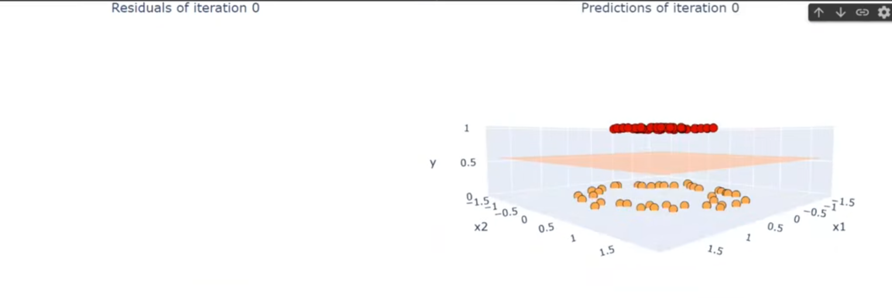
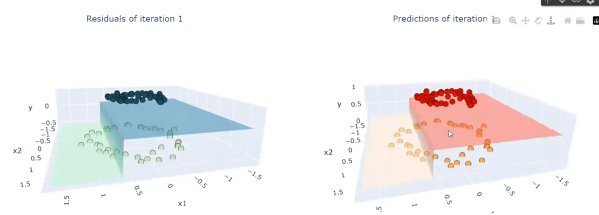
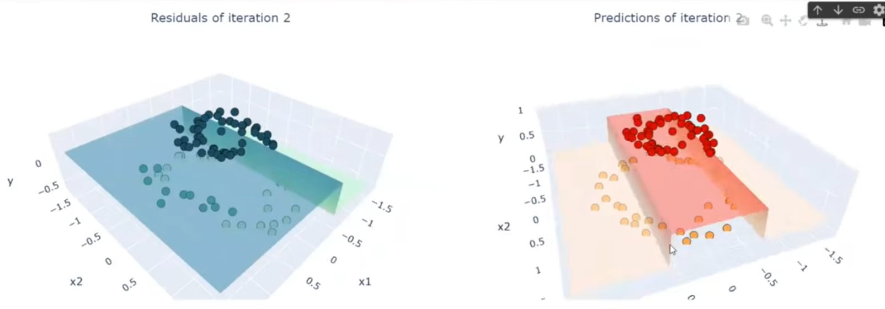
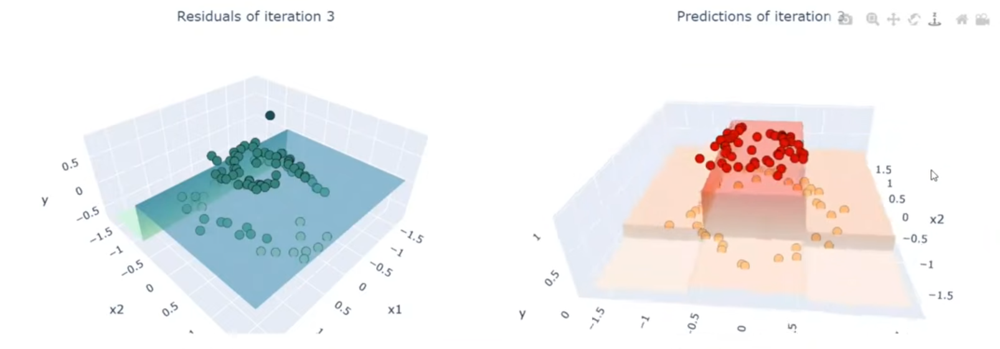
*Iteration 0 starts as a flat plane; with each added tree the surface bends to separate the red (class 1) points from the orange (class 0) points, and the residual lines get shorter.*

---

## 5.10 Predicting a new point (classification)

```
1. Start with the initial log-odds:   F₀ = ln(5/3) ≈ 0.51
2. Send the point through Tree 1 → reach a leaf → get γ₁
3. Send it through Tree 2 → reach a leaf → get γ₂
4. Combine:   F_final = 0.51 + 0.1×γ₁ + 0.1×γ₂
5. Convert:   p = e^F_final / (1 + e^F_final)
6. Classify:  p ≥ 0.5 → Class 1,  else Class 0
```

---

## 5.11 Gradient Boosting Hyperparameters

| Parameter | Typical | Notes |
|---|---|---|
| **Tree depth / leaves** | **8 to 32 terminal leaves** | GB uses **deeper trees than AdaBoost**. AdaBoost uses stumps (depth 1); GB trees are bigger because each tree must capture complex residual patterns. Small dataset → ~8 leaves; large → 32+ |
| **Learning rate (ν)** | 0.01, 0.05, 0.1, 0.2 | Also called **shrinkage**. Constant across all iterations. Smaller ν → more trees needed → better generalisation |
| **n_estimators (M)** | 100 – 1000 | More trees = more complexity. Balance with ν + **early stopping** |
| `subsample` | 0.5 – 1.0 | < 1.0 gives **Stochastic Gradient Boosting** — adds randomness, reduces overfitting |

> ⭐ **The rule:** `small ν + large M + early stopping` is the winning combination.

---

## 5.12 ⭐ AdaBoost vs Gradient Boosting

| Feature | **AdaBoost** | **Gradient Boosting** |
|---|---|---|
| **Base learner** | Decision **Stumps** (depth = 1) | Decision Trees (**8–32 leaves**) |
| **How errors are handled** | **Increases the weights** of misclassified points | **Fits new models to the residuals** (pseudo-residuals) |
| **Model weights** | Each model gets a different weight `αₘ` | All trees share the **same learning rate ν** |
| **Loss function** | **Exponential loss** (fixed) | **Any differentiable loss** (MSE, LogLoss, custom) |
| **Tree size** | Very small (stumps) | Larger |
| **Flexibility** | Low | **High** |
| **Outlier sensitivity** | **High** (exponential loss blows up on outliers) | Lower (can use robust losses like Huber) |

> 🎤 **Interview one-liner:** "AdaBoost re-weights the data points; Gradient Boosting re-fits
> the residuals. The deeper insight is that the residual *is* the negative gradient of the
> squared-error loss — so Gradient Boosting is really gradient descent in **function space**,
> where each tree is one descent step and the learning rate is the step size."

---

# PART 6 — XGBoost

> **XGBoost = eXtreme Gradient Boosting.** Created by **Tianqi Chen** in **2014**.
> ⚠️ It is **not a new algorithm** — it is a **library** built on top of Gradient Boosting,
> with extreme software + ML optimizations.

## 6.1 Why XGBoost was created — the history

### Evolution of ML algorithms

| Era | Algorithms | Advantage | Problem |
|---|---|---|---|
| **1970s–80s** | Linear Regression, Naive Bayes | Could solve ML problems | **Too specialised** — LR only for linear data, NB only for text-like data |
| **1990s** | Random Forest, SVM, GBM | Powerful + worked on many data types | 1. Overfitting. 2. **Scalability** — too slow as internet-era data grew |
| **2014+** | **XGBoost** | Fixed both speed and performance | — |

### Why Gradient Boosting was chosen as the base (5 reasons)
1. **Flexibility** — any differentiable loss function (regression, classification, ranking, custom)
2. **Performance** — good results on most datasets
3. **Robustness** — very stable with proper regularization
4. **Missing-value handling** — handles them internally
5. **Kaggle success** — people were already winning with GBM

> The only problems were: (1) performance could be pushed further, (2) it was slow on large
> datasets. XGBoost was built to fix both.

### Three stages of XGBoost's history
| Stage | What happened |
|---|---|
| **Stage 1 (2014)** | Paper published: *"XGBoost: A Scalable Tree Boosting System"* |
| **Stage 2 (~2016)** | Tianqi Chen won the **Higgs Boson** competition. **16 out of 29** winning Kaggle submissions in 2016 used XGBoost. Popularity exploded |
| **Stage 3 (post-2016)** | Made **open source** → multi-platform, multi-language, more features. 10 years of growth happened in 5 |

### Three design goals
```
1. PERFORMANCE : high accuracy, robust, no overfitting
2. SPEED       : scalable, comfortable on big data
3. FLEXIBILITY : reach as many people as possible (not just Python users)
```

**Flexibility in practice:**
- **Cross-platform:** Linux, Windows, Mac
- **Multi-language (unique):** Python, R, Java, Scala, C++, C, Julia, Ruby, Swift — build a
  model in Python, save it, load it in Java for predictions
- **Integrations:** NumPy, Pandas, scikit-learn, Spark, Dask, SHAP, LIME, Docker, Kubernetes, Airflow, MLflow
- **Task versatility:** regression, binary/multi-class classification, time series, **ranking**
  (recommender systems), anomaly detection, custom loss functions

---

## 6.2 The Big Picture — how XGBoost differs from GBM

At its core XGBoost **is** Gradient Boosting. The workflow is identical:
```
1. Start with a base model
2. Calculate residuals
3. Train a Decision Tree to predict those residuals
4. Add the tree to the previous model (with a learning rate)
5. Repeat
```

> ⭐ **The major twist:** the **Decision Trees themselves are different.**
> - Normal Gradient Boosting trees split using **Gini Impurity** or **Entropy** or **MSE**
> - **XGBoost trees split using a special metric: the SIMILARITY SCORE**

### Key terms

| Term | Symbol | Default | Meaning |
|---|---|---|---|
| Learning rate | `η` (eta) | **0.3** | Multiply each tree's output before adding |
| L2 Regularization | `λ` (lambda) | 1 | Appears in the **denominator** of Similarity Score & Leaf Output |
| Min split loss | `γ` (gamma) | 0 | Minimum Gain required to make a split |
| Similarity Score | SS | — | Replaces Gini/Entropy. **More similar the residuals → higher the score** |

---

## 6.3 ⭐ Formula Summary (learn this box first)

### Regression
```
┌──────────────────────────────────────────────┐
│  Similarity Score:   SS = (Σ Residuals)²     │
│                           ─────────────      │
│                               N + λ          │
│                                              │
│  Gain:  Gain = SS_Left + SS_Right − SS_Root  │
│                                              │
│  Leaf Output:   Output = Σ Residuals         │
│                          ────────────        │
│                             N + λ            │
│                                              │
│  Update:  Fₘ(x) = F_{m−1}(x) + η × TreeOut   │
└──────────────────────────────────────────────┘
```

### Classification
```
┌────────────────────────────────────────────────────┐
│  Log of Odds:   LO = ln( p / (1 − p) )             │
│                                                    │
│  Probability:   P = e^LO / (1 + e^LO)              │
│                                                    │
│  Similarity Score:   SS =      (Σ Residuals)²      │
│                            ──────────────────────  │
│                              Σ[Pᵢ(1 − Pᵢ)] + λ     │
│                                                    │
│  Gain:  Gain = SS_Left + SS_Right − SS_Root        │
│                                                    │
│  Leaf Output:   Output =     Σ Residuals           │
│                           ──────────────────────   │
│                             Σ[Pᵢ(1 − Pᵢ)] + λ      │
│                                                    │
│  Update:  LO_new = LO_old + η × TreeOutput         │
└────────────────────────────────────────────────────┘
```

---

## 6.4 ⭐ Worked Example — XGBoost for REGRESSION

**Dataset:** 4 students. (Using `λ = 0`, `η = 0.3` for simplicity.)

| Student | CGPA | Package (LPA) |
|---|---|---|
| 1 | 4.0 | 4.5 |
| 2 | 6.0 | 6.0 |
| 3 | 7.5 | 8.0 |
| 4 | 9.0 | 11.0 |

### Stage 1 — Base model = mean
```
Mean = (4.5 + 6.0 + 8.0 + 11.0) / 4 = 29.5 / 4 = 7.375 ≈ 7.3
```
No matter the CGPA, the first model predicts **7.3 LPA** for everyone.

### Residuals
| Student | Actual | Predicted | Residual |
|---|---|---|---|
| 1 | 4.5 | 7.3 | **−2.8** |
| 2 | 6.0 | 7.3 | **−1.3** |
| 3 | 8.0 | 7.3 | **+0.7** |
| 4 | 11.0 | 7.3 | **+3.7** |

### Step A+B — Root node Similarity Score
```
Root residuals: [−2.8, −1.3, +0.7, +3.7]
Σ Residuals = (−2.8) + (−1.3) + 0.7 + 3.7 = 0.3

SS_Root = (0.3)² / (4 + 0) = 0.09 / 4 ≈ 0.02
```
> ⭐ **Key insight:** when residuals are very **different** (some +, some −) they **cancel
> out** → low score. When residuals are **similar**, the score is **high**. That is why it is
> called a *similarity* score.

### Step C — Candidate splits (averages of consecutive sorted CGPA)
```
CGPA sorted: 4.0, 6.0, 7.5, 9.0
Split 1: (4.0+6.0)/2 = 5.0
Split 2: (6.0+7.5)/2 = 6.75
Split 3: (7.5+9.0)/2 = 8.25
```

### Step D — Try CGPA < 5.0
```
Left  : [−2.8]              SS = (−2.8)²/1 = 7.84
Right : [−1.3, +0.7, +3.7]  Σ = 3.1,  SS = (3.1)²/3 = 9.61/3 ≈ 3.20
Gain  = 7.84 + 3.20 − 0.02 = 11.02
```

### Step E — Try CGPA < 6.75
```
Left  : [−2.8, −1.3]  Σ = −4.1,  SS = (−4.1)²/2 = 16.81/2 = 8.405
Right : [+0.7, +3.7]  Σ =  4.4,  SS = (4.4)²/2  = 19.36/2 = 9.68
Gain  = 8.405 + 9.68 − 0.02 = 18.065
```

### Step F — Try CGPA < 8.25
```
Left  : [−2.8, −1.3, +0.7]  Σ = −3.4,  SS = (−3.4)²/3 = 11.56/3 ≈ 3.85
Right : [+3.7]              SS = (3.7)²/1 = 13.69
Gain  = 3.85 + 13.69 − 0.02 = 17.52
```

### Step G — Pick the best split

| Split Point | Gain |
|---|---|
| CGPA < 5.0 | 11.02 |
| **CGPA < 6.75** | **18.065 ← Winner** |
| CGPA < 8.25 | 17.52 |

**Root node = `CGPA < 6.75?`**

### Step H — Split the left node further
Left node has Students 1, 2 (CGPA 4.0, 6.0). Only one possible split: 5.0.
```
Left  : [−2.8]  SS = 7.84
Right : [−1.3]  SS = 1.69
Parent SS      = (−4.1)²/2 = 8.405
Gain = 7.84 + 1.69 − 8.405 = 1.125
```
Stop here (max depth = 2 for this small dataset).

### Step I — Leaf output values
```
Leaf 1 (CGPA < 5.0,     Student 1)   : Output = −2.8 / (1+0) = −2.8
Leaf 2 (5.0 ≤ CGPA<6.75, Student 2)  : Output = −1.3 / (1+0) = −1.3
Leaf 3 (CGPA ≥ 6.75,  Students 3,4)  : Output = (0.7+3.7)/(2+0) = 4.4/2 = 2.2
```
> **Note:** when `λ = 0`, the leaf output is simply the **average of the residuals** in that leaf.

### The resulting tree
```
                  [CGPA < 6.75?]
                 /              \
            Yes /                \ No
               /                  \
        [CGPA < 5.0?]        [Output: +2.2]
         /         \
    Yes /           \ No
       /             \
 [Out: −2.8]     [Out: −1.3]
```

### Stage 2 — Update the model (η = 0.3)
```
Student 1 (CGPA 4.0): 4.0<6.75 Yes → 4.0<5.0 Yes → Out −2.8
      Pred = 7.3 + (0.3 × −2.8) = 7.3 − 0.84 = 6.46
Student 2 (CGPA 6.0): 6.0<6.75 Yes → 6.0<5.0 No  → Out −1.3
      Pred = 7.3 + (0.3 × −1.3) = 7.3 − 0.39 = 6.91
Student 3 (CGPA 7.5): 7.5<6.75 No → Out +2.2
      Pred = 7.3 + (0.3 × 2.2) = 7.3 + 0.66 = 7.96
Student 4 (CGPA 9.0): 9.0<6.75 No → Out +2.2
      Pred = 7.3 + 0.66 = 7.96
```

### New residuals
| Student | Actual | Stage-2 Pred | Residual₂ |
|---|---|---|---|
| 1 | 4.5 | 6.46 | −1.96 |
| 2 | 6.0 | 6.91 | −0.91 |
| 3 | 8.0 | 7.96 | +0.04 |
| 4 | 11.0 | 7.96 | +3.04 |

```
Old: [−2.8, −1.3, +0.7, +3.7]
New: [−1.96, −0.91, +0.04, +3.04]      ← shrinking toward zero ✔
```

### Stage 3 and beyond
```
1. Take CGPA as input and Residual₂ as target
2. Build another XGBoost tree (same process)
3. F₃(x) = 7.3 + (0.3 × Tree₁) + (0.3 × Tree₂)
4. Compute Residual₃
5. Repeat n_estimators times
```

---

## 6.5 ⭐ Worked Example — XGBoost for CLASSIFICATION

**Dataset:** 5 students. (1 = Placed, 0 = Not Placed.)

| Student | CGPA | Placement |
|---|---|---|
| 1 | 5.70 | 0 |
| 2 | 6.40 | 0 |
| 3 | 7.10 | 1 |
| 4 | 8.15 | 1 |
| 5 | 9.60 | 1 |

### Stage 1 — Base model = Log of Odds
```
Total = 5,  Placed = 3,  Not placed = 2
p = 3/5 = 0.6
Odds = 0.6 / 0.4 = 1.5
Log of Odds = ln(1.5) ≈ 0.405
```

**Convert to probability:**
```
P = e^0.405 / (1 + e^0.405) = 1.5 / 2.5 = 0.6
```
Base model predicts 60% probability for everyone → since 0.6 > 0.5, predicts "Placed" for all.

### Pseudo-residuals
| Student | Observed | Pred Prob | Residual |
|---|---|---|---|
| 1 | 0 | 0.6 | **−0.6** |
| 2 | 0 | 0.6 | **−0.6** |
| 3 | 1 | 0.6 | **+0.4** |
| 4 | 1 | 0.6 | **+0.4** |
| 5 | 1 | 0.6 | **+0.4** |

### Root Similarity Score
```
Σ Residuals = (−0.6) + (−0.6) + 0.4 + 0.4 + 0.4 = 0
Numerator   = 0² = 0
Denominator = 5 × (0.6 × 0.4) = 5 × 0.24 = 1.2
SS_Root = 0 / (1.2 + 0) = 0
```

### Candidate splits
```
(5.70+6.40)/2 = 6.05
(6.40+7.10)/2 = 6.75
(7.10+8.15)/2 = 7.625
(8.15+9.60)/2 = 8.875
```

### Try CGPA < 6.05
```
Left  : [−0.6]                     SS = (−0.6)²/(0.6×0.4) = 0.36/0.24 = 1.5
Right : [−0.6, +0.4, +0.4, +0.4]   Σ = 0.6,  denom = 4×0.24 = 0.96
                                   SS = 0.36/0.96 = 0.375
Gain = 1.5 + 0.375 − 0 = 1.875
```

### Try CGPA < 6.75
```
Left  : [−0.6, −0.6]         Σ = −1.2,  denom = 2×0.24 = 0.48
                             SS = 1.44/0.48 = 3.0
Right : [+0.4, +0.4, +0.4]   Σ =  1.2,  denom = 3×0.24 = 0.72
                             SS = 1.44/0.72 = 2.0
Gain = 3.0 + 2.0 − 0 = 5.0
```

### Try CGPA < 7.625
```
Left  : [−0.6, −0.6, +0.4]  Σ = −0.8,  denom = 0.72,  SS = 0.64/0.72 ≈ 0.889
Right : [+0.4, +0.4]        Σ =  0.8,  denom = 0.48,  SS = 0.64/0.48 ≈ 1.333
Gain = 0.889 + 1.333 − 0 ≈ 2.222
```

### Try CGPA < 8.875
```
Left  : [−0.6,−0.6,+0.4,+0.4]  Σ = −0.4, denom = 0.96, SS = 0.16/0.96 ≈ 0.167
Right : [+0.4]                 SS = 0.16/0.24 ≈ 0.667
Gain = 0.167 + 0.667 − 0 ≈ 0.834
```

### Best split

| Split Point | Gain |
|---|---|
| CGPA < 6.05 | 1.875 |
| **CGPA < 6.75** | **5.0 ← Winner** |
| CGPA < 7.625 | 2.222 |
| CGPA < 8.875 | 0.834 |

### Leaf outputs
```
Left leaf (Students 1,2):
   Σ residuals = −1.2,  denom = 2 × 0.24 = 0.48
   Output = −1.2 / 0.48 = −2.5

Right leaf (Students 3,4,5):
   Σ residuals = 1.2,   denom = 3 × 0.24 = 0.72
   Output = 1.2 / 0.72 ≈ 1.667
```

```
          [CGPA < 6.75?]
         /              \
    Yes /                \ No
       /                  \
 [Out: −2.5]         [Out: +1.667]
```

### Stage 2 — Update the LOG ODDS (η = 0.3)
```
Students 1 & 2:  LO = 0.405 + (0.3 × −2.5)  = 0.405 − 0.75 = −0.345
Students 3,4,5:  LO = 0.405 + (0.3 × 1.667) = 0.405 + 0.50 =  0.905
```

### Convert back to probability
```
Students 1 & 2: P = e^(−0.345)/(1+e^(−0.345)) = 0.708/1.708 ≈ 0.415
                0.415 < 0.5  →  "Not Placed"  ✔ IMPROVEMENT!

Students 3,4,5: P = e^(0.905)/(1+e^(0.905))   = 2.472/3.472 ≈ 0.712
                0.712 > 0.5  →  "Placed"  ✔
```

### New residuals
| Student | Observed | Stage-2 Prob | Residual₂ |
|---|---|---|---|
| 1 | 0 | 0.415 | −0.415 |
| 2 | 0 | 0.415 | −0.415 |
| 3 | 1 | 0.712 | +0.288 |
| 4 | 1 | 0.712 | +0.288 |
| 5 | 1 | 0.712 | +0.288 |

```
Old: [−0.6, −0.6, +0.4, +0.4, +0.4]
New: [−0.415, −0.415, +0.288, +0.288, +0.288]   ← shrinking ✔
```
⚠️ For Stage 3, build the tree using the **new probabilities (0.415 / 0.712)**, not the old 0.6.

### Regression vs Classification side by side

| Aspect | Regression | Classification |
|---|---|---|
| Base model | Mean of target | **Log of Odds** |
| Probability step | Not needed | **Sigmoid** `e^LO/(1+e^LO)` |
| Residuals | Actual − Predicted | Observed − Predicted **Probability** |
| SS denominator | `N + λ` | `Σ[P(1−P)] + λ` |
| Leaf output denom | `N + λ` | `Σ[P(1−P)] + λ` |
| Model update | Direct addition | Add to **log odds**, then convert |
| Tree construction | Similarity Score & Gain | Similarity Score & Gain (**same**) |

---
## 6.6 ⭐⭐⭐ THE FULL MATHEMATICAL DERIVATION (highest-value interview topic)

So far we **used** the Similarity Score and Leaf Output formulas. Now we **prove** where
they come from. This is the single most impressive thing you can derive in an ML interview.

### 6.6.1 Prerequisite: Taylor Series

> **Taylor's idea:** *"Give me any complicated function, and I can approximate it with a
> simple polynomial."* The more terms you add, the better the approximation.

**General formula** — for a function `f(x)` around a point `a`:
```
                     f'(a)            f''(a)              f'''(a)
f(x) ≈ f(a)  +  ───── (x − a)  +  ────── (x − a)²  +  ────── (x − a)³  + ...
                       1!               2!                   3!
```

**Example — approximate `eˣ` around `a = 0`:**
```
f(a)   = e⁰ = 1
f'(a)  = e⁰ = 1   → term:  1·(x − 0)     = x
f''(a) = e⁰ = 1   → term:  ½·x²
f'''(a)= e⁰ = 1   → term:  (1/6)·x³

           x²   x³
eˣ ≈ 1 + x + ── + ── + ...
           2    6
```
| Terms used | Approximation | Quality |
|---|---|---|
| 1 | `1` | Poor |
| 2 | `1 + x` | Better near 0 |
| 3 | `1 + x + x²/2` | Even better |
| more | ... | Hugs the real curve over a wider range |

### 6.6.2 Step 1 — The Objective Function

XGBoost's objective is special: it has **regularization built in by default**.

At stage `t`:
```
┌──────────────────────────────────────────────────────────┐
│          n                                               │
│ Obj⁽ᵗ⁾ =  Σ  L( yᵢ , ŷᵢ⁽ᵗ⁻¹⁾ + fₜ(xᵢ) )  +  Ω(fₜ)        │
│         i=1                                              │
└──────────────────────────────────────────────────────────┘
```
- **First term** = loss function (how wrong we are)
- **Second term** = regularization (how complex the tree is)

**Why it's called "Objective Function", not "Loss Function":**
> Because it is the sum of **TWO** things — the loss AND the regularization penalty.

**The regularization term** for a tree with `T` leaves and leaf weights `w`:
```
┌───────────────────────────────┐
│                    1   T      │
│   Ω(f) = γT  +  ── λ Σ wⱼ²   │
│                    2  j=1     │
└───────────────────────────────┘
```
| Symbol | Meaning | Penalises |
|---|---|---|
| `T` | number of leaves | — |
| `wⱼ` | output value (weight) of leaf j | — |
| **`γ`** (gamma) | leaf-count penalty | **Too many leaves** → keeps trees simple |
| **`λ`** (lambda) | L2 penalty on leaf weights | **Large leaf outputs** → stops any one leaf dominating (helps with outliers) |

**Objective at different stages:**
```
Stage 1 (base model only, just the mean — not a tree):
      Obj⁽¹⁾ = Σ L(yᵢ, f₁(xᵢ))            ← no regularization, f₁ is a constant

Stage 2 (base + 1 tree):
      Obj⁽²⁾ = Σ L(yᵢ, ŷᵢ⁽¹⁾ + f₂(xᵢ)) + Ω(f₂)

Stage 3 (base + 2 trees):
      Obj⁽³⁾ = Σ L(yᵢ, ŷᵢ⁽²⁾ + f₃(xᵢ)) + Ω(f₃)
      ← we do NOT re-add Ω(f₂); it was already handled at stage 2
```

### 6.6.3 Step 2 — Why we NEED Taylor Series here

In Linear Regression, `ŷ = mx + b` is smooth, the loss is a nice parabola, and we can just
differentiate.

But in XGBoost:
- The prediction includes a **Decision Tree**
- Decision trees produce **piecewise-constant** outputs — sudden jumps between regions
- So the loss curve is **jagged / zig-zag**, not smooth
- It is **not differentiable** with respect to `fₜ(xᵢ)` at many points
- ⚠️ **We cannot use standard calculus directly.**

```
Linear Regression loss:          XGBoost loss w.r.t. a tree:
       ╲        ╱                      ┌─┐   ┌┐
        ╲      ╱                    ┌──┘ └─┐ ││  ┌──
         ╲____╱                  ───┘      └─┘└──┘
       smooth parabola               jagged — NOT differentiable
       → easy to optimise            → need an approximation
```

**Solution: approximate the loss with a smooth 2nd-order Taylor polynomial.**

### 6.6.4 Step 3 — Apply Taylor Series

We use a **2nd-order** expansion (up to the second derivative). Third and higher terms are
not needed — the job gets done with three terms.

**Identify `x` and `a`:**
```
x = ŷᵢ⁽ᵗ⁻¹⁾ + fₜ(xᵢ)       (the NEW prediction after adding the tree)
a = ŷᵢ⁽ᵗ⁻¹⁾                 (the OLD prediction — our expansion point)

Therefore:  x − a = fₜ(xᵢ)   (the change brought by the new tree)
```

**Identify the derivatives:**
```
f(a)   = L(yᵢ, ŷᵢ⁽ᵗ⁻¹⁾)                    ← a CONSTANT
f'(a)  = ∂L / ∂ŷᵢ⁽ᵗ⁻¹⁾        = gᵢ         ← GRADIENT (1st derivative)
f''(a) = ∂²L / ∂(ŷᵢ⁽ᵗ⁻¹⁾)²    = hᵢ         ← HESSIAN  (2nd derivative)
```

**Write the approximation:**
```
                                                          1
L( yᵢ, ŷᵢ⁽ᵗ⁻¹⁾ + fₜ(xᵢ) )  ≈  L(yᵢ, ŷᵢ⁽ᵗ⁻¹⁾)  +  gᵢ·fₜ(xᵢ)  +  ── hᵢ·fₜ(xᵢ)²
                                                          2
```

**Plug into the objective:**
```
            n ⎡                              1              ⎤           1    T
Obj⁽ᵗ⁾  ≈   Σ ⎢ L(yᵢ, ŷᵢ⁽ᵗ⁻¹⁾) + gᵢfₜ(xᵢ) + ── hᵢfₜ(xᵢ)² ⎥  +  γT + ── λ Σ wⱼ²
           i=1⎣                              2              ⎦           2   j=1
```

**Drop the constant.** `L(yᵢ, ŷᵢ⁽ᵗ⁻¹⁾)` does not depend on `fₜ` — it is a constant for this
optimization, so it cannot change where the minimum is.
```
┌──────────────────────────────────────────────────────────────┐
│            n ⎡              1            ⎤        1   T      │
│ Obj⁽ᵗ⁾  ≈  Σ ⎢ gᵢfₜ(xᵢ) + ── hᵢfₜ(xᵢ)² ⎥ + γT + ── λ Σ wⱼ²  │
│           i=1⎣              2            ⎦        2  j=1     │
└──────────────────────────────────────────────────────────────┘
```
✔ This is now a **smooth polynomial** — easy to optimise!

### 6.6.5 Step 4 — Group by leaf nodes

Key observation: for any data point `xᵢ`, the tree sends it to **exactly one leaf**, and all
points in the same leaf get the **same output value**.

Define:
- `Iⱼ` = the set of row indices that land in leaf `j` (the **instance set** of leaf j)
- `wⱼ` = the output value (weight) of leaf `j`
- So for any `i ∈ Iⱼ`: **`fₜ(xᵢ) = wⱼ`**

**Rewrite the summations — sum over leaves instead of over rows:**
```
 n                T                T   ⎛             ⎞
 Σ gᵢ fₜ(xᵢ)  =   Σ   Σ   gᵢ wⱼ  =  Σ  wⱼ ⎜  Σ   gᵢ  ⎟
i=1              j=1 i∈Iⱼ           j=1  ⎝ i∈Iⱼ      ⎠

 n  1                T   1                T  1     ⎛            ⎞
 Σ ── hᵢ fₜ(xᵢ)²  =  Σ   Σ  ── hᵢ wⱼ²  =  Σ ── wⱼ² ⎜  Σ   hᵢ   ⎟
i=1 2               j=1 i∈Iⱼ 2           j=1 2     ⎝ i∈Iⱼ       ⎠
```

**Define the shorthand:**
```
┌──────────────────────────────────────────────────┐
│  Gⱼ = Σ_{i∈Iⱼ} gᵢ    (sum of GRADIENTS in leaf j)│
│  Hⱼ = Σ_{i∈Iⱼ} hᵢ    (sum of HESSIANS  in leaf j)│
└──────────────────────────────────────────────────┘
```

**Final simplified objective:**
```
┌──────────────────────────────────────────────────┐
│            T  ⎡          1               ⎤       │
│ Obj⁽ᵗ⁾  =  Σ  ⎢ Gⱼwⱼ + ── (Hⱼ + λ) wⱼ² ⎥ + γT  │
│           j=1 ⎣          2               ⎦       │
└──────────────────────────────────────────────────┘
```

> ⭐ **Key insight:** The objective is now a **sum of independent terms, one per leaf**, and
> each is a simple **quadratic** in `wⱼ`. We can optimise each leaf **separately**.

### 6.6.6 Step 5 — Derive the optimal Leaf Weight

For a single leaf `j`:
```
Objⱼ = Gⱼwⱼ + ½ (Hⱼ + λ) wⱼ²
```

**Step 1 — Differentiate w.r.t. `wⱼ`:**
```
∂Objⱼ / ∂wⱼ = Gⱼ + (Hⱼ + λ) wⱼ
```
**Step 2 — Set equal to zero:**
```
Gⱼ + (Hⱼ + λ) wⱼ = 0
```
**Step 3 — Solve:**
```
┌───────────────────────────┐
│                Gⱼ         │
│    wⱼ*  =  − ───────      │   ← GENERAL LEAF WEIGHT FORMULA
│              Hⱼ + λ       │
└───────────────────────────┘
```

#### Specialise to Regression (MSE loss)
```
L = ½ (yᵢ − ŷᵢ)²

Gradient:  gᵢ = ∂L/∂ŷᵢ   = −(yᵢ − ŷᵢ) = ŷᵢ − yᵢ = −residualᵢ
Hessian:   hᵢ = ∂²L/∂ŷᵢ² = 1

                Σ gᵢ          Σ(−residualᵢ)        Σ residuals
wⱼ* = −  ───────────  =  − ───────────────  =  ─────────────
              Σ hᵢ + λ          Σ 1 + λ           count + λ
```
```
┌──────────────────────────────────────┐
│               Σ residuals            │
│   wⱼ* =  ──────────────────────      │  ✔ EXACTLY the regression formula
│          number of residuals + λ     │     we used in section 6.4!
└──────────────────────────────────────┘
```

#### Specialise to Classification (Log Loss)
```
L = −[ yᵢ log(pᵢ) + (1 − yᵢ) log(1 − pᵢ) ]

Gradient:  gᵢ = pᵢ − yᵢ = −residualᵢ
Hessian:   hᵢ = pᵢ(1 − pᵢ)

                Σ gᵢ             Σ residuals
wⱼ* = −  ───────────  =  ───────────────────────
              Σ hᵢ + λ      Σ pᵢ(1 − pᵢ) + λ
```
```
┌────────────────────────────────────┐
│            Σ residuals             │
│  wⱼ* = ─────────────────────       │  ✔ EXACTLY the classification formula
│        Σ pᵢ(1 − pᵢ) + λ            │
└────────────────────────────────────┘
```

### 6.6.7 Step 6 — Derive the Similarity Score

Now plug the **optimal** weight `wⱼ*` back into the objective to find the **minimum loss**
achievable by that leaf.

```
Objⱼ* = Gⱼwⱼ* + ½ (Hⱼ + λ)(wⱼ*)²
```

**Step 1 — Substitute `wⱼ* = −Gⱼ/(Hⱼ+λ)`:**
```
            ⎛   Gⱼ   ⎞       1            ⎛   Gⱼ   ⎞²
Objⱼ* = Gⱼ ⎜ − ───── ⎟  +  ── (Hⱼ + λ) ⎜ − ───── ⎟
            ⎝  Hⱼ+λ  ⎠       2            ⎝  Hⱼ+λ  ⎠
```
**Step 2 — Simplify the first term:**
```
      Gⱼ²        1              Gⱼ²
  = − ─────  +  ── (Hⱼ + λ) ─────────
      Hⱼ+λ       2            (Hⱼ+λ)²
```
**Step 3 — Simplify the second term:**
```
      Gⱼ²       1   Gⱼ²
  = − ─────  +  ── ─────
      Hⱼ+λ       2  Hⱼ+λ
```
**Step 4 — Combine:**
```
┌────────────────────────┐
│             1    Gⱼ²   │
│  Objⱼ* = − ── ──────   │   ← minimum objective for leaf j
│             2  Hⱼ + λ  │      (more NEGATIVE = better leaf)
└────────────────────────┘
```

**Step 5 — The Similarity Score is defined as the NEGATIVE of this minimum** (so it comes
out positive and "bigger = better"):

```
┌─────────────────────────────────────────┐
│                      1     Gⱼ²          │
│  Similarity Score = ── ─────────        │
│                      2   Hⱼ + λ         │
│                                         │
│  Equivalently:                          │
│                      1   (Σ_{i∈Iⱼ} gᵢ)² │
│  Similarity Score = ── ───────────────  │
│                      2  Σ_{i∈Iⱼ} hᵢ + λ │
└─────────────────────────────────────────┘
```

**Interpretation:**
- **Higher similarity score = better leaf** (more loss reduction)
- It is used exactly like Gini Impurity or Entropy, to evaluate splits
- ⭐ But unlike Gini/Entropy, it is **derived directly from the objective function** — it is
  **not a heuristic**

> **Note on the ½:** in the hand-worked examples (section 6.4/6.5) the `½` is often dropped
> because it is a constant factor that appears in every term of the Gain, so it does not
> change which split wins. The actual XGBoost library keeps it.

### 6.6.8 Step 7 — Derive the Gain formula

XGBoost builds trees **greedily**:
```
1. Start with a single leaf (the root)
2. Try all possible feature values to find the best split
3. For each candidate split, calculate the Gain
4. Choose the split with the highest Gain
5. Repeat on the new leaves until a stopping criterion is met
```

**Score before splitting (parent):**
```
                 1   (Σ_{i∈I} gᵢ)²
Score_parent =  ── ─────────────────
                 2  Σ_{i∈I} hᵢ + λ
```

**Scores after splitting (children):**
```
                 1   (Σ_{i∈I_L} gᵢ)²                      1   (Σ_{i∈I_R} gᵢ)²
Score_left   =  ── ───────────────────      Score_right = ── ───────────────────
                 2  Σ_{i∈I_L} hᵢ + λ                       2  Σ_{i∈I_R} hᵢ + λ
```

**The Gain:**
```
┌────────────────────────────────────────────────────────────────┐
│  Gain = Score_left + Score_right − Score_parent − γ            │
│                                                                │
│  Written out fully:                                            │
│                                                                │
│         1 ⎡   G_L²        G_R²       (G_L + G_R)²  ⎤           │
│  Gain = ─ ⎢ ─────── + ─────── − ─────────────────  ⎥ − γ       │
│         2 ⎣ H_L + λ     H_R + λ    H_L + H_R + λ   ⎦           │
└────────────────────────────────────────────────────────────────┘
```

**Interpretation:**
| Part | Meaning |
|---|---|
| `Score_left + Score_right` | Combined quality of the two children after the split |
| `Score_parent` | Quality before the split |
| **`γ` (gamma)** | **Penalty for adding a new leaf** (complexity cost) |
| `Gain > 0` | The split is beneficial → **make it** |
| `Gain ≤ 0` | Complexity outweighs the benefit → **don't split** |

**This mirrors the normal Decision Tree exactly:**
```
Decision Tree:  Information Gain = Entropy(Parent) − Weighted Avg Entropy(Children)
XGBoost      :  Gain = Score(Left) + Score(Right) − Score(Parent) − γ
```

### 6.6.9 Summary table — Regression vs Classification maths

| Component | **Regression (MSE)** | **Classification (Log Loss)** |
|---|---|---|
| Loss `L` | `½(yᵢ − ŷᵢ)²` | `−[yᵢ log pᵢ + (1−yᵢ) log(1−pᵢ)]` |
| Gradient `gᵢ` | `ŷᵢ − yᵢ = −residual` | `pᵢ − yᵢ = −residual` |
| **Hessian `hᵢ`** | **`1`** | **`pᵢ(1 − pᵢ)`** |
| Leaf weight `wⱼ*` | `Σ residuals / (count + λ)` | `Σ residuals / (Σ pᵢ(1−pᵢ) + λ)` |
| Similarity Score | `½ · (Σ residuals)² / (count + λ)` | `½ · (Σ residuals)² / (Σ pᵢ(1−pᵢ) + λ)` |

> **Why `count` appears in regression:** because `hᵢ = 1` for every point, so `Hⱼ = Σ 1 = count`.
> **Why `p(1−p)` appears in classification:** because that is the Hessian of log loss.
> **Same single formula** `wⱼ* = −Gⱼ/(Hⱼ+λ)` produces both. 🎯

### 6.6.10 Mind map of the derivation

```
XGBoost
  │
  ├── Core Concepts ──── Additive Modeling
  │                      Stage-wise Training
  │                      Optimization over Gradient Boosting
  │
  ├── Objective Function ── Loss Function component
  │                         Regularization term ── γ (leaf count)
  │                                              └ λ (leaf weight)
  │
  ├── Optimization ──── Taylor Series Expansion (2nd order)
  │    Technique         ├── Gradient (g) = 1st derivative
  │                      └── Hessian  (h) = 2nd derivative
  │                     Simplified Objective:  Σⱼ [Gⱼwⱼ + ½(Hⱼ+λ)wⱼ²] + γT
  │
  ├── Leaf Weight ───── General:        w* = −G / (H + λ)
  │                     Regression:     Σr / (n + λ)
  │                     Classification: Σr / (Σp(1−p) + λ)
  │
  └── Tree Building ─── Similarity Score: ½ · G²/(H + λ)
                        Gain: ½(Left + Right − Parent) − γ
```

---

## 6.7 ⭐ The 6 SPEED Optimizations (software engineering)

Tianqi Chen realised existing Gradient Boosting was too slow on large data. Six software
optimizations were applied.

### Optimization 1 — Parallel Processing

**The doubt:** *"Boosting is sequential — Model 1 → Model 2 → Model 3. How can it be parallel?"*

**The answer:**
> Parallel processing is **NOT** at the model-building sequence level. Models are still added
> sequentially. **Parallelism happens INSIDE each individual tree's construction.**

**How:** To find the best split at a node, you must evaluate **all features**:
```
Feature f1: sort values → compute candidate split points → calculate impurity for each → best
Feature f2: do exactly the same, INDEPENDENTLY
Feature f3: ... etc.
```
Since evaluating `f1` and `f2` are **independent**, different CPU cores handle different
features **simultaneously**.

```
Best Split = argmin over (j, s)  [ Impurity(Left(j,s)) + Impurity(Right(j,s)) ]
                 ↑
         j = feature index, s = split point.
         Each core computes this for ONE feature in parallel.
```
**Hyperparameter:** `n_jobs = -1`

### Optimization 2 — Column Block Storage (cache efficient)

| Traditional (row-wise) | XGBoost (column-wise) |
|---|---|
| Block 1 = Row 1 (all features) | Block 1 = Feature f1 (all rows) |
| Block 2 = Row 2 (all features) | Block 2 = Feature f2 (all rows) |
| Processing row by row | Each column block stored separately |

**Why it matters:**
1. **Parallel feature splitting** (Opt 1) becomes easy — each core grabs one column block
2. **Cache efficiency** improves — accessing one feature means reading **contiguous memory**

### Optimization 3 — Cache Awareness

**The hardware problem:** the CPU needs data from RAM. CPU and RAM are separate hardware
connected by a system bus — transfer takes time.

**Cache memory** is a very small memory (4–8 MB) **inside the CPU**. Store frequently used
data there so the CPU doesn't fetch from RAM every time.

**XGBoost's histogram-based training:**
```
1. For each numerical feature, create a histogram with bins
2. e.g. IQ ranges 50–150 → bins [50,60), [60,70), ...
3. Store bin boundaries and counts in CACHE memory
4. During tree building the CPU repeatedly needs these bin values
5. They're already in cache (right next to the CPU) → big speed-up
```

> **Analogy:** a cook keeps frequently used ingredients on the **counter (cache)** instead of
> walking to the **fridge (RAM)** every time.

### Optimization 4 — Out-of-Core Computing

**Problem:** 8 GB RAM but a 10 GB dataset. You cannot load it all.

**Solution — disk chunking:**
```
1. Divide the 10 GB dataset into chunks (e.g. five 2 GB chunks)
2. Load Chunk 1 → train → unload
3. Load Chunk 2 → train → unload
4. Continue through all chunks
```
**Hyperparameter:** `tree_method = 'hist'`
While processing chunks sequentially, frequently needed statistics stay in cache so the next
chunk can reuse them.

### Optimization 5 — Distributed Computing

Use **multiple machines (nodes)** instead of one.
```
1. Partition the dataset into k chunks
2. Send one chunk to each of k nodes
3. Each node independently finds the best splits for ITS data (local tree)
4. A MASTER NODE collects all local split proposals
5. The master aggregates and selects the GLOBALLY best split
6. Repeat for each tree level
```
```
Mathematically: for feature j, node m computes local optimal split s_m^(j) and gain G_m^(j).
The master selects:      s^(j)* = argmax_m  G_m^(j)
```
**External libraries:** Dask, Spark, Kubernetes.

### Optimization 6 — GPU Support

| | CPU | GPU |
|---|---|---|
| Cores | Few, powerful | **Thousands**, less powerful each |
| Fits XGBoost? | OK | **Perfect** — histogram creation and split finding are highly parallelizable |

**Hyperparameter:** `tree_method = 'gpu_hist'` (newer versions: `device='cuda'`)
Result: dramatic speed-up — GPUs reaching better test error in ~120 seconds where CPUs took
far longer.

---

## 6.8 ⭐ The 4 PERFORMANCE Optimizations (ML concepts)

Speed came from software engineering. **Performance** comes from ML innovations.

### Performance Optimization 1 — Regularized Learning Objective

**The problem with plain Gradient Boosting:** regularization was limited to
1. the learning rate (shrinkage), and
2. tree pruning during construction.

You could **not** add L1/L2 regularization directly to the loss.

**XGBoost's fix** — regularization is built into the objective (derived in detail in §6.6):
```
         n                   K
 L(φ) =  Σ  l(yᵢ, ŷᵢ)   +   Σ  Ω(f_k)
        i=1                 k=1

                       1   T
 where   Ω(f) = γT + ── λ Σ wⱼ²
                       2  j=1
```
| Term | Effect |
|---|---|
| `γT` | Discourages growing too many leaves → simpler trees |
| `½λΣwⱼ²` | Discourages large leaf outputs → prevents overfitting to outliers |

Minimising `L` requires minimising **both** prediction error AND complexity → the model
generalises better on test data.

### Performance Optimization 2 — Automatic Missing Value Handling (Sparsity-Aware Split Finding)

**Traditional approach:** most algorithms cannot handle missing values. You must impute them
or drop rows/columns.

**XGBoost's approach:** handles missing values **internally during tree building**.

```
Setup: feature f has values 4, 5, 6, 8, and one MISSING.
Candidate splits: 4.5, 5.5, 7, 8.5

Process:
1. Build the node with split f > 4.5
2. All NON-missing points go Left or Right by the rule
3. For the missing value, XGBoost tries BOTH directions:
      Option A: send missing LEFT  → calculate Gain
      Option B: send missing RIGHT → calculate Gain
4. Pick the direction with the MAXIMUM gain
```

**Result:** XGBoost **learns a "default direction"** for missing values, separately for every
split. No preprocessing needed.

> 🎤 **Interview one-liner:** "XGBoost doesn't impute missing values — it treats 'missing' as
> a direction. At each split it computes the gain with missings sent left and with missings
> sent right, and stores whichever is better as that node's default direction."

### Performance Optimization 3 — Efficient Split Finding

Two related ideas: **Approximate Tree Learning** + **Weighted Quantile Sketch**.

#### The problem with Exact Greedy Search
```
1. Sort all unique values of the feature
2. Test every possible split point (average of consecutive values)
3. Compute the score for each
4. Pick the best
```
For a feature with millions of unique values, this is **very slow**.

#### Solution A — Approximate Tree Learning (Histogram-Based)
```
1. Divide the feature range into k bins (bucketization)
2. e.g. values 0–100 → bins [0,10), [10,20), ..., [90,100]
3. The continuous feature becomes discrete
4. Test only k−1 split points instead of millions
```
**Trade-off:** speed increases dramatically; accuracy may drop slightly (usually negligible).

#### Solution B — Weighted Quantile Sketch

**The question:** *how should the bins be created?*

**Naive approach (uniform binning):**
```
Bin_i = [ 100(i−1)/k ,  100i/k )
```
❌ **Problem:** uniform bins ignore the data distribution. If most data is concentrated in one
region, uniform bins waste resolution there.

**XGBoost's approach:**
```
1. Study the actual data distribution of the feature
2. Place bin boundaries based on QUANTILES of the data
3. Where data is SPARSE  → use LARGER bins
4. Where data is DENSE   → use SMALLER bins (more resolution)
```

**Formal definition** — find boundaries `{s₁, ..., s_{k−1}}` such that each bin holds roughly
equal **weighted mass**:
```
                        1   n
    Σ      hᵢ    ≈     ──   Σ  hᵢ
  xᵢ ∈ Binⱼ             k  i=1
```
where `hᵢ` is the **Hessian** (second-derivative) weight of point i.

> ⭐ **Why weight by the Hessian?** Because `hᵢ` measures how much point `i` matters for the
> loss. In classification `hᵢ = pᵢ(1−pᵢ)`, which is largest when `p ≈ 0.5` — i.e. the points
> the model is **most unsure about**. So the bins get finer resolution exactly where the model
> needs the most help. This is the "**weighted**" in weighted quantile sketch.

**Benefit:** bins respect the data distribution → trees built on them are more accurate,
compensating for the approximation loss.

### Performance Optimization 4 — Advanced Tree Pruning

| Type | Meaning |
|---|---|
| **Post-pruning** | Grow the tree fully, then trim back |
| **Pre-pruning** | Decide the tree size **during** construction |

**XGBoost's pruning controls:**

| Parameter | Meaning |
|---|---|
| `max_depth` | Limits tree depth (pre-pruning) |
| `min_child_weight` | Minimum sum of **Hessians** in a child node |
| **`gamma` (γ)** | **Minimum loss reduction required to make a split** |

**The gamma parameter:** a new branch is created **only if**
```
Gain > γ
```
If the best possible split doesn't reduce the loss by at least γ, the branch is not grown.
This pre-pruning is built **directly into the Gain calculation**.

> **Why it matters:** prevents unnecessary complexity. The tree grows only when there is a
> statistically significant benefit.

---

## 6.9 XGBoost Hyperparameters (full list for interviews)

### Tree-structure parameters
| Parameter | Default | Meaning |
|---|---|---|
| `n_estimators` | 100 | Number of boosting rounds (trees) |
| `max_depth` | **6** | Max tree depth. Use smaller for small datasets |
| `min_child_weight` | 1 | Min sum of Hessians in a child. ↑ = more conservative |
| `gamma` / `min_split_loss` | 0 | Min loss reduction to split. ↑ = more pruning |
| `max_leaves` | 0 | Max number of leaves (with `grow_policy='lossguide'`) |

### Regularization parameters
| Parameter | Default | Meaning |
|---|---|---|
| `learning_rate` / `eta` | **0.3** | Shrinkage. Lower = more trees needed, better generalisation |
| `lambda` / `reg_lambda` | **1** | **L2** regularization on leaf weights |
| `alpha` / `reg_alpha` | 0 | **L1** regularization on leaf weights (drives weights to 0) |

### Sampling parameters
| Parameter | Default | Meaning |
|---|---|---|
| `subsample` | 1.0 | Fraction of **rows** per tree. 0.5–0.8 reduces overfitting |
| `colsample_bytree` | 1.0 | Fraction of **columns** per tree |
| `colsample_bylevel` | 1.0 | Fraction of columns per depth level |
| `colsample_bynode` | 1.0 | Fraction of columns **per split** (like Random Forest!) |

### System parameters
| Parameter | Options | Meaning |
|---|---|---|
| `tree_method` | `'auto'`, `'exact'`, `'approx'`, `'hist'`, `'gpu_hist'` | Split-finding algorithm. `'hist'` for big data, `'gpu_hist'` for GPU |
| `n_jobs` | −1 | CPU cores |
| `scale_pos_weight` | 1 | For imbalanced binary data. Set to `n_negative / n_positive` |
| `early_stopping_rounds` | — | Stop if validation score doesn't improve for N rounds |

```python
import xgboost as xgb

model = xgb.XGBClassifier(
    n_estimators=1000,
    learning_rate=0.05,
    max_depth=6,
    min_child_weight=1,
    gamma=0,
    subsample=0.8,
    colsample_bytree=0.8,
    reg_lambda=1,
    reg_alpha=0,
    tree_method='hist',
    n_jobs=-1,
    early_stopping_rounds=50,
    eval_metric='logloss',
    random_state=42
)
model.fit(X_train, y_train, eval_set=[(X_val, y_val)], verbose=False)
```

---

## 6.10 Complete XGBoost summary

```
1. BASE: Gradient Boosting Decision Trees (GBDT)

2. OBJECTIVE: minimize the regularized loss
        n                 K ⎛         1        ⎞
   L =  Σ  l(yᵢ, ŷᵢ)  +   Σ ⎜ γT_k + ── λ‖w_k‖²⎟
       i=1               k=1⎝         2        ⎠

3. SPEED OPTIMIZATIONS (software engineering):
   • Parallel feature splitting during tree construction
   • Column block storage for cache efficiency
   • Cache-aware histogram-based training
   • Out-of-core computing for data larger than RAM
   • Distributed computing across multiple nodes
   • GPU support for parallel histogram operations

4. PERFORMANCE OPTIMIZATIONS (ML):
   • L1/L2 regularization inside the objective function
   • Automatic missing-value handling via sparsity-aware splits
   • Approximate tree learning with weighted quantile sketch
   • Advanced tree pruning using the gamma parameter

5. OUTPUT: an ensemble of K trees minimizing the regularized objective
```

> 🎤 **Interview one-liner:** "XGBoost is Gradient Boosting with a second-order Taylor
> approximation of the loss and regularization baked into the objective. That gives a
> closed-form optimal leaf weight `w* = −G/(H+λ)` and a split criterion
> `Gain = ½[G_L²/(H_L+λ) + G_R²/(H_R+λ) − G²/(H+λ)] − γ` — so unlike Gini or Entropy, the
> split rule is **derived from the loss**, not a heuristic. On top of that sit system
> optimizations: column-block storage, cache-aware histograms, out-of-core and GPU training."

---

# PART 7 — LightGBM

> **LightGBM = Light Gradient Boosting Machine.** Built by **Microsoft Research** (paper:
> NeurIPS 2017). "**Light**" because it is **fast** and uses **low memory**.

## 7.1 Why LightGBM was needed

XGBoost was already fast, but it still had a bottleneck. In histogram-based boosting, to find
the best split the algorithm must **scan every data point for every feature**:
```
Cost of building one tree  ≈  O( #data × #features )
```
When you have 10 million rows and 1000 features, this is still painfully slow.

LightGBM asked two clever questions:

| Question | Answer | Technique |
|---|---|---|
| Do we really need **ALL the rows**? | No — rows the model already predicts well teach us little | **GOSS** |
| Do we really need **ALL the features** separately? | No — in sparse data many features are never non-zero together, so they can share one slot | **EFB** |

```
GOSS reduces  #data        ⎫
                           ⎬→  O(#data × #features) becomes much smaller
EFB  reduces  #features    ⎭
```

Plus a third big change: **leaf-wise tree growth** instead of level-wise.

---

## 7.2 Histogram-Based Split Finding (the foundation)

Before GOSS and EFB, understand this — LightGBM (and XGBoost's `hist` mode) work on
**histograms**, not raw values.

```
Raw continuous feature:  4.1, 4.3, 5.0, 5.2, 6.8, 7.1, 7.9, 9.2, ...  (millions of values)
                                        ↓  bucketize into bins
Binned feature:          bin0  bin0  bin1  bin1  bin2  bin2  bin3  bin4   (e.g. 255 bins)
```

**How a split is evaluated:**
```
1. For each bin, store two accumulators:  Σ gradients  and  Σ hessians (or counts)
2. Walk through the bins left → right, accumulating the sums
3. At each bin boundary compute the Gain (same formula as XGBoost)
4. Pick the boundary with the highest Gain
```

| | Exact Greedy | Histogram-Based |
|---|---|---|
| Split points tested | every unique value | only `#bins − 1` (e.g. 254) |
| Pre-sorting needed | **Yes** (expensive) | **No** |
| Memory | stores sorted indices (large) | stores small integer bin ids (**8× smaller**) |
| Speed | Slow | **Fast** |
| Accuracy | Slightly higher | Slightly lower (usually negligible — binning even acts as regularization) |

### ⭐ The histogram subtraction trick (big speed-up, often asked)
```
Histogram(parent) = Histogram(left child) + Histogram(right child)

→ So build the histogram for the SMALLER child only (cheap),
  and get the larger child for FREE by subtraction:

  Histogram(bigger child) = Histogram(parent) − Histogram(smaller child)
```
This roughly **halves** the histogram-building cost at every node.

---

## 7.3 ⭐ Leaf-wise Tree Growth (vs Level-wise)

This is LightGBM's most visible difference.

### Level-wise (XGBoost's classic style — "depth-wise")
Grow the tree **one complete level at a time**. Split **all** nodes at the current depth
before moving down.

```
                      [Root]
                     /      \
               [A]              [B]           ← level 1: BOTH split
              /    \           /    \
           [C]     [D]      [E]     [F]       ← level 2: ALL FOUR split
          /  \    /  \     /  \    /  \
        ...  ... ...  ... ...  ... ...  ...   ← balanced, symmetric
```
- ✔ Balanced tree, naturally regularized, harder to overfit
- ✘ Wastes effort splitting nodes that barely reduce the loss

### Leaf-wise (LightGBM's style — "best-first")
Among **all current leaves**, split the **one leaf with the maximum Gain (loss reduction)**.
Repeat.

```
                      [Root]
                     /      \
               [A]              [B]
              /    \              │             ← B had low gain → NOT split
           [C]      [D]           │
                   /   \          │
                [E]    [F]        │            ← D had the highest gain → split
                      /   \
                    [G]   [H]                  ← deep, UNBALANCED/asymmetric
```
- ✔ For the **same number of leaves**, leaf-wise reaches **lower loss** than level-wise,
  because every split is the globally best one available
- ✔ Converges faster — fewer trees needed
- ✘ Can grow **very deep, unbalanced** trees → **overfits on small datasets**

### ⭐ The critical control: `num_leaves`
```
In a level-wise tree of depth d:      num_leaves = 2^d
In a leaf-wise tree, depth is NOT bounded by num_leaves.
```
> ⚠️ **The #1 LightGBM mistake:** leaving `num_leaves` too high.
> **Rule of thumb:** `num_leaves < 2^max_depth`. For example if `max_depth = 7`, use
> `num_leaves ≈ 70–127`, not 128. Also raise `min_data_in_leaf` on small data.

| | Level-wise (XGBoost default) | Leaf-wise (LightGBM) |
|---|---|---|
| Growth rule | Split all nodes at a depth | Split the single best-gain leaf |
| Tree shape | Balanced, symmetric | **Unbalanced, deep** |
| Loss for a fixed #leaves | Higher | **Lower** |
| Speed of convergence | Slower | **Faster** |
| Overfitting risk | Lower | **Higher** (control with `num_leaves`, `min_data_in_leaf`) |
| Best for | Small/medium data | **Large data** |

---

## 7.4 ⭐⭐ GOSS — Gradient-based One-Side Sampling

> **The problem:** scanning all N rows at every split is expensive. Can we use fewer rows
> without losing accuracy?

### The key observation
In gradient boosting, every row has a **gradient `gᵢ`**:
```
|gᵢ| small   →  the model already predicts this row WELL    →  it is "easy", well-trained
|gᵢ| large   →  the model predicts this row BADLY           →  it is "hard", under-trained
```
> 💡 **Insight:** rows with **large gradients contribute much more** to the information gain.
> Rows with small gradients are nearly already solved.

### The naive (wrong) idea
*"Just throw away all the small-gradient rows."*
❌ **Problem:** this changes the **data distribution**. The remaining data would look much
harder than reality, and the computed gain would be **biased** — the model would be wrong.

### GOSS's solution: keep all the hard ones, sample the easy ones, then COMPENSATE

```
┌──────────────────────────────────────────────────────────────────┐
│  GOSS ALGORITHM                                                  │
│                                                                  │
│  Input: training data, sampling ratios a (top) and b (rest)      │
│                                                                  │
│  1. Compute |gᵢ| for every row and SORT descending by |gᵢ|       │
│                                                                  │
│  2. TOP SET A  : keep the top  a × 100%  rows  (largest |g|)     │
│                  → keep ALL of them, no sampling                 │
│                                                                  │
│  3. REST SET B : from the remaining (1−a)×100% rows,             │
│                  RANDOMLY sample  b × 100%  of the full dataset  │
│                                                                  │
│  4. ⭐ AMPLIFY: multiply the gradients (and hessians) of the      │
│     sampled set B by the constant                                │
│                                                                  │
│                      1 − a                                       │
│                      ─────                                       │
│                        b                                         │
│                                                                  │
│  5. Compute the split gain using only A ∪ B                      │
└──────────────────────────────────────────────────────────────────┘
```

### ⭐ Why the amplification factor `(1−a)/b`? (the derivation)

The "rest" group originally held a fraction `(1 − a)` of the data. We only sampled a fraction
`b` of the data from it. To make the small sample **represent** the whole rest group, scale
each sampled row up by:
```
   how much we SHOULD have        (1 − a)
   ───────────────────────  =  ───────────
   how much we ACTUALLY took        b
```
This keeps the **expected value of the gain unbiased**, so the data distribution is not
distorted. That single constant is what makes GOSS work instead of just being lossy sampling.

### Worked numerical example
```
N = 10,000 rows,   a = 0.2,   b = 0.1

Step 1: sort by |gradient| descending
Step 2: Set A = top 20%        = 2,000 rows   (all kept)
Step 3: Set B = randomly take 10% of 10,000 = 1,000 rows from the remaining 8,000
Step 4: amplification = (1 − 0.2) / 0.1 = 0.8 / 0.1 = 8
        → multiply the gradients of those 1,000 rows by 8
Step 5: build the histogram using 2,000 + 1,000 = 3,000 rows

Result: only 30% of the data used → ~3× faster, with almost no accuracy loss
```

### The modified gain formula
Using `A_l`/`A_r` for the top-set rows and `B_l`/`B_r` for the sampled rows going left/right:
```
                 1  ⎡ ( Σ_{i∈A_l} gᵢ  +  (1−a)/b · Σ_{i∈B_l} gᵢ )²
  Ṽ(j, d)  =  ───  ⎢ ────────────────────────────────────────────
                 n  ⎣                   n_l(j,d)

                      ( Σ_{i∈A_r} gᵢ  +  (1−a)/b · Σ_{i∈B_r} gᵢ )² ⎤
                   +  ──────────────────────────────────────────── ⎥
                                        n_r(j,d)                   ⎦
```
Notice the `(1−a)/b` sitting in front of every **B** term — that is the compensation.

**Hyperparameters:** `boosting_type='goss'`, `top_rate` (= a, default 0.2), `other_rate`
(= b, default 0.1).

> 🎤 **Interview one-liner:** "GOSS keeps every row with a large gradient — those are the
> under-trained, informative ones — and randomly samples only a small fraction of the
> small-gradient rows. To stop that sampling from distorting the data distribution, the
> sampled rows' gradients are scaled up by (1−a)/b, which keeps the gain estimate unbiased."

---

## 7.5 ⭐⭐ EFB — Exclusive Feature Bundling

> **The problem:** high-dimensional data is usually **very sparse** (think one-hot encoded
> categories, bag-of-words). Histogram cost grows with `#features`. Can we reduce the number
> of features without losing information?

### The key observation: mutual exclusivity
In sparse data, many features are **mutually exclusive** — they are almost **never non-zero
at the same time**.

**Classic example — one-hot encoding of "City":**
```
            is_Delhi   is_Mumbai   is_Chennai
Row 1          1           0           0
Row 2          0           1           0
Row 3          0           0           1
Row 4          1           0           0
            └──────── exactly ONE is non-zero per row ────────┘
```
These 3 columns carry only as much information as **one** column. So why pay for 3 histograms?

### The solution: bundle them into ONE feature

**Merging trick — use disjoint value ranges (offsets):**
```
Suppose:  feature A takes values in [0, 10)
          feature B takes values in [0, 20)

Add an OFFSET to B so the two ranges never overlap:
          bundled = A                 when A ≠ 0
          bundled = B + 10            when B ≠ 0
          bundled = 0                 when both are 0

Now:  bundled ∈ [0, 10)  → it was feature A
      bundled ∈ [10, 30) → it was feature B
```
> The split finder can still recover **exactly** which original feature a value came from,
> because the ranges are disjoint. **Zero information is lost.**

### The two sub-problems (and how LightGBM solves both)

#### Sub-problem 1: Which features go into which bundle?
This is **graph colouring**, which is **NP-hard**. LightGBM uses a **greedy approximation**:
```
1. Build a graph: each FEATURE is a vertex.
   Add an edge between two features with weight = how often they CONFLICT
   (conflict = both non-zero in the same row)
2. Sort the vertices by DEGREE (most-conflicting features first)
3. For each feature in order:
      try to put it into an EXISTING bundle such that the bundle's total
      conflict stays ≤ max_conflict_rate (γ)
      if no bundle fits → start a NEW bundle
```
> ⭐ **Allowing a small conflict rate `γ`** is the clever part. Perfect exclusivity is rare,
> but *almost* exclusive is common. Permitting a tiny overlap gives far fewer bundles for
> only a tiny accuracy cost — the error is bounded by `O(γ)`.

#### Sub-problem 2: How to merge features inside a bundle?
The offset trick described above (**Merge Exclusive Features**).

### Complexity improvement
```
Before EFB:   O( #data × #features )
After  EFB:   O( #data × #bundles )      where #bundles ≪ #features
```
For a one-hot encoded dataset this can be a **10–100× reduction** in effective features.

**Hyperparameters:** `enable_bundle=True` (default), `max_conflict_rate`.

> 🎤 **Interview one-liner:** "EFB bundles mutually exclusive sparse features — ones that are
> never non-zero together, like one-hot columns — into a single feature by giving each
> original feature a disjoint value range via offsets. Choosing the bundles is graph
> colouring, so LightGBM solves it greedily and even allows a small conflict rate, which
> drops the histogram cost from #features to #bundles."

---

## 7.6 Native Categorical Feature Handling

LightGBM can handle categorical features **directly** — no one-hot encoding needed.

**Why one-hot is bad for trees:**
- It creates many sparse columns
- Each one-hot column can only make an unbalanced split ("is it Delhi or not?")
- To isolate a group of cities you need **many** levels of depth → deep, weak trees

**LightGBM's approach (based on Fisher's 1958 optimal-split result):**
```
1. For a categorical feature, gather the statistics of each category
2. SORT the categories by  (Σ gradients / Σ hessians)   ← their "average target behaviour"
3. Now treat the sorted categories like an ordered numeric feature
4. Find the best split point along that sorted order
   → this gives an optimal partition of categories into two groups, in O(k log k)
```
Result: **one split can separate {Delhi, Mumbai} from {Chennai, Kolkata}** instead of needing
several one-hot splits.

```python
train_data = lgb.Dataset(X, label=y, categorical_feature=['city', 'product_type'])
# or with the sklearn API: pass pandas 'category' dtype columns
```
**Guards against overfitting:** `min_data_per_group`, `cat_smooth`, `max_cat_threshold`.

---

## 7.7 LightGBM Architecture (full picture)

```
                         TRAINING DATA
                               │
        ┌──────────────────────┴──────────────────────┐
        ▼                                             ▼
┌──────────────────────┐                  ┌──────────────────────┐
│   EFB                │                  │   GOSS               │
│ Bundle mutually      │                  │ Keep ALL large-|g|   │
│ exclusive sparse     │                  │ rows + random sample │
│ features via offsets │                  │ of small-|g| rows,   │
│                      │                  │ amplified by (1−a)/b │
│  #features ↓↓        │                  │  #rows ↓↓            │
└──────────┬───────────┘                  └──────────┬───────────┘
           └──────────────────┬──────────────────────┘
                              ▼
            ┌────────────────────────────────────┐
            │   HISTOGRAM CONSTRUCTION           │
            │   bucket values into ~255 bins     │
            │   (+ histogram subtraction trick)  │
            └─────────────────┬──────────────────┘
                              ▼
            ┌────────────────────────────────────┐
            │   LEAF-WISE TREE GROWTH            │
            │   repeatedly split the leaf with   │
            │   the MAXIMUM gain                 │
            │   (capped by num_leaves)           │
            └─────────────────┬──────────────────┘
                              ▼
            ┌────────────────────────────────────┐
            │   ADD TREE:  Fₘ = F_{m−1} + ν·hₘ   │
            └─────────────────┬──────────────────┘
                              │
                     repeat n_estimators times
                              ▼
                      FINAL PREDICTION
```

---

## 7.8 LightGBM Hyperparameters

### Core
| Parameter | Default | Meaning |
|---|---|---|
| `num_leaves` | 31 | ⭐ **The most important parameter.** Max leaves per tree. Keep `< 2^max_depth` |
| `max_depth` | −1 (no limit) | Depth cap — use it to tame leaf-wise growth |
| `learning_rate` | 0.1 | Shrinkage |
| `n_estimators` | 100 | Number of boosting rounds |
| `min_data_in_leaf` / `min_child_samples` | 20 | ⭐ Min rows in a leaf. **Raise it on small data** to stop overfitting |
| `min_sum_hessian_in_leaf` | 1e-3 | Min sum of Hessians in a leaf |

### Sampling / speed
| Parameter | Meaning |
|---|---|
| `boosting_type` | `'gbdt'` (default), `'goss'`, `'dart'`, `'rf'` |
| `bagging_fraction` / `subsample` | Row sampling fraction (needs `bagging_freq > 0`) |
| `feature_fraction` / `colsample_bytree` | Column sampling fraction |
| `max_bin` | 255. Number of histogram bins. Lower = faster, less accurate |

### Regularization
| Parameter | Meaning |
|---|---|
| `lambda_l1` / `reg_alpha` | L1 regularization |
| `lambda_l2` / `reg_lambda` | L2 regularization |
| `min_gain_to_split` | Like XGBoost's `gamma` |

### Categorical / imbalance
| Parameter | Meaning |
|---|---|
| `categorical_feature` | List of categorical columns |
| `cat_smooth` | Smoothing for categorical splits |
| `is_unbalance` / `scale_pos_weight` | For imbalanced classification |

```python
import lightgbm as lgb

model = lgb.LGBMClassifier(
    num_leaves=31,            # keep < 2^max_depth
    max_depth=7,
    learning_rate=0.05,
    n_estimators=1000,
    min_child_samples=20,     # raise on small data
    subsample=0.8, subsample_freq=1,
    colsample_bytree=0.8,
    reg_lambda=1.0,
    n_jobs=-1,
    random_state=42
)
model.fit(X_train, y_train,
          eval_set=[(X_val, y_val)],
          callbacks=[lgb.early_stopping(50), lgb.log_evaluation(0)])
```

---

## 7.9 LightGBM Advantages & Disadvantages

| ✔ Advantages | ✘ Disadvantages |
|---|---|
| **Very fast** — often 5–20× faster than XGBoost's exact mode | **Overfits on small datasets** (< ~10,000 rows) due to leaf-wise growth |
| **Low memory** — histograms store small bin ids | Needs careful `num_leaves` / `min_data_in_leaf` tuning |
| **Native categorical support** — no one-hot needed | Sensitive to hyperparameters compared to Random Forest |
| **Leaf-wise growth** → lower loss with fewer trees | Unbalanced trees are harder to interpret |
| Scales to very large data; distributed + GPU support | Results can vary slightly between versions |
| Handles missing values automatically | |

> 🎤 **Interview one-liner:** "LightGBM speeds up gradient boosting in three ways: **GOSS**
> cuts the number of rows by keeping all large-gradient samples and amplifying a small
> sample of the rest; **EFB** cuts the number of features by bundling mutually exclusive
> sparse columns; and **leaf-wise growth** reaches lower loss per leaf than level-wise. The
> price is a higher overfitting risk on small data, which you control with `num_leaves` and
> `min_data_in_leaf`."

---

# PART 8 — CatBoost

> **CatBoost = Categorical Boosting.** Built by **Yandex** (paper: NeurIPS 2018).
> Its two headline ideas are **Ordered Target Statistics** (for categorical features) and
> **Ordered Boosting** (to remove prediction shift). Its trees are **symmetric (oblivious)**.

## 8.1 The problem CatBoost solves: TARGET LEAKAGE

Both of CatBoost's main innovations attack the **same underlying bug**: using a data point's
own target value to build the model that will later predict that same point.

---

## 8.2 ⭐ Handling Categorical Features — the road to Ordered TS

### Option 1: One-Hot Encoding
```
City → is_Delhi, is_Mumbai, is_Chennai, ...
```
✘ Explodes the feature count for high-cardinality columns (e.g. 50,000 user IDs)
✘ Each column gives only a weak, unbalanced split

### Option 2: Label / Ordinal Encoding
```
Delhi → 0,  Mumbai → 1,  Chennai → 2
```
✘ Invents a **fake order** — it implies Chennai > Mumbai > Delhi, which is meaningless

### Option 3: Target Statistics (TS) — the good idea
Replace each category with **the average target value for that category**:
```
                 average of y for all rows where city = Delhi
x̂_Delhi  =  ──────────────────────────────────────────────────
                       count of rows where city = Delhi
```
With smoothing (to handle rare categories):
```
             Σ (y over rows of this category)  +  a · P
    x̂   =  ───────────────────────────────────────────────
             count of rows of this category    +  a
```
| Symbol | Meaning |
|---|---|
| `a` | smoothing / prior weight (`> 0`) |
| `P` | the prior — usually the global mean of the target |

✔ One column instead of hundreds
✔ Works for very high cardinality
✘ **BUT it leaks the target!**

### ⭐ The leakage problem (Greedy TS) — interview favourite

If you compute the target statistic for row `i` using a dataset that **includes row `i`'s own
label**, then `x̂ᵢ` secretly contains `yᵢ`.

**The killer example:**
```
Suppose a categorical feature is a UNIQUE ID (every category appears exactly ONCE).

Greedy TS for row i   =  (yᵢ + a·P) / (1 + a)        ← it IS basically yᵢ !

The tree then finds a single "perfect" split on this feature,
gets 100% TRAINING accuracy...
and is completely USELESS on test data (where the IDs are new).
```
This is **target leakage**, and it causes **conditional shift**: the distribution of `x̂`
given `y` differs between training and test data.

### Attempted fixes (and why they're not enough)

| Approach | How | Problem |
|---|---|---|
| **Greedy TS** | Use all data including row i | **Leaks** — overfits badly |
| **Holdout TS** | Split data: compute TS on part A, train on part B | **Wastes data** — you lose a chunk for training |
| **Leave-One-Out TS** | For row i, use all rows **except** i | Still leaks! For a binary target it is reconstructible; the model can invert it |

### ⭐⭐ CatBoost's answer: ORDERED Target Statistics

Inspired by **online learning**: when predicting a point, use only data that arrived
**before** it in time. CatBoost invents an **artificial time** by applying a **random
permutation** to the rows.

```
┌──────────────────────────────────────────────────────────────────┐
│  ORDERED TARGET STATISTICS                                       │
│                                                                  │
│  1. Draw a random permutation σ of the training rows             │
│     (this is the artificial "arrival time")                      │
│                                                                  │
│  2. For row at position k in the permutation, compute its TS     │
│     using ONLY the rows at positions 1 .. k−1 that share the     │
│     same category:                                               │
│                                                                  │
│          Σ_{j < k, xⱼ = xₖ} yⱼ  +  a · P                         │
│   x̂ₖ = ───────────────────────────────────                       │
│          count_{j < k, xⱼ = xₖ}  +  a                            │
│                                                                  │
│  3. Row k's OWN label yₖ is never used → NO LEAKAGE ✔            │
└──────────────────────────────────────────────────────────────────┘
```

**Worked illustration** (category = "Delhi", target = 0/1, a=1, P=0.5):

| Position in permutation | city | y | History of "Delhi" so far | TS used for this row |
|---|---|---|---|---|
| 1 | Delhi | 1 | (none) | (0 + 1×0.5)/(0+1) = **0.500** |
| 2 | Mumbai | 0 | — | — |
| 3 | Delhi | 1 | [1] | (1 + 0.5)/(1+1) = **0.750** |
| 4 | Delhi | 0 | [1, 1] | (2 + 0.5)/(2+1) = **0.833** |
| 5 | Delhi | 1 | [1, 1, 0] | (2 + 0.5)/(3+1) = **0.625** |

Notice each row's own `y` never appears in its own TS value. ✔

**Problem:** early rows in the permutation have very little history → **high variance**.
**Solution:** CatBoost uses **several different random permutations** (default 4) and
averages, so no single row is unlucky in every permutation.

---

## 8.3 ⭐⭐ Ordered Boosting (fixing Prediction Shift)

### The problem: prediction shift in standard gradient boosting

Go back to the gradient boosting loop:
```
Step 1: compute residual  rᵢ = yᵢ − F_{m−1}(xᵢ)
Step 2: fit tree hₘ on those residuals
```
**The hidden bug:** `F_{m−1}` was trained on a dataset that **includes row i**. So
`F_{m−1}(xᵢ)` is an *in-sample* prediction — it is biased, too good. Therefore the residual
`rᵢ` is biased too, and the next tree is fitted to biased targets.

```
This compounds over hundreds of boosting rounds:

   model sees its own training point
        → residual too small
        → next tree learns a distorted signal
        → the training distribution of gradients ≠ the test distribution
        → this gap is called PREDICTION SHIFT
```
> This is the exact same leakage disease as Greedy TS, just appearing in the gradients
> instead of the features.

### ⭐ The solution: Ordered Boosting

Same medicine: a **random permutation** defines an artificial arrival order, and each point's
residual is computed by a model that **never saw that point**.

```
┌───────────────────────────────────────────────────────────────────────┐
│  ORDERED BOOSTING (the idea)                                          │
│                                                                       │
│  1. Take a random permutation σ of the training data                  │
│                                                                       │
│  2. Maintain a set of "supporting models"  M₁, M₂, ..., M_n           │
│     where  Mₖ  is trained ONLY on the first k rows of the permutation │
│                                                                       │
│  3. To get the residual for the row at position k:                    │
│          rₖ = yₖ − M_{k−1}(xₖ)                                        │
│     ← M_{k−1} has NEVER seen row k  →  unbiased residual ✔            │
│                                                                       │
│  4. Fit the new tree on these unbiased residuals                      │
└───────────────────────────────────────────────────────────────────────┘
```

**Visual:**
```
permutation order →   x₁    x₂    x₃    x₄    x₅    x₆  ...
                       │     │     │     │     │     │
residual for x₄ uses ──┴─────┴─────┴──▶ M₃ (trained on x₁,x₂,x₃ only)
                                         │
                                   r₄ = y₄ − M₃(x₄)     ← x₄ NOT in M₃  ✔

residual for x₅ uses M₄ (trained on x₁..x₄)
residual for x₆ uses M₅ (trained on x₁..x₅)
```

**The practical problem:** keeping `n` separate models would need `O(n²)` memory and time.
**CatBoost's trick:** it maintains only `O(log n)` supporting models (at positions
1, 2, 4, 8, 16, ...) and reuses the same permutations that Ordered TS uses. This brings the
cost back to something comparable with ordinary boosting.

### Two modes
| Mode | When to use |
|---|---|
| **`Ordered`** | Small datasets (< ~50k rows). Slower, but much less overfitting |
| **`Plain`** | Large datasets. Classic gradient boosting scheme (with Ordered TS still on) |

> 🎤 **Interview one-liner:** "In standard boosting the residual for a point is computed by a
> model that was trained on that same point, so the residual is biased — that's prediction
> shift. Ordered boosting fixes it by imposing a random permutation and computing each
> point's residual with a model trained only on the points before it, so no point ever
> influences its own gradient."

---

## 8.4 ⭐ Symmetric (Oblivious) Trees

CatBoost's base learners are **oblivious decision trees**, also called **symmetric trees**.

> **Definition:** In a symmetric tree, **every node at the same depth uses the SAME feature
> and the SAME split condition.**

### Normal tree vs Oblivious tree

```
NORMAL (asymmetric) TREE — each node picks its own split
                    [Age < 30?]
                   /            \
          [Income < 50k?]     [City = Delhi?]     ← DIFFERENT features
            /        \           /         \
        leaf       leaf       leaf       leaf


OBLIVIOUS (symmetric) TREE — one split per LEVEL
                    [Age < 30?]              ← level 1: Age < 30
                   /            \
          [Income < 50k?]   [Income < 50k?]  ← level 2: SAME split both sides
            /      \           /      \
        leaf     leaf      leaf      leaf
         w1       w2        w3        w4
```

### How prediction becomes a lookup table
Because every level asks the same question, the path of any row is just a sequence of
yes/no answers → **a binary number** → a direct index into the leaf array.

```
Depth-3 oblivious tree  →  2³ = 8 leaves

Row: Age<30 = TRUE(1), Income<50k = FALSE(0), Score>7 = TRUE(1)
     → binary 101 → decimal 5 → leaf_values[5]

NO branching, NO if-else chain — just ONE array lookup.
```

### Advantages

| Advantage | Why |
|---|---|
| **Extremely fast prediction** | A tree becomes a bit-index into an array. CatBoost inference is often **10–50× faster** than XGBoost/LightGBM |
| **Acts as regularization** | Forcing one split per level is a strong constraint → the tree cannot chase noise → **less overfitting** |
| **CPU/GPU friendly** | Vectorisable, branch-free, cache-friendly |
| **Smaller model size** | Only `depth` split conditions + `2^depth` leaf values per tree |
| **Balanced by construction** | Always a complete binary tree |

### Disadvantage
✘ **Less expressive per tree** — a normal tree can use different features on different
branches. CatBoost compensates by building **more trees** (its default `depth=6` is modest
and `iterations=1000`).

> 🎤 **Interview one-liner:** "CatBoost uses oblivious trees, where every node at a given
> depth shares the same split. That makes each tree weaker but acts as built-in
> regularization, and prediction becomes a single array lookup indexed by the bit-vector of
> the split answers — which is why CatBoost inference is dramatically faster."

---

## 8.5 Feature Combinations (a bonus CatBoost trick)

CatBoost automatically builds **combinations of categorical features**:
```
"city"  +  "device"   →   combined feature "city_device"
Delhi + Mobile, Delhi + Desktop, Mumbai + Mobile, ...
```
- Done **greedily**: at each split, CatBoost considers combining the categorical features
  already used in the current tree with all other categorical features
- The combination is then converted to numbers using **Ordered TS** (same leakage-free rule)
- This captures **interactions** a human would have to engineer by hand

Controlled by `max_ctr_complexity` (default 4).

---

## 8.6 CatBoost Architecture (full picture)

```
                           TRAINING DATA
                     (numerical + CATEGORICAL)
                                 │
                                 ▼
          ┌──────────────────────────────────────────────┐
          │  RANDOM PERMUTATIONS σ₁ ... σ₄               │
          │  (artificial "arrival time" for every row)   │
          └───────────────────┬──────────────────────────┘
                              │
        ┌─────────────────────┴─────────────────────┐
        ▼                                           ▼
┌───────────────────────────┐        ┌──────────────────────────────┐
│  ORDERED TARGET STATISTICS│        │  ORDERED BOOSTING            │
│  categorical → numeric    │        │  residual of row k computed  │
│  using ONLY rows BEFORE   │        │  by model M_{k−1} trained on │
│  this one in σ            │        │  rows BEFORE k only          │
│  → NO target leakage      │        │  → NO prediction shift       │
└─────────────┬─────────────┘        └──────────────┬───────────────┘
              │                                     │
              │        + automatic FEATURE          │
              │          COMBINATIONS (city×device) │
              └──────────────────┬──────────────────┘
                                 ▼
              ┌──────────────────────────────────────┐
              │  BUILD SYMMETRIC (OBLIVIOUS) TREE    │
              │  ONE split condition per LEVEL       │
              │  → 2^depth leaves, lookup-table      │
              └──────────────────┬───────────────────┘
                                 ▼
              ┌──────────────────────────────────────┐
              │  ADD TREE:  Fₘ = F_{m−1} + ν · hₘ    │
              └──────────────────┬───────────────────┘
                                 │
                        repeat `iterations` times
                                 ▼
                         FINAL PREDICTION
```

---

## 8.7 CatBoost Hyperparameters

| Parameter | Default | Meaning |
|---|---|---|
| `iterations` / `n_estimators` | 1000 | Number of trees |
| `learning_rate` | auto | Shrinkage. CatBoost auto-selects a sensible value |
| `depth` | **6** | ⭐ Tree depth. Because trees are symmetric, 6–10 is the useful range |
| `l2_leaf_reg` | 3.0 | **L2** regularization on leaf values |
| `boosting_type` | `'Ordered'` (small data) / `'Plain'` (large) | Ordered boosting on/off |
| `cat_features` | — | ⭐ **Indices or names of categorical columns.** Just pass raw strings! |
| `one_hot_max_size` | 2 | Categories with ≤ this many levels get one-hot instead of TS |
| `max_ctr_complexity` | 4 | Max number of features combined together |
| `random_strength` | 1 | Randomness added to split scores (regularization) |
| `bagging_temperature` | 1 | Bayesian bootstrap intensity |
| `border_count` | 254 | Number of splits for numerical features (histogram bins) |
| `early_stopping_rounds` | — | Stop when validation stops improving |
| `auto_class_weights` | None | `'Balanced'` for imbalanced data |
| `task_type` | `'CPU'` | Set `'GPU'` for GPU training |

```python
from catboost import CatBoostClassifier

model = CatBoostClassifier(
    iterations=1000,
    learning_rate=0.05,
    depth=6,
    l2_leaf_reg=3,
    cat_features=['city', 'device', 'product_type'],  # RAW STRINGS, no encoding!
    eval_metric='AUC',
    early_stopping_rounds=50,
    random_seed=42,
    verbose=100
)
model.fit(X_train, y_train, eval_set=(X_val, y_val))
```
> 💡 **The selling point:** you pass the categorical columns as plain text. No
> `LabelEncoder`, no `get_dummies`, no leakage-prone manual target encoding.

---

## 8.8 CatBoost Advantages & Disadvantages

| ✔ Advantages | ✘ Disadvantages |
|---|---|
| **Best-in-class categorical handling** — no manual encoding | **Slower to train** than LightGBM (ordered boosting is expensive) |
| **Ordered boosting** removes prediction shift → less overfitting | More memory during training (permutations + supporting models) |
| **Excellent default parameters** — often wins with almost no tuning | Oblivious trees are less expressive per tree |
| **Very fast inference** (oblivious trees = lookup tables) | Smaller community / fewer tutorials than XGBoost |
| **Automatic feature combinations** capture interactions | Can be overkill when you have no categorical features |
| Robust on small datasets | |
| Built-in GPU support, SHAP values, text & embedding features | |

---

## 8.9 ⭐ The three "Ordered" ideas in one table (don't mix them up!)

| Name | What problem it solves | Mechanism |
|---|---|---|
| **Greedy TS** | (the broken baseline) | Uses all rows incl. row i → **leaks** |
| **Ordered TS** | Target leakage in **categorical encoding** | Row k's TS uses only rows **before k** in a random permutation |
| **Ordered Boosting** | Prediction shift in **residuals/gradients** | Row k's residual uses model `M_{k−1}` trained only on rows before k |

Both use the **same random permutations**. One fixes the **features**, the other fixes the
**gradients**.

---

# PART 9 — Stacking and Blending

> **Stacking (Stacked Generalization)** = train several **different** base models, then train
> **another ML model (the meta-model)** to learn how best to combine their predictions.
> It is extremely popular in Kaggle — winning solutions very often use stacking.

## 9.1 How Stacking extends Voting

### Recap: Voting
```
Student with CGPA = 7.5, IQ = 80
  → Linear Regression  predicts 3.5 LPA
  → Random Forest      predicts 4.1 LPA
  → Decision Tree      predicts 2.7 LPA
Final = (3.5 + 4.1 + 2.7)/3 = 3.43 LPA     ← a FIXED rule (mean)
```

### The core idea of Stacking
> **Instead of a fixed rule, feed the base models' outputs as INPUT FEATURES to another
> machine learning model, and let THAT model learn the best way to combine them.**

```
New meta-dataset:

  Model1_Pred   Model2_Pred   Model3_Pred   │   Actual_Package
  ──────────────────────────────────────────┼──────────────────
      3.7           4.1           2.5       │        3.5
      ...           ...           ...       │        ...
   └───────── INPUT FEATURES ─────────┘         └── TARGET ──┘
```
Then train a **Meta Model** (a.k.a. **Level-1 model**, **blender**) on this new dataset.

### Terminology
| Term | Meaning |
|---|---|
| **Level-0 / Base models** | The first layer: LR, DT, KNN, SVM, RF... |
| **Level-1 / Meta model** | The model trained on the base models' predictions |
| **Meta-features** | The base model predictions used as input columns |

---

## 9.2 Naive Stacking workflow (and why it breaks)

```
Step 1: Choose base models        → Linear Regression, Decision Tree, KNN
Step 2: Train them on the training data
Step 3: Run them on the TRAINING data again to get predictions
        → creates columns LR_Pred, DT_Pred, KNN_Pred
Step 4: Form the new dataset: [LR_Pred, DT_Pred, KNN_Pred] → target
Step 5: Train the Meta Model on it
Step 6: Retrain base models on the full training data
Step 7: For a new point: base models → meta model → final prediction
```

### ⚠️ The big problem: DATA LEAKAGE / OVERFITTING

```
1. Base models are trained on the dataset
2. We then ask them to predict on THE SAME dataset
3. They have already SEEN this data → their predictions are unrealistically GOOD
4. The Meta Model trains on these "too good" predictions
5. In production, the base models see UNSEEN data → predictions are worse
6. The Meta Model, which learned to trust them completely, FAILS
```

> ⭐ This is a **very big problem** in stacking and the interviewer will ask about it.
> There are two standard fixes.

---

## 9.3 Solution 1 — BLENDING (hold-out method)

Base models are trained on one part of the data, and predict on a **different, unseen** part.

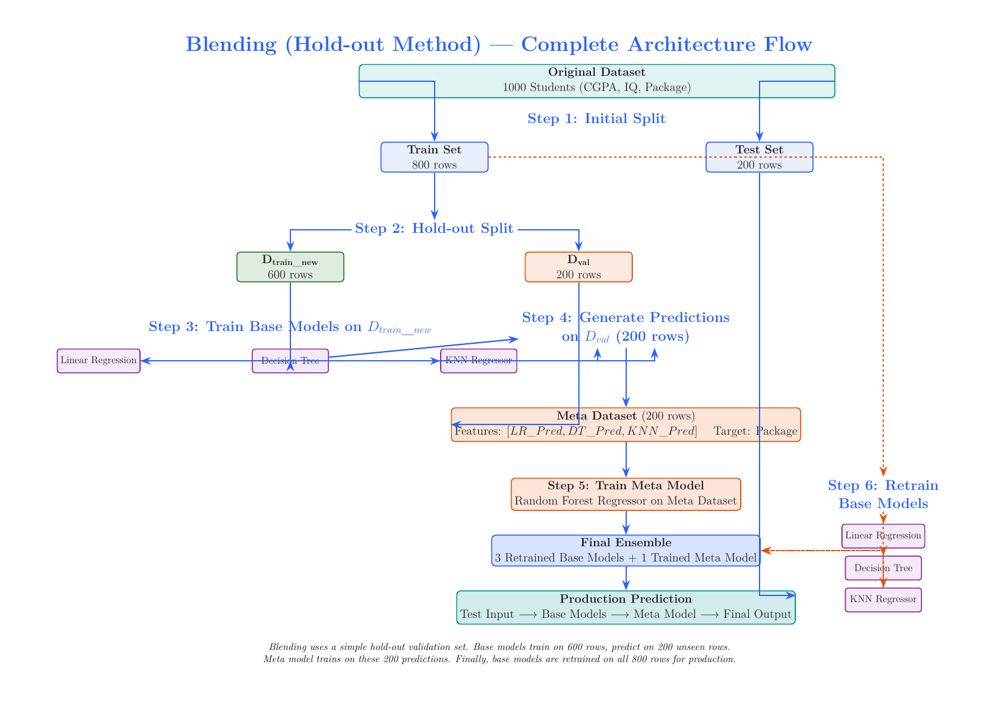

### Step-by-step (1000 students: CGPA, IQ, Package)

```
Step 1: Initial split
        D_total = 1000  →  D_train = 800,  D_test = 200

Step 2: Split the TRAIN set again
        D_train = 800  →  D_train_new = 600,  D_val = 200

Step 3: Define the architecture
        Base (Level 0): Linear Regression M1, Decision Tree M2, KNN M3
        Meta (Level 1): Random Forest Regressor

Step 4: Train base models on D_train_new (600 rows)
        M1, M2, M3  ←  Train(D_train_new)

Step 5: Generate validation predictions
        Run M1, M2, M3 on D_val (200 rows)
        → meta-dataset with 200 rows and 3 prediction columns + target

Step 6: Train the Meta Model on that 200-row meta-dataset

Step 7: RETRAIN base models on the FULL 800-row train set
        M1*, M2*, M3*  ←  Train(D_train)

Step 8: Test
        For each test point: → M1*, M2*, M3* → collect 3 predictions
                             → Meta Model → final prediction
```

**Why it works:** the base models were trained on 600 rows and predicted on **200 different
rows they had never seen**. No data leakage.

**Downsides:** the meta model only gets **200 rows** to learn from, and the base models only
saw 600 rows when generating meta-features. **Data is wasted.**

---

## 9.4 Solution 2 — STACKING (K-Fold Cross-Validation method)

This is the **proper** stacking approach. It uses **out-of-fold (OOF) predictions**.

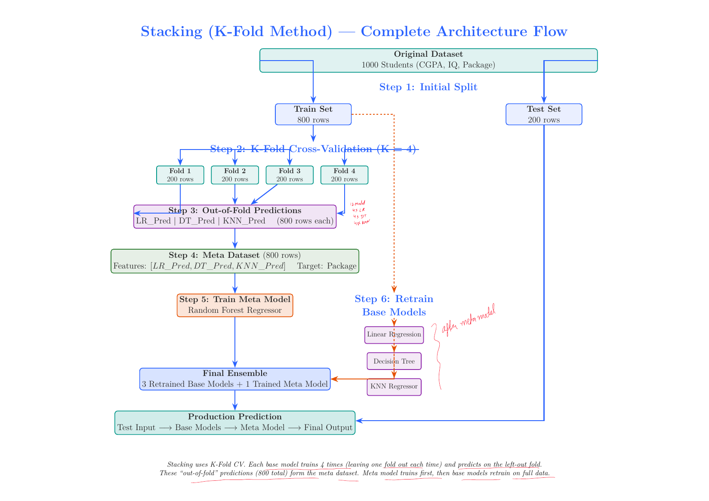

### Step-by-step (same 1000 students)

```
Step 1: Initial split
        D_train = 800,  D_test = 200

Step 2: Choose K = 4  →  each fold has 800/4 = 200 rows

Step 3: Architecture
        Base: Linear Regression, Decision Tree, KNN
        Meta: Random Forest Regressor
```

### Generating Out-Of-Fold predictions (the core of stacking)

**Round 1 — Linear Regression:**

| Iteration | Train On | Predict On | Output |
|---|---|---|---|
| Fold 1 | Folds 2,3,4 (600 rows) | Fold 1 (200 rows) | LR_Pred₁ |
| Fold 2 | Folds 1,3,4 (600 rows) | Fold 2 (200 rows) | LR_Pred₂ |
| Fold 3 | Folds 1,2,4 (600 rows) | Fold 3 (200 rows) | LR_Pred₃ |
| Fold 4 | Folds 1,2,3 (600 rows) | Fold 4 (200 rows) | LR_Pred₄ |

```
LR_Pred = concat(LR_Pred₁, LR_Pred₂, LR_Pred₃, LR_Pred₄)
        = 200 + 200 + 200 + 200 = 800 predictions
```
> ⭐ This is the **out-of-fold prediction**: **one prediction for every row in the train set,
> where each prediction came from a model that did NOT see that row during training.**

**Round 2 — Decision Tree:** repeat the exact same 4-fold process → 800 OOF predictions
**Round 3 — KNN:** repeat again → 800 OOF predictions

### Form the meta-dataset (800 rows)

| LR_Pred | DT_Pred | KNN_Pred | Actual_Package |
|---|---|---|---|
| ŷ₁⁽¹⁾ | ŷ₁⁽²⁾ | ŷ₁⁽³⁾ | y₁ |
| ŷ₂⁽¹⁾ | ŷ₂⁽²⁾ | ŷ₂⁽³⁾ | y₂ |
| ... | ... | ... | ... |
| ŷ₈₀₀⁽¹⁾ | ŷ₈₀₀⁽²⁾ | ŷ₈₀₀⁽³⁾ | y₈₀₀ |

- Rows: **800** (vs only 200 in blending ✔)
- Input columns: 3 (one per base model)
- Target: the actual value

### Then
```
Step: Train the Meta Model (Random Forest) on the 800-row meta-dataset
Step: RETRAIN all base models on the entire 800-row train set
      ⚠️ KEY POINT: you get the Meta Model FIRST, then retrain the base models on full data
Step: Final pipeline for a test point:
      x → [M1*, M2*, M3*] → [ŷ⁽¹⁾, ŷ⁽²⁾, ŷ⁽³⁾] → Meta Model → final prediction
```

### Counting the models trained (K = 4, 3 base models)

| Model | CV training | Final training |
|---|---|---|
| Linear Regression | 4 folds | 1 (full data) |
| Decision Tree | 4 folds | 1 (full data) |
| KNN | 4 folds | 1 (full data) |
| Meta Model (Random Forest) | — | 1 |
| **Total** | **12** | **4** |

```
GRAND TOTAL = 16 models trained
```
> **Rule:** every base model is trained **K times during CV, plus once on the full data.**

---

## 9.5 ⭐ Blending vs Stacking (the terminology question)

Many people call everything "stacking", but interviewers do ask for the distinction.

| Method | Technique used | Correct name |
|---|---|---|
| **Hold-out** | Simple train/validation split | **Blending** |
| **K-Fold** | Cross-validation for meta-features | **Stacking** |

| | **Blending** | **Stacking** |
|---|---|---|
| Meta-feature source | One hold-out validation set | **Out-of-fold CV predictions** |
| Meta-dataset size | Small (e.g. 200 rows) | **Full train set (e.g. 800 rows)** |
| Data efficiency | Wasteful | **Efficient** |
| Computation | **Cheap** (train each base model once) | Expensive (K+1 times per base model) |
| Risk | Meta model may overfit the small hold-out | Lower |
| Leakage risk | Low | Low |
| Simplicity | **Simpler to implement** | More code |

---

## 9.6 ⭐ Stacking vs Bagging vs Boosting

Two major differences:

### Difference 1 — Heterogeneous base models
- **Stacking:** base models can be **different types** of algorithm (LR + DT + SVM + KNN)
- **Bagging/Boosting:** generally the **same** type of base model
  (Random Forest = only Decision Trees; AdaBoost = only stumps)

### Difference 2 — A trained meta-model instead of simple averaging
- **Voting/Bagging:** outputs combined by a **fixed rule** (mean, majority vote)
- **Stacking:** a **new ML model is trained** to learn the best combination

| | Bagging | Boosting | Stacking |
|---|---|---|---|
| Base models | Same algorithm | Same algorithm | **Different algorithms** |
| Data | Bootstrap samples | Re-weighted / residuals | Same data (via CV folds) |
| Training | Parallel | Sequential | Parallel + meta layer |
| Combination | Fixed (vote/mean) | Weighted sum | **Learned meta-model** |
| Main goal | ↓ Variance | ↓ Bias | ↓ Both (exploit model diversity) |

---

## 9.7 Multi-Layer Stacking

You are not limited to one layer.

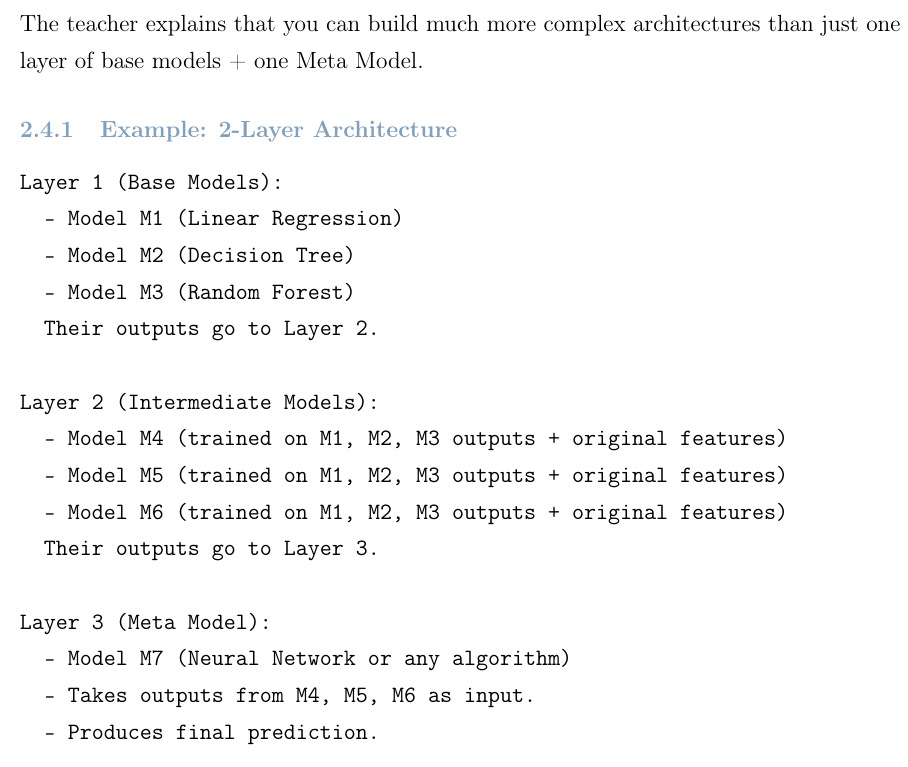

```
Layer 0 (Base Models):
    M1 = Linear Regression
    M2 = Decision Tree
    M3 = KNN
    → their outputs go to Layer 1

Layer 1 (Intermediate Models):
    M4, M5, M6  trained on [M1, M2, M3 outputs] (+ optionally the original features)
    → their outputs go to Layer 2

Layer 2 (Final Meta Model):
    M7 = Neural Network (or anything)
    → produces the final prediction
```

**How the data is managed:**
```
Step 1: Split Train into 3 parts: D1, D2, D3 (≈267 rows each)
Step 2: Train M1, M2, M3 on D1. Run them on D2 to get predictions.
        Build a new dataset from the D2 predictions (3 columns + target)
Step 3: Train M4, M5, M6 on that new dataset
Step 4: Run Layer-1 models on another validation set → another new dataset
Step 5: Train M7 on the Layer-1 outputs
```

> ⚠️ **Key observation:** the more layers you add, the more fold divisions you need. Managing
> those folds across layers is the hard part.

**Real Kaggle example:** winner Jeong-Yoon Lee used **Layer 1: 64 models, Layer 2: 10 models**.

### Practical tips for stacking
| Tip | Why |
|---|---|
| Base models should be **diverse** (tree + linear + distance-based + NN) | Correlated base models give the meta model nothing to learn |
| Keep the meta-model **simple** — Logistic/Linear Regression or Ridge | A complex meta-model overfits the small meta-dataset |
| For classification, feed **probabilities** (`predict_proba`), not labels | More information for the meta model |
| Optionally add the **original features** to the meta-dataset | Lets the meta model learn *when* to trust each base model |
| Use the **same CV folds** for every base model | Otherwise the meta-features are inconsistent |

```python
from sklearn.ensemble import StackingClassifier, StackingRegressor

stack = StackingRegressor(
    estimators=[('lr',  LinearRegression()),
                ('dt',  DecisionTreeRegressor()),
                ('knn', KNeighborsRegressor())],
    final_estimator=RandomForestRegressor(),   # the META model
    cv=5,                                      # K-fold → proper STACKING
    passthrough=False                          # True = also pass original features
)
stack.fit(X_train, y_train)
```

> 🎤 **Interview one-liner:** "Stacking trains a meta-model on the base models' predictions.
> The danger is leakage — if the base models predict on data they were trained on, the
> meta-features are over-optimistic. The fix is out-of-fold predictions via K-fold CV
> (= stacking) or a separate hold-out set (= blending). After the meta-model is trained, the
> base models are refitted on the full training data for production."

---

# PART 10 — Practical Side

## 10.1 ⭐ Which algorithm should I pick? (decision guide)

```
Is your data TABULAR?
 ├── NO  → use Deep Learning (images, text, audio)
 └── YES ↓

Is the dataset SMALL (< 10k rows)?
 ├── YES → Random Forest  or  CatBoost  (both resist overfitting)
 └── NO  ↓

Do you have MANY high-cardinality CATEGORICAL features?
 ├── YES → CatBoost  (native Ordered TS handling)
 └── NO  ↓

Is the dataset VERY LARGE (millions of rows) / is SPEED critical?
 ├── YES → LightGBM  (GOSS + EFB + leaf-wise)
 └── NO  ↓

Want maximum accuracy with a well-documented, battle-tested library?
 └──────→ XGBoost

Need an INTERPRETABLE baseline fast, with almost no tuning?
 └──────→ Random Forest

Competition / squeezing the last 0.1%?
 └──────→ STACK XGBoost + LightGBM + CatBoost + Random Forest
```

---

## 10.2 ⭐ How to control overfitting in boosting

| Lever | Direction | Effect |
|---|---|---|
| `learning_rate` | **↓ lower** (0.01–0.05) | Most effective. Smaller steps → better generalisation |
| `n_estimators` | ↑ raise (with low LR) + **early stopping** | Lets the low LR converge without overshooting |
| `max_depth` / `num_leaves` | **↓ lower** | Simpler trees |
| `min_child_weight` / `min_data_in_leaf` | **↑ raise** | Leaves need more support → less noise fitting |
| `subsample` | ↓ to 0.5–0.8 | Stochastic boosting adds randomness |
| `colsample_bytree` | ↓ to 0.5–0.8 | Feature randomness, decorrelates trees |
| `reg_lambda` (L2), `reg_alpha` (L1) | **↑ raise** | Shrinks leaf weights |
| `gamma` / `min_gain_to_split` | **↑ raise** | Prunes low-value splits |

> ⭐ **The #1 rule in boosting: LOW learning rate + MANY trees + EARLY STOPPING.**

### Early stopping
```python
model.fit(X_train, y_train,
          eval_set=[(X_val, y_val)],
          early_stopping_rounds=50)    # stop if val score doesn't improve for 50 rounds
```

---

## 10.3 Recommended tuning order

```
1. Fix learning_rate = 0.1, find a good n_estimators with early stopping
2. Tune tree structure:  max_depth / num_leaves, min_child_weight
3. Tune randomness:      subsample, colsample_bytree
4. Tune regularization:  reg_lambda, reg_alpha, gamma
5. Finally LOWER the learning_rate (0.01–0.05) and RAISE n_estimators proportionally
6. (Optional) ensemble/stack several tuned models with different seeds
```
Use **RandomizedSearchCV** first (coarse), then **GridSearchCV** around the best region. For
serious work use **Optuna** / Bayesian optimization.

---

## 10.4 Handling Imbalanced Data

| Method | How |
|---|---|
| **Class weights** | RF: `class_weight='balanced'` · XGB/LGBM: `scale_pos_weight = n_neg/n_pos` · CatBoost: `auto_class_weights='Balanced'` |
| **Resampling** | SMOTE / ADASYN (oversample minority), random undersample majority |
| **Threshold tuning** | Don't use 0.5 — pick the threshold that maximises F1 or Youden's J |
| **Right metric** | ⚠️ **Never use accuracy.** Use **ROC-AUC, PR-AUC, F1, recall** |
| **Right CV** | Use **StratifiedKFold** so every fold keeps the class ratio |

---

## 10.5 Missing values — how each algorithm handles them

| Algorithm | Handling |
|---|---|
| **Random Forest (sklearn)** | ❌ Not supported — you must impute first |
| **XGBoost** | ✔ **Sparsity-aware split finding** — learns a default direction per split |
| **LightGBM** | ✔ Same idea (`use_missing=True`); can also treat them as a separate bin |
| **CatBoost** | ✔ `nan_mode`: `'Min'` or `'Max'` — treats NaN as the smallest/largest value |

---

## 10.6 Feature importance — which method when?

| Method | Speed | Bias | Use when |
|---|---|---|---|
| **MDI** (`feature_importances_`) | Fastest | ⚠️ Biased toward **high-cardinality** features | Quick first look |
| **Permutation Importance** | Medium | Unbiased by cardinality, but confused by correlated features | Proper feature selection |
| **SHAP** | Slowest | Best — theoretically grounded | Explaining to clients, per-row explanations, direction of effect |

---

## 10.7 Common mistakes (the interviewer may probe these)

| ❌ Mistake | ✔ Correct |
|---|---|
| Using bagging on Linear Regression | Bagging only helps **high-variance** models |
| Saying "RF differs from bagging because it only uses trees" | The real difference is **node-level vs tree-level** column sampling |
| Leaving LightGBM's `num_leaves` high on small data | Keep `num_leaves < 2^max_depth`; raise `min_data_in_leaf` |
| Stacking with in-sample base predictions | Use **out-of-fold** predictions |
| Target-encoding categories using the full dataset | Use **Ordered TS** / out-of-fold target encoding |
| Tuning with accuracy on imbalanced data | Use **ROC-AUC / PR-AUC / F1** |
| Adding more trees to fix boosting overfitting | **Lower the learning rate** and use early stopping |
| Expecting Random Forest to extrapolate | Tree models **cannot predict outside the training range** |

---

# PART 11 — Cheat Sheet

## 11.1 ⭐⭐ Master Comparison Table

| | **Random Forest** | **AdaBoost** | **Gradient Boosting** | **XGBoost** | **LightGBM** | **CatBoost** |
|---|---|---|---|---|---|---|
| **Type** | Bagging | Boosting | Boosting | Boosting | Boosting | Boosting |
| **Training** | Parallel | Sequential | Sequential | Sequential (parallel inside a tree) | Sequential | Sequential |
| **Base learner** | Deep trees | Stumps (depth 1) | Trees (8–32 leaves) | Trees (depth ~6) | Leaf-wise trees | **Symmetric/oblivious** trees |
| **Reduces** | Variance | Bias | Bias | Bias | Bias | Bias |
| **Tree growth** | — | — | Level-wise | Level-wise (`lossguide` optional) | **Leaf-wise** | **Symmetric (level-wise, same split)** |
| **Split criterion** | Gini / Entropy / MSE | Weighted error | Gradient (MSE on residuals) | **Similarity Score / Gain** | Gain on histograms | Gain on histograms |
| **How errors handled** | — | Re-weight samples | Fit residuals | Fit residuals (2nd order) | Fit residuals (2nd order) | **Ordered boosting** |
| **Regularization** | Depth, min samples | Learning rate | Learning rate, subsample | **L1 + L2 + γ in objective** | L1 + L2 + `num_leaves` | **L2 + ordered boosting + symmetry** |
| **Categorical** | Needs encoding | Needs encoding | Needs encoding | Needs encoding (`enable_categorical` in new versions) | ✔ **Native** | ✔✔ **Best (Ordered TS)** |
| **Missing values** | ❌ Impute | ❌ Impute | ❌ Impute | ✔ Automatic | ✔ Automatic | ✔ Automatic |
| **Speed (train)** | Fast | Fast | **Slow** | Fast | ⚡ **Fastest** | Slower |
| **Speed (predict)** | Medium | Fast | Fast | Fast | Fast | ⚡ **Fastest** |
| **Small data** | ✔ Good | ✔ Good | ✔ OK | ✔ OK | ⚠️ Overfits | ✔✔ **Best** |
| **Big data** | ⚠️ Memory | ⚠️ | ❌ Slow | ✔ Good | ✔✔ **Best** | ✔ Good |
| **Overfit risk** | **Low** | Medium | High | Medium | **High** | **Low** |
| **Tuning effort** | **Low** | Low | High | **High** | High | ✔ **Low (great defaults)** |
| **Outlier sensitivity** | Low | **High** | Medium | Medium | Medium | Medium |

---

## 11.2 ⭐ Formula Cheat Sheet (last-minute revision)

### Bias-Variance
```
Error = Bias² + Variance + σ²
Var(bagged) = ρσ² + (1 − ρ)σ²/M          (ρ = correlation between models)
Var(bagged, independent) = σ²/M
```

### Bootstrap
```
P(row not selected) = (1 − 1/N)^N → 1/e ≈ 0.368
→ 63.2% in-bag, 36.8% out-of-bag (OOB)
```

### Voting
```
Hard : ŷ = mode{ h₁(x), ..., h_M(x) }
Soft : ŷ = argmax_c (1/M) Σ P_m(c|x)
3 models @ 70% → 78.4%  |  3 models @ 30% → 21.6%  (needs p > 0.5!)
```

### Decision tree impurity
```
Gini    = 1 − Σ pᵢ²
Entropy = − Σ pᵢ log₂ pᵢ
IG      = Entropy(parent) − Σ (Nⱼ/N)·Entropy(childⱼ)
```

### Feature importance
```
Node Importance = (Nt/N) × [ impurity − (NtR/Nt)·right_imp − (NtL/Nt)·left_imp ]

Feature Importance = Σ node importances for that feature / Σ over ALL nodes
Sum of all feature importances = 1.0
RF importance = average over all trees
```

### AdaBoost
```
Init     : wᵢ = 1/N
Error    : ε = Σ_{misclassified} wᵢ
Alpha    : α = ½ · ln( (1 − ε) / ε )
Update   : wrong → w·e^(+α)   |   correct → w·e^(−α)
Normalise: wᵢ / Σwⱼ
Final    : H(x) = sign( Σₜ αₜ·hₜ(x) )        [classes are +1 / −1]
```

### Gradient Boosting
```
Init (reg)  : F₀(x) = mean(y)
Init (clf)  : F₀(x) = ln(N₁/N₀)                     [log of odds]
Sigmoid     : p = e^F / (1 + e^F)
Residual    : rᵢₘ = −[∂L/∂F]  = yᵢ − F_{m−1}(xᵢ)   (MSE)
                               = yᵢ − pᵢ            (LogLoss)
Leaf (reg)  : γ_jm = mean of residuals in the leaf
Leaf (clf)  : γⱼ   = Σ rᵢ / Σ pᵢ(1 − pᵢ)
Update      : Fₘ(x) = F_{m−1}(x) + ν · Σⱼ γ_jm·1(x ∈ R_jm)
```

### XGBoost
```
Objective  : Obj = Σ L(yᵢ, ŷᵢ) + Σ Ω(f_k),   Ω(f) = γT + ½λΣwⱼ²
Taylor (2nd order):
             Obj ≈ Σ [ gᵢf(xᵢ) + ½hᵢf(xᵢ)² ] + γT + ½λΣwⱼ²
Grouped    : Obj = Σⱼ [ Gⱼwⱼ + ½(Hⱼ + λ)wⱼ² ] + γT

Leaf weight: wⱼ* = − Gⱼ / (Hⱼ + λ)
Similarity : SS  = ½ · Gⱼ² / (Hⱼ + λ)
Gain       : Gain = ½[ G_L²/(H_L+λ) + G_R²/(H_R+λ) − G²/(H+λ) ] − γ

Regression     :  gᵢ = −residual,  hᵢ = 1
                  w* = Σresiduals / (count + λ)
Classification :  gᵢ = −residual,  hᵢ = pᵢ(1 − pᵢ)
                  w* = Σresiduals / (Σ pᵢ(1−pᵢ) + λ)

Update     : Fₘ = F_{m−1} + η × TreeOutput
```

### LightGBM
```
GOSS amplification factor  =  (1 − a) / b
   a = top_rate (keep all), b = other_rate (sampled)
EFB: O(#data × #features) → O(#data × #bundles)
Histogram subtraction: Hist(big child) = Hist(parent) − Hist(small child)
Keep:  num_leaves < 2^max_depth
```

### CatBoost
```
Target Statistic (smoothed):
            Σ y over the category  +  a·P
   x̂  =  ────────────────────────────────
            count of the category  +  a

Ordered TS (leakage-free):   use ONLY rows j < k in the permutation σ
Ordered Boosting:            rₖ = yₖ − M_{k−1}(xₖ)
Oblivious tree:              one split condition per LEVEL → 2^depth leaves (lookup table)
```

### Stacking
```
Blending  = hold-out split        → meta-dataset = size of the hold-out set
Stacking  = K-fold OOF predictions→ meta-dataset = size of the full train set
Models trained = (#base × K) + #base + 1
   e.g. 3 base models, K=4  →  12 + 3 + 1 = 16 models
```

---

# PART 12 — Rapid-Fire Interview Q&A

### Basics

**Q1. What is ensemble learning?**
Combining multiple base models into one stronger model. It is based on "wisdom of the
crowd" — a diverse group is more reliable than any single member.

**Q2. What are the 4 main types?**
Voting (different algorithms, same data), Bagging (same algorithm, different data,
parallel), Boosting (same algorithm, sequential, learns from mistakes), Stacking (different
algorithms + a trained meta-model).

**Q3. Why must base models be different?**
If all models make the same mistake, averaging cannot fix it. The ensemble's variance floor
is `ρσ²`, where ρ is the correlation between models — so diversity is what buys the gain.

**Q4. When does an ensemble make things WORSE?**
When the base models are below 50% accuracy. Three 30%-accurate models majority-voting give
21.6% — worse than any one of them.

**Q5. What is a weak learner?**
A model slightly better than random guessing (>50%). Usually a shallow tree or a stump.

### Bias–Variance

**Q6. Explain the bias-variance trade-off.**
`Error = Bias² + Variance + irreducible noise`. High bias = too simple = underfitting; high
variance = too sensitive to the training data = overfitting.

**Q7. Does bagging reduce bias or variance? Boosting?**
Bagging reduces **variance** (base learners are low-bias/high-variance deep trees).
Boosting reduces **bias** (base learners are high-bias/low-variance stumps or shallow trees).

**Q8. Can bagging overfit by adding more trees?**
No. `Var = ρσ² + (1−ρ)σ²/M` — adding trees only shrinks the second term. Boosting **can**
overfit with more trees, which is why it needs a learning rate and early stopping.

### Bagging / Random Forest

**Q9. Why sampling WITH replacement?**
It creates more diversity. Without replacement all models would see nearly identical data.

**Q10. Derive the 63.2% rule.**
`P(row not picked in one draw) = 1 − 1/N`. Over N independent draws: `(1 − 1/N)^N → 1/e ≈
0.368`. So 36.8% out-of-bag, 63.2% in-bag.

**Q11. What is the OOB score and why is it useful?**
Each tree never saw ~37% of the rows. Predicting those rows with only the trees that missed
them gives an unbiased generalisation estimate — free, no separate validation split needed.

**Q12. OOB vs cross-validation?**
CV explicitly makes K folds and uses the **full ensemble** per fold, retraining K models —
expensive. OOB happens implicitly during bootstrapping, uses only the **~36% subset** of
trees per point, and is computationally **free**.

**Q13. ⭐ Difference between Bagging and Random Forest?**
Bagging samples columns at the **tree level** (one subset fixed for the whole tree); Random
Forest samples columns at the **node level** (a fresh random subset at every split). The
node-level randomness decorrelates the trees further, which is why RF usually wins. (Saying
"RF only uses trees" is the incomplete answer.)

**Q14. What are Pasting, Random Subspaces, Random Patches?**
Pasting = row sampling **without** replacement. Random Subspaces = all rows, random columns.
Random Patches = random rows **and** random columns (max diversity).

**Q15. Default `max_features`?**
`√p` for classification, `p/3` for regression.

**Q16. Why is MDI feature importance misleading?**
It is biased toward **high-cardinality** features (IDs, timestamps, continuous values)
because they offer more split points. Use permutation importance or SHAP instead.

**Q17. Random Forest vs Extra Trees?**
Extra Trees drops bootstrapping and picks split thresholds **at random** instead of
searching for the best. Higher bias, lower variance, much faster (no sorting).

**Q18. Can Random Forest extrapolate?**
No. Predictions are averages of training leaf values, so it can never predict outside the
range seen in training.

### AdaBoost

**Q19. How does AdaBoost work in one line?**
It keeps weights on data points, fits a stump, gives it a say `α = ½ln((1−ε)/ε)`, multiplies
the weights of wrong points by `e^(+α)` and right points by `e^(−α)`, and predicts with
`sign(Σ αₜhₜ(x))`.

**Q20. Why ±1 instead of 0/1?**
Because the final prediction uses `sign()`, and `αₜ·hₜ(x)` must be able to vote positively
or negatively.

**Q21. What if α is negative (ε > 0.5)?**
The model is worse than random — so just **flip its predictions** (multiply by −1) and it
becomes useful. Nothing is wasted.

**Q22. What happens at ε = 0.5?**
`α = ½ln(1) = 0` — the learner gets zero say. It is pure random guessing.

**Q23. Which base estimator will NOT work with AdaBoost?**
**KNN** — it does not support sample weights.

**Q24. What does the learning rate do in AdaBoost?**
Effective α = α × learning_rate. It shrinks each stump's contribution, so weight updates are
gentler and the model generalises better. Pair a low learning rate with high `n_estimators`.

**Q25. SAMME vs SAMME.R?**
SAMME is the discrete multi-class version; SAMME.R is the real-valued version using
probabilities. SAMME.R converges faster with fewer rounds and is the default.

### Gradient Boosting

**Q26. AdaBoost vs Gradient Boosting?**
AdaBoost **re-weights the data points** and uses a fixed exponential loss with stumps.
Gradient Boosting **fits the residuals** and works with **any differentiable loss**, using
larger trees (8–32 leaves).

**Q27. Why is it called "gradient" boosting?**
Because the residual being fitted is the **negative gradient of the loss** with respect to
the prediction. For MSE, `−∂L/∂F = y − F`, i.e. the ordinary residual. It is gradient
descent in **function space**.

**Q28. Why is `F₀(x) = mean(y)` for regression?**
Minimise `Σ ½(yᵢ − γ)²`: setting `∂/∂γ = Σ(γ − yᵢ) = 0` gives `nγ = Σyᵢ`, so `γ = mean(y)`.

**Q29. Why log-odds for classification?**
It plays the same role as the mean — it is the constant that minimises log loss. We then map
it to a probability with the sigmoid.

**Q30. Why use REGRESSION trees for a classification problem?**
Because the residuals `(y − p)` are **continuous** numbers, not class labels. The tree
predicts those continuous residuals; γ converts them into log-odds space.

**Q31. Why do we need gamma (γ) in GB classification?**
The previous model lives in **log-odds** space but the tree outputs a residual in
**probability** space. You cannot add them. γ = `Σr / Σp(1−p)` converts the leaf's residuals
into log-odds so the addition is valid.

**Q32. What does the learning rate do?**
Shrinkage — each tree only fixes a fraction of the error. Small ν + many trees generalises
much better than ν = 1.

### XGBoost

**Q33. Is XGBoost an algorithm?**
No — it is a **library** (Tianqi Chen, 2014) implementing Gradient Boosting with heavy
software and ML optimizations.

**Q34. ⭐ How does an XGBoost tree differ from a GBM tree?**
It splits on the **Similarity Score / Gain** derived from the regularized objective, instead
of Gini/Entropy/MSE, and the leaf value is `−G/(H+λ)` instead of a plain mean.

**Q35. Why use a Taylor expansion?**
A decision tree's output is piecewise constant, so the loss is **not differentiable** with
respect to the tree. A 2nd-order Taylor expansion replaces it with a smooth quadratic that
has a closed-form minimum.

**Q36. Derive the optimal leaf weight.**
`Objⱼ = Gⱼwⱼ + ½(Hⱼ+λ)wⱼ²`. Set `∂/∂wⱼ = Gⱼ + (Hⱼ+λ)wⱼ = 0` → `wⱼ* = −Gⱼ/(Hⱼ+λ)`.

**Q37. What is the Similarity Score?**
Plug `wⱼ*` back into the objective → `Objⱼ* = −½Gⱼ²/(Hⱼ+λ)`. The Similarity Score is its
negative: `½Gⱼ²/(Hⱼ+λ)`. Higher = better leaf.

**Q38. What are the gradient and Hessian for regression and classification?**
Regression (MSE): `g = −residual`, `h = 1`.
Classification (LogLoss): `g = −residual`, `h = p(1−p)`.

**Q39. What do λ and γ do?**
`λ` = L2 penalty on leaf weights (in the **denominator** → shrinks outputs).
`γ` = minimum gain required to make a split (pre-pruning; split only if `Gain > γ`).

**Q40. How does XGBoost handle missing values?**
**Sparsity-aware split finding** — at each split it computes the gain with missing values
sent left and sent right, and stores the better one as that node's **default direction**.

**Q41. ⭐ Boosting is sequential — so how is XGBoost "parallel"?**
The parallelism is **not** across trees. It is **inside** one tree: evaluating candidate
splits for different **features** is independent, so different CPU cores handle different
features at the same time.

**Q42. What is the Weighted Quantile Sketch?**
A way of choosing histogram bin boundaries by **quantiles weighted by the Hessian `hᵢ`**, so
bins are finer where the data is dense and where the model is most uncertain, instead of
uniform bins that ignore the distribution.

**Q43. Name XGBoost's system optimizations.**
Parallel split finding, column block storage, cache-aware histograms, out-of-core computing,
distributed computing, GPU support.

### LightGBM

**Q44. Why is LightGBM faster than XGBoost?**
Three things: **GOSS** (fewer rows), **EFB** (fewer features), and **leaf-wise growth**
(lower loss per split). Plus histogram binning with the subtraction trick.

**Q45. ⭐ Explain GOSS.**
Keep **all** rows with large |gradient| (under-trained, informative), randomly sample a small
fraction of the small-gradient rows, and **multiply the sampled rows' gradients by (1−a)/b**
so the gain estimate stays unbiased.

**Q46. Why the (1−a)/b factor?**
The rest group held a `(1−a)` fraction of the data but we only took `b`. Scaling by `(1−a)/b`
restores the correct expected contribution, so the data distribution is not distorted.

**Q47. ⭐ Explain EFB.**
Mutually exclusive sparse features (never non-zero together, e.g. one-hot columns) are merged
into one feature using **disjoint value ranges via offsets**. Picking the bundles is graph
colouring (NP-hard), so LightGBM uses a greedy algorithm that even allows a small conflict
rate.

**Q48. Leaf-wise vs level-wise growth?**
Level-wise splits all nodes at a depth (balanced, safer). Leaf-wise splits the single leaf
with the **highest gain** (unbalanced, deeper, lower loss per leaf, faster convergence, but
overfits small data).

**Q49. Biggest LightGBM pitfall?**
Leaving `num_leaves` too high on a small dataset. Keep `num_leaves < 2^max_depth` and raise
`min_data_in_leaf`.

**Q50. What is the histogram subtraction trick?**
`Hist(parent) = Hist(left) + Hist(right)`, so you build the histogram for the smaller child
and get the larger one for free by subtraction — roughly halving the cost.

### CatBoost

**Q51. What problem does CatBoost solve?**
**Target leakage.** Both of its main ideas stop a data point from influencing the model used
to process that same point.

**Q52. ⭐ What is target leakage in target encoding?**
If you replace a category with the mean target computed from data that includes the row
itself, the encoded value secretly contains that row's label. With unique IDs the encoding
basically *is* `y`, giving perfect training accuracy and useless test performance.

**Q53. ⭐ Explain Ordered Target Statistics.**
Apply a random permutation (an artificial "time"), then compute each row's target statistic
using only the **earlier** rows of the same category. The row's own label is never used.
CatBoost averages several permutations to reduce variance for early rows.

**Q54. ⭐ What is prediction shift and how does Ordered Boosting fix it?**
In standard boosting, the residual for row i is computed by a model that was trained on row
i, so it is biased and this compounds over rounds. Ordered boosting computes row k's residual
with a model `M_{k−1}` trained **only on the rows before k** in the permutation.

**Q55. Why Leave-One-Out TS is not enough?**
It still leaks. For a binary target the model can effectively invert the statistic and
recover the label.

**Q56. ⭐ What is a symmetric / oblivious tree?**
A tree where **every node at the same depth uses the same feature and split condition**. The
path becomes a bit-vector, so prediction is a single array lookup — hence very fast
inference. It is also strong regularization, at the cost of less expressiveness per tree.

**Q57. When should I pick CatBoost?**
When you have many (especially high-cardinality) categorical features, or a small dataset, or
you want strong results with minimal tuning, or you need very fast inference.

### Stacking

**Q58. What is stacking?**
Train several different base models, then train a **meta-model** on their predictions to
learn the best way to combine them — instead of using a fixed rule like a mean or a vote.

**Q59. ⭐ What is the main danger in stacking and how do you fix it?**
**Data leakage.** If base models predict on data they were trained on, the meta-features are
unrealistically good and the meta-model overfits. Fix it with **out-of-fold predictions**
(K-fold = stacking) or a **hold-out set** (= blending).

**Q60. Stacking vs Blending?**
Blending uses one hold-out split → small meta-dataset, cheap, wasteful. Stacking uses K-fold
OOF predictions → meta-dataset as big as the whole train set, more expensive but more
data-efficient.

**Q61. In stacking, do you train the meta-model or retrain the base models first?**
**Meta-model first** (on the OOF predictions), **then** retrain the base models on the full
training data for production.

**Q62. How many models are trained in stacking with 3 base models and K=4?**
`3 × 4 = 12` during CV, `+3` final base models, `+1` meta model = **16**.

**Q63. What should the meta-model be?**
Something **simple** — Logistic/Linear Regression or Ridge. The meta-dataset is small and
a complex meta-model overfits it.

**Q64. Stacking vs Voting?**
Voting combines with a **fixed rule**; stacking **learns** the combination with a trained
model. Voting weights (if used) are set by hand; stacking derives them from data.

### Overall

**Q65. Why does boosting usually beat Random Forest on tabular data?**
RF only reduces variance — its bias is whatever the average tree's bias is. Boosting actively
reduces **bias** by fitting the remaining error each round, so with enough rounds and a small
learning rate it can get closer to the true function.

**Q66. When would you still prefer Random Forest?**
Small/noisy data, when you need a strong baseline with almost no tuning, when you want OOB
validation for free, or when training time and robustness matter more than the last 1% of
accuracy.

**Q67. ⭐ XGBoost vs LightGBM vs CatBoost in one sentence each?**
**XGBoost** — the battle-tested all-rounder with regularization derived from a second-order
objective. **LightGBM** — the fastest, thanks to GOSS, EFB and leaf-wise growth; best on very
large data. **CatBoost** — the best with categorical features and small data, thanks to
Ordered TS and Ordered Boosting, with the fastest inference via oblivious trees.

---

## 📌 Appendix — Sources and coverage notes

**Built from your 8 uploaded PDFs:**

| PDF | Covered in |
|---|---|
| `voting.pdf` | Part 0 (basics, wisdom of crowd, 70%→78.4% proof), Part 1 |
| `Bagging.pdf` | Part 2 (bootstrap, 37% derivation, 4 types, OOB, hyperparameters, variance proof) |
| `rf1.pdf` | Part 3 (node-level vs tree-level, feature importance derivation, all hyperparameters, GridSearchCV maths) |
| `Adaboost.pdf` | Part 4 (all 9 steps, worked example, resampling, hyperparameters, Viola-Jones) |
| `Gradient_boosting1.pdf` | Part 5 (Friedman algorithm, all 3 regression derivations, classification + gamma derivation, geometric intuition) |
| `Xgboost_Basic.pdf` | Part 6.1, 6.7, 6.8 (history, design goals, 6 speed + 4 performance optimizations) |
| `XGboost_2.pdf` | Part 6.3–6.6 (Similarity Score, both worked examples, full Taylor derivation) |
| `Architecture_of_Stacking.pdf` | Part 9 (both architecture diagrams, blending vs stacking, multi-layer) |

**Added by me (not in the PDFs), as you asked:**
- **Part 7 — LightGBM** in full: histogram split finding, histogram subtraction, leaf-wise vs
  level-wise growth, **GOSS** with the `(1−a)/b` derivation, **EFB** with the offset-merging
  and graph-colouring explanation, native categorical handling, architecture, hyperparameters
- **Part 8 — CatBoost** in full: the target-leakage problem, Greedy/Holdout/Leave-one-out/
  **Ordered TS**, **Ordered Boosting** and prediction shift, **symmetric (oblivious) trees**,
  feature combinations, architecture, hyperparameters
- Extra Trees (Part 3.11), the complete decision guide, overfitting-control and tuning-order
  tables, imbalanced-data handling, missing-value comparison (Part 10)
- The master comparison table, formula cheat sheet (Part 11) and the 67-question rapid-fire
  bank (Part 12)

**Not accessible from this session** (so written from standard references instead): the
`apxml.com` chapter and the three YouTube links were blocked by this environment's network
policy, and the local `C:\important\Downloads\100 ML\...` folder is on your own machine, not
reachable from the cloud container. The LightGBM and CatBoost sections follow the original
**LightGBM (NeurIPS 2017)** and **CatBoost (NeurIPS 2018)** papers, which are what the apxml
chapter is itself based on, and they cover the same section list: GOSS, EFB, CatBoost
categorical handling, ordered boosting, symmetric trees, and the three-way comparison.

---

*End of document — good luck with your interviews! 🚀*
