# Interview Preparation Guide
## Data Science Intern — KC Investments (May'26 – Jul'26)
### Project: Financial Research Assistant (Stock Forecasting + News Sentiment + RAG Chatbot)

> Written in simple English so you can speak it in the interview.
> Every number in this document comes from your repo (`README.md`, `config.py`, code). Nothing is invented.
> Tags used: **[RESUME]** = your CV claim. **[REPO]** = seen in code/README. **[INFERENCE]** = my reasoning, check it yourself. **[CLARIFY]** = only you know the answer.

---

# HOW TO USE THIS DOCUMENT

1. Read **Chapter 0, 1, 2** first (big picture + your 1-minute story). 
2. Then read **Chapters 3 to 9** one by one. Each chapter has the same order:
   *What it is → Theory → Diagram → How it works in your project → Why this / why not that → Problems faced → Questions with follow-ups and cross-questions.*
3. Before the interview, read **Chapter 10 (Traps)**, **Chapter 14 (Cheat sheet)** and do **Chapter 15 (Mock interview)** aloud.

**Golden rule for the interview:** be honest about the results. Your repo already says "ARIMA did not beat the naive baseline". Interviewers *like* a student who checked this and says it clearly. A student who hides it and gets caught loses trust.

---

# CHAPTER 0 — The Big Picture

## 0.1 What did you build? (one paragraph)

You built **one project with three parts**, all shown in **one Streamlit dashboard**:

| # | Part | Question it answers | Main tools | Your headline number |
|---|---|---|---|---|
| 1 | **Stock forecasting** | "What will tomorrow's closing price be?" | yfinance, pandas, statsmodels (ARIMA) | 1.70% MAPE, 985 folds, 5 tickers |
| 2 | **News sentiment classifier** | "Is this finance sentence negative / neutral / positive?" | scikit-learn (TF-IDF + Logistic Regression) | 71.49% accuracy vs 59.4% baseline |
| 3 | **RAG chatbot** | "What does the news say about Apple?" (with sources) | LangChain, FAISS, MiniLM embeddings, Groq LLM | 85% precision@4, ~9,000 embeddings (8,819) |

## 0.2 Your three resume bullets, decoded

### Bullet 1
> *Built a yfinance-based ARIMA stock forecasting pipeline with walk-forward validation across 5 tickers and 985 folds, achieving 1.70% MAPE*

| Word / claim | What it really means in your repo | What an interviewer can ask |
|---|---|---|
| yfinance-based | Data downloaded from Yahoo Finance, 5 years, daily | Why yfinance? Is it reliable? Fallback? |
| ARIMA | `ARIMA(5,1,0)` from `statsmodels`, same order for all tickers | What are p, d, q? Why (5,1,0)? |
| walk-forward validation | Expanding training window, predict next day, move forward | Why not normal train/test split or k-fold? |
| 5 tickers | AAPL, MSFT, GOOGL, AMZN, TSLA | Why these? Is 5 enough? |
| 985 folds | 197 folds × 5 tickers. A fold = one fit + one prediction. Every **5th** day, not every day | How did you get 985? Why not every day? |
| 1.70% MAPE | Average of the 5 per-ticker MAPE values for ARIMA | Compared to what? Is it good? |

⚠ **Biggest trap:** the naive baseline ("tomorrow = today") got **1.69%** — almost the same. See Chapter 4 and 10.

### Bullet 2
> *Developed a RAG chatbot using LangChain, FAISS & Groq API over 1,000 news articles, achieving 85% precision@4 across ~9,000 embeddings*

| Claim | Meaning in repo |
|---|---|
| 1,000 news articles | From FNSPID dataset, 5 tickers (AAPL 400, others 150 each), dates Nov 22 – Dec 16 2023 |
| ~9,000 embeddings | **8,819** chunks, each turned into a 384-number vector |
| LangChain | Used for text splitter, embedding wrapper, FAISS wrapper, `Document` class. *(The final LLM call uses the `groq` Python SDK directly.)* |
| FAISS | Vector search library (Facebook AI) |
| Groq API | Fast hosted LLM service. Default model in config: `qwen/qwen3.6-27b` |
| 85% precision@4 | Of 80 retrieved chunks (20 queries × 4), 68 were tagged with the **correct company**. A *proxy* metric |

### Bullet 3
> *Trained a TF-IDF and Logistic Regression sentiment classifier on ~4,800 financial sentences, achieving 71.49% accuracy over a 59.4% baseline*

| Claim | Meaning in repo |
|---|---|
| ~4,800 sentences | 4,838 rows of Financial PhraseBank (`50agree` subset) |
| 71.49% accuracy | On a held-out 20% test set (968 sentences) |
| 59.4% baseline | "Always predict neutral" (DummyClassifier most_frequent) |
| Single split | One 80/20 split, no cross-validation. Macro-F1 is 0.667 vs 0.248 for baseline |

## 0.3 "Know these numbers by heart" table

| Item | Value |
|---|---|
| Tickers | AAPL, MSFT, GOOGL, AMZN, TSLA |
| Stock history | 5 years daily (≈1,254 raw rows → 1,235 after features) |
| Engineered features | 8 |
| ARIMA order | (5,1,0) |
| Min training window | 250 trading days |
| Walk-forward step | 5 days |
| Folds | 197 per ticker × 5 = **985** |
| ARIMA avg MAPE / RMSE | 1.70% / 5.70 |
| Naive avg MAPE / RMSE | 1.69% / 5.69 |
| Best / worst ticker (MAPE) | MSFT 1.16% / TSLA 2.86% |
| Sentiment data | 4,838 sentences (neutral 2,872 / positive 1,362 / negative 604) |
| Split | 80/20 stratified → 3,870 train / 968 test, seed 42 |
| TF-IDF settings | max_features 5000, ngram (1,2), min_df 2, English stop words |
| LogReg settings | max_iter 1000, class_weight balanced |
| Sentiment accuracy / macro-F1 | 71.49% / 0.667 (baseline 59.40% / 0.248) |
| RAG articles | 1,000 (avg ≈4,690 characters each) |
| Chunking | 800 characters, overlap 150 |
| Chunks (embeddings) | 8,819 |
| Embedding model | all-MiniLM-L6-v2, 384 dimensions |
| Retrieval | top-k = 4 |
| LLM | Groq, `qwen/qwen3.6-27b`, temperature 0.1 |
| precision@4 | 85% on 20 hand-labelled queries (ticker-match proxy) |
| Latency | median 1,077 ms, mean 2,158 ms, p95 4,954 ms |
| Tests | 26 offline pytest tests |

---

# CHAPTER 1 — Architecture of the Whole Internship Project

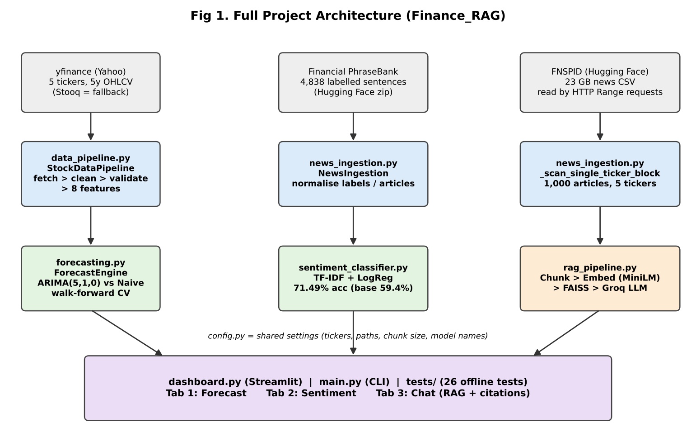

## 1.1 Read the picture in 30 seconds
- **Top row (grey):** three outside data sources: Yahoo Finance, Financial PhraseBank, FNSPID.
- **Second row (blue):** code that loads and cleans each source.
- **Third row (green/orange):** the three models/systems.
- **Bottom (purple):** the dashboard, CLI and tests that use all of them.

## 1.2 Architecture in table format

| Layer | File | Class / function | Input | Output |
|---|---|---|---|---|
| Config | `config.py` | constants | `.env` file | tickers, paths, model names, chunk size |
| Stock data | `data_pipeline.py` | `StockDataPipeline` | ticker names | clean OHLCV + 8 features CSV |
| Forecast | `forecasting.py` | `ForecastEngine` | Close price series | MAPE/RMSE table, predictions |
| News data | `news_ingestion.py` | `NewsIngestion` | HF URLs | PhraseBank dataframe, 1,000 articles |
| Sentiment | `sentiment_classifier.py` | `SentimentClassifier` | text + label | saved model `.joblib`, metrics |
| RAG | `rag_pipeline.py` | `RAGPipeline` | articles + question | answer + citations, precision@k, latency |
| UI | `dashboard.py` | `main()` + cached loaders | user clicks | 3 tabs |
| CLI | `main.py` | `run_stock/forecast/sentiment/rag/eval` | `--run ...` | printed results, JSON/CSV |
| Tests | `tests/` | 26 tests | mocked data | pass/fail |

## 1.3 Data flow, step by step (say this if asked "walk me through the flow")

1. **Stock:** yfinance → cache CSV → clean → validate → 8 features → `Close` column → ARIMA walk-forward → MAPE/RMSE.
2. **Sentiment:** PhraseBank zip → parse `sentence@label` → normalise → split → TF-IDF → LogReg → accuracy/F1 → save model.
3. **RAG:** FNSPID (HTTP Range) → 1,000 articles → chunk → embed → FAISS → question → top-4 → prompt → Groq → answer + sources.
4. **Dashboard:** loads all above, shows them in three tabs.

## 1.4 Honest note about how the parts connect [REPO]
- The three parts are **separate models**. The sentiment model is **not** used inside the RAG answer or inside the ARIMA forecast.
- The sentiment model is shown in Tab 2 (you type a sentence) and used in an **exploratory notebook** (`notebooks/exploratory_sentiment_price.ipynb`) that scores AAPL headlines and checks correlation with next-day return. The README says this notebook is **not** a validated predictive model. Do **not** claim "sentiment predicts price".
- ARIMA uses only the `Close` price. The 8 engineered features are **not** inputs to ARIMA. (Say this before they ask — see Chapter 3 trap.)

## 1.5 Why this design? (short)
- **Modules per file** → easy to test, each can be run alone (`python main.py --run forecast`).
- **config.py** → one place to change tickers, chunk size, model name.
- **Cache to disk** (`data/raw`, FAISS index, joblib model) → no re-download, no re-training each time.
- **Offline tests with mocks** → tests do not need internet or an API key.

---

# CHAPTER 2 — Your Interview Stories (speak these)

## 2.1 30–45 seconds

> "During my internship at KC Investments I built a financial research assistant with three parts. First, an ARIMA forecasting pipeline on five large stocks using yfinance data, validated with walk-forward testing over 985 folds. Second, a sentiment classifier using TF-IDF and logistic regression trained on about 4,800 financial sentences, which got 71.5% accuracy against a 59.4% baseline. Third, a RAG chatbot over 1,000 news articles using LangChain, FAISS and the Groq API, with source citations. I also compared ARIMA with a naive baseline and found they perform almost the same, which taught me how hard daily stock prices are to predict."

## 2.2 1–2 minutes

> "The goal was a small research assistant for investors. It has three tabs in a Streamlit dashboard: forecast, sentiment and chat.
>
> For forecasting, I downloaded five years of daily prices for five tickers using yfinance, cleaned them, validated them, and created eight features. I used ARIMA(5,1,0) and tested it with walk-forward validation, which means I train only on the past and predict the next day, then move forward. That gave 985 folds in total. The average MAPE was 1.70%. I also built a naive baseline, 'tomorrow equals today', which got 1.69%. So ARIMA did not add value, which is expected because daily stock prices behave like a random walk.
>
> For sentiment, I used the Financial PhraseBank, about 4,800 sentences labelled negative, neutral or positive. I made a TF-IDF plus logistic regression pipeline with class weights because the data is imbalanced. It reached 71.49% accuracy and 0.667 macro-F1, compared to 59.4% and 0.248 for always predicting neutral.
>
> For the chatbot, I took 1,000 articles from the FNSPID dataset, split them into chunks of 800 characters, made embeddings with MiniLM, stored 8,819 vectors in FAISS, and for each question I retrieve the top 4 chunks and send them to an LLM on Groq with a prompt that says 'answer only from these excerpts and cite them'. I measured retrieval with precision@4 on 20 hand-labelled questions and got 85%."

## 2.3 3–5 minutes (full walk-through)

> **Problem.** Investors read many news articles and look at prices separately. I wanted one tool that shows a price forecast, reads sentiment of a text, and answers questions from news with sources.
>
> **Data.** Prices from Yahoo Finance for AAPL, MSFT, GOOGL, AMZN, TSLA. Sentiment labels from Financial PhraseBank. News text from FNSPID, which is a 23 GB file on Hugging Face.
>
> **Stock pipeline.** I fetch with yfinance using three retries and a Stooq fallback and cache the CSV. Then I clean: remove duplicate dates, sort, forward-fill missing prices. Then I validate: required columns, no negative values, High not below Low, no NaN. Then I create eight features like returns, moving averages, volatility.
>
> **Forecast.** ARIMA needs a stationary series, so d=1 means it works on daily price changes. p=5 means it looks at the last five changes. I use an expanding window starting at 250 days and move 5 days each time, so each ticker has 197 folds. I cannot use random k-fold on time series because it would use future data to predict the past. I compared with naive. MAPE is 1.70% for ARIMA and 1.69% for naive. So I report honestly that ARIMA is not better — which is a known result for liquid stocks.
>
> **Sentiment.** TF-IDF with unigrams and bigrams, 5,000 features, then logistic regression with balanced class weights. The split is stratified 80/20. I compare with a majority-class baseline. Accuracy 71.49%, macro-F1 0.667. Positive class is the weakest.
>
> **RAG.** Reading FNSPID was the hardest engineering part. The normal streaming methods stalled, so I read the file with HTTP Range requests, and found each ticker's byte position by binary search so I did not need to scan 23 GB. GOOGL is tagged as GOOG in that dataset, so I mapped it. After that I chunk, embed with MiniLM, and store in FAISS. At question time I embed the question, take the top 4 chunks, and call Groq with a strict prompt. The answer comes with [1]–[4] citations I can show in the UI.
>
> **Evaluation.** Retrieval precision@4 is 85% on 20 queries, but I know it only checks that the chunk is about the right company, not that it fully answers the question. Median latency was about 1.1 seconds.
>
> **Limits and next steps.** Corpus covers only about 3.5 weeks, ARIMA order is fixed, sentiment trained on newswire sentences, and I would add metadata filtering and a stronger relevance evaluation for RAG."

---

# CHAPTER 3 — Stock Data Pipeline (`data_pipeline.py`)

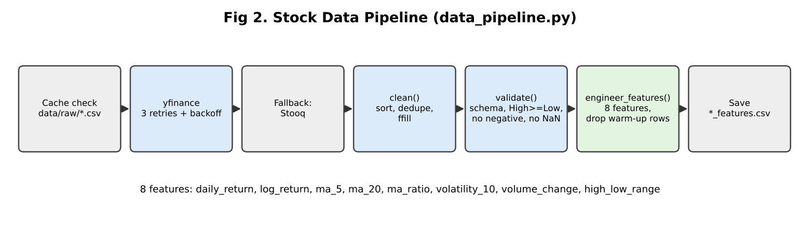

## 3.1 Theory in simple words

**OHLCV** = one row per trading day: **O**pen, **H**igh, **L**ow, **C**lose price and **V**olume (number of shares traded).

**yfinance** = a free Python library that downloads Yahoo Finance data. It is not an official API, so it can fail or change. That is why the code has **retries** and a **fallback (Stooq)**.

**Features you built (8):**

| Feature | Formula (simple) | Why useful |
|---|---|---|
| daily_return | (Close today − Close yesterday) / Close yesterday | % change — comparable across stocks |
| log_return | log(Close today / Close yesterday) | adds up over days; used in finance maths |
| ma_5 | average Close of last 5 days | short-term trend |
| ma_20 | average Close of last 20 days | long-term trend |
| ma_ratio | ma_5 / ma_20 | >1 means short trend is above long trend (momentum) |
| volatility_10 | std-dev of last 10 daily returns | how "shaky" the price is (risk) |
| volume_change | % change in Volume | sudden interest |
| high_low_range | (High − Low) / Close | how wide the day's price moved |

**Warm-up rows:** the 20-day average needs 20 days of data, so first rows have NaN. You drop them: 1,254 raw rows → 1,235 rows.

## 3.2 How it works in your code

1. `fetch_ticker()` — look in cache `data/raw/<TICKER>_ohlcv.csv`; if not found call `_fetch_yfinance()` (3 attempts, wait 2s, 4s…); if empty use `_fetch_stooq()`; else raise error. Saves cache.
2. `clean()` — remove duplicate dates (keep last), sort by date, **forward-fill** OHLC, set missing Volume to 0, drop rows still NaN.
3. `validate()` — returns (True/False, list of problems): missing columns, index not DatetimeIndex, negative prices/volume, High < Low, NaN left.
4. `engineer_features()` — creates the 8 features and drops warm-up rows.
5. `run()` — loops tickers, saves `data/processed/<TICKER>_features.csv`.

## 3.3 Why this? Why not that?

| Decision | Why | Why not the alternative | What if you change it |
|---|---|---|---|
| yfinance | Free, no API key, 5 years in one call | Paid APIs (Bloomberg, Alpha Vantage) cost money or have tight limits | If Yahoo changes format, code breaks → that's why fallback exists |
| Stooq fallback | Also free, via pandas-datareader | — | Code says Stooq was "not needed this run" [REPO] — so fallback is **not tested live**; be honest |
| Disk cache | Faster reruns, avoids rate-limit | Always re-download wastes time | Stale data if you forget `--force-refresh` |
| Forward-fill | Holiday/halt: price carried over from last session | Drop rows = holes in the time series; interpolate = uses future price (look-ahead) | Interpolation would leak future info |
| Volume NaN → 0 | No trades = zero volume | Forward-fill volume would invent trades | — |
| `auto_adjust=False` | Keeps raw Open/High/Low/Close as Yahoo reports | `True` rewrites prices for dividends/splits | [INFERENCE] choose based on what you need; be ready to say you did not test the effect |
| 5-year period | Enough for 250-day start + ~985 test days | 1 year is too short for 197 folds | 10 years = slower ARIMA run |

## 3.4 Problems faced (real ones from your repo)
1. **yfinance can fail** → retries with exponential wait + Stooq fallback.
2. **Timezone-aware dates** in cached CSV → `pd.to_datetime(..., utc=True, format="mixed")` when reading cache.
3. **Windows OpenBLAS memory error** during hundreds of ARIMA fits → you set `OMP_NUM_THREADS=1` etc. at the top of `main.py`, `forecasting.py`, `dashboard.py` before numpy loads. (Good story: "I debugged a memory error that only happened on Windows.")
4. **Type-checker complaints** with pandas/yfinance stubs → explicit type annotations. (Minor; only mention if asked about code quality.)

## 3.5 Questions, follow-ups and cross-questions

**Q1. Why did you create 8 features if ARIMA only uses Close?**
*Answer:* "ARIMA is a univariate model, it uses only the Close series. The features are prepared for other models and for the exploratory notebook (it uses `daily_return`). In this project the forecasting result does not depend on them. I would use them if I tried a model like XGBoost or an ARIMAX with extra inputs."
- *Follow-up:* So the features are useless? → "Not useless, but not used by the final ARIMA result. I would not say they improved the forecast."
- *Cross-question:* Why did you count them as 8 in README? → "Because `engineer_features` really creates 8 new columns; the test `test_feature_count_matches_engineered_columns` checks that."
- *Tests:* honesty and understanding of what ARIMA uses.

**Q2. Why forward-fill and not interpolate or drop?**
*Answer:* "Forward-fill only uses the past, so there is no look-ahead. Interpolation uses the next day's value to fill today — that leaks the future. Dropping rows creates gaps in the time axis, which can confuse moving averages."
- *Follow-up:* Does forward-fill have a risk? → "Yes, if many days are missing, it creates flat prices and zero returns, which lowers volatility. Here only isolated gaps are expected."

**Q3. What is validation doing? Did any ticker fail?**
*Answer:* "It checks the schema and basic sanity, such as no negative price and High ≥ Low. If it fails, the pipeline raises a ValueError and stops, instead of training on bad data. [CLARIFY: tell them if you saw any ticker fail; README does not say any failed.]"

**Q4. Why log return as well as simple return?**
*Answer:* "For small changes they are almost equal. Log returns add over time (the 5-day log return is the sum of five daily log returns) and are more symmetric, so they are common in finance models."

**Q5. What is moving average and what is `ma_ratio`?**
*Answer:* "Moving average smooths noise. ma_5 reacts fast, ma_20 reacts slowly. If ma_5 / ma_20 is above 1 the recent trend is up compared to the longer trend."
- *Cross:* Is there look-ahead in the moving average? → "No. `rolling(window).mean()` uses the current and previous days only."

**Q6. What is volatility?**
*Answer:* "How much returns move up and down. I used the standard deviation of the last 10 daily returns. A high value means a risky, jumpy period. TSLA has the highest error in my results, which matches its higher volatility."

**Q7. What if yfinance returns wrong/old data?**
*Answer:* "I added validation and caching, but I did not compare with a second source in this run. In production I would cross-check against another provider and alert on missing dates."

**Q8. How would you scale to 500 tickers?**
*Answer:* "Download in parallel/batches (`yf.download` for many tickers), store in a database or Parquet, schedule with a job runner, and make ARIMA fitting parallel per ticker. ARIMA walk-forward is the slow part — 985 fits for 5 tickers; for 500 tickers it would be about 100,000 fits at step=5."

---

# CHAPTER 4 — Forecasting with ARIMA (`forecasting.py`)

## 4.1 Theory in simple words

### 4.1.1 Time series
Data in time order (price each day). Today depends on the past. So we **cannot shuffle** it.

### 4.1.2 Stationarity
A series is **stationary** if its mean and variance do not change over time. Prices trend up/down, so they are **non-stationary**. Daily *changes* (differences) are usually closer to stationary.

### 4.1.3 ARIMA(p, d, q)

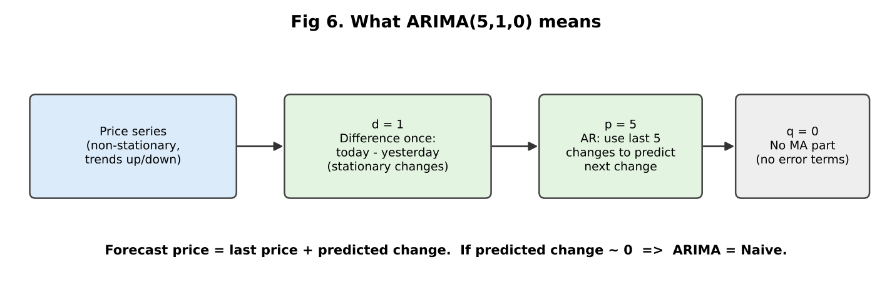

| Letter | Name | Meaning | Your value |
|---|---|---|---|
| **AR (p)** | Auto-Regressive | predict next value from last *p* values | 5 |
| **I (d)** | Integrated | how many times we difference the series to make it stationary | 1 |
| **MA (q)** | Moving Average | use past *forecast errors* | 0 |

**Plain example:** with d=1 the model predicts *change* = a1×(change yesterday) + a2×(change 2 days ago) + … a5. Forecast price = last price + predicted change.

> **Key insight to say in the interview:** If the stock is close to a *random walk*, the best predicted change is about **zero**, so ARIMA forecast ≈ yesterday's price = **naive forecast**. That is exactly what your results show.

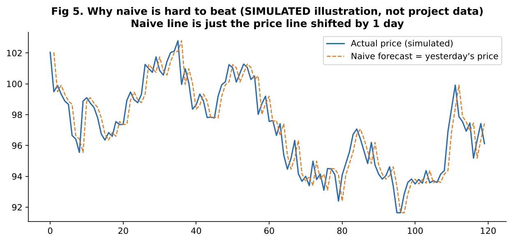
*(Simulated data to explain the idea; not your project data.)*

[INFERENCE] statsmodels' ARIMA with d=1 uses no constant/drift by default, so the "zero change" case equals the naive forecast. Check with `fitted.params` if asked live.

### 4.1.4 Naive baseline
"Tomorrow = today." The simplest forecast. A model must **beat the naive baseline** to be useful. If not, it adds complexity for no gain.

### 4.1.5 Walk-forward validation

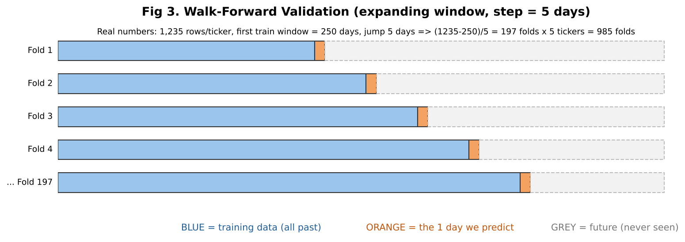

- Blue = training data (all days before the test day), orange = the day to predict, grey = future, never touched.
- Window **expands** each time (the "expanding window").
- **Why not normal train/test or k-fold?** Random splits put future days in training and past days in test → **look-ahead leakage** → fake good scores. Walk-forward copies real life: you only know the past.
- **Your numbers:** 1,235 rows; first train = 250 days; jump 5 days → (1235 − 250) / 5 = **197 folds per ticker**; 197 × 5 tickers = **985 folds**.
- **Why step = 5?** Fitting ARIMA 1,000 times per ticker is slow on a laptop (code comment). Step=5 is still genuine walk-forward, just fewer test days. `step=1` gives the full version.

### 4.1.6 Metrics

| Metric | Formula | Meaning | Good / bad |
|---|---|---|---|
| **MAPE** | mean( \|actual − predicted\| / \|actual\| ) × 100 | average % error | Easy to read. Example: 1.70% on a $200 stock ≈ $3.40 error |
| **RMSE** | sqrt( mean( (actual − predicted)² ) ) | average error in **dollars**, punishes big misses more | Same unit as price; can't compare across stocks of different price level |

Why both? MAPE is scale-free (good to compare AAPL and TSLA). RMSE shows big mistakes.

## 4.2 Your results

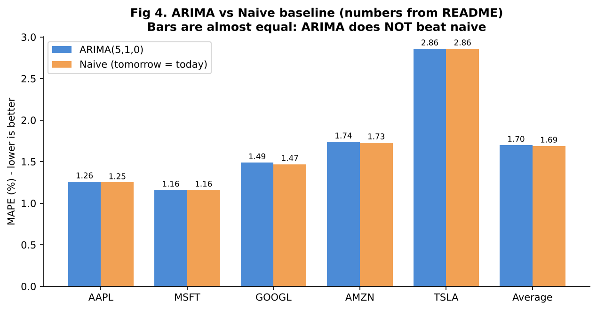

| Ticker | Folds | ARIMA MAPE | Naive MAPE | ARIMA RMSE | Naive RMSE |
|---|---|---|---|---|---|
| AAPL | 197 | 1.26% | 1.25% | 4.12 | 4.14 |
| MSFT | 197 | 1.16% | 1.16% | 5.31 | 5.34 |
| GOOGL | 197 | 1.49% | 1.47% | 4.06 | 4.00 |
| AMZN | 197 | 1.74% | 1.73% | 4.67 | 4.65 |
| TSLA | 197 | 2.86% | 2.86% | 10.32 | 10.34 |
| **Average** | | **1.70%** | **1.69%** | **5.70** | **5.69** |

**How to say it:** "ARIMA's 1.70% looks small, but the naive baseline is 1.69%. So the model is *as good as* naive, not better. I reported this honestly."

## 4.3 How it works in code
- `walk_forward_folds(n)` → list of (train_end, test_idx).
- For each fold: `train_series = series.iloc[:train_end]`, `actual = series.iloc[test_idx]`.
- `naive_baseline_predict` → last value of the training window.
- `_arima_predict` → `ARIMA(train.values, order=(5,1,0)).fit().forecast(1)` with warnings silenced.
- If ARIMA fit crashes → logs a warning and **uses the naive prediction** for that fold.
- `evaluate_ticker` collects arrays, computes MAPE/RMSE; `evaluate_all` adds an AVERAGE row (simple mean of the 5 tickers).

## 4.4 Why this? Why not that?

| Decision | Why | Why not alternative | What if changed |
|---|---|---|---|
| ARIMA | Classic, simple, explainable, works in `statsmodels` | LSTM/Transformer: needs more data, tuning, easy to overfit, harder to explain; Prophet: for trend + seasonality, not 1-day noise | A deep model would likely also tie naive on daily closes |
| Order (5,1,0) fixed | Spec choice; one setting for all tickers keeps the comparison fair and simple | auto-ARIMA (`pmdarima`) per ticker picks (p,d,q) by AIC | README: unlikely to beat naive, "a property of the data" |
| d = 1 | Prices are non-stationary | d=0 would fit trending data badly | — |
| Close price (levels) | Easy to read in dollars | Predicting *returns* is the usual research target and would make "no signal" even clearer | MAPE on price level looks small because price barely changes in 1 day |
| 1-step ahead | Simple and standard | Multi-step (5-day, 30-day) errors are much larger | — |
| Naive baseline | Honest benchmark | Comparing only to itself shows nothing | — |
| Expanding window | Uses all history | Rolling (fixed-size) window adapts faster to new regimes | Could test both |
| MAPE + RMSE | Complementary | MAE, directional accuracy, Sharpe of a strategy | **Directional accuracy / profit** is what a trader cares about — not measured here |
| Walk-forward | No leakage | k-fold, random split | Fake optimistic results |

## 4.5 Problems faced
1. **Speed** — ~1,000 refits per ticker too slow → `step=5`.
2. **Windows OpenBLAS crash** after a few hundred fits → pin BLAS threads to 1.
3. **A model fit can fail** (non-convergence) → fall back to naive for that fold so the run does not crash. [Risk to know: this can make ARIMA look closer to naive. The code does **not** count how many folds fell back. Say: "I would log the count; in my logs I did not see a high number, but I did not record it." — only say this if true. **[CLARIFY]**]
4. **Main finding** — ARIMA ≈ naive; this is a result, not a failure.

## 4.6 Questions, follow-ups and cross-questions

**Q1. Explain your forecasting approach in simple words.**
*Answer:* "For each of 5 stocks I take the closing price series. I start with the first 250 days, fit ARIMA(5,1,0), predict the next day, compare with the real price, then move forward 5 days and repeat. This gives 197 predictions per stock, 985 in total. I compute MAPE and RMSE and compare with a naive baseline."

**Q2. Is 1.70% MAPE good?**
*Answer:* "On its own it looks good, but it is not meaningful without a baseline. Naive gets 1.69%, so ARIMA gives no improvement. Daily prices change very little from day to day, so even 'tomorrow = today' has a low percentage error."
- *Follow-up:* So why put it on your resume? → "It shows that I built a correct, leakage-free evaluation and measured against a baseline. The honest finding — that ARIMA does not beat naive — is the real learning."
- *Cross-question:* Would you say your model works? → "It works technically and is evaluated correctly, but it has no extra predictive value over naive. I would not trade on it."

**Q3. What do p, d, q mean? Why (5,1,0)?**
*Answer:* (use table in 4.1.3). "(5,1,0) was the default setting in the project spec [CLARIFY: tell them if you chose it or tried others]. I did not tune it per ticker. With a random-walk-like series, tuning would not change the result much."
- *Follow-up:* How would you choose p, d, q properly? → "Check stationarity with the ADF test to choose d; look at ACF/PACF plots for p and q; or use AIC/BIC grid search or `auto_arima`; and always validate with walk-forward."
- *Cross:* What is ADF test? → "Augmented Dickey-Fuller test. Null hypothesis: the series has a unit root (non-stationary). Small p-value (<0.05) → reject → stationary."
- *Cross:* What are ACF and PACF? → "ACF is correlation of the series with its lagged self; PACF is the same but removes the effect of the shorter lags. PACF cut-off suggests p; ACF cut-off suggests q."

**Q4. Why walk-forward and not train_test_split / k-fold?**
*Answer:* "In time series order matters. Random splits train on future days and test on past days, which leaks information. Walk-forward trains only on data before the test day, like real life."
- *Follow-up:* Expanding vs rolling window? → "Expanding uses all history (more stable); rolling uses last N days (adapts to changes but less data). I used expanding."
- *Follow-up:* Does the model re-fit each time? → "Yes, ARIMA is re-fitted at every fold on the new training window."
- *Cross:* Isn't 985 folds on only 5 stocks over-claiming? → "It is 985 *test points*, not 985 independent experiments. The folds overlap in training data and the 5 stocks are all US large-cap tech, so they are correlated. It is good evidence for this setting, not a general proof."

**Q5. Why step = 5? Does it make results biased?**
*Answer:* "Only for speed. We still never use future data. The test days are every 5th day instead of every day, so the sample is smaller but should be similar. step=1 would give about 985 test points per ticker."

**Q6. What is MAPE? Weakness?**
*Answer:* "Mean absolute percentage error. Weakness: undefined or huge if actual is 0; it treats over- and under-prediction differently (penalises over-forecasts more than under-forecasts [INFERENCE: well-known property]); and for stock prices that rarely change much in a day it can look small."
- *Follow-up:* In code, how do you avoid divide-by-zero? → "`_mape` masks out rows where actual == 0."

**Q7. Why is ARIMA no better than naive?**
*Answer:* "Liquid large-cap stock prices are close to a random walk (efficient market idea). The AR coefficients on past changes are near zero, so predicted change ≈ 0 and the forecast equals the last price."
- *Cross:* Does this prove the market is efficient? → "No. It only shows that a linear model on past prices has no edge at 1-day horizon on these five stocks. Other information (news, fundamentals, order flow) or non-linear models might, but that needs proper testing."
- *Cross:* So how can your sentiment/news help? → "That is the idea of the exploratory notebook, but the README says it's not validated. I would need multiple tickers, lagged features and a walk-forward test."

**Q8. Which ticker was hardest and why?**
*Answer:* "TSLA, MAPE 2.86%, RMSE 10.32. TSLA is the most volatile, so daily moves are bigger."

**Q9. RMSE vs MAPE — why report both?**
*Answer:* (see table above).

**Q10. What would you do to improve?**
*Answer:* "Predict returns instead of price; add external features like sentiment or volume (ARIMAX / gradient boosting); use auto-ARIMA or GARCH for volatility; evaluate directional accuracy and a simple strategy with transaction cost; test over longer periods and more tickers."

**Q11. What is overfitting here? Could you overfit with ARIMA?**
*Answer:* "With too many parameters on little data, yes. Walk-forward test on unseen future days protects me. p=5 on 250+ points is small."

**Q12. What is a unit root?** → "A feature of random-walk series: shocks never fade, so the series isn't stationary. Differencing removes it."

**Q13. How does ARIMA get fitted?** → "statsmodels estimates the parameters by maximum likelihood (state-space / Kalman filter). I don't need to derive it; I know it finds the p AR weights that best explain the differenced series."

**Q14. Code-level: show me where the leakage is prevented.** → `train_series = series.iloc[:train_end]` and the actual is `series.iloc[test_idx]` where `test_idx == train_end` — the test point is never inside the training slice. Also `naive_baseline_predict` uses `train_end - 1`, the last training value.

**Q15. What if the data had gaps / different trading calendars?** → "The index is trading days, so weekends are missing by design. For crypto (24/7) I'd handle frequency separately."

---

# CHAPTER 5 — News & Text Data Ingestion (`news_ingestion.py`)

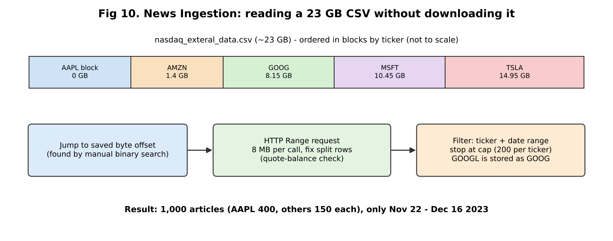

## 5.1 The two datasets

| Dataset | What it is | Size used | Purpose | License note |
|---|---|---|---|---|
| **Financial PhraseBank** (Malo et al., 2014) | Finance sentences labelled negative/neutral/positive by 5–8 finance-aware annotators | 4,838 sentences (`50agree` subset) | Train sentiment | CC BY-NC-SA 4.0 (non-commercial) [REPO] |
| **FNSPID** | Financial news + prices dataset, huge | 1,000 articles with full text | RAG knowledge base | see dataset page [REPO] |

**"50agree" means:** at least 50% of the annotators agreed on the label. Bigger dataset, but **noisier** labels than `AllAgree` (fewer, cleaner sentences). A common interview question.

## 5.2 How PhraseBank is loaded
1. If local cache CSV exists → use it.
2. Else try Kaggle (needs credentials) → else Hugging Face raw zip file (`FinancialPhraseBank-v1.0.zip`).
3. Each line looks like `sentence text@label`; code splits with `rsplit("@", 1)` (safe if the sentence itself has `@`).
4. `_normalize_phrasebank`: lower-case label, keep only the 3 valid labels, map to 0/1/2, drop empty and **duplicate** sentences.

## 5.3 How FNSPID is loaded (your hardest engineering story)

**Problem:** File is ~23 GB. You can't download it on a laptop. Normal methods (`datasets` streaming, `pandas.read_csv(chunksize)`) **stalled** (zero progress for 10+ minutes) [REPO].

**Solution (4 steps):**
1. **HTTP Range request** — ask the server for only bytes `a–b` of the file (8 MB each). Speed measured ≈1–2 MB/s.
2. **Fix split rows** — a CSV row can be cut in the middle at a chunk boundary, and article text contains newlines inside quotes. `_find_safe_csv_split` counts quote marks; a newline counts as end-of-row only when the number of quotes so far is **even** (outside quotes).
3. **Jump to the right place** — file is stored in big blocks sorted by ticker. You found each ticker's start byte by **manual binary search** with small Range probes and saved them in `config.FNSPID_TICKER_START_OFFSETS` (AAPL 0, AMZN 1.4 GB, GOOG 8.15 GB, MSFT 10.45 GB, TSLA 14.95 GB).
4. **Filter** — keep rows with the right ticker and date within 2022-01-01…2023-12-31; stop at cap (200 per ticker by config; README says AAPL was raised to 400 "opportunistically").
5. **GOOGL → GOOG alias** — dataset uses the older symbol. You found it because scanning for GOOGL gave 0 matches over ~36k rows [REPO].

**Result:** 1,000 articles, average body ≈4,690 characters, 0 empty. AAPL 400 / AMZN 150 / GOOGL 150 / MSFT 150 / TSLA 150. **All dates fall between Nov 22 and Dec 16, 2023** (≈3.5 weeks), because each scan took only the front of each ticker's block.

## 5.4 Why this? Why not that?

| Decision | Why | Alternative | What if |
|---|---|---|---|
| Range requests | Only way that worked in the environment | Download 23 GB; `datasets` streaming (stalled) | Slow but works; fragile if server changes |
| Hard-coded offsets | Avoid scanning GBs of other tickers | Full scan = hours | Offsets break if dataset file changes |
| Cap 1,000 articles | Laptop-friendly | Full dataset (millions of articles) | Better coverage, more cost |
| FNSPID | Has full article text (needed for RAG) | NewsAPI (limits, only recent), scrape (legal/robustness) | — |
| PhraseBank | Gold-standard labelled finance sentences | Label yourself (slow), Twitter data (noisy) | — |

## 5.5 Problems faced
1. Streaming methods stalled → manual Range requests.
2. CSV rows split at boundaries → quote-balance logic.
3. Ticker blocks far apart → byte-offset jump.
4. `GOOGL` vs `GOOG` naming.
5. Very large CSV fields → `csv.field_size_limit(2_000_000)`.
6. Kaggle credentials missing → automatic Hugging Face fallback; `datasets.load_dataset` didn't work for PhraseBank (old loading script) → download zip with `hf_hub_download`.
7. **Result limitation:** only 3.5 weeks of news. Be honest.

## 5.6 Questions, follow-ups and cross-questions

**Q1. How did you get 1,000 articles from a 23 GB file?**
*Answer:* (summarise 5.3 in 5 sentences.)
- *Follow-up:* How did you find the byte offsets? → "I made small Range requests at different positions, read the `Stock_symbol` column, and moved the position forward or back like binary search until I landed just before each ticker's block."
- *Cross:* Is binary search valid if the file isn't fully sorted? → "The README says it is *roughly* alphabetical by blocks. Binary search works at block level, which is enough to land near the start. It's a heuristic, not a guarantee."
- *Cross:* Is your sample biased? → "Yes. It's the first ~150–400 articles per ticker in one block, all in about 3.5 weeks. It's not a random sample of all news. Answers can only be about that period."

**Q2. Why not just use NewsAPI?** → "Free tier gives only recent articles and often only snippets, with rate limits. FNSPID has full text and is a public research dataset. `NEWSAPI_KEY` exists in config as an optional future source."

**Q3. What does "50agree" mean? Why choose it?** → "At least half of annotators agree. It gives more data (4,838 vs ~2,264 for AllAgree [INFERENCE: known figure, verify]) but noisier labels. Because noisy labels cap accuracy, 71% is not as low as it looks." 
- *Cross:* Did you test AllAgree? → "[CLARIFY] The repo config can switch (`PHRASEBANK_HF_CONFIG`), but README reports only 50agree."

**Q4. How do you handle duplicates?** → "`drop_duplicates(subset=['text'])` after normalising. This matters because duplicates across train/test would inflate accuracy."

**Q5. Is PhraseBank licence a problem?** → "CC BY-NC-SA — non-commercial. Fine for learning/research; a company product would need a licence check."

**Q6. Why a fallback from Kaggle to HF?** → "Kaggle needs an API token that wasn't configured. HF hosts the same original release file, so results are the same data."

---

# CHAPTER 6 — Sentiment Classifier (`sentiment_classifier.py`)

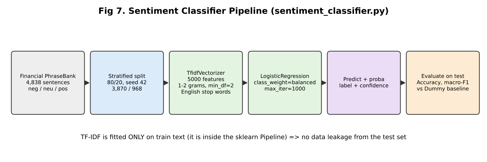

## 6.1 Theory in simple words

### 6.1.1 Text classification
Input: a sentence. Output: one of 3 labels (negative / neutral / positive). Computers need numbers, so we first turn text into a vector.

### 6.1.2 Bag-of-words and TF-IDF
- **Bag of words:** count how many times each word appears. Word order is ignored.
- **TF (term frequency):** how often a word is in *this* sentence.
- **IDF (inverse document frequency):** rare words across all sentences get a *higher* weight; very common words ("the", "company") get lower weight. Formula idea: `idf = log( N / df )` (sklearn adds smoothing).
- **TF-IDF = TF × IDF.** So "profit" or "layoffs" matter more than "said".

Your settings:

| Setting | Meaning | Why |
|---|---|---|
| `max_features=5000` | keep only the 5,000 most frequent terms | smaller, less noise, less overfitting on 3,870 training sentences |
| `ngram_range=(1,2)` | single words **and** two-word phrases ("net profit") | captures a bit of context |
| `stop_words="english"` | remove words like "the", "is", "and" | reduces noise |
| `min_df=2` | ignore terms seen in only 1 sentence | removes typos/rare junk |

⚠ **Weakness to know:** sklearn's English stop-word list also contains **"not", "no", "never"** [INFERENCE: well-known; verify with `sklearn.feature_extraction.text.ENGLISH_STOP_WORDS`]. So "profit did **not** rise" can look like "profit rise" → wrong. This is a good "what would you improve" answer: keep negations or use a transformer.

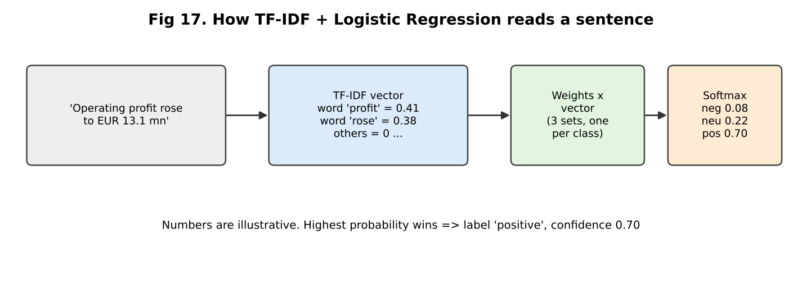

### 6.1.3 Logistic Regression (for 3 classes)
- Despite the name it is a **classifier**.
- For each class it learns a **weight for every word**. Score = sum(weight × tfidf value). 
- **Softmax** turns the 3 scores into probabilities that add to 1. Highest = predicted label; its probability = "confidence".
- It is trained by minimising **log-loss (cross-entropy)** with an optimiser (default lbfgs [INFERENCE: sklearn default]) — `max_iter=1000` just allows enough iterations to converge.
- **Regularisation:** sklearn default L2 with C=1 — keeps weights small to reduce overfitting.
- **Interpretable:** you can print the biggest positive weights per class ("profit", "rose" → positive).

### 6.1.4 Class imbalance and `class_weight="balanced"`
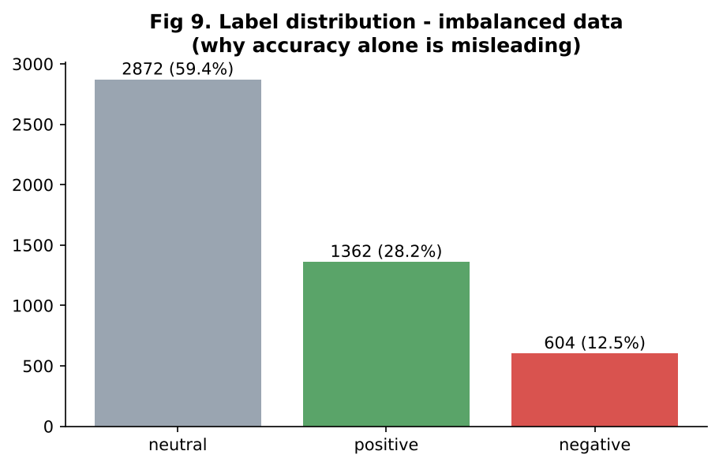

Neutral is 59% of data. A lazy model that always says "neutral" gets 59.4% accuracy. `balanced` gives rare classes (negative, positive) **larger weight in the loss** (weight ≈ N / (n_classes × n_in_class)), so the model cannot ignore them.

### 6.1.5 Metrics
| Metric | Meaning |
|---|---|
| **Accuracy** | correct / total |
| **Precision (class)** | of the sentences I labelled "negative", how many truly are |
| **Recall (class)** | of all truly negative sentences, how many I found |
| **F1** | balance of precision & recall = 2PR/(P+R) |
| **Macro-F1** | average F1 of the 3 classes, each class equal weight — **fair for imbalanced data** |

Your per-class result (test, n=968) [REPO]:

| Class | Precision | Recall |
|---|---|---|
| negative | 0.56 | 0.67 |
| neutral | 0.79 | 0.79 |
| positive | 0.63 | 0.57 |

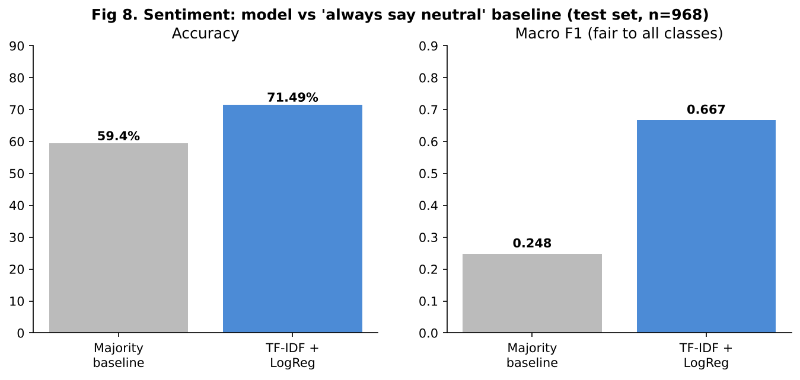

**Why baseline macro-F1 = 0.248?** "Always neutral": neutral F1 ≈ 0.745, the other two = 0 → average = 0.248.

**Statistical honesty:** 71.49% on 968 test sentences has about **±2.9%** margin (95%, rough: 1.96 × √(0.715×0.285/968)). So "71.5%" really means "roughly 69–74%". The gap to baseline (+12 points) is far larger than this noise, so the improvement is real, but small differences between models would not be.

## 6.2 How it works in code
- `build_pipeline()` → `Pipeline([tfidf, clf])`. Because TF-IDF is **inside** the pipeline, it is fitted **only on training text** → no data leakage.
- `train()` → stratified split (keeps class ratio), fit, predict, plus a `DummyClassifier(most_frequent)` baseline, returns metrics dict.
- `predict()` → `predict_proba`, picks `argmax`, returns label + confidence + all probabilities.
- `save()/load()` → `joblib` file `data/models/sentiment_pipeline.joblib`. Dashboard loads it; if missing it trains.

## 6.3 Why this? Why not that?

| Decision | Why | Why not alternative | What if changed |
|---|---|---|---|
| TF-IDF + LogReg | Fast (seconds), small data, interpretable, strong baseline | **FinBERT / BERT**: more accurate (higher 80s) but needs GPU/time, harder to explain; Naive Bayes: simpler but usually a bit weaker; SVM: similar performance | Transformer would likely add several accuracy points |
| Word2Vec/GloVe | — | Averages lose detail, needs more setup | — |
| class_weight balanced | Imbalanced data | Oversampling (SMOTE) works on vectors but adds complexity; undersampling wastes data | Without it, minority recall drops, accuracy may rise slightly |
| Stratified split | Keeps class ratio in train & test | Random split could change ratios | — |
| 80/20 split, random_state 42 | Standard, reproducible | k-fold CV gives a more stable estimate | **Weak point:** one split only; no CV; no tuning |
| Macro-F1 + accuracy | Imbalance | Accuracy alone is misleading | — |
| Majority baseline | Shows what "no learning" scores | — | — |
| PhraseBank | Finance-specific labelled data | Generic sentiment (movie reviews) fails: "liability" or "cut" mean different things in finance | — |

## 6.4 Problems faced
1. **Class imbalance** → balanced class weights, macro-F1, baseline comparison.
2. **pandas 3 pyarrow strings** broke `train_test_split` → use `.tolist()` (comment in code).
3. **sklearn stub mismatch** on `zero_division` → `# type: ignore` (harmless).
4. **Distribution mismatch:** trained on newswire-style sentences; used later on short headlines (notebook) — accuracy likely lower. (README says so.)
5. **Positive class is weakest** (recall 0.57) — confusing positive vs neutral is common because many "positive" PhraseBank sentences are factual.

## 6.5 Questions, follow-ups and cross-questions

**Q1. Explain how your sentiment model works.**
*Answer:* "I convert each sentence into a TF-IDF vector — a long list of numbers, one per word or word-pair, bigger for words that are important for that sentence. Logistic regression learns weights for these words for each class and gives probabilities with softmax. The highest probability is the label. I used balanced class weights because neutral is 59% of the data."
- *Follow-up:* What is IDF? → "It lowers the weight of words that appear in many sentences."
- *Cross:* Why not just count words? → "Counts overvalue common words. TF-IDF focuses on discriminative words."

**Q2. 71.49% — is it good?**
*Answer:* "It beats the 59.4% baseline by 12 points and macro-F1 is 0.667 vs 0.248. It's a good lightweight baseline but not state of the art; fine-tuned FinBERT is usually higher. Labels are 50% agreement, so there's noise too."
- *Follow-up:* How much of the 71% is real? → "The test set has 968 sentences, so about ±3%. Still clearly above baseline."
- *Cross:* Did you tune hyperparameters on the test set? → "No — I used one fixed configuration and evaluated once, so the test score is not tuned on. But that also means I did not tune; with a validation set or cross-validation I could improve."

**Q3. Why accuracy and macro-F1?** → "Because data is imbalanced; accuracy hides weak minority classes. Macro-F1 gives each class equal importance."

**Q4. Why TF-IDF + LogReg and not BERT?** → "Small dataset, CPU-only, wanted fast and explainable baseline. BERT/FinBERT would be a natural next step, but needs more compute and more explanation of results. I'd fine-tune FinBERT and compare with this baseline."
- *Cross:* What do you lose? → "Context and word order. 'Not good' vs 'good', or sarcasm."

**Q5. How do you prevent data leakage?** → "Stratified split first, then TF-IDF fit inside the Pipeline on training data only, and duplicate sentences were removed."

**Q6. What does `class_weight='balanced'` do?** → "Multiplies each sample's loss by N / (k × count of its class), so negative and positive errors cost more."
- *Cross:* Any downside? → "Can lower precision for the minority class; can slightly lower accuracy."

**Q7. Why `min_df=2`, `max_features=5000`?** → "Remove very rare terms and cap the feature count, so the model doesn't memorise single words with only 3,870 examples. I did not run a grid search for these [CLARIFY]."

**Q8. What does 'confidence' mean in `predict`?** → "The softmax probability of the top class. It's not guaranteed to be well calibrated — 0.70 doesn't mean it's right 70% of the time. Could check with a calibration curve."

**Q9. What mistakes does it make? Show an example.** → Mostly positive ↔ neutral. Negations ("not"), numbers ("rose 5% vs expected 10%"), and company-specific context.

**Q10. How could you improve it?** → "Keep negation words; add character n-grams; try LinearSVC; tune C and n-gram range with cross-validation; use FinBERT; add more data (headlines, social posts); calibrate probabilities."

**Q11. Precision vs recall for negative class — which matters more for investors?** → "Recall for negative: missing bad news is costly. But too many false alarms reduces trust. Depends on use; I'd choose a threshold on probability."

**Q12. Did you use the sentiment model on the news articles in RAG?** → "No. In the main pipeline the classifier is a separate tab. I used it in an exploratory notebook on AAPL headlines vs next-day return, but I treat that as exploration only, not a validated result."

**Q13. What is stratified sampling?** → "Splitting so that each class has the same proportion in train and test. Important for the 604 negative sentences."

**Q14. Overfitting check?** → "I did not report training accuracy [CLARIFY]. A quick check is to compare train vs test accuracy; a big gap means overfitting."

**Q15. Explain the softmax formula.** → "p(class i) = exp(score_i) / sum of exp(score_j). Makes all values positive and sum to 1."

---

# CHAPTER 7 — RAG Chatbot (`rag_pipeline.py`)

## 7.1 Theory in simple words

### 7.1.1 Why RAG?
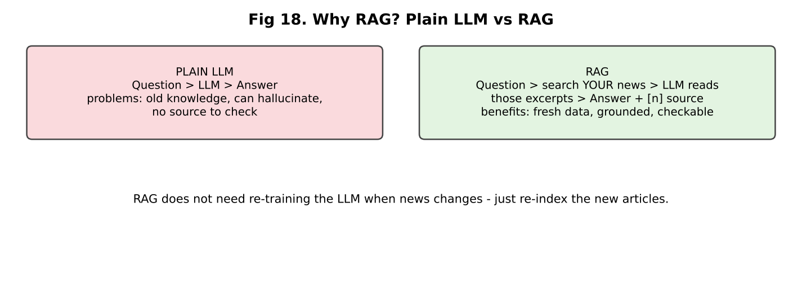

- An LLM knows only what it learned in training (old) and can **hallucinate** (make up facts).
- **RAG = Retrieval-Augmented Generation:** first **retrieve** relevant text from *your* documents, then **generate** the answer using only that text. You can show sources.
- Alternative: **fine-tuning** the LLM on news — costly, becomes old, no sources. RAG just needs re-indexing new articles.

### 7.1.2 Embeddings
- A model converts text into a list of numbers (a **vector**), so that texts with similar meaning have vectors that are close.
- **all-MiniLM-L6-v2** (sentence-transformers): 384 numbers per text; small (~90 MB), free, runs on CPU; reads up to ~256 word-pieces (tokens) — your 800-character chunks fit [INFERENCE: known model limit].
- **Similarity:** close vectors = similar meaning. Measured by distance (L2) or cosine similarity. LangChain's FAISS wrapper uses an exact L2 index by default [INFERENCE — check `type(rag.vectorstore.index)` to be sure].

### 7.1.3 Chunking
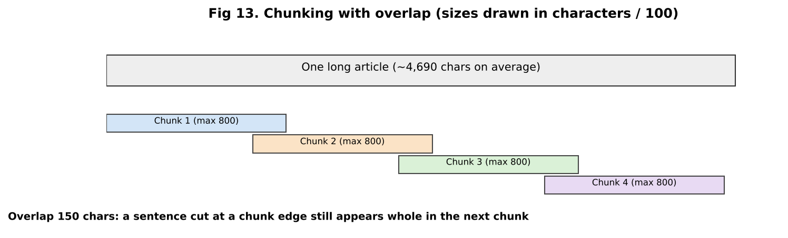

- Articles are long (≈4,690 chars). We split into **chunks** of up to 800 characters with **150 overlap**.
- **Why chunk?** (1) the embedding model has a token limit; (2) one small chunk = one focused idea, better match; (3) the LLM prompt has a limit and costs tokens.
- **Why overlap?** So a sentence cut at the border is still complete in one chunk.
- **RecursiveCharacterTextSplitter** tries separators in order: paragraph `\n\n` → line `\n` → sentence `. ` → space → character. It prefers natural boundaries.
- You also put the **headline in front of the body** text, and keep **metadata** (article_id, chunk_id, headline, source URL, date, ticker) with each chunk.

### 7.1.4 FAISS
- Library from Facebook/Meta for fast similarity search over vectors. Stores vectors, returns the nearest ones for a query vector.
- For 8,819 vectors a flat (exact) search is instant. For millions you'd use approximate indexes (IVF, HNSW).
- Saved to `data/faiss_index/` so the dashboard loads it instead of re-embedding. `allow_dangerous_deserialization=True` is needed to load the pickle part — safe only because *you* created the file.

### 7.1.5 Groq
- **Groq** = company with special chips (LPUs) that run open LLMs very fast. You call it with an API key (OpenAI-style chat API).
- Free tier has limits (README: ~8,000 tokens per minute) → rate-limit errors in your benchmark.
- Default model `qwen/qwen3.6-27b` — open-weight reasoning model. Original spec wanted a Llama model, but all Llama models were decommissioned/unavailable on the account when built [REPO]. `reasoning_effort="none"` is used so there's no `<think>` text in the answer (only for `qwen/` models).
- **temperature 0.1** = almost deterministic, good for factual answers.

### 7.1.6 Prompt (grounding)
```
SYSTEM: You are a financial research assistant. Answer using ONLY the information
in the provided article excerpts. If the excerpts do not contain enough
information, say so plainly instead of guessing. Cite which article(s) you used
by their [n] marker.
USER: Article excerpts:
[1] (AAPL, 2023-12-01) Headline ...
<chunk text>
[2] ...
Question: ...
```
Citations: `format_citations` returns marker, headline, source URL, date, ticker, first 300 characters of snippet. The dashboard prints them under the answer.

## 7.2 Two flows

### Flow A — Build index (offline)
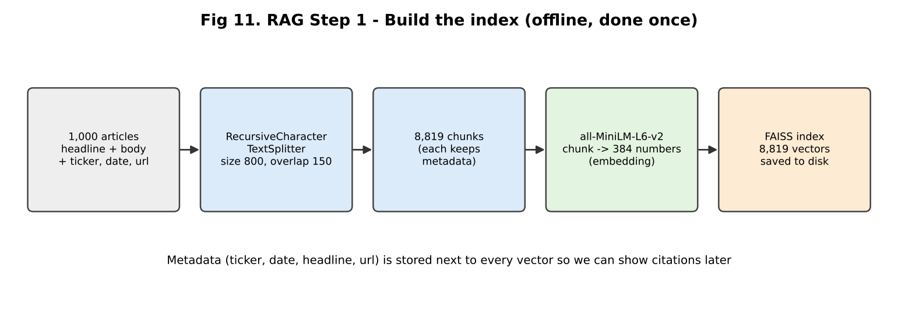

### Flow B — Answer question (online)
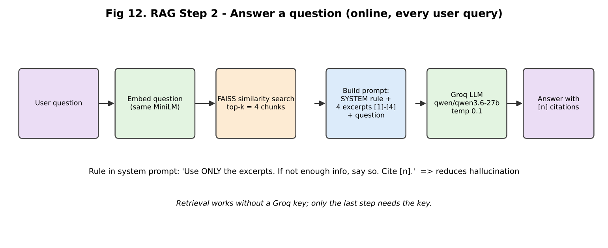

## 7.3 Code map

| Step | Function |
|---|---|
| Split | `chunk_articles()` |
| Embed + store | `build_index()` (loads from disk if index exists) |
| Search | `retrieve()` → `vectorstore.similarity_search(question, k)` |
| Prompt | `_format_context()` |
| LLM call | `generate_answer()` (needs `GROQ_API_KEY`) |
| Full answer | `answer()` (no docs → "No relevant passages…") |
| Quality | `evaluate_retrieval_precision()`, `benchmark_latency()` |

## 7.4 Why this? Why not that?

| Decision | Why | Why not alternative | What if changed |
|---|---|---|---|
| RAG | Fresh data, grounded, citations, no training cost | Fine-tuning: costly, stale; plain LLM: hallucination | — |
| MiniLM | Free, local, small, no API cost, 384-d | OpenAI/other API embeddings: cost + external dependency (project rule: no OpenAI); bigger models (bge, e5, mpnet): better quality, slower | Better embedding → better retrieval (esp. "Google" vs "Alphabet") |
| FAISS | Fast, free, local, no server | Chroma/Pinecone/Weaviate: databases with filtering and persistence, more setup or cost | For metadata filters (ticker, date) a vector DB is easier |
| Chunk 800 / overlap 150 | Balanced size; fits MiniLM window | Smaller = precise but loses context; larger = more noise, token cost | [CLARIFY] not tuned — say "starting value, I'd test 400/800/1200 with the eval set" |
| top-k = 4 | Enough context, low token cost (free tier limit) | k=10 more recall, but more noise and tokens | Bigger k → higher recall, lower precision |
| Groq | Free tier, very fast | OpenAI/Gemini: paid or other limits; local LLM: needs GPU | Latency would change |
| temperature 0.1 | Factual | High temp = creative, less grounded | — |
| "Answer only from excerpts" | Reduces hallucination | Free generation | Model may use outside knowledge |
| Plain similarity search | Simple | MMR (diversity), hybrid BM25 + vector, re-ranker (cross-encoder) | Improves quality — natural next steps |
| LangChain | Ready-made splitter / FAISS / embedding wrappers | Write by hand (possible) | — |

## 7.5 Problems faced
1. **Windows `paging file too small`** when loading MiniLM → `low_cpu_mem_usage=False`.
2. **Groq rejected `reasoning_effort`** on non-reasoning models → apply only for `qwen/`.
3. **Llama models gone** → chose Qwen on Groq; documented why.
4. **Rate limit** (`RateLimitError`) crashed the first benchmark → retry with backoff, delay between calls.
5. **GOOGL queries retrieve other tickers** — broad questions like "Is Google stock a buy?" pull market-wide articles. Real weakness.
6. **Ingestion was hard** (Chapter 5).
7. **Short time window** (3.5 weeks) — can't answer older questions.

## 7.6 Questions, follow-ups and cross-questions

**Q1. Explain RAG in your own words.** → "Instead of asking the LLM from its memory, I first search my own news database for the most relevant pieces, put them in the prompt, and tell the LLM to answer only from them and cite them. This gives fresher, checkable answers."
- *Follow-up:* What are the main steps? → "Chunk → embed → index → retrieve → prompt → generate."
- *Cross:* RAG vs fine-tuning? → "RAG injects knowledge at question time; fine-tuning changes the model's weights. For changing news RAG is cheaper and gives sources. Fine-tuning is better for style or task behaviour."

**Q2. What is an embedding? How does similarity search work?** → (7.1.2). "The question gets the same embedding, FAISS finds the 4 closest chunk vectors."
- *Cross:* L2 vs cosine? → "If vectors are normalised, they give the same ranking. MiniLM sentence-transformer vectors are often normalised in their own pipeline, but LangChain's wrapper default may not normalise [INFERENCE]. Check `encode_kwargs={'normalize_embeddings': True}`."
- *Cross:* What is a vector dimension? → "384 numbers per chunk. 8,819 × 384 floats × 4 bytes ≈ 13.5 MB — small."

**Q3. Why chunk size 800 and overlap 150?** → "A paragraph-size piece fits the embedding model and the prompt. Overlap prevents cutting ideas in half. It was a reasonable starting value; I did not run a full experiment [CLARIFY]."
- *Cross:* What if chunk is too small/large? → "Too small → no context, many chunks. Too large → vector is a blur of many topics, lower precision, more tokens."

**Q4. Why 8,819 chunks from 1,000 articles?** → "Average article ≈4,690 chars; with ~800-char chunks that's ~6–9 chunks per article. Recursive splitting breaks at natural boundaries, so chunks are often a bit shorter than 800, giving about 8.8 per article."

**Q5. How do you reduce hallucination?** → "Grounded prompt ('only from excerpts, say if not enough'), low temperature, and citations so the user can verify. Limits: LLM can still misread excerpts; I have not measured faithfulness."
- *Cross:* How would you measure hallucination? → "Faithfulness checks: for each claim, is it supported by retrieved chunks? Use human review on a sample or an LLM-as-judge (RAGAS-style metrics: faithfulness, answer relevancy, context precision/recall)."

**Q6. What if the answer isn't in the documents?** → "The system prompt tells the model to say it doesn't have enough information. But retrieval **always** returns 4 chunks even if none are relevant (no score threshold). Improvement: add a similarity-score cutoff."

**Q7. Why FAISS and not Chroma/Pinecone?** → "Local, free, no server, enough for 8.8k vectors. If I need metadata filtering, concurrent users or updates, I'd move to a vector DB."

**Q8. How would the system handle new articles daily?** → "Right now `build_index` loads the existing index, or builds if missing (`force_rebuild` to rebuild). I'd add incremental `add_documents`, de-duplication and a scheduled job."

**Q9. LangChain: what exactly did you use?** → "`RecursiveCharacterTextSplitter`, `Document`, `HuggingFaceEmbeddings`, and the FAISS vector store wrapper. The Groq call itself uses the `groq` SDK directly." (Be precise; `langchain-groq` is in requirements but the code doesn't call it.) 
- *Cross:* Why use LangChain at all? → "To avoid writing splitter/FAISS glue. It's a convenience, not required."

**Q10. Why is Groq fast? What are the limits?** → "Custom LPU hardware for LLM inference. Free tier ≈8,000 tokens/min, so 20 quick queries hit the limit — I added retries."

**Q11. Which LLM and why did it change?** → "Qwen 3.6 27B on Groq. The plan was Llama but those models were decommissioned or not available on my account (I tested live), so I used the closest open-weight model available. The backend is swappable via `GROQ_MODEL` env variable."

**Q12. What does `reasoning_effort='none'` do?** → "Qwen is a reasoning model that prints thinking text. This turns it off to get a direct answer and lower latency/tokens."

**Q13. How are citations produced?** → "Each chunk carries metadata. The prompt labels excerpts [1]–[4]; the LLM refers to those numbers; the UI lists `format_citations` — headline, URL, date, ticker, snippet. The LLM's [n] choice is not verified by code."
- *Cross:* Can the LLM cite wrongly? → "Yes; I don't automatically check that the cited chunk supports the sentence."

**Q14. Security concern in your code?** → "`allow_dangerous_deserialization=True` loads a pickle; only safe if the index file is trusted (made locally). API key is read from `.env`, which is gitignored. Prompt-injection from article text is a risk in any RAG: an article could contain instructions; mitigation is the system prompt, content filtering, and output checks."

**Q15. What would you add to improve retrieval?** → "Metadata filtering by ticker (detect the company in the question), hybrid BM25 + vectors, re-ranker, query rewriting, MMR for diversity, better embedding model, more articles across a longer time window."

**Q16. How does the `answer()` handle no docs?** → returns a plain message and empty citations. (FAISS usually returns k docs, so it rarely triggers.)

**Q17. Why does a question "Is Google a buy?" retrieve other tickers?** → "The query is broad and semantic; MiniLM doesn't know GOOGL=Alphabet=Google strongly, and many market-wrap articles mention several companies. A ticker filter or query expansion fixes it."

---

# CHAPTER 8 — RAG Evaluation: precision@4 and Latency

## 8.1 What is precision@k?
**Precision@k** = (number of relevant items in the top-k results) / k.

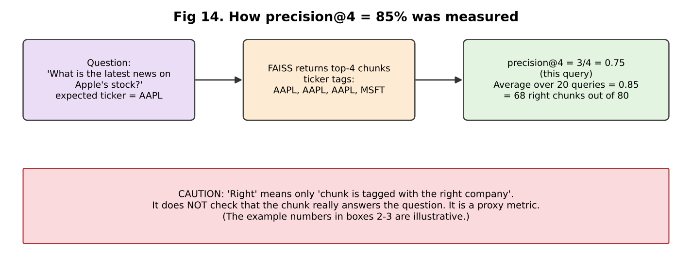

**Your version:**
- 20 hand-written questions, 4 per ticker (`EVAL_QUERIES`), each labelled with the expected ticker.
- For each, take the top 4 chunks; precision = (# chunks whose `ticker` metadata == expected) / 4.
- Mean over 20 queries = **0.85** → 68 of 80 chunks right.
- GOOGL queries weakest (0.25–0.75).

**Critical honesty points (say them first!):**
1. It's a **proxy**: "about the right company", not "contains the answer".
2. **Metadata is not used in retrieval**, only in evaluation. Retrieval is purely text similarity.
3. Only **20 queries**, written by you; no inter-annotator check.
4. **Corpus imbalance:** AAPL = 40% of articles (400/1,000) so AAPL questions are easier; a random retriever would get roughly **20%** on average [INFERENCE: average share of the 5 tickers]. So 85% is clearly above random.
5. It measures **retrieval**, not final answer quality, not hallucination.
6. Questions all name the company ("Apple", "Microsoft") → easy keyword match. Harder questions ("Which supplier risks were mentioned?") are not tested.

**Better metrics to mention:** Recall@k, MRR (mean reciprocal rank), nDCG, hit-rate@k, plus end-to-end: faithfulness, answer relevance (RAGAS), human rating.

## 8.2 Latency

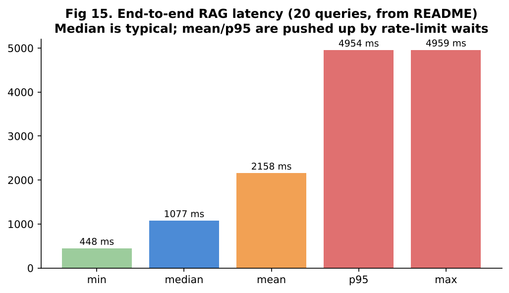

- Measured **end-to-end** (retrieve + Groq) with `time.perf_counter`, 20 real queries, 0 failures.
- **median 1,077 ms, mean 2,158 ms, p95 4,954 ms, min 448 ms, max 4,959 ms.**
- Why mean ≫ median? Free-tier rate limit → retries wait several seconds; those few slow runs lift mean and p95. The 2-second pause between calls is **not** counted.
- **Median = typical single query. p95 = 95% of queries are faster than this.**
- Retrieval itself is a few ms (FAISS); most time is the network + LLM.

## 8.3 Questions, follow-ups and cross-questions

**Q1. How did you get 85% precision@4?** → (8.1) Give the 68/80 detail.
- *Follow-up:* Is 85% good? → "It's clearly above a ~20% random baseline, but it's a coarse proxy. I would use it to compare settings (chunk size, k, embeddings), not to claim 85% answer accuracy."
- *Cross:* Then why call it precision? → "Because it follows the precision@k formula, with 'relevant' defined as same-ticker. I reported the definition openly in the README."
- *Cross:* How would you create a better test set? → "Write 50–100 questions with known source articles, label which chunks answer them, and compute recall@k, MRR, nDCG; add negative questions where the right answer is 'not in the data'."

**Q2. Why is GOOGL the lowest?** → "Broad question; 'Google/Alphabet' naming; the dataset uses GOOG; many market-mover articles mention it with other stocks."

**Q3. What is the difference between precision and recall in retrieval?** → "Precision@k: how clean are the k results. Recall@k: of all relevant chunks that exist, how many appear in the k. I didn't measure recall because I didn't label all relevant chunks."

**Q4. Why is median better than mean here?** → "Outliers from rate limiting skew the mean. Median shows the typical experience; p95 shows the tail."

**Q5. How would you reduce latency?** → "Cache frequent answers; stream tokens; smaller prompt (fewer/shorter chunks); a paid tier without rate limit; faster model; run retrieval and generation close (same region)."

**Q6. 8,819 vs '~9,000 embeddings' on resume?** → "I rounded 8,819 to about 9,000." (Be ready to give the exact number.)

---

# CHAPTER 9 — Dashboard, CLI, Config and Tests

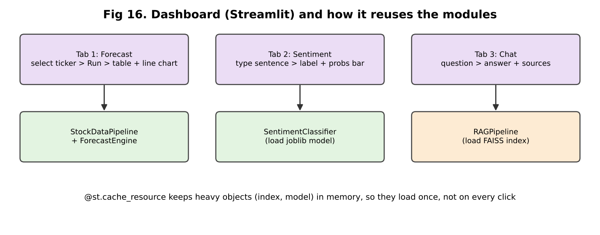

## 9.1 Dashboard (`dashboard.py`, Streamlit)
- **Streamlit:** Python library to build web apps with no HTML/JS. The script re-runs top to bottom on every click.
- `@st.cache_resource` keeps heavy objects (stock data, trained model, FAISS index) in memory so they load once.
- **Tab 1 Forecast:** choose ticker → runs/gets walk-forward results → table, line chart (actual vs ARIMA vs naive), two metric boxes.
- **Tab 2 Sentiment:** type a sentence → label, confidence, bar chart of 3 probabilities.
- **Tab 3 Chat:** type a question → `rag.answer()` → answer + sources. If no Groq key, shows warning (retrieval still works).
- Caveat: Forecast tab runs all 5 tickers' walk-forward once (slow the first time), then it's cached.

## 9.2 CLI (`main.py`)
`python main.py --run stock|forecast|sentiment|rag|eval|all [--force-refresh] [--question "..."]`. Saves outputs in `data/processed/` (CSV/JSON).

## 9.3 Config and secrets
- `config.py` loads `.env` via python-dotenv. API key never hardcoded; `.env` is in `.gitignore`; `.env.example` shows the format.

## 9.4 Tests (26, pytest, offline)
- What is tested: metric functions, walk-forward fold boundaries and step, naive baseline, data cleaning/validation/features, normalisation of datasets, chunking and metadata, retrieval (mocked FAISS), citations, precision@k math, latency stats and retry logic, sentiment train/predict on a toy dataset.
- **Mocks** replace network and Groq calls so tests are fast and need no internet.
- What is **not** tested: real ARIMA fits on real data, real Groq answers, answer quality.

## 9.5 Questions

**Q1. Why Streamlit?** → "Fast to build a demo UI in pure Python; good for data apps. Not for heavy production traffic — for that I'd use FastAPI + a front-end."

**Q2. How did you test the project?** → "26 pytest tests with mocks. For the models I also ran real end-to-end runs and recorded results in the README."
- *Cross:* What is a mock? → "A fake object that replaces a real dependency (like the Groq API) so I can test my logic alone."

**Q3. How would you deploy this?** → "Docker image; Streamlit on a VM or Streamlit Cloud/Cloud Run; keys in secret manager; FAISS index and model files in a volume or object storage; scheduled job to refresh prices/news; logging and monitoring. [CLARIFY: say honestly it was run locally if so.]"

**Q4. How do you monitor it in production?** → "Log latency, token use, error rate; track retrieval scores; sample answers for human review; re-run precision@k on a fixed test set after every index change; data-drift checks for sentiment."

**Q5. What happens if Groq is down?** → "`generate_answer` raises; dashboard catches `RuntimeError` for missing key only. I would add try/except for API errors with a user message, and a fallback to show retrieved excerpts only."

---

# CHAPTER 10 — Resume Traps and Weak Points (read twice)

## 10.1 Resume ↔ Repository table

| Claim | Repository evidence | Status | What you must know |
|---|---|---|---|
| yfinance ARIMA pipeline | `data_pipeline.py`, `forecasting.py` | Clearly supported | ARIMA(5,1,0), Close only |
| Walk-forward, 5 tickers | `walk_forward_folds`, `TICKERS` | Clearly supported | expanding window, min 250, step 5 |
| 985 folds | README: 197 × 5. (1235−250)/5 = 197 ✓ | Clearly supported | Every 5th day, 1-step ahead |
| 1.70% MAPE | README table (ARIMA average) | Supported, **but naive = 1.69%** | Must say ARIMA ≈ naive |
| RAG with LangChain, FAISS, Groq | `rag_pipeline.py` | Supported (Groq SDK used directly) | Which LangChain parts you used |
| 1,000 articles | README + `FNSPID_MAX_ARTICLES` | Supported (data files gitignored — cannot re-verify from repo) | 5 tickers, 3.5-week window |
| ~9,000 embeddings | README: 8,819 | Supported (rounded) | Say 8,819 |
| 85% precision@4 | `evaluate_retrieval_precision`, README | Supported **as a ticker-match proxy** | Define it before they do |
| TF-IDF + LogReg on ~4,800 sentences | `sentiment_classifier.py`, 4,838 rows | Clearly supported | 50agree, 80/20 split |
| 71.49% over 59.4% baseline | README + DummyClassifier | Supported | Macro-F1 0.667, ±3% |
| "news sentiment analysis" (overview) | Classifier on PhraseBank; notebook on AAPL headlines | **Partially supported** | Not applied inside RAG; notebook is exploratory |
| "grounded Q&A" | System prompt + citations | Supported | Faithfulness not measured |
| Your personal contribution | Repo has **one commit** | **Needs clarification** | Be ready to explain every file |
| Internship dates (May–Jul'26) | Cannot verify from code | Cannot verify | — |

## 10.2 Trap list (each with the right answer)

### Trap 1 — "1.70% MAPE: is that good?"
- Risk: you say "yes, very accurate".
- Right answer: "It looks small, but naive is 1.69%. The value of the work was measuring that honestly."

### Trap 2 — "985 folds, so you ran 985 experiments?"
- Right answer: "985 one-day-ahead test points: 197 per ticker × 5, every 5th trading day with an expanding window. Not independent experiments."

### Trap 3 — "Did your forecast beat anything?"
- Right answer: "No. ARIMA ≈ naive on all 5 tickers (tiny wins/losses within 0.02 pp). I would not use it to trade."

### Trap 4 — "Why do you have 8 features if ARIMA uses one series?"
- Right answer: Chapter 3 Q1.

### Trap 5 — "85% precision@4 — is your chatbot 85% accurate?"
- Right answer: "No. It means 85% of retrieved chunks were tagged with the right company across 20 queries. It does not measure whether the final answer is correct."

### Trap 6 — "You used LangChain with Groq?"
- Right answer: "I used LangChain for splitting, embeddings and FAISS. The Groq call is made with the Groq Python SDK directly."

### Trap 7 — "Which Llama model?"
- Right answer: "Default is `qwen/qwen3.6-27b` on Groq. Llama models weren't available on my account."

### Trap 8 — "71.49% — on which data? Cross-validated?"
- Right answer: "20% held-out test (968 sentences), one stratified split, seed 42, no cross-validation, no tuning. Margin ≈ ±3%."

### Trap 9 — "Is 59.4% baseline a fair comparison?"
- Right answer: "It's the simplest baseline (always neutral). A stronger baseline would be a Naive Bayes or a keyword lexicon (Loughran-McDonald). I'd compare against FinBERT as the upper bound."

### Trap 10 — "1,000 articles — random sample? What period?"
- Right answer: "Not random. First articles in each ticker's block, all within Nov 22–Dec 16, 2023. So the bot knows only that window."

### Trap 11 — "Did you write all this code yourself?" **[CLARIFY]**
- The repo has one commit and very long explanatory comments/README. The interviewer may test whether you understand every file.
- Right answer: be truthful. If you used AI tools or a spec/mentor guidance, say: "I used [tool/guidance] for parts, but I understand and can explain each module, and I ran and debugged it myself (e.g., the Windows BLAS memory issue, the FNSPID range reading, the Groq rate limit)." Never claim something you can't explain. 

### Trap 12 — "Sentiment predicts stock price?"
- Right answer: "No, I did not claim that. I ran an exploratory correlation on one ticker, not validated."

### Trap 13 — Silent fallback to naive in ARIMA failures
- If they read the code: "On a failed fit I use the naive prediction, so the run doesn't crash. I didn't log how many; if many fell back, ARIMA would look closer to naive. Next step: count failures."

### Trap 14 — "Data leakage anywhere?"
- Right answer: "Forecast: training slice ends before the test day. Sentiment: TF-IDF fit inside the pipeline on train only; duplicates removed. RAG: the 20 eval queries aren't derived from the chunks, but I wrote them myself and didn't tune chunking on them (I did not tune at all [CLARIFY])."

### Trap 15 — "Real-time? Production-ready? Scalable?"
- Don't claim these. It's a research prototype on a laptop. Say what you'd add.

## 10.3 Words on your CV that are "interview-sensitive"

| Word | Be ready to say |
|---|---|
| Delivered | A working dashboard + CLI; not deployed to production [CLARIFY] |
| Built | Which modules were you? |
| Achieving | The metric, the data, the baseline |
| Grounded | Prompt rule + citations; not measured |
| Precision@4 | Ticker-match proxy |

---

# CHAPTER 11 — Cross-Question Ladders (the interviewer keeps digging)

## Ladder A — ARIMA
| Level | Question | Answer |
|---|---|---|
| L1 | What is ARIMA? | Model that predicts next value from past values and past errors, after differencing. |
| L2 | What does (5,1,0) mean? | 5 lags of the differenced series, 1 difference, no MA term. |
| L3 | Why d=1? | Price series has a unit root; differencing makes it stationary (ADF test would confirm). |
| L4 | Your ARIMA equals naive. Why? | AR coefficients ≈ 0 for a random-walk-like series → predicted change ≈ 0. |
| L5 | How can you really test if there is any predictability? | Compare with naive using a Diebold-Mariano test on forecast errors, check ACF of returns / Ljung-Box test, test directional accuracy, and run on returns not prices. |

## Ladder B — Walk-forward
| L1 | What is walk-forward validation? | Train on the past, predict the next point, move on. |
| L2 | Why not k-fold? | Leakage: future in training. |
| L3 | Expanding vs rolling? | Expanding uses all history; rolling uses last N days. |
| L4 | Overlapping folds — are errors independent? | No, so standard error of the mean MAPE is understated. |
| L5 | How to get a confidence interval? | Block bootstrap of the error series, or compare per-fold errors between models (paired test). |

## Ladder C — Sentiment
| L1 | What is TF-IDF? | Word importance = frequency in sentence × rarity across sentences. |
| L2 | Why LogReg? | Linear, fast, interpretable, good with sparse high-dimension text. |
| L3 | Why does it work with 5,000 features and 3,870 samples? | L2 regularisation and sparsity limit overfitting; `max_features` and `min_df` help. |
| L4 | Why is positive recall low (0.57)? | Positive vs neutral confusion; factual sentences labelled positive; no context/negation. |
| L5 | How to improve beyond a linear model? | Fine-tune FinBERT, ensembling, calibrated probabilities, more data; evaluate with CV and error analysis on confusion matrix. |

## Ladder D — RAG
| L1 | What is RAG? | Retrieve relevant text, then generate an answer from it. |
| L2 | How do you find relevant text? | Embed question and chunks, nearest-neighbour search in FAISS. |
| L3 | Why can retrieval fail? | Query–document vocabulary gap, chunk boundaries, similar-looking wrong entities, no filter. |
| L4 | How do you reduce failures? | Hybrid BM25 + dense, metadata filter, re-ranker, query rewriting, better chunking. |
| L5 | How do you know the final answer is faithful? | Evaluate faithfulness and context precision/recall with a labelled set or LLM judge; require citation per claim; refusal when evidence is weak. |

## Ladder E — Embeddings/FAISS
| L1 | What's an embedding? | Meaning as numbers. |
| L2 | Why 384? | It's the MiniLM output size. |
| L3 | Exact vs approximate search? | Flat is exact, O(N·d) per query; IVF/HNSW trade a bit of accuracy for speed at scale. |
| L4 | 10 million chunks? | IVF-PQ or HNSW, sharding, GPU, or managed vector DB; quantisation to save memory. |
| L5 | Embedding drift when model changes? | Must re-embed whole corpus; query and docs must use the same model. |

---

# CHAPTER 12 — "What If…" Questions (teach the thinking)

| What if… | How to think | Short answer |
|---|---|---|
| Data becomes 10× bigger? | Which step is slowest? | ARIMA fits (parallelise per ticker, bigger step); embeddings (batch/GPU); FAISS (IVF/HNSW). |
| ARIMA fails to converge? | What's the safe fallback? | Currently naive. Better: log it, try different order, count failures. |
| Stock has a split/dividend? | Adjusted vs raw prices | Use adjusted close or handle jumps; otherwise a fake 50% "drop" ruins MAPE. |
| Market crash (regime change)? | Past ≠ future | Errors rise; rolling window / retrain more often; volatility models. |
| New class "very negative"? | Retrain with relabelled data | Needs new labelled data; use ordinal model. |
| Labels are noisy? | Check agreement level | Use `AllAgree` for clean eval; keep 50agree for training. |
| Sentiment on tweets? | Domain shift | Accuracy drops; retrain on tweets/FinBERT. |
| User asks about a company not in the index? | Retrieval returns nearest junk | Add similarity threshold + "no info" answer; ticker detection. |
| Retrieval returns wrong company? | Metadata | Filter by ticker; query rewriting. |
| LLM ignores instructions? | Prompt + validation | Stronger prompt, structured output, post-check citations. |
| Groq rate limit? | Backoff, caching | Retries (have), paid tier, fallback to retrieved excerpts. |
| Articles contain malicious instructions? | Prompt injection | Treat excerpts as data, sanitise, delimit, restrict outputs. |
| 100× users? | Stateless service | FastAPI + queue + cache + vector DB + async LLM calls. |
| Need real-time prices? | Streaming API | yfinance is delayed/unofficial; use a provider with websocket. |
| Accuracy must be 90%? | What's the error type? | Error analysis, more/cleaner data, FinBERT, ensembling. |
| Chunk size 200 or 2,000? | Trade-off | Run eval set at several sizes and choose by precision/recall + answer quality. |

---

# CHAPTER 13 — "If They Ask Me…" Answers

**Tell me about the project.** → Chapter 2 scripts.

**What exactly was YOUR contribution? [CLARIFY — fill with truth]**
> Suggested frame: "I built [list the modules you wrote], I debugged [list problems], I ran the experiments and wrote the README. [Mentor/team gave X.]" Fill honestly. If you did everything, say "I implemented all six modules end to end."

**What was the hardest part?** → "Reading the 23 GB FNSPID file. Streaming stalled, so I used HTTP Range requests, handled rows cut at chunk boundaries, and found each ticker's block by binary search."

**What did you learn?** → "A model must beat a simple baseline; honest negative results are valuable; evaluation design matters more than model choice; RAG quality depends on retrieval, not just the LLM."

**What would you improve?** → "Metadata filtering and re-ranking for RAG; a better relevance test set; FinBERT; returns-based forecasting with extra features; ARIMA failure logging; longer news window."

**What would you do differently?** → "Define the evaluation first, log every fallback, and keep a validation set for tuning."

**What are the limitations?** → Fixed ARIMA order; only 5 US tech stocks; 3.5-week news window; 50agree noisy labels; proxy retrieval metric; no faithfulness evaluation; local prototype.

**How do you know it works?** → "Forecast: against naive baseline with walk-forward. Sentiment: held-out test vs baseline. RAG: precision@4 proxy plus manual checks of citations. I know the RAG answer quality isn't fully measured."

**Why should we trust your results?** → "I used leakage-free splits, baselines, and reported negative results. All numbers come from actual runs saved in `data/processed`. Limitations are stated."

**A time something failed?** → The first latency benchmark crashed with `groq.RateLimitError`; fixed with retries and delay. Also the Windows BLAS memory crash.

**If you had more time?** → Test auto-ARIMA, GARCH for volatility, FinBERT, hybrid retrieval, RAGAS evaluation, deploy with Docker.

**Why finance?** → [Your own honest reason.]

---

# CHAPTER 14 — Cheat Sheet

| Concept | Simple definition | Why used | One-line answer |
|---|---|---|---|
| OHLCV | Open/High/Low/Close/Volume daily | Stock data format | "One row per trading day." |
| Return | % change in price | Comparable across stocks | `(P_t − P_{t−1}) / P_{t−1}` |
| Stationarity | Stable mean/variance | ARIMA needs it | Prices aren't, returns/differences nearly are. |
| ARIMA(p,d,q) | AR lags, differencing, MA errors | Classic forecasting | "(5,1,0): last 5 changes, 1 difference." |
| Naive baseline | Tomorrow = today | Benchmark | "If you can't beat naive, the model adds nothing." |
| Walk-forward | Train past, test next, expand | No leakage | "Time-ordered validation." |
| MAPE | mean(\|y−ŷ\|/\|y\|)×100 | % error | "Scale-free but misleading when price moves little." |
| RMSE | √mean((y−ŷ)²) | Error in $ | "Punishes big errors." |
| TF-IDF | tf × idf | Text → numbers | "Important rare words get more weight." |
| N-gram | Word sequences | Capture phrases | "(1,2) = words and word pairs." |
| Logistic Regression | Linear model + softmax | Classification | "Weights per word → probabilities." |
| Class weight balanced | Weight ∝ N/(k·n_c) | Imbalance | "Rare classes count more." |
| Macro-F1 | Mean of class F1 | Fair for imbalance | "Each class equal." |
| Data leakage | Test info used in training | Fake scores | "Fit TF-IDF only on train." |
| Embedding | Vector of meaning | Semantic search | "MiniLM: 384 numbers." |
| Chunking | Split text with overlap | Fit model and prompt | "800 chars, 150 overlap." |
| FAISS | Vector similarity library | Fast NN search | "Exact flat search here." |
| RAG | Retrieve then generate | Grounded answers | "Search first, then answer from the text." |
| Hallucination | LLM makes up facts | Risk | "Reduce with grounding, low temp, citations." |
| precision@k | relevant in top-k / k | Retrieval quality | "Mine = ticker-match proxy, 85%." |
| Latency (median/p95) | Typical / tail time | Performance | "Median 1.1 s." |
| Rate limit | API call cap | Free-tier | "Retries + delay." |
| Groq | Fast LLM host (LPU) | Generation | "Free tier, Qwen 27B." |
| Streamlit | Python web UI | Demo | "3 tabs." |
| Mock | Fake dependency in tests | Offline tests | "26 tests, no internet." |

**Formulas**
- Return = (P_t − P_{t−1}) / P_{t−1}
- TF-IDF = tf(w,d) × log(N / df(w))
- Softmax: p_i = e^{s_i} / Σ e^{s_j}
- F1 = 2PR / (P+R)
- MAPE = (100/n) Σ |y−ŷ|/|y|
- RMSE = √((1/n) Σ (y−ŷ)²)
- precision@k = (#relevant in top k) / k

---

# CHAPTER 15 — Mock Interview

## 15.1 Questions (no answers — answer aloud first)

**Round 1 — Resume**
1. Tell me about this project in 1 minute.
2. What was your exact contribution?
3. Walk me through your three bullet points.

**Round 2 — Forecasting**
4. What is ARIMA(5,1,0)?
5. Why walk-forward instead of train-test split?
6. How did you get 985 folds?
7. Is 1.70% MAPE good? Compared to what?
8. Why does ARIMA not beat naive?
9. What does your pipeline do if a fit fails?

**Round 3 — Sentiment**
10. Why TF-IDF + Logistic Regression?
11. Why 59.4% baseline? Why macro-F1?
12. Where does your model fail?
13. How did you avoid leakage?
14. How would you use FinBERT?

**Round 4 — RAG**
15. Explain the RAG flow end to end.
16. Why chunk 800 / overlap 150 / k=4?
17. What does 85% precision@4 mean and not mean?
18. How do you stop hallucination?
19. What would you change to improve retrieval?
20. Why is mean latency higher than median?

**Round 5 — Engineering and judgement**
21. Hardest bug or challenge?
22. Which LangChain components did you use?
23. How would you deploy and monitor it?
24. What are the limitations of your work?
25. If you had one more week, what would you do?

## 15.2 Answer key (key points)

| # | Key points to hit | Common mistake |
|---|---|---|
| 1 | Problem → 3 parts → numbers → honest ARIMA ≈ naive | Reading numbers with no story |
| 2 | Name modules and problems *you* solved | "We did everything" |
| 3 | Each bullet: what / data / method / metric / baseline | Missing baseline |
| 4 | p=5 lags of differences, d=1, q=0 | Mixing p and q |
| 5 | Leakage, time order | "Because it's better" |
| 6 | (1235−250)/5=197; ×5 | Saying every day |
| 7 | Naive 1.69% | "Yes, very good" |
| 8 | Random walk, coefficients ≈ 0 | "Model is bad" |
| 9 | Falls back to naive; should log count | Not knowing the code |
| 10 | Small data, fast, interpretable baseline | "Because it's popular" |
| 11 | Always-neutral = 59.4%; imbalance | Using accuracy only |
| 12 | Positive/neutral confusion, negation, stop-words removing "not" | Claiming it's perfect |
| 13 | Split first, TF-IDF in Pipeline, dedupe | "No leakage possible" |
| 14 | Fine-tune, compare with same test set | Claiming it'd be 99% |
| 15 | Chunk → embed → FAISS → top-4 → prompt → Groq → citations | Skipping embedding step |
| 16 | Reasons + "not tuned" honesty | Fake experiments |
| 17 | Ticker-match proxy, 68/80, 20 queries, ~20% random | "Answers are 85% correct" |
| 18 | Grounded prompt, temp 0.1, citations, limits | "Hallucination is solved" |
| 19 | Metadata filter, hybrid, re-rank, better embeddings | Only "bigger LLM" |
| 20 | Rate-limit retries; median typical | Blaming FAISS |
| 21 | FNSPID Range requests / BLAS / rate limit | Vague answer |
| 22 | Splitter, Document, HF embeddings, FAISS wrapper; Groq SDK directly | Claiming LangChain did generation |
| 23 | Docker, secrets, logging, scheduled refresh | "Just run Streamlit" |
| 24 | Fixed order, 3.5-week window, proxy metric, 5 stocks | Hiding limits |
| 25 | Better eval, FinBERT, hybrid retrieval, ARIMA failure logs | Random list without priority |

---

# CHAPTER 16 — Weak Areas, Questions for You, and Final Checklist

## 16.1 Questions only YOU can answer (write answers before the interview) [CLARIFY]
1. Which parts did you write yourself, which came from a spec/mentor/AI tool? (Be ready to say it honestly.)
2. Did you choose ARIMA(5,1,0) or was it given? Did you try other orders?
3. Did you check how many ARIMA fits fell back to naive?
4. Did you run on Windows (the BLAS comment suggests yes)? Which Python version?
5. Who wrote the 20 evaluation questions? Did you tune chunk size/k using them?
6. Did anyone at KC Investments use the dashboard? What feedback? (Don't invent.)
7. Was Stooq fallback ever used? (README says no.)
8. Your learning story: what surprised you?

## 16.2 Likely weak areas (study these)
| Area | Why it is weak | What to do |
|---|---|---|
| Time-series theory (ADF, ACF/PACF, unit root) | ARIMA order wasn't tuned | Read Chapter 4 ladder A |
| Retrieval evaluation (recall, MRR, nDCG, RAGAS) | Only a proxy was used | Learn 4 definitions |
| Statistics (confidence interval for accuracy) | Single split | Know ±3% rule |
| Transformers / FinBERT | Not used | 2-minute explanation: pretrained BERT fine-tuned on finance text |
| Vector DB alternatives | FAISS only | Know Chroma/Pinecone/pgvector |
| Deployment | Local only | Prepare a 5-line plan |

## 16.3 Final revision checklist
- [ ] I can draw Fig 1 on paper and explain each box.
- [ ] I know all numbers in the Chapter 0.3 table.
- [ ] I can explain ARIMA(5,1,0) and why ARIMA ≈ naive in 30 seconds.
- [ ] I can compute 985 = 197 × 5 and 197 = (1235−250)/5.
- [ ] I can define precision@4 and say it's a proxy.
- [ ] I can explain TF-IDF, LogReg, class weights, macro-F1.
- [ ] I can explain chunking, embeddings, FAISS, Groq, grounding prompt.
- [ ] I know what LangChain was used for.
- [ ] I know three problems I faced and how I solved each.
- [ ] I know the limitations and improvements.
- [ ] I have written my honest contribution statement.
- [ ] I have practiced the 1-minute and 3-minute story aloud.
- [ ] I can open the repo and point to each function mentioned (`walk_forward_folds`, `_arima_predict`, `build_pipeline`, `chunk_articles`, `retrieve`, `generate_answer`, `evaluate_retrieval_precision`).

## 16.4 Quick code map for "show me in the code"
| Topic | File → function |
|---|---|
| Retry + fallback | `data_pipeline.py` → `_fetch_yfinance`, `_fetch_stooq` |
| Cleaning | `clean()` |
| Features | `engineer_features()` |
| No look-ahead | `forecasting.py` → `walk_forward_folds`, `evaluate_ticker` |
| Naive | `naive_baseline_predict` |
| ARIMA | `_arima_predict` |
| Pipeline | `sentiment_classifier.py` → `build_pipeline` |
| Baseline | `train()` → `DummyClassifier` |
| Range scan | `news_ingestion.py` → `_scan_single_ticker_block`, `_find_safe_csv_split` |
| Chunk | `rag_pipeline.py` → `chunk_articles` |
| Index | `build_index` |
| Retrieve | `retrieve` |
| Prompt | `SYSTEM_PROMPT`, `_format_context` |
| Metric | `evaluate_retrieval_precision`, `EVAL_QUERIES` |
| Latency | `benchmark_latency` |
| UI | `dashboard.py` → `main` |

*Good luck. Speak slowly, name the baseline, be honest about limits — that is what makes this project strong.*
